<p align="center">
  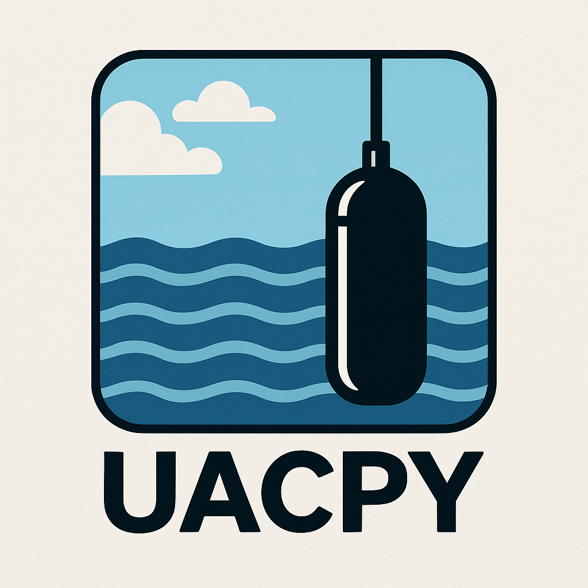
</p>

# 🌊 Underwater Acoustics for Python 🌊

<p align="center">
  <a href="https://github.com/ErVuL/uacpy/actions/workflows/ci.yml"></a>
  <a href="#"></a>
  <a href="https://www.gnu.org/licenses/gpl-3.0"></a>
  <a href="#"></a>
  <a href="#"></a>
</p>

## 🚀 Vision & Motivation

For decades, underwater acoustic propagation models have been
implemented in highly optimized Fortran/C code. For many years, wrapping 
these models in MATLAB was the natural solution adopted by the scientific 
community. As Python has become a dominant language in scientific computing, 
a noticeable gap has emerged. Despite multiple efforts to wrap or re-implement 
these models, Python users still lack a unified, comprehensive, and up-to-date 
solution.

**UACPY is an attempt to close that gap.**\
It was created for researchers, engineers, oceanographers, and acousticians 
who need underwater acoustic modeling to be more open, consistent, 
transparent, and reproducible. It builds on decades of pioneering work in 
the field and aims to provide a shared foundation for comparing models, 
validating results, running experiments, and developing new ideas.

This project began as an AI-assisted (Claude Code with Sonnet 4.5, Opus 4.6 
and 4.7) initiative to reduce early development time, but starting with the 
first release, it will be maintained manually by its author—without autonomous 
AI-driven modifications.

Community feedback, verification, and contributions are warmly 
encouraged. The project’s success depends on collective effort; the 
codebase is far too large and complex for one person to maintain alone 
in their spare time. The goal is for this module to be truly 
community-driven.


> ### **⚠️ Notes**
> 
> UACPY is *not* production‑ready. Expect missing features,
> inconsistencies, and the need for validation.
>
> #### Use of LLM and definitive API
> 
> Project development will now focus on stabilization, bug fixes, and human review.
> The development of new features and the automated use of LLMs will be scaled back,
> API changes will be limited but may still occur in beta.
> The code base is quite big, and covers a wide range of scientific fields. To review such a
> technical work, it needs some community usage and feedback. 

## 🔍 What's in UACPY?

A unified Python API over the classical underwater‑acoustic propagation
models — consistent `Environment` / `Source` / `Receiver` construction and
`Result` objects — plus first‑class toolkits for everything around them.

**Propagation models**

| Model             | Kind                                                               |
|-------------------|--------------------------------------------------------------------|
| **Bellhop**       | Ray / beam tracing                                                 |
| **Kraken**        | Normal modes                                                       |
| **Scooter**       | Wavenumber integration for range independent env                   |
| **SPARC**         | Experimental time-marched FFP for pulses in range independent env  |
| **RAM**           | Parabolic equation                                                 |
| **OASES**         | OAST (TL) · OASN (covariance / MFP replicas) · OASR (reflection) · OASP (broadband TRF) · OASS (reverberation) · OASSP (scattered pulse) |
| **Bounce**        | Reflection coefficients                                            |

**Toolkits** — first‑class modules, not just glue around the models:

- **Real‑world environments** (`uacpy.data`) — build an `Environment` from GPS coordinates and a date, fetching bathymetry, sound‑speed, seafloor, sea‑ice and sea‑state data from public ocean databases (GEBCO, GMRT multibeam, EMODnet DTM, World Ocean Atlas, Argo floats, Copernicus, EMODnet, AusSeabed MARS, NCEI/GlobSed/CRUST1/Graw/Diesing seabed, NSIDC sea ice, GLODAP + Copernicus‑BGC pH, NBS wind, WaveWatch III / WAVERYS waves).
- **Signal processing** (`uacpy.acoustic_signal`) — waveforms, matched filtering, beamforming, time‑frequency transforms, channel simulation.
- **Sonar performance** (`uacpy.sonar`) — sonar equation, scattering, reverberation, detection & range, and matched-field source localization (KRAKEN replicas, Bartlett/MVDR).
- **Communications** (`uacpy.comms`) — digital modems (PSK/QAM/OFDM…), equalization, FEC, and the **NATO JANUS** standard.
- **Modelled channels for modems** — `Arrivals.channel_taps(symbol_rate, fc=…)` turns a Bellhop arrivals result into symbol-spaced baseband taps (`ChannelTaps`) that `comms.simulate_link(channel=…)` runs directly, with `Arrivals.coherence_bandwidth` and `Arrivals.channel_regime` to say whether the link is flat or frequency-selective.
- **Multi-source superposition** — a `Source(depths=[…], weights=[…])` runs on every field model and returns one `Field` with a leading `source_depth` axis; `Field.superpose()` sums it as Σ wᵢ·pᵢ with complex weights, so a phased vertical array is one run and one call.
- **Ambient noise** (`uacpy.noise`) — Wenz spectra (wind / shipping / rain / thermal).
- **Standards & metrics** — sound speed, decidecade bands, a ship's monopole source level from a measured radiated noise level (ISO 17208) or, without one, the mean merchant-ship spectrum of Wales & Heitmeyer (2002, no speed term), marine‑mammal weighting.
- **Visualization** — TL maps, rays, modes, fields, cross‑model comparisons.

**Simplest example — 100 m of water, one model run, one plot.** Needs the
native models built — an [install](#-installation) that answered yes to
"Build propagation models" (the pure-Python, data-only install cannot run a
propagation model). Beyond that, nothing: no network, no downloads, no data
cache:

``` python
import numpy as np
import uacpy
from uacpy.models import Bellhop

env = uacpy.Environment(
    bathymetry=100.0,                                    # flat 100 m seabed
    ssp=1500.0,                                          # isovelocity water, m/s
    bottom=uacpy.BoundaryProperties(
        acoustic_type='half-space',
        sound_speed=1650.0, density=1.8, attenuation=0.6,
    ),
)
source   = uacpy.Source(depths=25.0, frequencies=200.0)
receiver = uacpy.Receiver(depths=np.linspace(1, 99, 100),
                          ranges=np.linspace(50, 5000, 250))

field = Bellhop().run(env, source, receiver)          # complex pressure, Pa
field.plot(env=env, source=source)
```

Three carriers in, one result out, and the result plots itself — every model in
the package has that shape. The default run mode is coherent TL, which hands back
the complex pressure field; the loss is one accessor away: `field.dB` (or
`field.tl`) is the transmission-loss array in dB, positive loss, no sign
juggling. A sound-speed profile is a list of `(depth m, speed m/s)` pairs,
`ssp=[(0.0, 1500.0), (100.0, 1490.0)]`; its gradient bends the rays into
caustics, which Bellhop's default hat-shaped beams draw as thin bright streaks
of too little loss ([Bellhop §1](./docs/models/bellhop.md#1-what-it-solves)
says when `beam_type='B'` is the better choice — and when its `πλ` floor
biases a shallow duct), so this first map keeps the
water isovelocity. The documentation's [Start here](./docs/README.md#start-here) runs the
same program and links each carrier to its guide page, and
[DOCUMENTATION §3](./DOCUMENTATION.md#3-quick-start) lists which call to use for
each common task. The water is lossless unless you pass
`absorption=` (`uacpy.Thorp()`, or `uacpy.FrancoisGarrison(...)` for a given
temperature, salinity and pH, each a single value or a profile given as
`[(depth, value), ...]` pairs); a run where that leaves out a decibel or more
says so.

<div align="center">
  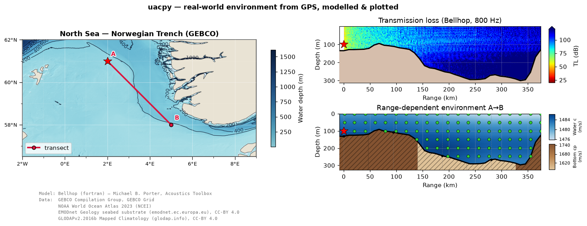
</div>

**Real-world example — from GPS to a modelled field: the core of
[example 37](./uacpy/examples/example_37_realworld_environment.py), whose first
composite is the figure above (`docs/figure_scripts/readme.py` regenerates it
with the example's settings).** This one is a showcase rather than a starting point: the
`data.fetch_*` calls reach out to public ocean databases, so it needs **network
access**, or a local cache populated in advance with `./install.sh --data all`
(the `--data` flag is in [Installation](#-installation)). It is also a 374 km
transect at 800 Hz: about two minutes of the Fortran Bellhop on one core, about
30 s of the multithreaded C++ build on eight and under 10 s of the CUDA one;
`Bellhop()` takes the fastest build installed.

``` python
import numpy as np, matplotlib.pyplot as plt
import uacpy
from uacpy import data
from uacpy.models import Bellhop, RunMode

# 1. Fetch a real range-dependent environment from GPS + date — GEBCO bathymetry,
#    WOA23 sound speed, NCEI seabed and the site's own Francois-Garrison water
#    absorption — across the North Sea shelf down into the Norwegian Trench.
A, B = (61.0, 2.0), (58.0, 5.0)           # (lat, lon): North Sea shelf → Norwegian Trench
env  = data.fetch_environment(A, transect_to=B, date='2026-01-15', bottom_sources='auto',
                              with_absorption=True)
# The 400×400 map grid reads the installed GEBCO grid (./install.sh --data gebco);
# over the public API it is past the per-call request cap, so fetch it coarser.
grid = data.fetch_bathy_grid((56.5, 62.0), (-2.0, 9.0), n_lat=400, n_lon=400)

# 2. Model transmission loss with Bellhop at 800 Hz, out to the transect length.
src = uacpy.Source(depths=100, frequencies=800)
rcv = uacpy.Receiver(depths=np.linspace(1, env.depth, 150),
                     ranges=np.linspace(100, env.range_max, 350))  # env range extent
# Bellhop takes the absorption from the range-0 column of a range-dependent
# profile and says so in a FallbackWarning ('Q'); here that moves the loss by
# under 1 %, and the fetched depth-varying absorption is kept as the real water.
tl  = Bellhop().run(env, src, rcv, run_mode=RunMode.COHERENT_TL)

# 3. One call → the figure above: map · transmission loss · environment.
#    The left map is pluggable (map_fn=); the default is the bathymetry map.
uacpy.plot.plot_overview(env, grid, transect=(A, B), tl=tl, source=src, receiver=rcv,
                         map_title="North Sea — Norwegian Trench (GEBCO)",
                         tl_title="Transmission loss (Bellhop, 800 Hz)",
                         env_title="Range-dependent environment A→B",
                         title="uacpy — real-world environment from GPS, modelled & plotted",
                         map_kwargs=dict(contours=True, aspect=1, coastline_resolution='50m',
                                         graticule=2.0, graticule_minor=1.0))
plt.show()
```

## 📦 Installation

uacpy v0.5.0 is distributed from this GitHub repository only — there is no
PyPI package, because the propagation models are compiled on your machine by
`./install.sh`, which no wheel can carry. Install by cloning, as below.

**Linux is the primary supported platform.** macOS works with Homebrew.
Windows is supported **via WSL2** (Windows Subsystem for Linux) — see the
[Windows section](#-windows-via-wsl2) below for why and how.

What `install.sh` builds:

| Tool                     | Required for                                      |
|--------------------------|---------------------------------------------------|
| `python3`                | Driving `install.sh` and importing uacpy (always) |
| `gfortran`, `make`       | OALIB, mpiramS, ramsurf (`rams0.5` elastic + `ramsurf1.5` rough surface), ramgeo (`ramgeo1.5` layered fluid), OASES (Fortran models — always) |
| `git`                    | Cloning uacpy + submodules (always)               |
| `tar`                    | OASES source archive (`--oases yes`)              |
| `cmake`, `g++`/`clang++` | C++ Bellhop variant (`--bellhop cxx`)             |
| CUDA toolkit (`nvcc`)    | GPU Bellhop variant (`--bellhop cuda`) — **required** when `--bellhop cuda` is passed; the installer hard-errors if `nvcc` is absent (no silent downgrade to cxx) |
| `curl`                   | OASES archive download (`--oases yes`)            |

`install.sh` **verifies** these are present and aborts with a clear
message if anything is missing — it does *not* install system packages
itself. Provision the toolchain once for your platform, then run the
build.

---

### 🐧 Linux

**1. Install dependencies**

```bash
# Debian / Ubuntu
sudo apt-get update
sudo apt-get install -y gfortran make git \
                        cmake g++ curl tar python3-venv python3-pip

# Fedora / RHEL
sudo dnf install -y gcc-gfortran make git \
                    cmake gcc-c++ curl tar python3-virtualenv python3-pip

# Arch / Manjaro
sudo pacman -S --needed gcc-fortran make git \
                        cmake gcc curl tar python python-pip
```

For GPU Bellhop, additionally install the CUDA toolkit from your
distribution or NVIDIA's site.

**2. Clone, create venv, install**

```bash
git clone --recurse-submodules https://github.com/ErVuL/uacpy.git
cd uacpy
python3 -m venv uacpy_venv
source uacpy_venv/bin/activate
pip install -e .
./install.sh
```

`./install.sh` runs interactively by default. Useful flags:

| Flag                      | Effect                                                      |
|---------------------------|-------------------------------------------------------------|
| `-y` / `--yes`            | Non-interactive — auto-detect everything                    |
| `--bellhop fortran`       | Skip the C++ build (Fortran Bellhop is always built)        |
| `--bellhop cxx`           | Also build C++ Bellhop (CPU)                                |
| `--bellhop cuda`          | Also build CUDA Bellhop (GPU, requires `nvcc`)              |
| `--oases yes` / `no`      | Download + build OASES (or skip the prompt)                 |
| `--data LIST`             | Download public datasets for the `uacpy.data` offline backend into `./data_cache` (gitignored). `LIST` is a comma list (`gebco`, `woa23`, `sediment`, `emodnet`, `coastline`, `globsed`, `crust1`, `diesing`, `seaice`, `glodap`, `wind`, `graw`) or `all`. See `./install.sh --help` for sizes/licences. |
| `--no-models` / `--data-only` | Skip **all** native model builds (no compilers needed) — pure-Python install; pair with `--data` for an offline data-only setup |
| `--force`                 | Skip incremental builds; do a full clean rebuild of every selected component |

The Fortran models are compiled for the CPU that builds them (`-march=native`,
or `-mcpu=native` on ARM).
To use one build on several machines — a shared filesystem, a container image,
a cluster — build for a CPU family instead:
`UACPY_FORTRAN_ARCH_FLAGS="-march=x86-64-v3" ./install.sh --force`.

---

### 🍎 macOS

**1. Install dependencies**

```bash
# Install Homebrew (skip if 'brew' is already on PATH). See https://brew.sh
/bin/bash -c "$(curl -fsSL https://raw.githubusercontent.com/Homebrew/install/HEAD/install.sh)"

# Xcode Command Line Tools (provides make, clang, git, tar)
xcode-select --install

# Build dependencies. The 'gcc' formula provides gfortran on macOS.
brew install gcc cmake curl python
```

CUDA Bellhop is **not** available on macOS (no NVIDIA toolkit). The C++
Bellhop variant (`--bellhop cxx`) builds fine with Apple's clang.

**2. Clone, create venv, install**

```bash
git clone --recurse-submodules https://github.com/ErVuL/uacpy.git
cd uacpy
python3 -m venv uacpy_venv
source uacpy_venv/bin/activate
pip install -e .
./install.sh
```

(See the Linux section above for `install.sh` flags — they're identical
on macOS.)

---

### 🪟 Windows (via WSL2)

**uacpy on Windows runs inside WSL2 (Windows Subsystem for Linux),
following the Linux instructions above.**

WSL2 needs CPU virtualization extensions. Some computers ship with this
**disabled by default**, so first of all enable hardware virtualization 
in your BIOS/UEFI.

In an **elevated PowerShell** (Run as Administrator):

```powershell
wsl --install -d Ubuntu
```

Reboot when prompted. Open Ubuntu (Start menu → "Ubuntu") and follow the 
**Linux / Debian** recipe from above:

```bash
sudo apt-get update
sudo apt-get install -y gfortran make git \
                        cmake g++ curl tar python3-venv python3-pip

cd ~
git clone --recurse-submodules https://github.com/ErVuL/uacpy.git
cd uacpy
python3 -m venv uacpy_venv
source uacpy_venv/bin/activate
pip install -e .
./install.sh
```

> **Tip:** clone into the WSL filesystem (`~/uacpy`), **not** into
> `/mnt/c/...`. Cross-filesystem I/O is 10–20× slower and the
> Acoustics-Toolbox build does a lot of small file writes.

### Check the install

```bash
python -m uacpy
```

prints the version and one row per binary each engine can launch (every
backend, and Kraken's `field.exe`): whether it was found, where, and which
backend a model built without `backend=` resolves. It exits 0 when every
engine has a binary and 1 otherwise; an OASES install not made
(`--oases no`) is named but does not fail the check. The binaries are found,
not run. From Python the same table is `uacpy.models.engine_status()`.

### Update

```bash
cd uacpy
git pull
source uacpy_venv/bin/activate
pip install -e .
rm -rf uacpy/bin   # Optional
rm -rf data_cache  # Optional
./install.sh       # Optional
```

### Uninstall

```bash
pip uninstall uacpy
rm -rf uacpy
```

## 📚 Documentation & Examples

Three entry points, depending on what you need:

- **[`docs/`](./docs/README.md) — the guided documentation.** 22 pages (24
  counting the two index READMEs) with 139
  generated figures: one per model (Bellhop, Kraken, RAM, Scooter, SPARC,
  Bounce, OASES), a [validation page](./docs/models/validation.md) with each
  engine's measured agreement with the published benchmarks, plus guides to
  environments, sources and receivers, results,
  plotting, signal processing, arrays, communications, noise, sonar, external
  data, I/O, utilities and reproducibility, and a
  [broadband-products theory page](./docs/theory/broadband_products.md) with the
  literature and measurements behind the time-domain methods. Each page covers the physics, when
  to reach for the model, its limits, and a worked example whose code is the
  code that generates the page's figures.
- **[`DOCUMENTATION.md`](./DOCUMENTATION.md) — the API reference.** Every
  signature, keyword and unit in a single file, plus quick start, environment
  setup and troubleshooting.
- **[`docs/DEV.md`](./docs/DEV.md) — internals**, for extending the package or
  adding a model wrapper.

Inside `uacpy/examples/` you will find numbered example scripts
(`example_01_*.py` onwards; the list is in DOCUMENTATION §17) — from a first TL
field to communications modems, a standards-based noise-impact assessment, a
GPS-to-modelled-field real-world pipeline, matched-field source
localization, and end-to-end chains from a source array to a detection map.
Run them **by script path**, with the environment you installed uacpy into
active (the form `uacpy/examples/run_all_examples.py` and the test suite use):

```bash
python uacpy/examples/example_01_basic_shallow_water.py
```

The module form, `python -m uacpy.examples.example_01_…`, works too (from a
source checkout; the examples are not part of the wheel). See the
[examples index](./DOCUMENTATION.md#17-examples-index) for a description
of each one.

## 📏 Validation at a glance

The engines measured against closed forms and published benchmarks, every
published case run on its reference's water (density 1.0 g/cm³), as the tests
state them; [docs/models/validation.md](./docs/models/validation.md) gives the
cases, bounds, null controls and known limits. Each plot reruns its row's case
and draws the row's engines over the reference, at the receiver depth in its
title (click for full size); OASP, scored on one bin of a broadband run, is not
drawn.

| Benchmark (reference) | Metric | Measured | Plot |
|---|---|---|---|
| Pekeris waveguide, 50 Hz (KRAKEN manual eq. 2.19) | median \|ΔTL\| | Kraken 0.015 dB · Scooter 0.017 dB · OAST 0.02 dB (strong-field cells) · OASP 0.0068 dB · RAM 0.52 dB | <a href="./docs/models/figures/validation_pekeris.png">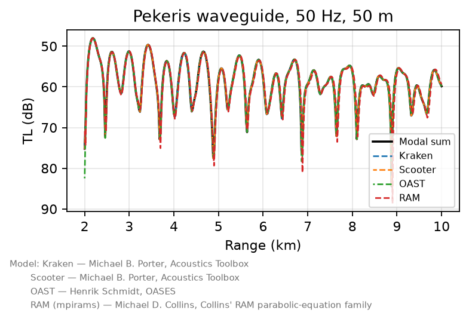</a> |
| Ideal (pressure-release) waveguide | median \|ΔTL\| | Kraken 0.014 dB · RAM 0.0085 dB | <a href="./docs/models/figures/validation_ideal_waveguide.png">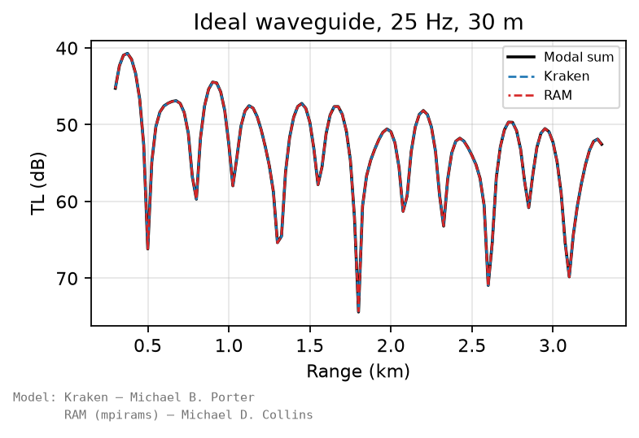</a> |
| Rigid-bottom waveguide | median \|ΔTL\| | SPARC 0.17 dB | <a href="./docs/models/figures/validation_rigid_waveguide.png">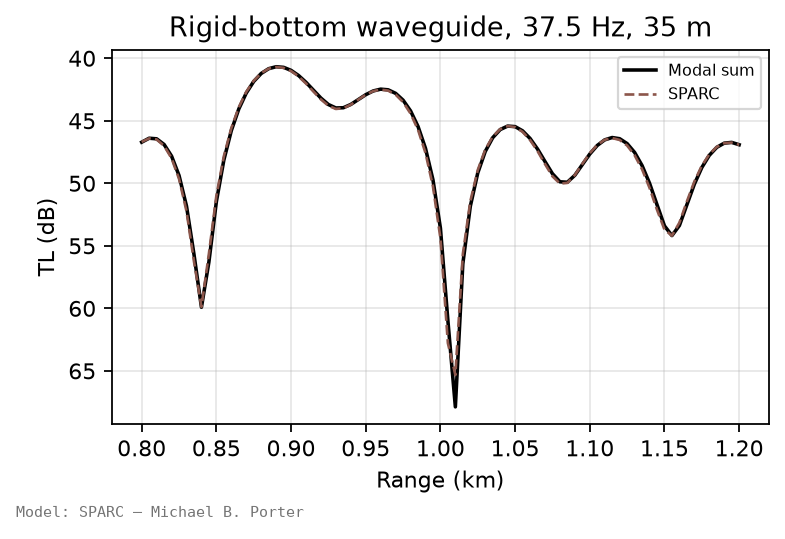</a> |
| Ideal wedge, 25 Hz (ASA Problem I, Buckingham & Tolstoy) | median \|ΔTL\| at 30 m / 150 m | Bellhop (line source) 0.47 / 0.384 dB | <a href="./docs/models/figures/validation_ideal_wedge.png">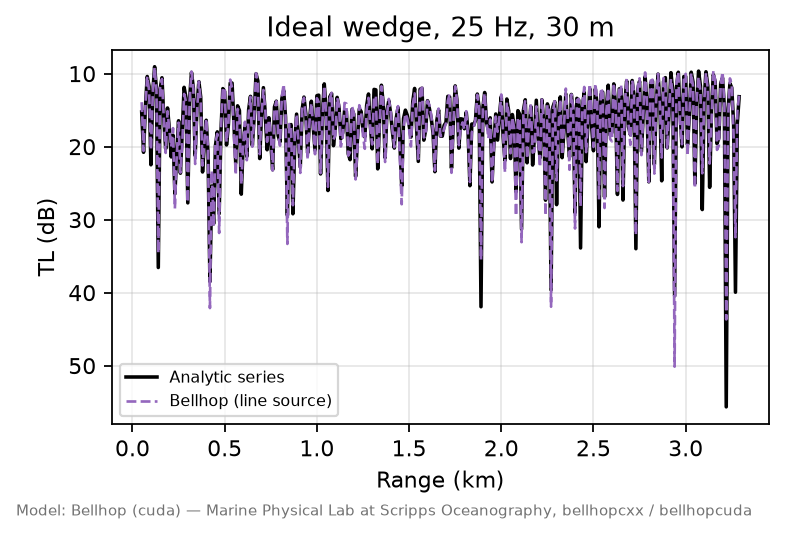</a> |
| Rayleigh reflection, fluid half-space | largest \|R\| difference | Bounce 3.3e-16 · OASR about 1e-6 | <a href="./docs/models/figures/validation_rayleigh.png">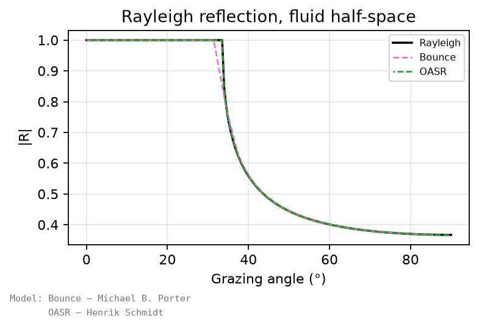</a> |
| ASA upslope wedge, 25 Hz (COUPLE07) | RMS ΔTL at 30 m / 150 m | RAM 0.110 / 0.133 dB (pinned grid) · Bellhop 1.834 / 2.141 dB · Kraken adiabatic 2.221 / 2.502 dB · Kraken coupled 2.756 / 2.392 dB | <a href="./docs/models/figures/validation_asa_wedge.png">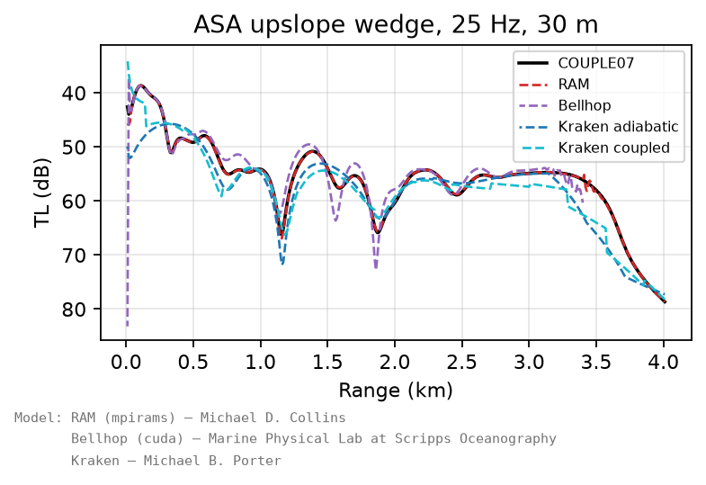</a> |
| NORDA PE Workshop 3b, 250 Hz (COUPLE07) | median \|ΔTL\| | Kraken 0.067 dB · RAM 0.160 dB · Scooter 0.192 dB · Bellhop 4.41 dB (loses the near-bed field) | <a href="./docs/models/figures/validation_pe_workshop_3b.png">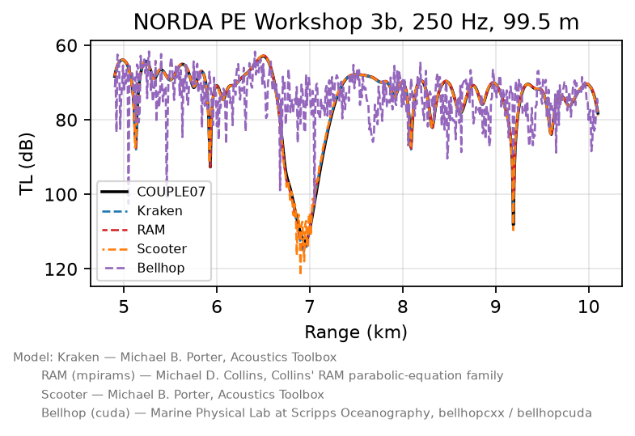</a> |
| Corrugated seafloor, 25 Hz (COUPLE07, two-way) | mean TL offset, 10–18.09 km | Kraken coupled +2.83 dB · RAM +4.70 dB (mpiramS) / +5.82 dB (ramgeo) — one-way engines | <a href="./docs/models/figures/validation_corrugated_seafloor.png">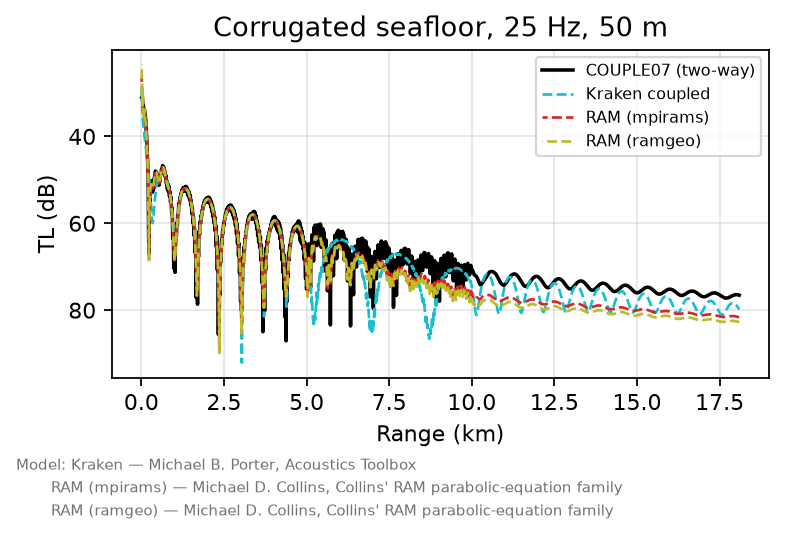</a> |
| Bucker waveguide, 100 Hz (Scooter, checked against OAST) | median \|ΔTL\|, 2–20 km | OAST 0.0145 dB · Kraken `leaky_modes=True` 0.0198 dB (defaults 0.1235 dB) · RAM `zmax=2000` 0.0776 dB (defaults 0.1188 dB) | <a href="./docs/models/figures/validation_bucker_waveguide.png">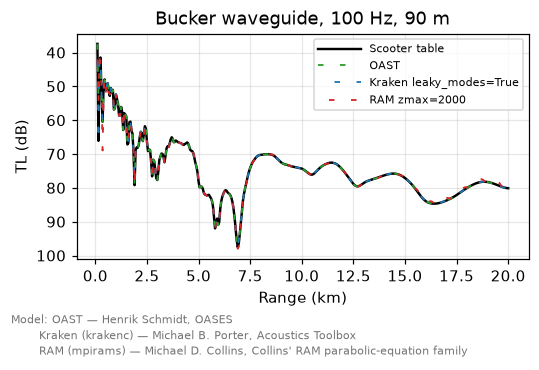</a> |
| NORDA PE Workshop 4c, 25 Hz (COUPLE07) | median \|ΔTL\|, flat 5–150 km, at 150 m / 700 m | Kraken adiabatic 0.101 / 0.153 dB · RAM 0.279 / 0.413 dB · Kraken coupled fails on the shelf (mean −21.761 dB) | <a href="./docs/models/figures/validation_pe_workshop_4c.png">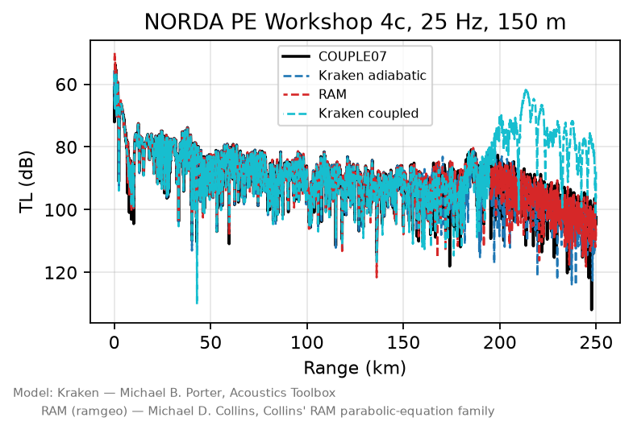</a> |
| Reverberation Modeling Workshop Problem XI, 250 Hz – 3.5 kHz (Scooter, checked against OAST) | median \|ΔTL\|, 0.1–10 km, at 250 Hz / 1 kHz / 3.5 kHz | Bellhop 0.401 / 0.1027 / 0.0302 dB · OAST 0.0272 / 0.0277 / 0.0381 dB | <a href="./docs/models/figures/validation_problem_xi.png">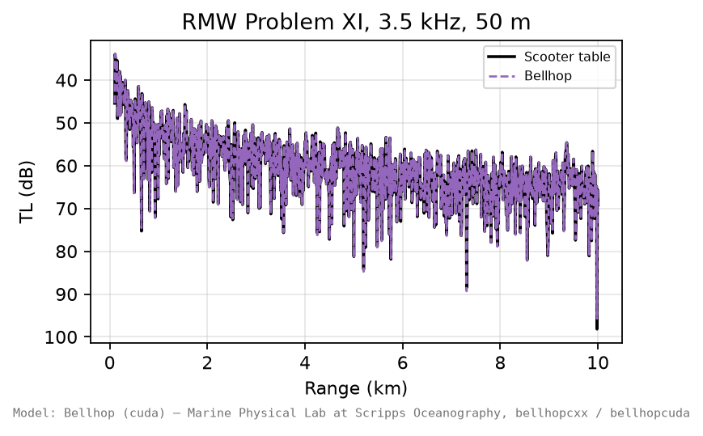</a> |

## 🧪 Testing

UACPY uses **pytest** with custom markers for categorizing tests.

`pytest` and `pytest-xdist` are not part of the runtime dependency
set — install the `test` extra to get them, or the `dev` extra
for the additional formatting / linting / coverage tooling:

``` bash
# For running the test suite
pip install -e ".[test]"

# For development (test deps + black, flake8, pytest-cov)
pip install -e ".[dev]"
```

> Note: With macOS you may need to use **pip install -e .\\[xxx\\]**.

### Run all tests

``` bash

pytest uacpy/tests/

```

### Test markers

Tests use custom markers to allow selective execution:

- `slow` -- Long-running tests (broadband, large grids, slow examples)
- `requires_binary` -- Tests that need compiled native binaries (Fortran/C)
- `requires_oases` -- Tests that need the OASES binaries or sources (`./install.sh --oases yes`)
- `requires_network` -- Tests that hit a live external service (the `uacpy.data`
  fetchers); **deselected by default** by `addopts` in `pyproject.toml`.
  A command-line `-m` replaces that default rather than adding to it, so
  every `-m` expression below ends in `and not requires_network`; drop it
  and the live-service tests run.
- `benchmark` -- Tests that validate model output against a closed-form
  analytic solution, a canonical published reference, or an independent
  reference solution
- `convention` -- Tests that pin repo conventions rather than runtime
  behaviour (docstring prose, source-convention sweeps, repr snapshots);
  a failure signals doc/convention drift, not a runtime defect

``` bash

# Skip slow tests
pytest uacpy/tests/ -m "not slow and not requires_network"

# Run only tests that don't need compiled binaries
pytest uacpy/tests/ -m "not requires_binary and not requires_network"

# Fast pure-Python dev tier: no binaries and no slow tests
pytest uacpy/tests/ -m "not requires_binary and not slow and not requires_network"

# Skip OASES tests (if OASES is not installed)
pytest uacpy/tests/ -m "not requires_oases and not requires_network"

# Run the live-service tests (deselected by default)
pytest uacpy/tests/ -m requires_network

```

The composed dev tier `-m "not requires_binary and not slow and not requires_network"` is the fast
development loop (the conftest attaches `requires_binary` to every
`requires_oases` test automatically). The count it selects moves with every
change; ask pytest rather than this page:

``` bash
pytest uacpy/tests/ -m "not requires_binary and not slow and not requires_network" --collect-only -q | tail -1
```

The full suite (default `pytest` invocation) must still pass before a change
lands.

## 🗺️ Roadmap

Because the initial codebase was LLM‑bootstrapped, *auditing* comes before
new features. The first list is the priority; the second collects ideas — open an
issue or PR for anything you investigate. Full diffs of in‑tree native‑model changes
live in [MODIFICATIONS.md](./uacpy/third_party/MODIFICATIONS.md).

### 🛠️ Hardening & validation (priority)

- **🔎 Audit & human validation** — the code was LLM‑bootstrapped. It is audited line by
  line and every engine is checked against closed forms and published benchmarks
  ([validation page](./docs/models/validation.md)), but it still needs review and
  validation by human experts, for the models and regimes they use. Issues and PRs welcome.

> **If you are evaluating UACPY for a project: do not trust any specific number it
> produces until it has been validated for the model and regime you care about.**

### 💡 Ideas for the future

Possible directions, not commitments: none of them is planned or scheduled. Discussion and
contributions are welcome.

- **🧊 Full 3‑D propagation** — Bellhop3D and 3‑D modes; most of the plumbing already
  exists.
- **🚤 Moving platforms** — per‑arrival Doppler for a moving source or receiver in the
  received signal (as the Acoustics Toolbox's `delayandsum.m` does), then arrivals
  recomputed along a track.
- **🎯 Geoacoustic inversion & uncertainty** — fit seabed parameters to measured array
  data with the matched‑field tools already in uacpy, and run ensembles over the
  uncertainty of the environment to give TL and detection ranges with percentile bands.
- **🛰️ Scenario "digital twin"** — from a ship track and a date: fetched environment →
  propagation → detection, communication and noise‑exposure maps (most pieces exist).
- **🖥️ GUI** — scenario‑based simulations, interactive TL / modes / noise level,
  dashboards.


## 🙏 Acknowledgments

UACPY would not exist without decades of prior work by the underwater
acoustics community. Every propagation model shipped here was designed,
implemented, and validated elsewhere --- UACPY only provides a unified
Python interface around them. Which codebases are vendored vs modified
is summarised in the [licensing table](#-licensing); full diffs for
modified sources live in
[MODIFICATIONS.md](./uacpy/third_party/MODIFICATIONS.md).

### Acoustics Toolbox --- Bellhop, Kraken, Scooter, SPARC, Bounce

Michael B. Porter --- http://oalib.hlsresearch.com/AcousticsToolbox/
- Porter, *The BELLHOP Manual and User's Guide*, 2011
- Porter, *The KRAKEN Normal Mode Program*, SACLANTCEN SM-245, 1991

### bellhopcxx / bellhopcuda

Marine Physical Lab, Scripps Institution of Oceanography (The Regents of the
University of California), 2021-2026 --- https://github.com/A-New-BellHope/bellhopcuda
- C++/CUDA port of BELLHOP / BELLHOP3D (Michael B. Porter, 1983-2022)

### RAM

Michael D. Collins (Naval Research Laboratory)
- Collins, "A split-step Padé solution for the parabolic equation
  method," *JASA*, 1993

### mpiramS

Brian D. Dushaw --- https://zenodo.org/records/10818570

### ramsurf --- Collins RAM family (rams0.5 elastic, ramsurf1.5 rough surface)

Vendored from the Quiet Oceans repackaging of David C. Calvo's NRL
distribution --- https://github.com/quiet-oceans/ramsurf

- Collins, *A split-step Padé solution for the parabolic equation method*, JASA, 1993
- Collins, *Higher-order Padé approximations for accurate and stable elastic parabolic equations with application to interface wave propagation*, JASA 89, 1050–1057, 1991 (RAMS / elastic)
- Collins, Coury & Siegmann, *Beach acoustics* (variable surface / ramsurf), JASA 97, 2767–2770, 1995

### ramgeo --- Collins RAM family (RAMGEO 1.5g, range-dependent layered fluid PE)

Range-dependent layered-fluid parabolic-equation model by Michael D. Collins
(Naval Research Laboratory). **Public domain** — a U.S. Government work; the
source carries no copyright or licence notice. uacpy vendors it from the
Acoustics Toolbox `RAM/` bundle (Porter's AT, mirroring
http://oalib.hlsresearch.com/Modes/AcousticsToolbox/), which merely
redistributes Collins' original.

- Collins, *A split-step Padé solution for the parabolic equation method*, JASA 93, 1736–1742, 1993
- Collins, *Users Guide for RAM versions 1.0 and 1.0p / RAMGeo*, NRL, 1999

The vendored RAM codes are patched to read an optional water-column attenuation
profile (how `env.absorption` reaches them); every change is listed in
[`uacpy/third_party/MODIFICATIONS.md`](uacpy/third_party/MODIFICATIONS.md).

### OASES --- OAST, OASN, OASR, OASP, OASS, OASSP

Henrik Schmidt (Massachusetts Institute of Technology) --- https://acoustics.mit.edu/faculty/henrik/oases.html

### arlpy

Mandar Chitre (Acoustic Research Lab, National University of Singapore) --- https://github.com/org-arl/arlpy

Utility functions adapted into `uacpy/core/acoustics/` keep arlpy's
copyright header ("Copyright (c) 2016-2020, Acoustic Research Laboratory") and
cite arlpy as the source.


## 📄 Licensing

### Third party code

UACPY aggregates code from multiple projects, each under its own
license. Downstream users are responsible for respecting each license
when redistributing or modifying UACPY or its outputs.

| Component                  | Location                           | How it ships                                     | License                                          |
|----------------------------|------------------------------------|--------------------------------------------------|--------------------------------------------------|
| UACPY wrapper              | this repository                    | source + Python package                          | GPL-3.0                                          |
| Acoustics Toolbox (Porter) | `uacpy/third_party/Acoustics-Toolbox/`   | vendored Fortran sources, **modified**           | GPL-3.0                                          |
| bellhopcuda (Scripps MPL)  | `uacpy/third_party/bellhopcuda/`         | git submodule pinned to uacpy's fork (`ErVuL/bellhopcuda`): upstream `v1.5` + the Francois-Garrison fix in `MODIFICATIONS.md` | GPL-3.0                                       |
| mpiramS (Dushaw)           | `uacpy/third_party/mpiramS/`             | vendored Fortran sources, **modified** (see `MODIFICATIONS.md`) | Creative Commons Attribution 4.0 International   |
| ramsurf (Calvo / Quiet Oceans) | `uacpy/third_party/ramsurf/`         | vendored Fortran sources, **modified** (see `MODIFICATIONS.md`) | BSD-3-Clause |
| ramgeo (Collins, NRL)      | `uacpy/third_party/ramgeo/`              | vendored Fortran source, **modified** (see `MODIFICATIONS.md`) | Public domain (U.S. Government work, no explicit licence) |
| arlpy utilities (Chitre)   | `uacpy/core/acoustics/`            | adapted (ported into UACPY sources, unmodified scientifically) | BSD-3-Clause                    |
| OASES (Schmidt, MIT)       | `uacpy/third_party/oases/` (gitignored)  | **optional** download at install time, **not redistributed**| Academic license --- see Henrik Schmidt's terms  |


### Python dependencies

UACPY's runtime dependencies are installed from PyPI (not bundled or
redistributed by UACPY); all are permissive and GPL-3.0-compatible.

| Package | Used for | License |
|---------|----------|---------|
| **numpy** | arrays / numerics (core) | BSD-3-Clause |
| **scipy** | interpolation, FFT, nearest-neighbour search | BSD-3-Clause |
| **matplotlib** | visualization | Matplotlib License (PSF-based, BSD-style) |
| **netCDF4** | reading WOA23 / GEBCO / GlobSed grids | MIT |
| **shapely** | EMODnet seabed-substrate polygon lookups | BSD-3-Clause |
| **pyproj** | map projections (sea-ice / Diesing reprojection) | MIT |
| **tifffile** | NSIDC sea-ice raster reads | BSD-3-Clause |
| **pillow** | image encode/decode behind the map and animation writers; Diesing lithology raster reads | HPND (MIT-style) |
| **copernicusmarine** | Copernicus operational sound speed — the optional `[copernicus]` extra, not installed by default | EUPL-1.2 (lists GPL-3.0 as compatible) |
| **xarray** | `Field.to_xarray` / `Field.from_xarray` (and NetCDF through them) — the optional `[xarray]` extra, not installed by default | Apache-2.0 |

Test/development tooling (`pytest`, `pytest-xdist`, `setuptools`, `xarray`
— the `[test]` extra — plus `pytest-cov`, `black`, `flake8`, `mypy` in
`[dev]`) is not required at runtime; all of it is MIT- or Apache-2.0-licensed
(xarray is Apache-2.0).


### External data sources

The `uacpy.data` layer builds an `Environment` (and, for
`uacpy.plot.plot_bathymetry_map`, a coastline map) from public databases.
These datasets are **fetched on demand - not redistributed** with UACPY.
Their licences (CC-BY, public domain, the Copernicus Marine licence, …) impose: whoever fetches 
the data is its licensee and is responsible for honouring the licence and 
citing the source. Heavy users can point at their own mirror through the
`base_url=` of every live fetcher — bathymetry (OpenTopoData, GMRT or the
EMODnet DTM, whichever `source=` reads), WOA, Argo, EMODnet-substrate, MARS,
`fetch_wind` (NOAA NBS) and `fetch_waves` (PacIOOS WaveWatch III) — and
through the `url=`/`base_url=` of every `download_*_db` installer (which
feeds the fetchers that read an installed dataset). Left at its default, a
fetcher reads the service's module constant, as the composites
(`fetch_environment`, `fetch_sea_surface`) always do. The Copernicus fetchers (`*_operational`,
`fetch_waves`' WAVERYS source) go through the `copernicusmarine` client.

| Source | Used for | License | Required attribution / citation |
|--------|----------|---------|---------------------------------|
| **GEBCO** grid (served via [OpenTopoData](https://www.opentopodata.org/), MIT) | bathymetry | Public domain (attribution requested) | "GEBCO Compilation Group, *GEBCO Grid*" (see [GEBCO terms](https://www.gebco.net/data-products/gridded-bathymetry/terms-of-use) for the grid DOI). OpenTopoData public API is fair-use: **≤1000 req/day, ≤1 req/s** --- self-host for heavy use |
| **GMRT** Global Multi-Resolution Topography (`bathymetry_sources='gmrt'`) | bathymetry (multibeam, higher-res) | **CC-BY 4.0** | Ryan, W.B.F., *et al.* (2009). *Global Multi-Resolution Topography synthesis.* Geochem. Geophys. Geosyst. 10, Q03014. doi:[10.1029/2008GC002332](https://doi.org/10.1029/2008GC002332) |
| **EMODnet Bathymetry DTM** (`bathymetry_sources='emodnet_dtm'`) | bathymetry (European seas + Caribbean, ~115 m) | **CC-BY 4.0** | "EMODnet Bathymetry (emodnet.ec.europa.eu), CC-BY 4.0"; EMODnet Bathymetry Consortium (2024), *EMODnet Digital Bathymetry (DTM 2024)* |
| **World Ocean Atlas 2023** (NOAA NCEI) | sound speed (climatology), absorption | U.S. Government work --- public domain | Reagan, J.R., *et al.* (2024). *World Ocean Atlas 2023.* NOAA National Centers for Environmental Information |
| **Copernicus Marine Service** (free account required) | sound speed (operational) | [Copernicus Marine License](https://marine.copernicus.eu/user-corner/service-commitments-and-licence) (free; **commercial use allowed**; free account required) | "Generated using E.U. Copernicus Marine Service Information; *&lt;product DOI&gt;*" |
| **Argo** float profiles (`ssp_sources='argo'`, via Ifremer ERDDAP) | sound speed (real in-situ profiles) | **Free and unrestricted** (Argo data policy) | "These data were collected and made freely available by the International Argo Program (argo.ucsd.edu)"; Argo (2024), Argo GDAC, SEANOE, doi:[10.17882/42182](https://doi.org/10.17882/42182) |
| **GLODAPv2.2016b** Mapped Climatology (`--data glodap`, feeds `with_absorption`) | seawater pH (Francois-Garrison absorption) | **CC-BY 4.0** | Lauvset, S.K., *et al.* (2016). *A new global interior ocean mapped climatology: the 1×1 GLODAP version 2.* Earth Syst. Sci. Data 8, 325--340. doi:[10.5194/essd-8-325-2016](https://doi.org/10.5194/essd-8-325-2016) |
| **Copernicus BGC** global biogeochemistry reanalysis (`ssp_sources='copernicus'` + `with_absorption`) | seawater pH (operational, date-specific) | [Copernicus Marine License](https://marine.copernicus.eu/user-corner/service-commitments-and-licence) (free; **commercial use allowed**) | "E.U. Copernicus Marine Service Information; *&lt;product DOI&gt;*"; GLOBAL_MULTIYEAR_BGC_001_029 |
| **EMODnet Geology** --- seabed substrate (`bottom_sources='emodnet'`) | sediment (European seas) | **CC-BY 4.0** | "EMODnet Geology seabed substrate (emodnet.ec.europa.eu), CC-BY 4.0" |
| **AusSeabed MARS** database (`bottom_sources='mars'`) | sediment (Australian margin, point samples) | **CC-BY 4.0** | Geoscience Australia (2020). *Marine Sediments (MARS) Database.* AusSeabed data portal |
| **NCEI Seafloor Sediment Grain-Size Database** (NOAA, G00127; `bottom_sources='grainsize'`) | sediment (global, public-domain samples) | U.S. Government work --- public domain | National Geophysical Data Center (1976), *The NGDC Seafloor Sediment Grain Size Database*, NOAA NCEI, doi:[10.7289/V5G44N6W](https://doi.org/10.7289/V5G44N6W) |
| **DECK41** Surficial Seafloor Sediment Descriptions (NOAA NCEI, G02094; a hand-placed `deck41.csv` read by `bottom_sources='grainsize'`, never downloaded) | sediment (global, dominant-lithology descriptions) | U.S. Government work --- public domain | Bershad, S. & Weiss, M. (1976). *Deck41 Surficial Seafloor Sediment Description Database.* NOAA NCEI (G02094), doi:[10.7289/V5VD6WCZ](https://doi.org/10.7289/V5VD6WCZ) |
| **Diesing 2020** global deep-sea seafloor lithology (`bottom_sources='diesing'`) | sediment (global deep-sea, >500 m) | **CC-BY 4.0** | Diesing, M. (2020). *Deep-sea sediments of the global ocean.* Earth Syst. Sci. Data 12, 3367--3381. doi:[10.5194/essd-12-3367-2020](https://doi.org/10.5194/essd-12-3367-2020); data: PANGAEA doi:[10.1594/PANGAEA.911692](https://doi.org/10.1594/PANGAEA.911692) |
| **Pelagic model** (`bottom_sources='pelagic'`, depth/latitude classifier) | sediment (global open-ocean fallback, modelled) | **Public domain** (first-principles model) | after Diesing (2020) & Berger, W.H. (1974), *Deep-sea sedimentation* |
| **GlobSed** total sediment thickness (NOAA NCEI) | sediment thickness (low-frequency seabed) | U.S. Government work --- public domain | Straume, E.O., *et al.* (2019). *GlobSed: Updated total sediment thickness in the world's oceans.* Geochem. Geophys. Geosyst. 20, 1756--1772. doi:[10.1029/2018GC008115](https://doi.org/10.1029/2018GC008115) |
| **CRUST1.0** global crustal model (`bottom_sources='crust1'`) | layered seabed Vp/Vs/density (low-frequency) | **No formal licence** --- verify before commercial use | Laske, G., Masters, G., Ma, Z. & Pasyanos, M. (2013). *Update on CRUST1.0 --- a 1-degree global model of Earth's crust.* Geophys. Res. Abstr. 15, EGU2013-2658 |
| **Graw 2021** predicted seabed bulk density (`bottom_sources='graw'`, `--data graw`) | seabed density (measured-density half-space) | **CC-BY 4.0** | Graw, J.H., Wood, W.T. & Phrampus, B.J. (2021). *Predicting global marine sediment density using the random forest regressor machine learning algorithm.* J. Geophys. Res. Solid Earth 126; data: Zenodo doi:[10.5281/zenodo.3762390](https://doi.org/10.5281/zenodo.3762390) |
| **NSIDC Sea Ice Index** (`surface_sources='seaice'`) | sea-ice concentration → elastic ice surface (monthly climatology) | U.S. Government work --- public domain | Fetterer, F., Knowles, K., Meier, W.N., Savoie, M., Windnagel, A.K. & Stafford, T. (2025). *Sea Ice Index*, Version 4 (G02135), NSIDC, doi:[10.7265/a98x-0f50](https://doi.org/10.7265/a98x-0f50) |
| **NOAA/NCEI Blended Seawinds** (`data.fetch_wind`; `--data wind` climatology) | 10 m wind → ambient noise + sea surface | U.S. Government work --- public domain | Saha, K. & Zhang, H.-M. (2022). *Hurricane and typhoon storm wind resolving NOAA NCEI Blended Sea Surface Wind (NBS) product.* Front. Mar. Sci. 9, 935549, doi:[10.3389/fmars.2022.935549](https://doi.org/10.3389/fmars.2022.935549) (NBS v2); method: Zhang, H.-M., *et al.* (2006), Geophys. Res. Lett. 33, L17714 |
| **NOAA WaveWatch III** (`data.fetch_waves`, `altimetry_sources='ww3'`) | significant wave height → sea surface (recent) | U.S. Government work --- public domain | Tolman, H.L. (2009). *User manual and system documentation of WAVEWATCH III.* NOAA/NWS/NCEP Tech. Note 276 |
| **Copernicus WAVERYS** (`data.fetch_waves`, `altimetry_sources='waverys'`, needs login) | significant wave height → sea surface (reanalysis, 1980→) | [Copernicus Marine License](https://marine.copernicus.eu/user-corner/service-commitments-and-licence) (free; **commercial use allowed**) | "E.U. Copernicus Marine Service Information (WAVERYS); *&lt;product DOI&gt;*"; GLOBAL_MULTIYEAR_WAV_001_032 |
| **Natural Earth** land polygons (`uacpy.plot.plot_bathymetry_map` coastline) | map backdrop | **Public domain** | none required |

> A fetched environment carries its provenance per layer: `env.data_sources` is
> a tuple of `DataProvenance` records, each pairing the dataset (`.source`) with
> the **actual date and coordinates** that fetch returned. `uacpy.data.citations(env)`
> prints the required attribution/citation — plus the fetched date/location — for
> exactly those sources (`uacpy.data.citations()` prints the full catalogue below).

## 📬 Contact

Questions, bug reports, and contributions are welcome. For matters not
suited to a GitHub issue (collaboration proposals, private questions,
etc.), the maintainer can be reached at:

**ervul.github@gmail.com**


## 📖 Citation

``` bibtex
@software{uacpy2026,
  title   = {UACPY: Underwater ACoustics for PYthon},
  author  = {ErVuL and UACPY Contributors},
  year    = {2026},
  url     = {https://github.com/ErVuL/uacpy}
}
```


## Other interesting projects

- https://github.com/hunterakins/pykrak
- https://github.com/signetlabdei/WOSS?tab=readme-ov-file
- https://github.com/nposdalj/PropaMod
- https://github.com/marcuskd/pyram
- https://github.com/org-arl/UnderwaterAcoustics.jl
- https://github.com/SPECFEM
- https://github.com/TengjiaoHE/Multimodal-PE

