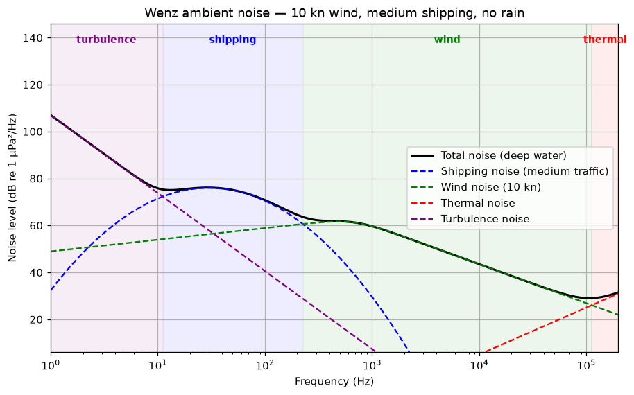
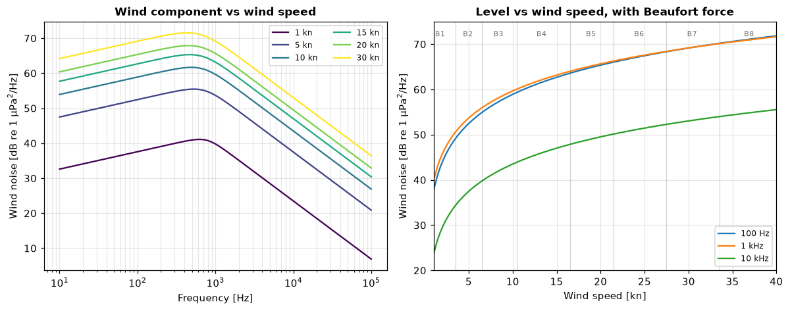
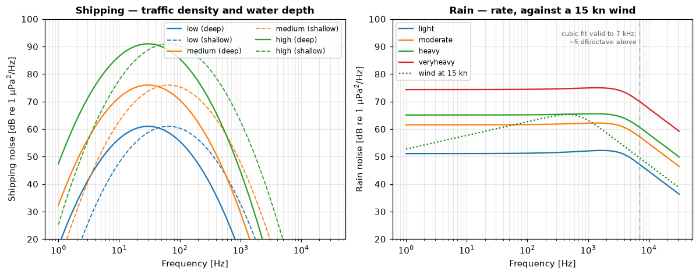
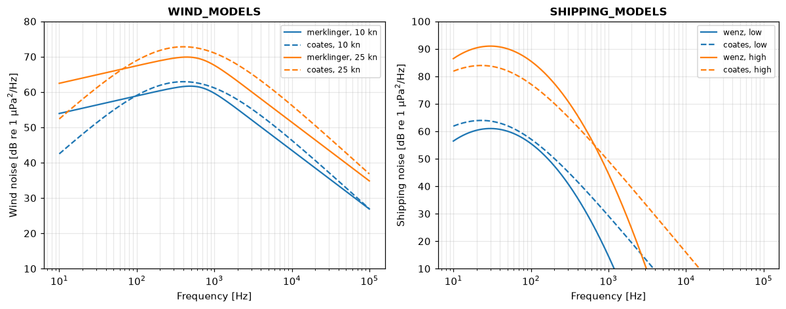
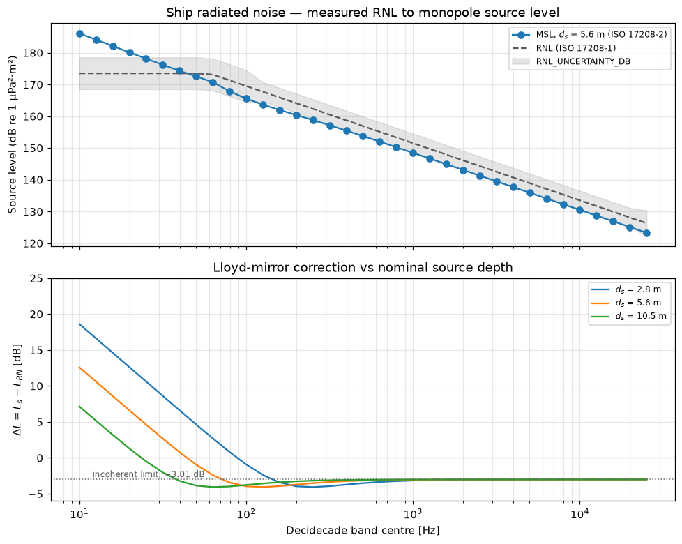
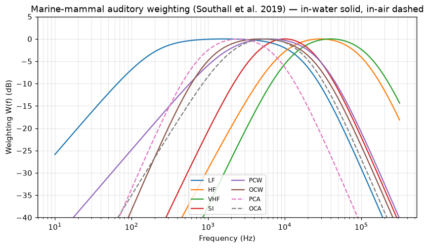
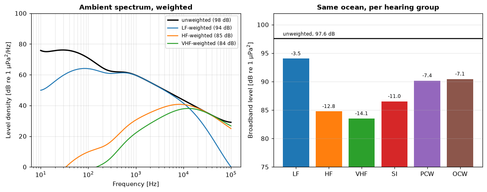

# Noise — the soundscape a receiver sits in

> `uacpy.noise` · Wenz composite ambient spectra · ship radiated noise
> (ISO 17208) · marine-mammal auditory weighting (Southall et al. 2019)

A propagation model tells you what arrives. It says nothing about what that
arrival has to compete with. `uacpy.noise` supplies the other half: the level
of the ocean itself, the level a ship puts into it, and the weighting that
turns a received spectrum into something an animal actually hears.

Three products, three consumers:

| Product | Function | Feeds |
|---|---|---|
| Ambient spectrum | `WenzNoise` | the `NL` term of the [sonar equation](sonar.md) |
| Ship source level | `monopole_source_level` (measured, band levels); `ship_source_level_wales_heitmeyer` (the mean merchant ship, a spectral density level, dB re 1 µPa² m²/Hz) | a propagation run, as the source |
| Auditory weighting | `weighted_level`; `weighting=` on every SEL | impact assessment |

Nothing in `uacpy.noise` imports matplotlib: it is pure computation, and the
matching plotters — `plot_wenz`, `plot_weighting`, `plot_source_level` — live
on `uacpy.plot` ([plotting](plotting.md)). `WenzNoise.plot()` hands the
object to `plot_wenz`, importing matplotlib only when it is called.

---

## 1. The Wenz curves

Wenz's 1962 compilation is the canonical picture of ambient noise: spectral
level against frequency, from 1 Hz to 100 kHz, with the physically distinct
sources drawn as separate curves and the total as their envelope. It is the
first thing to look at because it answers the question "is my problem even
noise-limited, and by what?" before you run anything.

Every figure on this page is generated by
[`docs/figure_scripts/noise.py`](../figure_scripts/noise.py); the snippets
below are condensed from it, so the script is the authoritative figure code.

```python
import numpy as np
import uacpy
from uacpy.noise import WenzNoise

f = np.logspace(0.0, 5.3, 1200)              # 1 Hz - 200 kHz
wenz = WenzNoise(f, wind_speed_kn=10.0, shipping_level='medium')

uacpy.plot.plot_wenz(wenz)
```



The shaded bands are not decoration and are not hard-coded: they are read back
off the components, one band per source that is the largest at that frequency.
That is the point of the figure — the composite has the shape it has because
**four unrelated physical processes each own a stretch of the band**, and the
total is just their incoherent sum.

Every level on this page is a central estimate inside a very wide band: the
Wenz compilation it comes from spans about **50 dB at any given frequency**
(Abraham §3.3), and DRDC's own table of turbulence intercepts runs 88–138 dB.

The band edges quoted in the four headings below are this composite's own, at
10 kn and medium shipping, and they move with both. The canonical regimes are
broader and overlapping — turbulence below 20 Hz, shipping 10 Hz to 1 kHz,
wind-driven surface noise 100 Hz to 100 kHz, thermal above 50 kHz (Abraham,
Table 3.3) — so do not read a sharp edge as physics.

### Turbulence — below ~13 Hz

`107 − 33.2·log₁₀(f_Hz)`, so 107 dB at 1 Hz falling at 10 dB per octave —
`−10/log₁₀2 ≈ −33.2` dB per decade.

This is largely not radiated sound. The term fits the pressure fluctuation
produced by non-linear interaction among wind-generated surface waves and by
oceanic and atmospheric turbulence. It is 107 dB at 1 Hz and already under the
shipping hump by 13 Hz, so it matters only for infrasonic work — and there, a
real measurement depends as much on how the hydrophone is mounted as on the
ocean. Mounting is a separate quantity, though: flow past the sensor and cable
strumming land in the same band, but they are **self-noise** — excluded from
ambient noise by definition, and absent from this model.

The term takes no `wind_speed_kn` — the wind component is the only one that does —
so raising the wind leaves this curve exactly where it was, and a VLF budget
built here will not respond to sea state. That is a known simplification: DRDC
notes a wind dependence in the slope "that is not captured by using a constant
value", and measured VLF noise correlates strongly with wind speed from 1–5 Hz.

### Shipping — roughly 13 to 230 Hz

A broad hump peaking near 30 Hz in deep water. This is **distant** traffic
integrated over a very large area, not one ship going past: propeller
blade-rate and machinery lines are low-frequency to begin with, and volume
absorption strips everything above a few hundred Hz out of the contributions
that travelled hundreds of kilometres. What survives the integration is the
low-frequency end, and that is the hump.

### Wind and sea state — ~230 Hz to ~110 kHz

Breaking waves and the oscillation of the bubble clouds they inject. This is
the dominant source across most of the band anyone works in, which is why wind
speed is the one ambient parameter you should always try to know — see
[external data](data.md) for fetching it from a real date and position.

The curve peaks near 500 Hz and rolls off at −5 dB per octave above it. Level
scales roughly as `20·log₁₀(u)`: **≈6 dB per doubling of wind speed** (5.99 dB
between 10 and 20 kn at 1 kHz, in this model).

### Thermal — above ~110 kHz

`−75 + 20·log₁₀(f)`, rising at 20 dB per decade: 25 dB at 100 kHz.

Molecular agitation of the water at the transducer face. This is a **floor**,
not a source — no receiver design beats it, because the medium itself is the
noise. Where it takes over depends entirely on the wind: at 10 kn the crossover
in this model is near 110 kHz, but in a flat calm (1 kn, no shipping) it falls
to about 32 kHz. The 110 kHz crossover is past the composite's published
1 Hz – 100 kHz range ([§2](#2-wenznoise--building-a-spectrum)); thermal is the
only term still meaningful up there, which is why the figure is drawn to
200 kHz.

### Rain — the fifth component

Rain is the fifth curve and does not own a band in the figure above, because
the figure is drawn with `rain_rate='no'` — the default. When it rains it
produces a broad hump — peaking at 1.2–1.7 kHz in this model — that can
dominate exactly the band the wind otherwise owns; see
[§4](#4-shipping-rain-and-the-deepshallow-switch).

---

## 2. `WenzNoise` — building a spectrum

```python
WenzNoise(frequencies=None, *, wind_speed_kn, rain_rate='no', water_depth='deep',
          shipping_level='medium', wind_model=None, shipping_model=None,
          rain_model=None, thermal_model=None, turbulence_model=None)
```

| Argument | Units / values | Default |
|---|---|---|
| `frequencies` | Hz, strictly `> 0`; the fits are published for **1 Hz – 100 kHz** and nothing enforces that. `None` builds no spectrum: `band_level` and `decidecade_levels` need none, and the spectrum attributes, `as_psd` and `plot` refuse | `None` |
| `wind_speed_kn` | **knots** at 10 m, `≥ 0`; keyword-only | **required** |
| `shipping_level` | `'no'`, `'low'`, `'medium'`, `'high'` | `'medium'` |
| `rain_rate` | `'no'`, `'light'`, `'moderate'`, `'heavy'`, `'veryheavy'` | `'no'` |
| `water_depth` | `'deep'`, `'shallow'` | `'deep'` |
| `*_model` | `None`, a name from the registry, or a callable | `None` |

Wind speed is in **knots**, the unit `uacpy.data.fetch_wind` returns and
`generate_sea_surface(wind_speed_kn=…)` takes. Every published coefficient
in this family is fitted in knots (DRDC-RDDC-2022-D051 §2.3 eq. 8); the one
stated in m/s (Coates) converts inside, and the unit rule for every wind
argument is in [§5](#wind-speed-from-a-beaufort-force-or-a-sea-state). A
reading in m/s converts with `uacpy.units.ms_to_knots`. That is why the
argument carries the `_kn` suffix, the same one
`sonar.chapman_harris_surface(wind_speed_kn=…)` uses, and why it is
**keyword-only**: a positional `WenzNoise(f, 10)` states no unit at all, and a
speed in the wrong unit is off by the knot ratio (a 10 m/s reading passed as
knots measured 5.7 dB low at 1 kHz).

Everything is computed in `__init__`, so a `WenzNoise` is a result object, not
a solver:

| Attribute | Is |
|---|---|
| `frequencies` | the input vector (1-D, Hz) |
| `total` | incoherent sum of all five components, dB re 1 µPa²/Hz |
| `wind`, `shipping`, `rain`, `thermal`, `turbulence` | per-source spectra, same units |
| `components` | `NoiseComponents(total, wind, shipping, rain, thermal, turbulence)` |
| `models` | the submodel name chosen per component |
| `as_psd()` | linear PSD in SI Pa²/Hz; `10·log10(as_psd() / 1e-12)` returns `total` to round-off |
| `band_level(freq_min, freq_max, *, component='total')` | band level, dB re 1 µPa²: the spectrum integrated over the band (submodels re-evaluated at 100 points per decade, so independent of `frequencies`) — the sonar-equation `NL` for a band source level |
| `decidecade_levels(freq_min, freq_max, *, component='total')` | `BandLevels(centers, levels)`: `band_level` of every decidecade band overlapping the range, with the band edges and `ref` = 1 µPa |

**A switched-off source is `-inf`, not zero.** `shipping_level='no'`,
`rain_rate='no'` and `wind_speed_kn=0` all return `-inf` dB at every frequency, so
the incoherent sum drops them exactly (`10**(-inf/10) == 0`) rather than adding
a 0 dB floor. That is why the hero figure's legend carries a "Rain noise (no
rain)" entry with no line under it: the component exists, it is silent.

`as_psd` is the bridge to time-domain work. The levels are dB re 1 µPa²/Hz and
the linear PSD is SI Pa²/Hz, the unit the synthesis takes for a signal in Pa
(`ref` in uacpy only ever names the reference pressure of a dB level):

```python
psd = wenz.as_psd()                          # Pa²/Hz
t, x, fs = uacpy.acoustic_signal.synthesize_noise_from_psd(
    psd, wenz.frequencies, sample_rate=96_000, duration=30.0)
```

That round-trip — analytic spectrum → realisation → PPSD back to the spectrum —
is [example 09](../../uacpy/examples/example_09_ambient_noise.py). See
[signal processing](signal.md) for the synthesis and PPSD side of it.

**Validation is at construction.** A DC bin (`f = 0`), a negative wind speed
and an unknown `shipping_level` each raise `ConfigurationError` immediately —
every component is a `log₁₀(f)` fit, and a 0 Hz bin would silently poison the
sum.

---

## 3. Wind and sea state

```python
f = np.logspace(1.0, 5.0, 800)
for u in [1.0, 5.0, 10.0, 15.0, 20.0, 30.0]:
    wenz = WenzNoise(f, wind_speed_kn=u, shipping_level='no')
    ax_s.semilogx(f, wenz.wind, label=f'{u:g} kn')

probes = np.array([100.0, 1000.0, 10_000.0])
u_grid = np.linspace(1.0, 40.0, 160)
levels = np.array([WenzNoise(probes, wind_speed_kn=u).wind for u in u_grid])
```



Left: the wind component alone, one curve per speed. The shape barely changes —
the whole family translates upward. The peak drifts slowly downward with
increasing wind (528 Hz at 5 kn, 453 Hz at 20 kn) because the knee frequency in
the fit is `770 − 100·log₁₀(u)`.

Right: the same data cut the other way, level against wind speed at three
frequencies, with Beaufort force marked. Two things read off it directly. The
**compression** — B1 to B4 buys 17.6 dB at 1 kHz, B5 to B8 only 5.8 dB — means
that in anything above a moderate sea, getting the wind speed exactly right
matters much less than it does in a calm. And 100 Hz and 1 kHz sit almost on
top of each other, which is the plateau at the top of the left panel.

`wind_noise_level` is the same wind term as a free function, without building
a whole composite:

```python
from uacpy.noise import wind_noise_level

wind_noise_level(f, wind_speed_kn=15.0, water_depth='deep')             # dB re 1 µPa²/Hz
```

It returns a spectral level, as every `WenzNoise` component does;
[§6](#6-spectral-level-vs-band-level) turns spectral levels into band levels.

---

## 4. Shipping, rain, and the deep/shallow switch

```python
for level in ['low', 'medium', 'high']:
    deep = WenzNoise(f, wind_speed_kn=5.0, shipping_level=level)
    shallow = WenzNoise(f, wind_speed_kn=5.0, shipping_level=level,
                        water_depth='shallow')

for rate in ['light', 'moderate', 'heavy', 'veryheavy']:
    wenz = WenzNoise(f, wind_speed_kn=5.0, rain_rate=rate)
```



**Traffic density is a 15 dB ladder.** `low` / `medium` / `high` peak at 61 /
76 / 91 dB re 1 µPa²/Hz — exactly 15 dB apart, because the model's density term
is `5·(c₂ − 4)` with `c₂ ∈ {1, 4, 7}`. Choosing one of three words is therefore
a ±15 dB decision about the loudest part of the low-frequency band, and it is
the single largest discretionary lever on this page. If you know the actual
traffic, use AIS data rather than a word.

**`water_depth` is not about your bathymetry.** It selects a coefficient
family, and it moves two things: the shipping hump's centre from 30 Hz to
65 Hz (dashed curves, left), and the wind term up by a flat 3 dB. The shift is
physical — a shallow waveguide cuts off the lowest frequencies, so the
distant-traffic contribution that survives to the receiver is higher in
frequency. Set it to match the water you are in; it is not derived from `env`.
The two spellings are matched exactly and case-sensitively — `'SHALLOW'` and
any typo raise rather than fall back on `'deep'`, which would hand back a
spectrum 3.0 dB from the one asked for with nothing to say so. `'deep'` stays
the default for an *omitted* argument, which is what makes it wrong for an
unrecognised one.

**Rain is loud and lands where wind lives.** The right panel puts the four rain
rates against a 15 kn wind. Rain is nearly flat where wind is falling, so it
catches up with frequency: `light` rain is 11 dB below that wind at 1 kHz but
only 2.5 dB below by 5 kHz, and `veryheavy` is 12 dB above it at 1 kHz and
20 dB above at 5 kHz. Above the dot-dashed line at 7 kHz the cubic fit is out
of its published validity range, so the model melds onto a −5 dB/octave
roll-off anchored at the 7 kHz value. That anchoring is deliberate: without it,
the level above 7 kHz would depend on whether your frequency grid happened to
contain a sample just below the cutoff.

**Above ~10 kHz this component under-predicts rain.** The Torres–Costa cubic
peaks at 1.2–1.7 kHz and then falls monotonically, but measured rain noise has
a second, stronger peak in the **16–24 kHz** band from small-drop bubble
resonance (Abraham §3.3.4) which no term here carries. The DRDC report names
Ma, Nystuen & Lien (2005) — a combined wind-and-rain model — as the more
complex alternative it did not implement.

---

## 5. Swapping a component model

Each of the five components is looked up in a registry, so the composite is a
composition rather than one fused formula:

| Registry | Entries | Default |
|---|---|---|
| `WIND_MODELS` | `merklinger`, `coates`, `knudsen` | `merklinger` |
| `SHIPPING_MODELS` | `wenz`, `coates` | `wenz` |
| `RAIN_MODELS` | `torres_costa` | `torres_costa` |
| `THERMAL_MODELS` | `mellen` | `mellen` |
| `TURBULENCE_MODELS` | `wenz` | `wenz` |

The defaults are the DRDC composite — turbulence included, though DRDC's two
sources for that term disagree with each other. `TURBULENCE_MODELS['wenz']`
implements the report's §2.1 specification, `107 − 33.2·log₁₀(f_Hz)`: the
slope is the primitive quantity, −10 dB/octave (`−10/log₁₀2 ≈ −33.2`
dB/decade), at the steep end of the −8 to −10 dB/octave range Wenz, Urick and
Nichols & Bradley all cite, with the 107 dB anchor traceable to Nichols &
Bradley in the report's own Table 1. DRDC's Annex A reference code implements
something else — `108.5 − 32.5·log₁₀(f_Hz)` (−9.78 dB/octave), which sits
1.5–2.9 dB higher over 1–100 Hz. uacpy follows the same rule here as
everywhere in this module: the numbered equations are normative, and the annex
is an implementation that takes shortcuts.

`coates` is the Coates (1989) / Stojanović (2007) pair that the
underwater-communications literature uses, so `WIND_MODELS` and
`SHIPPING_MODELS` let you reproduce either convention from the same call.

`knudsen` is the original, in the form most commonly used:

```
NL = 44 + 20·log₁₀(U_kn) − 17·log₁₀(f_kHz)          dB re 1 µPa²/Hz
```

Straight parallel lines in log-log, which is the shape Knudsen, Alford and
Emling (1948) published — their curves shift with wind by the same amount at
every frequency. Both coefficients are theirs. `−17` dB/decade is the paper's
stated −5 dB/octave (−16.61 dB/decade) to 0.4 dB/decade, restated by Dahl
*et al.* (2007) as a "5 dB reduction in average pressure spectral density per
factor of two increase in frequency". The constant 44 is the calm curve: wind
force 0, whose overall 0.1–10 kc level of 57 dB works out at 44.8 dB re
1 µPa²/Hz at 1 kHz.

uacpy checks it against the figure rather than taking it on trust. Two details
of that paper are easy to lose and each is worth 20-plus decibels: its levels
are referred to **0.0002 dyne/cm² = 20 µPa**, needing +26.0 dB to become dB re
1 µPa²/Hz, and the numbers printed beside the curves are **overall 0.1–10 kc
levels**, not spectrum levels, sitting 38.2 dB above the 1 kHz spectrum level.
Carry both through and the formula lands +1.6 dB biased, 2.0 dB rms against
the six published curves from force 1 up (+0.4 dB / 3.2 dB over all seven:
force 0, a flat calm, reads 6.9 dB low and is below this straight line's
reach) — inside the 4–5 dB standard deviation the paper
reports for its own observations (`KNUDSEN_UNCERTAINTY_DB`). Those curves are
the expected side of the model's tests, cross-checked against Hildebrand
*et al.* (2021) Table IV so a misread figure cannot be checked against itself.

Two things to know when comparing it with something else. Knudsen is not truly
a power law in wind speed — the curve spacing is non-linear in log₁₀(U), which
Hildebrand *et al.* call "not substantiated by the present model" between
Beaufort 2–5 — so the straight-line form trades that curvature away. And being
a power law it keeps rising with wind past force 7, where the published curves
stop.

Not to be confused with the longer expression also called a Knudsen curve in
parts of the literature, `44 + 28·log(1+w^0.75) + 19·log(f) − 18·log(f² +
1/(2.78+0.14w^0.75)²)` with *w* in m/s. That one carries a spectral peak,
which Knudsen's straight parallel lines do not — it is a Wenz-shaped fit under
his name. Reach for `merklinger` if you want a peaked wind spectrum.

```python
merk = WenzNoise(f, wind_speed_kn=25.0, wind_model='merklinger')
coat = WenzNoise(f, wind_speed_kn=25.0, wind_model='coates')

wenz_ship = WenzNoise(f, wind_speed_kn=10.0, shipping_level='high',
                      shipping_model='wenz')
coat_ship = WenzNoise(f, wind_speed_kn=10.0, shipping_level='high',
                      shipping_model='coates')
```



The wind pair agrees to within a couple of dB in the mid-band and separates at
the ends: at 25 kn Coates is 4.77 dB louder at 10 kHz, and louder still around
4.3 kHz where the gap peaks at 5.14 dB; its low-frequency roll-off is much
steeper, so below about 65 Hz Coates is the quieter of the two, by 10.1 dB at
10 Hz. The shipping pair differs more — Coates has no real hump, just a shallow maximum and a monotone roll-off, so at the
Wenz peak (30 Hz, `high`) the two disagree by 7.3 dB, and by tens of dB above
1 kHz where both are far below the wind term anyway.

Selection accepts three things: `None` for the registry default, a `str` name,
or a **callable** used directly:

```python
from uacpy.noise import register_noise_model

def my_wind(frequencies, *, wind_speed_kn, **_):
    return 44.0 + 20.0 * np.log10(wind_speed_kn) - 17.0 * np.log10(frequencies)

register_noise_model('wind', 'mine', my_wind)       # register by name
WenzNoise(f, wind_speed_kn=12.0, wind_model='mine')     # ...and select it
WenzNoise(f, wind_speed_kn=12.0, wind_model=my_wind)    # or pass it directly
```

The registries (`WIND_MODELS`, `SHIPPING_MODELS`, `RAIN_MODELS`,
`THERMAL_MODELS`, `TURBULENCE_MODELS`) are read-only views, so a registration
goes through `register_noise_model(kind, name, fn)`. It replaces a name you
registered and refuses a shipped one, because every WenzNoise selecting that
name, the defaults among them, would change with it. A registration lasts for
the process.

A submodel takes the whole parameter bundle (`wind_speed_kn`, `water_depth`,
`shipping_level`, `rain_rate`) and ignores what it does not need via `**_`. It
must return one level per input frequency; a wrong shape or a missing `**_`
raises `ConfigurationError` naming the component, rather than failing
somewhere inside the sum. `wenz.models` records what was actually used — the
registry key if you passed a name, `'custom'` if you passed a callable
directly.

Because a submodel swallows what it does not model, a setting can be accepted,
validated, and then have no effect: `water_depth='shallow'` with
`wind_model='coates', shipping_model='coates'` returns a spectrum
**bit-identical** to the deep-water one, since neither Coates formula carries
a depth term. Both are needed — the default `shipping_model='wenz'` *does*
read `water_depth`, so switching the wind model alone still moves the total by
5.4 dB. `WenzNoise` says so rather than
letting the setting look applied —

```
WenzNoise: water_depth='shallow' was not used. None of the submodels selected
(rain='torres_costa', shipping='coates', ...) carries a water_depth term, so
the spectrum is identical to the one you would get with water_depth='deep'.
```

It warns only for a value you *chose* — a knob left at its default is never
reported — and it invents nothing: a model without a depth term keeps not
having one. `knudsen` has none either, its measurements being coastal.

### Wind speed from a Beaufort force or a sea state

Every uacpy fetcher returns wind in **knots**, and every wind argument takes
it: the Wenz family (`WenzNoise`, `wind_noise_level`),
`sonar.chapman_harris_surface`, `sonar.apl_uw_surface_backscatter`,
`bubble_surface_loss` and `generate_sea_surface` all name it `wind_speed_kn`;
the fits stated in m/s convert inside. A speed read in m/s converts first.
`uacpy.units` carries the bridge: `ms_to_knots` / `knots_to_ms` (the factor
is `KNOTS_PER_M_PER_S`, 3600/1852), plus
`beaufort_to_wind_speed`, `sea_state_to_wind_speed` and
`wind_speed_to_beaufort` over the Urick (1983) `BEAUFORT_SCALE`. Passing a m/s
value as knots is worth a measured **5.7 dB** at 1 kHz for 10 m/s, understating
the total.

```python
from uacpy.units import beaufort_to_wind_speed, sea_state_to_wind_speed
from uacpy.data import fetch_wind

point, date = (45.6, -6.2), '2026-07-15'
u10 = fetch_wind(point, date=date)          # knots, like every fetcher
WenzNoise(f, wind_speed_kn=u10)

WenzNoise(f, wind_speed_kn=beaufort_to_wind_speed(5))      # 19.0 kn (9.77 m/s)
WenzNoise(f, wind_speed_kn=sea_state_to_wind_speed(4))     # the same curve
```

A force names a *band* of speeds, so `beaufort_to_wind_speed` returns its
midpoint — a choice, not a conversion: at force 3 the band's ends move
the default wind term at 1 kHz by −1.68 dB and +1.40 dB, 3.08 dB end to
end. Sea state 6 spans forces 7 and 8, and `sea_state_to_wind_speed` resolves
it to force 8 (37.0 kn), following Dahl *et al.* (2007) on the WMO
correspondence; the force-7 midpoint (30.5 kn) would read 1.67 dB lower at
1 kHz, so the choice is stated rather than left to chance. Pass a measured
speed whenever you have one: Dahl *et al.* (2007) note that sea-surface noise
"correlates much better with wind speed than with sea state".

---

## 6. Spectral level vs band level

This is the one unit error that will silently cost you 20 dB.

Every level in `WenzNoise` is a **spectral** level: dB re 1 µPa²/**Hz**, a
density. `radiated_noise_level` and `monopole_source_level` in
[§7](#7-ship-radiated-noise-iso-17208) return **band** levels: dB re 1 µPa·m
integrated over a decidecade band. Differencing one against the other is a
`10·log₁₀(w)` error, where `w` is the bandwidth — 20 dB over a 100 Hz band.

The exact way across integrates the spectrum over each band:

```python
from uacpy.noise import WenzNoise

wind = WenzNoise(wind_speed_kn=15.0)
bands = wind.decidecade_levels(100.0, 1000.0, component='wind')  # BandLevels
nl = wind.band_level(100.0, 1000.0, component='wind')            # any one band
```

`decidecade_levels` integrates every true decidecade band (IEC 61260-1 edges,
100 points per decade), and `band_level` any band you name; neither depends on
a frequency grid. From spectral levels at the band centres, the explicit form
adds each band's own bandwidth:

```python
from uacpy.acoustic_signal import decidecade_bands
from uacpy.noise import wind_noise_level

lower, centers, upper = decidecade_bands(100.0, 1000.0)
spectral_level = wind_noise_level(centers, wind_speed_kn=15.0)
band_level = spectral_level + 10 * np.log10(upper - lower)            # its own bandwidth
```

Against `decidecade_levels` at 15 kn, 100 Hz – 1 kHz, it is within 0.03 dB in
every band: it holds the centre's spectral level across the band, where
`decidecade_levels` integrates the curve over it. If you cannot say what
bandwidth a level covers, it is not a band level.

The rule for the sonar equation is that `SL`, `NL` and `RL` must all sit on the
same side — all spectral or all band. [`uacpy.sonar`](sonar.md) states and owns
that rule; `WenzNoise.total` is the `NL` term it expects, and
`uacpy.sonar.noise_background` is where `NL − DI` is formed. This page does not
restate the sonar equation.

---

## 7. Ship radiated noise (ISO 17208)

A ship is a source, and if you want to propagate one you need a source level.
Getting from a hydrophone measurement to a number a propagation model can
consume takes two standardised steps.

**Radiated Noise Level** (`radiated_noise_level`, ISO 17208-1 / ANSI-ASA
S12.64) is the measured decidecade-band SPL corrected back to 1 m by spherical
spreading: `L_RN = L_p + 20·log₁₀(r)`. It is a *measurement report*, not a
source description — it still contains the sea surface's interference pattern,
so it depends on the geometry you measured at.

**Monopole Source Level** (`monopole_source_level`, ISO 17208-2 §4) removes
that. The sea surface is pressure-release, so a source at depth `d` has a
negative image above it, and the pair radiates as a dipole. `ΔL` is the
correction that turns the measured pair back into the single omni-directional
point source a propagation model assumes:

```
ΔL = −10·log₁₀[ (2(kd)⁴ + 14(kd)²) / (14 + 2(kd)² + (kd)⁴) ],   k = 2πf/c
```

`nominal_source_depth(draught)` gives the `d` the standard prescribes:
`d_s = 0.7 × draught` (Formula 1).

```python
from uacpy.acoustic_signal import decidecade_bands
from uacpy.noise import (RNL_UNCERTAINTY_DB, radiated_noise_level,
                         nominal_source_depth, monopole_source_level,
                         lloyd_mirror_correction)

_, fc, _ = decidecade_bands(10.0, 25_000.0)
received = 130.0 - 18.0 * np.log10(np.maximum(fc / 60.0, 1.0))

rnl = radiated_noise_level(received, 150.0)          # slant range 150 m
d_s = nominal_source_depth(8.0)                      # 8 m draught -> 5.6 m
msl = monopole_source_level(rnl, fc, d_s)
```



**Why this matters, and it matters a lot.** Look at the bottom panel. `ΔL`
settles to −3.01 dB at high frequency — source and image adding incoherently,
a factor of two in power — but at low frequency it grows without bound,
reaching +12.6 dB at 10 Hz for a 5.6 m source depth. A near-surface source
radiates *far less* at low frequency than its own strength implies, because
its image nearly cancels it. Report the RNL as a source level and you will
under-predict the low-frequency field by more than 10 dB.

The correction depends on `kd`, so **shallower sources are affected further up
in frequency**: a 2.8 m source is still +18.6 dB at 10 Hz where a 10.5 m source
is +7.2 dB. There is also a shallow dip to −4.07 dB before the curve settles —
the band where the surface image reinforces rather than cancels — whose
frequency scales inversely with depth (242 Hz at 2.8 m, 121 Hz at 5.6 m, 64 Hz
at 10.5 m).

**The honest uncertainty.** `RNL_UNCERTAINTY_DB` is the combined measurement
uncertainty ISO 17208-2 §5 attaches to a *measured* RNL, and it is the grey
band on the top panel:

| Bands | Uncertainty |
|---|---|
| 10 – 100 Hz | 5.0 dB |
| 125 Hz – 16 kHz | 3.0 dB |
| above 20 kHz | 4.0 dB |

Nothing in `uacpy.noise` applies it, deliberately: it belongs to a measurement,
and the uncertainty of a *modelled* level is the model's, not the standard's.
Quote it alongside a measured spectrum; do not add it to a synthetic one. (The
figure maps the two published band groups onto the full decidecade set by
treating everything from 125 Hz to below 20 kHz as `mid` — the standard leaves
16–20 kHz unnamed.)

### Without a measurement: the mean merchant-ship spectrum

`ship_source_level_wales_heitmeyer(frequency)` is a **spectral density level,
dB re 1 µPa² m²/Hz (per hertz)**: the mean monopole source spectrum of a
merchant ship that Wales and Heitmeyer (2002) fitted to 272 ships in the
Mediterranean and the eastern Atlantic, as Ainslie (*Principles of Sonar
Performance Modelling*, 2010, Eq. 8.195) gives it:

```
SL_mp,f = 230.0 − 35.94·log₁₀ f + 9.17·log₁₀[1 + (f/340)²]   dB re 1 µPa² m²/Hz
```

It was measured between 30 Hz and 1200 Hz. Above 1200 Hz it continues with the
−23 dB per decade Ainslie extrapolates it with (§8.3.1.4), joined at 1200 Hz, up
to 15 kHz; that gradient was fitted to one cargo ship at low speed, and the
extrapolated curve agrees with it near 12 kn. A frequency outside 30 Hz–15 kHz
is refused. 158.45 dB at 100 Hz, 131.21 dB at 1 kHz.

It is an ensemble mean with **no speed or length term**: Ainslie states none
for it, and one ship's spectrum moves with its speed (Ainslie's Fig. 8.16). Nor is it
a bound: the Scrimger and Heitmeyer (1991) mean over 50 ships at 14 kn lies
6–12 dB above it. Use it where a measured spectrum is missing, and say so.

It is a **density**, dB re 1 µPa² m²/Hz, where `monopole_source_level` returns
band levels. A decidecade band level is the density integrated over the band
(`uacpy.acoustics.band_level`), within 0.06 dB of the level at the band centre
plus `10·log₁₀(bandwidth)` from 40 Hz to 1 kHz:

```python
from uacpy.acoustic_signal import decidecade_bands
from uacpy.acoustics import band_level
from uacpy.noise import ship_source_level_wales_heitmeyer

low, fc, high = decidecade_bands(40.0, 1000.0)
f = np.geomspace(low[0], high[-1], 4000)
density = ship_source_level_wales_heitmeyer(f)   # dB re 1 µPa² m²/Hz
msl = np.array([band_level(density, f, lo, hi) for lo, hi in zip(low, high)])
```

Chaining an MSL through a real propagation run to a receiver is
[example 36](../../uacpy/examples/example_36_noise_impact_modeled.py); the
spreading-law version is
[example 35](../../uacpy/examples/example_35_noise_impact.py).

---

## 8. Marine-mammal auditory weighting

The impact-assessment path, and the one place on this page where getting it
wrong changes a regulatory answer.

**What a weighting function is for.** An unweighted broadband level treats
1 Hz and 100 kHz as equally damaging. No animal hears that way. A weighting
function `W(f)` is a filter shaped like a hearing group's sensitivity: apply it
before integrating, and the result is the part of the exposure that group can
actually receive. It is the marine-mammal analogue of A-weighting in air, and
it is what noise-exposure criteria are defined on.

Southall et al. (2019) Table 5 gives eight groups, each a five-parameter curve:

```
W(f) = C + 10·log₁₀[ (f/f₁)^2a / ( (1+(f/f₁)²)^a · (1+(f/f₂)²)^b ) ]
```

`f₁` and `f₂` set the low and high corners, the roll-off slopes are `+20a` and
`−20b` dB/decade, and `C` normalises the peak to 0 dB. `WEIGHTING_PARAMS`
carries all five plus the published `K`, the vertical position of the
**non-impulsive TTS** exposure function (Southall Table 5). The weighted TTS
threshold is `Tw = C + K` (Southall, discussion of their Eqs. 2-3), which
rounds to the Table 6 value in every group.

`EXPOSURE_THRESHOLDS` holds the criteria a weighted SEL is compared against:
Southall Table 6 (non-impulsive noise, weighted SEL) and Table 7 (impulsive
noise, weighted SEL and unweighted peak SPL), TTS and PTS onset, as
`EXPOSURE_THRESHOLDS[group][kind][onset][metric]` in dB. SEL is re 1 µPa²·s
and peak re 1 µPa under water; the in-air groups `PCA` and `OCA` are re
(20 µPa)²·s and re 20 µPa.

```python
from uacpy.noise import EXPOSURE_THRESHOLDS

EXPOSURE_THRESHOLDS['VHF']['impulsive']['TTS']   # {'SEL': 140, 'peak': 196}
EXPOSURE_THRESHOLDS['LF']['non_impulsive']['PTS']  # {'SEL': 199}
```

A weighted SEL map is compared with the SEL entry of its own group
(`sound_exposure_level(..., weighting='VHF')` against
`EXPOSURE_THRESHOLDS['VHF'][...]['TTS']['SEL']`); a peak level is compared
unweighted.

| Key | Group |
|---|---|
| `LF` | Low-frequency cetaceans |
| `HF` | High-frequency cetaceans |
| `VHF` | Very-high-frequency cetaceans |
| `SI` | Sirenians |
| `PCW` | Phocid carnivores in water |
| `OCW` | Other marine carnivores in water |
| `PCA` | Phocid carnivores **in air** |
| `OCA` | Other marine carnivores **in air** |

```python
from uacpy.noise import HEARING_GROUPS

in_water = ['LF', 'HF', 'VHF', 'SI', 'PCW', 'OCW']
in_air = [g for g in HEARING_GROUPS if g not in in_water]

fig, ax = uacpy.plot.plot_weighting(in_water)
uacpy.plot.plot_weighting(in_air, ax=ax, linestyle='--')
```



The spread is the whole story. `LF` (baleen whales) is within 3 dB of its peak
from 195 Hz to 12.5 kHz and only −16.4 dB at the 30 Hz shipping peak. `VHF`
(porpoises) has its 3 dB band at 14–111 kHz and is −92.3 dB at 30 Hz. That is a
**76 dB** difference in how the two groups receive the loudest part of the
low-frequency soundscape — the same ship spectrum is a serious exposure for one
and contributes essentially nothing to the other's weighted exposure, and
expressing that is the whole job of a weighting function. Read −92.3 dB as
"irrelevant to the exposure metric", not "cannot hear it": `W(f)` is fitted to
TTS-onset data and is deliberately broader and flatter than the group
audiogram, and Southall warns that `f₁` and `f₂` "do not represent the lowest
sound frequencies at which animals can hear". The two dashed curves are in-air
groups: they are defined for hauled-out animals and should not be applied to an
underwater spectrum.

### Three functions, two of which are easy to confuse

| Function | Takes | Returns |
|---|---|---|
| `auditory_weighting(frequency, group)` | frequency in **Hz** | `W(f)` in dB, peak 0 |
| `apply_weighting(level_dB, *, frequency, group)` | a level **spectrum** | `L(f) + W(f)`, still a spectrum |
| `weighted_level(psd_dB, *, frequency, group)` | a level **density** | one broadband number |

`weighted_level` integrates: `10·log₁₀(∫ 10^((L+W)/10) df)`. It takes a
**density** (dB re ref²/Hz) precisely so that the answer does not depend on how
finely you sampled the frequency axis — a bare sum over samples would scale
with the number of bins. Hand it decidecade band levels and the result is
meaningless; use `apply_weighting` per band and sum the band energies instead,
`10·log₁₀(Σ 10^(L_w/10))`, which is `uacpy.acoustics.sum_levels_dB` along the
band axis:

```python
from uacpy.acoustics import sum_levels_dB
from uacpy.noise import WenzNoise, apply_weighting

bands = WenzNoise(wind_speed_kn=15.0).decidecade_levels(100.0, 1000.0)
band_weighted = apply_weighting(bands.levels, frequency=bands.centers, group='LF')
weighted_total = sum_levels_dB(band_weighted, axis=-1)   # one weighted level
```

Examples 35 and 36 print that weighted band sum for each group.

```python
from uacpy.noise import apply_weighting, weighted_level

f = np.logspace(1.0, 5.0, 1200)              # 10 Hz - 100 kHz
wenz = WenzNoise(f, wind_speed_kn=10.0, shipping_level='medium')

unweighted = 10.0 * np.log10(np.trapezoid(10.0 ** (wenz.total / 10.0), f))
weighted = {g: weighted_level(wenz.total, frequency=f, group=g) for g in in_water}

apply_weighting(wenz.total, frequency=f, group='LF')   # the weighted spectrum itself
```



One ambient spectrum — 10 kn, medium shipping — heard six ways. Broadband it is
97.6 dB re 1 µPa². A baleen whale receives 94.0 dB of that (−3.5 dB: it hears
almost all of it, because the energy is where its hearing is). A porpoise
receives 83.5 dB (−14.1 dB). Nothing about the ocean changed between those two
numbers.

The left panel shows where the difference comes from. `LF` tracks the
unweighted spectrum across the whole mid-band and cuts only the extreme ends,
so it keeps most of the energy. `HF` and `VHF` delete the low-frequency
shipping hump outright — and that hump is where most of the energy is. The
practical consequence: quietening a ship at 30 Hz moves the `LF` number and
leaves the `VHF` one essentially unchanged, because `VHF` had already
discarded that band. You can only see that by weighting *before* you integrate,
never after.

### Weighting an exposure: a record, a map, or your own curve

The three functions above work on **spectra**. An exposure criterion is
written on the **weighted SEL** — the integral of the squared
frequency-weighted pressure (Southall et al. 2019) — and every SEL entry point
takes the weighting as one argument, `weighting=`: a group name, **your own
function** `W(frequency_Hz) -> dB`, or **your own table** `(frequencies_Hz,
W_dB)`. A table carries no weight outside its span, so one typed in kHz keeps
almost nothing; a table that leaves more than half of the energy outside its
span warns with the share it keeps, and says so when the table in Hz would
keep more.

```python
import numpy as np
from uacpy.acoustic_signal import tone_burst
from uacpy.acoustics import sound_exposure_level, frequency_weighting
from uacpy.core.results import Field

fs = 8000.0
recording = np.random.default_rng(0).standard_normal(8000)      # 1 s of p(t), Pa
f = np.arange(25.0, 4000.0, 25.0)
r = np.array([100.0, 200.0])
H = Field(data=(np.exp(-2j * np.pi * np.outer(r, f) / 1500.0) / r[:, None])[None],
          coords={'depth': [10.0], 'range': r, 'frequency': f})   # free-field H(f)
waveform = tone_burst(500.0, 5, sample_rate=fs)[1]


def my_W(f):
    return -20.0 * np.log10(1.0 + f / 2000.0)                    # your own curve, dB


sound_exposure_level(recording, fs, weighting='VHF')            # a record
H.sound_exposure_level(source_waveform=waveform, sample_rate=fs,
                       weighting='LF')             # a model map
sound_exposure_level(recording, fs, weighting=lambda f: my_W(f))  # yours
frequency_weighting(f, ([100.0, 1e3, 1e4], [-30.0, 0.0, -10.0]))  # look at it
```

The weighting is applied to the spectrum exactly, so a tone at `f` loses
`W(f)` to 0.002 dB even 105 dB down the VHF skirt. Accumulating the weighted
exposure over a record, over several events and along a moving source's track
is in [Results §6b](results.md#6b-weighted-accumulated-and-moving-source-exposure),
and example 47 runs it for a survey line.

### A noise-impact assessment, end to end

The steps live on three pages and four namespaces; these are the calls in
order, for one pile strike seen by very-high-frequency cetaceans (Southall
`'VHF'`, the NMFS "HF" group).

```python
import numpy as np
import uacpy
from uacpy.models import Bellhop, RunMode
from uacpy.acoustics import sum_levels_dB
from uacpy.noise import EXPOSURE_THRESHOLDS
from uacpy.sonar import detection_ranges

fs = 48000.0
t = np.arange(int(0.1 * fs)) / fs
pulse = np.sin(2 * np.pi * 200.0 * t) * np.exp(-t / 0.015)      # your strike, any shape
u = pulse / np.sqrt(np.sum(pulse ** 2) / fs)                     # unit energy: ∫u² dt = 1
esl = 210.0                                                      # ESL, dB re 1 µPa²·s·m²
waveform = u * 1e-6 * 10 ** (esl / 20.0)                         # Pa at 1 m

env = uacpy.Environment(bathymetry=30.0, ssp=1500.0, bottom='sand',
                        absorption=uacpy.Thorp())
src = uacpy.Source(depths=15.0, frequencies=500.0)
rcv = uacpy.Receiver(depths=np.array([5.0, 15.0, 25.0]),
                     ranges=np.linspace(50.0, 5000.0, 100))
f = np.arange(2.0, 4000.0, 2.0)                                  # the pulse's support
H = Bellhop().run(env, src, rcv, run_mode=RunMode.BROADBAND, frequencies=f)

sel = H.sound_exposure_level(source_waveform=waveform, sample_rate=fs,
                             weighting='VHF')                    # one strike, weighted
peak = H.peak_sound_pressure_level(source_waveform=waveform, sample_rate=fs)
worst_sel = np.nanmax(np.asarray(sel.data), axis=0)              # worst depth per range
worst_peak = np.nanmax(np.asarray(peak.data), axis=0)
criteria = EXPOSURE_THRESHOLDS['VHF']['impulsive']               # {'TTS': ..., 'PTS': ...}
reach = {effect: float(np.fmax(                                  # either metric is enough
    detection_ranges(sel.ranges, signal_excess_dB=worst_sel - c['SEL']),
    detection_ranges(peak.ranges, signal_excess_dB=worst_peak - c['peak'])))
    for effect, c in criteria.items()}                           # m; nan: never reached
strikes = sum_levels_dB(np.repeat(worst_sel[None], 3000, axis=0), axis=0)  # 3000 strikes
```

1. **The source.** The level rides on the waveform's amplitude: a waveform of
   unit energy times `1e-6 * 10**(ESL/20)` carries an energy source level ESL
   (dB re 1 µPa²·s·m²); for a source given as an rms level SL over a pulse,
   see [Results §6a](results.md#6a-the-level-a-signal-with-bandwidth-or-duration-reaches). A
   vessel's spectrum comes from a measurement (§7 converts a measured RNL to
   the monopole level a model takes) or, without one, from the mean
   merchant-ship spectrum `ship_source_level_wales_heitmeyer` (§7), an
   ensemble mean with no speed term.
2. **The channel.** A `RunMode.BROADBAND` run over the waveform's support;
   the `1/Δf` record must hold the pulse and the channel's spread
   ([Results §6](results.md#6-from-hf-to-pt)). This strike's spectrum is
   still −19.5 dB at 0 Hz, so its support runs down to the first bin: a band
   from 25 Hz moves the pulse's own peak 0.36 dB, and the peak map warns so,
   naming the support (0–681 Hz) and what a Hann band window would cost
   instead (−34.5 dB at the spectrum's 200 Hz peak, which takes every peak
   range here to "never").
3. **The two metrics.** The weighted SEL (`weighting=` the group) and the
   unweighted peak; Southall's impulsive criteria are the pair, and either
   one exceeded is enough.
4. **The range a criterion is reached.** `detection_ranges` reads the level
   minus the threshold as a signal excess: the outermost range where it is
   at least 0, `inf` when the map still exceeds it at its last range, `nan`
   when it never does. `np.nanmax(..., axis=0)` is the worst case over
   depth, and `np.fmax` takes the farther of the SEL and peak ranges (a
   `nan` "never" gives way to the other). For this strike the weighted SEL
   never reaches the VHF TTS criterion (120 dB at worst against 140 dB),
   while the peak reaches 196 dB out to 200 m and the PTS peak, 202 dB, out
   to 70 m: reading the SEL alone would report no TTS at all.
5. **More than one event.** `N` identical strikes add `10·log10(N)`
   (`sum_levels_dB`); a source moving along a line is `sel.track_exposure(
   positions, closest_approach=...)`, with a plan view
   ([Results §6b](results.md#6b-weighted-accumulated-and-moving-source-exposure),
   example 47). A **continuous** moving source is one event per interval
   `Δt`, positions `v·Δt` apart, each event's SEL the received level plus
   `10·log10(Δt)`: the received-level map of the band route
   (`H.broadband_loss(source_spectrum=...).at_source_level(SL)`) goes to
   `level.track_exposure(..., event_duration=Δt)`, or `Δt` seconds of its
   noise (`acoustic_signal.synthesize_noise_from_psd`) through
   `H.sound_exposure_level(..., weighting=)` make the per-event SEL map
   ([Results §6b](results.md#6b-weighted-accumulated-and-moving-source-exposure)).
   A record you already hold accumulates with
   `acoustics.cumulative_sound_exposure_level`.

---

## 9. Gotchas

**This is ambient noise, not the noise at your hydrophone.** Ambient noise is
what is left after every identifiable transient is removed. It excludes
self-noise — flow past the sensor, cable strumming, ownship and platform noise
— and it excludes transients: one ship going past, a biological chorus, a
passing rain shower. There is also no term for surf (20–700 Hz on a
continental shelf), for biologics, for seismic and microseism energy below
1 Hz, or for ice. Under a pack-ice canopy the wind and shipping terms both
over-predict — no wind-wave interaction, no local traffic, and open-ocean
levels can run 10 dB high — while at the marginal ice zone ice-edge noise
(3 Hz to >1 kHz, driven by ice fracture and surface-gravity-wave forcing) runs
*above* open ocean. No `wind_speed_kn` or `water_depth` you can pass here
represents any of that. (`uacpy.data` does carry sea ice —
`fetch_environment(surface_sources='seaice')` — but that sets the *surface
boundary* of a propagation run. Nothing there feeds `uacpy.noise`.)

**Wind speed is in knots here, as everywhere.** The Wenz family,
`sonar.chapman_harris_surface`, `sonar.apl_uw_surface_backscatter` and every
`uacpy.data` fetcher use knots; the `_kn` suffix says so at every call, and
`ms_to_knots` converts a reading in m/s.

**`WenzNoise.total` is a density, ship levels are band levels.** They cannot be
differenced directly. See [§6](#6-spectral-level-vs-band-level).

**`water_depth` is a coefficient family, not your bathymetry.** It is not read
from `env` and nothing checks it against one. Pick it to match the water.

**`shipping_level` is a ±15 dB choice.** Three words spanning 30 dB at the
peak. If the answer depends on it, it needs real traffic data, not a word.

**Rain and shipping `'no'` give `-inf`, not `0`.** Correct for summing, but
`np.mean` over a component array containing `-inf` is `-inf`. Mask before
aggregating.

**A 0 Hz bin raises.** Every component is a `log₁₀(f)` fit. Passing a raw
`rfft` grid trips this immediately — drop the DC bin with
`f[f > 0]`.

**Do not report an RNL as a source level.** Without the Lloyd-mirror
correction you under-predict the low-frequency field by 10 dB or more for a
near-surface source. [§7](#7-ship-radiated-noise-iso-17208).

**Do not weight with the in-air groups underwater.** `PCA` and `OCA` are for
hauled-out animals, and their thresholds are re (20 µPa)²·s, 26 dB from the
underwater 1 µPa²·s. An SEL weighted with either at the underwater reference
(the default `ref`) warns; pass `ref=20e-6` for a record made in air.

**`weighted_level` needs a density.** Band levels in, nonsense out. Use
`apply_weighting` for per-band work.

---

## 10. References

- Tollefsen, C. D. S. & Pecknold, S., *A simple yet practical ambient noise
  model*, DRDC-RDDC-2022-D051, DRDC-Atlantic, May 2022 — vendored at
  [`docs/other/WenzCurves.pdf`](../other/WenzCurves.pdf). This is the packaging
  `WenzNoise` implements, and the source of the default submodels.
The component references below are the ones the DRDC report lists for each
submodel:

- Wenz, G. M., "Acoustic ambient noise in the ocean: spectra and sources",
  *JASA* 34(12), 1962 — the original compilation and the shipping and
  turbulence curves.
- Mellen, R. H., "The thermal-noise limit in the detection of underwater
  acoustic signals", *JASA* 24(5), 1952.
- Piggott, C. L., "Ambient sea noise at low frequencies in shallow water",
  *JASA* 36(11), 1964 — the shallow-water wind adjustment.
- Merklinger, H. M., "Formulae for estimation of undersea noise spectra", 1979.
- Torres, C. & Costa, C., "Underwater ambient noise — an estimation", 2019 —
  the rain fits.
- Coates, R., *Underwater Acoustic Systems*, 1989; Stojanović, M., "On the
  relationship between capacity and distance in an underwater acoustic
  communication channel", 2007 — the `'coates'` wind and shipping models.
- ISO 17208-1:2016 and ISO 17208-2:2019, *Underwater acoustics — Quantities and
  procedures for description and measurement of underwater sound from ships*;
  ANSI/ASA S12.64-2009 (harmonised RNL).
- Southall, B. L., Finneran, J. J., Reichmuth, C., et al., "Marine Mammal Noise
  Exposure Criteria: Updated Scientific Recommendations for Residual Hearing
  Effects", *Aquatic Mammals* 45(2), 2019, Table 5. Its parameters agree with
  NMFS (2018) Technical Guidance, NMFS-OPR-59, but its cetacean labels move one
  step: NMFS LF / MF / HF / PW / OW are Southall LF / HF / VHF / PCW / OCW, so a
  harbour porpoise (NMFS "HF") is `'VHF'` here.
- Urick, R. J., *Principles of Underwater Sound*, 3rd ed., 1983 — chapter 7 for
  ambient noise, and the Beaufort/sea-state table reproduced in the `WenzNoise`
  docstring.

---

## 11. Where to go next

- **[Sonar](sonar.md)** — where `NL` is consumed: the sonar equation, signal
  excess, detection theory.
- **[External data](data.md)** — fetch the wind speed and sea state that drive
  the wind term from a real date and position.
- **[Signal processing](signal.md)** — synthesise a time series from
  `as_psd()`, then PPSD, spectrogram and SEL it back.
- **[Plotting](plotting.md)** — `plot_wenz`, `plot_weighting` and
  `plot_source_level`, and the `(fig, ax)` free-plotter convention they share
  with every other plotter in the package.
- **[OASES](../models/oases.md)** — the OASN module models a *spatially*
  correlated noise field across an array (surface, deep and white noise
  sheets), which is a different question from the point spectrum here.

---

**See also:** [documentation index](../README.md) · [sonar](sonar.md) ·
[signal processing](signal.md) · [external data](data.md) ·
[plotting](plotting.md) · [environment](environment.md)
