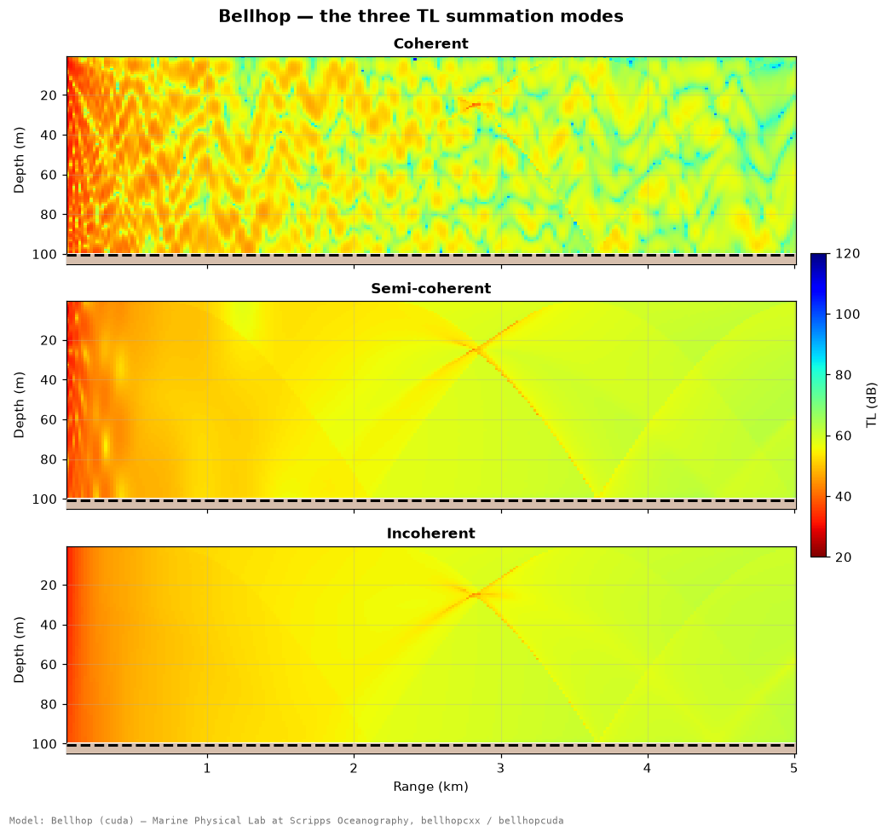
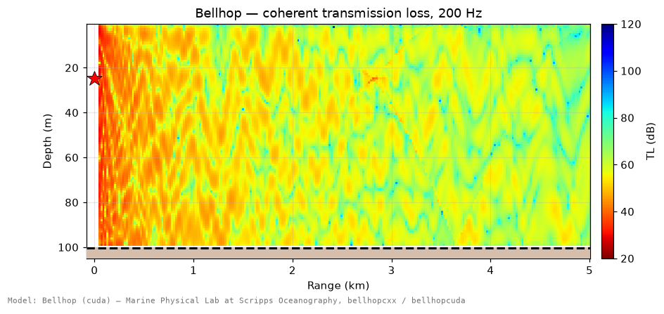
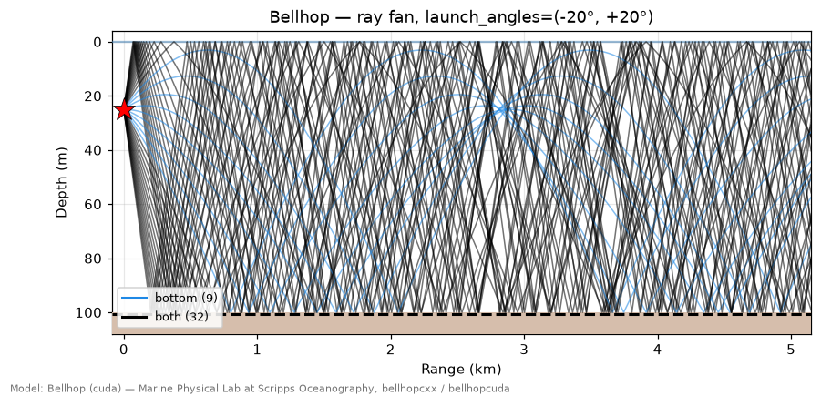
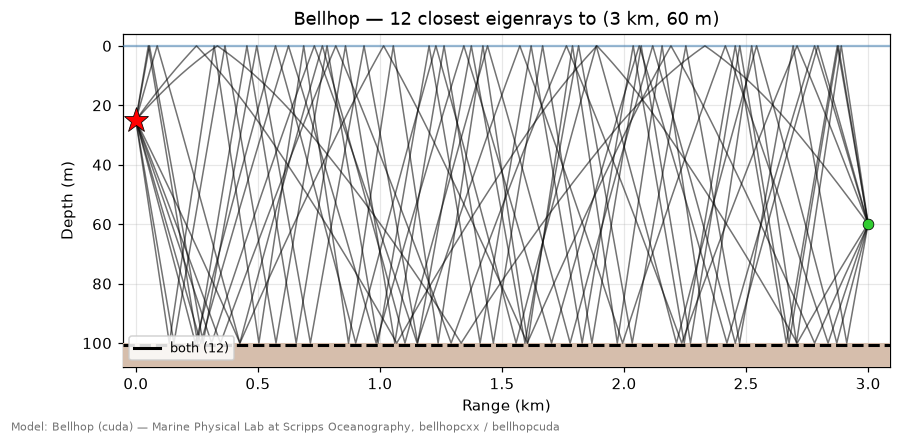
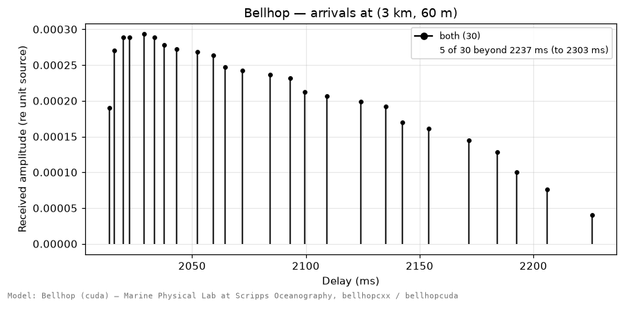
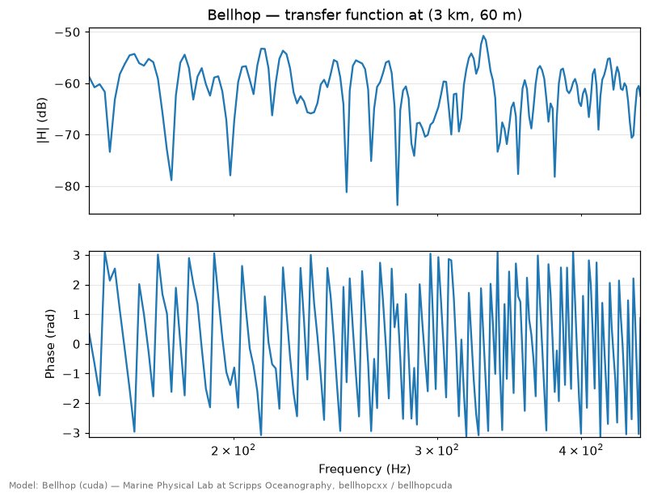

# Bellhop — Gaussian-beam ray tracing

> `uacpy.models.Bellhop` · backends: `fortran` — Michael B. Porter's BELLHOP
> (Acoustics Toolbox); `cxx` / `cuda` — bellhopcxx / bellhopcuda, the C++/CUDA
> port by Scripps' Marine Physical Lab. `result.model_source` credits whichever
> one resolved.

Bellhop is the model to reach for first in shallow water at mid-to-high
frequency, and the only uacpy model that gives you the **geometry** of the
sound field — the actual ray paths, which boundaries each one bounced off, and
the arrival structure at a point.

---

## 1. What it solves

Bellhop solves the Helmholtz equation in the **ray / Gaussian-beam
approximation**. Instead of solving for the field everywhere at once, it fires
a fan of rays from the source, traces each through the sound-speed profile by
Snell's law, and reconstructs pressure by summing the beams that pass near each
receiver.

Each ray obeys the eikonal equations, so a ray bends toward lower sound speed:

```
dr/ds = c·ξ            dξ/ds = −(1/c²)·∂c/∂r
dz/ds = c·ζ            dζ/ds = −(1/c²)·∂c/∂z
```

A pure ray field has zeros in shadow zones and infinities at caustics.
`beam_type='G'` (the default, and BELLHOP's own) replaces each ray with a
*geometric* **hat beam**: a finite width that follows the spreading of the
ray tube, with no floor, so a caustic keeps its ray-theoretic singularity.
`beam_type='B'` makes the cross-profile Gaussian and floors the width at
`min(0.2·f·τ, πλ)` (`influence.f90:563`): `πλ`, the Weinberg–Keenan focal limit,
once the travel time `τ` exceeds `5πλ/f`, below it nearer the source (in
1500 m/s water ≈ 880 m out at 200 Hz, ≈ 14 km at 50 Hz). That floor, not the Gaussian shape by
itself, is what keeps caustics finite, and it is also what biases a shallow
duct: when `πλ` is a sizeable part of the water depth the floored beams read
too much loss — +2.55 dB against a wavenumber integral on 100 m at 200 Hz,
+3.35 dB on Pekeris at 100 Hz, where the same rays with hat beams read +0.32
and −0.12 dB. Pass `beam_type='B'` where finite caustics matter (a
convergence-zone or Munk-profile study). The Gaussian tails also leak energy
into shadow zones. These beams interpolate the field between rays; they are
not models of a physically propagating beam.

**Validity is asymptotic, not a threshold.** Jensen (§3.4.2) is explicit that
no a-priori criterion exists; the guideline is that the wavelength be
substantially smaller than *any* physical scale in the problem — water depth,
bathymetric relief and duct thickness alike. The `D/λ` bands below are an
engineering convention on the depth scale only, uacpy guidance; a run does not
warn on them. The one source that gives numbers is stricter: "if the depth-to-wavelength ratio is 100 or more, ray
tracing models are accurate. Below that, corrections must be made to these
models. In shallow water or low frequencies, i.e., when the depth-to-wavelength
is about 30 or less, 'mode theory' models are used" (Stergiopoulos, *Advanced
Signal Processing Handbook*, §10.2.2). Treat the bands as a first filter, not a
criterion. At `c = 1500 m/s`:

| Depth | 50 Hz | 200 Hz | 1 kHz |
|---|---|---|---|
| 20 m | `D/λ ≈ 0.7` ✗ | `2.7` ✗ | `13` ~ |
| 100 m | `3.3` ✗ | `13` ~ | `67` ✓ |
| 1000 m | `33` ✓ | `133` ✓ | `667` ✓ |

✗ below `D/λ ≈ 5`, rays are the wrong tool · ~ `5–20`, cross-check a ray answer
against a modal one · ✓ above `≈ 20`, rays are comfortable and far cheaper.

Ray theory also degrades near caustics and in shadow zones whatever `D/λ` says,
and both regions widen with range. Where it fails, use a modal solver
([Kraken](kraken.md)) or a wavenumber-integral solver ([Scooter](scooter.md)) —
they are exact where Bellhop is asymptotic.

---

## 2. When to use it — and when not to

**Use Bellhop when:**

- you need **ray paths, eigenrays or arrival times**, not just transmission
  loss — no other uacpy model produces them;
- the water spans enough wavelengths — `D/λ ≳ 20` is comfortable, `5–20` wants
  a modal cross-check (§1);
- the environment is **range-dependent** (sloping bathymetry, a rough sea
  surface, a bottom whose properties change with range) — Bellhop handles all
  of these natively, without collapsing them;
- you want a **broadband impulse response** cheaply: one arrivals run gives
  `H(f)` across a whole band, instead of re-solving per frequency.

**Reach for something else when:**

| Situation | Why Bellhop struggles | Use instead |
|---|---|---|
| Low frequency / very shallow | Ray approximation breaks down | [Kraken](kraken.md), [Scooter](scooter.md) |
| You need modes themselves | Bellhop has no modal decomposition | [Kraken](kraken.md) |
| Layered *fluid* sediment stack | Reflection table, not resolved in the ray trace | [RAM](ram.md), [OASES](oases.md) |
| Full elastic wavefield (energy refracting through the sediment, head waves) | Only the *reflection* is elastic — the ray trace itself is fluid and specular | [OASES](oases.md), [Scooter](scooter.md) |
| Seismo-acoustic / shear detail | No shear field, only shear's effect on `R(θ)` | [OASES](oases.md) |

---

## 3. Environment support

What Bellhop takes natively, and what it routes or collapses first:

| Feature | Native? | Note |
|---|---|---|
| Range-dependent bathymetry | ✅ | written as a `.bty` boundary file |
| Range-dependent SSP | ✅ | multi-profile `.ssp`; needs `interp_ssp='quad'` |
| Range-dependent bottom | ✅ | |
| Sea-surface altimetry | ✅ | also supported by [RAM](ram.md) (`ramsurf` backend); no other model |
| Multiple source depths | ✅ | one `Field` over `source_depth` in the field modes; a `ResultStack` of `Rays` / `Arrivals` in `RAYS` / `EIGENRAYS` / `ARRIVALS` |
| Source beam pattern | ✅ | staged as an `.sbp` |
| Elastic media | ✅ | native for a half-space — bellhop.f90's exact acousto-elastic `R(θ)`, per column (a step switching midway between range nodes) when the bottom is range-dependent; a layered *elastic* stack goes via auto-BOUNCE — see below |
| Layered bottom | ✅ | via auto-BOUNCE; layer stack kept, range collapsed to one column |
| Rough surface/bottom (`sigma`) | ❌ | collapsed |

### Elastic bottoms and the auto-BOUNCE route

An elastic **half-space** needs no help: the writer puts the shear pair
(`c_s`, `α_s`) on the halfspace line — per column on a range-dependent
bottom, each holding to the midpoint with its neighbour — and `bellhop.f90:694-712` evaluates the exact acousto-elastic
reflection coefficient at every boundary hit. What Bellhop cannot represent is
a **layer stack**: its `.env` carries a single halfspace, so a layered bottom
(fluid or elastic) would silently lose its layers. When `env.bottom` is
layered, uacpy therefore automatically runs [Bounce](bounce.md) first to
compute a plane-wave reflection-coefficient table (`.brc`) over the stack,
then hands Bellhop that table as its bottom boundary.

The table is the exact **plane-wave** reflection coefficient of the layered
(elastic) stack, angle by angle — the layer stack itself is kept. Two things
the reflection treatment cannot carry, table or native. BOUNCE is
range-independent, so a routed bottom collapses to one representative column
(you get a `FallbackWarning`). And a plane-wave `R(θ)` applied
at the bounce point is specular: it misses beam and time displacement — real
energy enters the sediment, refracts, and re-emerges downrange — and misses the
head (lateral) wave generated near the critical angle. `Bellhop(beam_shift=True)`
turns on BELLHOP's own beam-displacement correction. Where those effects
dominate, use [OASES](oases.md) or [Scooter](scooter.md). Disable the route with
`Bellhop(auto_bounce=False)` — the layer stack is then collapsed to a single
halfspace by the collapse policy (the halfspace reflection itself stays exact,
shear included; what is lost is the stack's interference structure).

---

## 4. Run modes

```python
from uacpy.models import Bellhop, RunMode
```

| `RunMode` | Returns | What you get |
|---|---|---|
| `COHERENT_TL` | `Field` | complex pressure; keeps interference nulls |
| `INCOHERENT_TL` | `Field` | intensity sum; smooth, no nulls |
| `SEMICOHERENT_TL` | `Field` | intensity sum + Lloyd-mirror source shading |
| `RAYS` | `Rays` | the whole ray fan |
| `EIGENRAYS` | `Rays` | only rays that reach the receiver |
| `ARRIVALS` | `Arrivals` | amplitude + delay per path |
| `BROADBAND` | `Field` | `H(d, r, f)` transfer function |
| `TIME_SERIES` | `Field` | `p(d, r, t)` |

Default is `COHERENT_TL`. A multi-frequency `Source` left on the default run
mode raises `ConfigurationError` — here as in every model. The one promotion
that exists is Kraken's, and it keys on the `frequencies=` *run kwarg*, not on
the `Source`: Bellhop leaves the default alone even then. Ask for
`RunMode.BROADBAND` (or `TIME_SERIES`) explicitly.

### The three TL modes, side by side



Coherent TL keeps the interference structure — those nulls are real, and they
move if you shift the source by a wavelength. Incoherent TL sums intensities
and throws the phase away, giving the smooth envelope you want when you are
modelling a *band* of frequencies or do not trust the environment to
wavelength precision.

Semi-coherent is not a blend of the two. It sums intensities exactly as the
incoherent mode does, but first applies a Lloyd-mirror shading
`√2·|sin(ω z_s sinθ₀ / c)|` to the source's launch-angle **amplitude**
(`bellhop.f90:276-278`) — equivalently `2sin²(·)` once the contribution is
squared into the intensity sum. That is the physical `4sin²` Lloyd pattern
renormalised to unit mean, which is why the shading redistributes energy
rather than adding any. The
case for it is a shallow, mid-frequency source: the interference of the source
with its own surface image is a stable feature worth keeping even when the
ray-to-ray phase is not. That is why the middle panel tracks the incoherent one
everywhere except the first kilometre, where the source pattern still bites.

---

## 5. Constructor knobs

Everything is configured on the constructor; `run()` has a fixed signature.

**Geometry and beams**

| Name | Default | Meaning |
|---|---|---|
| `n_beams` | `0` | Number of rays. `0` lets Bellhop choose, as `doc/bellhop.htm` advises: "use 0 to have the program calculate a value automatically, but conservatively" (`angleMod.f90:38-51`); the count it chose, read from its `.prt`, is in `result.run_settings.notes`. |
| `single_beam` | `None` | Trace and sum one beam of the fan, by index (1 = lowest launch angle): `TopOpt(6:6) = 'I'` with the index after `NBeams` (`angleMod.f90:32-33`, `bellhop.f90:265`). Bellhop User Guide §6.2, "Plotting a single beam": "It is sometimes useful to be able to plot an individual beam in the sum." The beam keeps its width in the full fan, which `n_beams=1` does not give. Refused past a pinned `n_beams` (`angleMod.f90:80-83` stops on it). |
| `launch_angles_deg` | `(-80, 80)` | Launch-angle fan, degrees. Narrow it to isolate paths. uacpy guidance (no value in the manual: the Bellhop User Guide leaves the fan to "what part of the field the user is interested in seeing"); a receiver whose direct path needs a steeper launch is warned about. |
| `beam_type` | `'G'` | Cross-beam profile. `'G'` geometric hat and `'B'` geometric Gaussian, both Cartesian; `'g'` the ray-centred hat; `'S'` Bucker simple Gaussian; `'C'`/`'R'` Červený beams in Cartesian / ray-centred coordinates. `'G'` is BELLHOP's own default too (`ReadEnvironmentBell.f90:393-395`); pass `'B'` for finite caustics. The Bellhop User Guide finds `'B'` "In general ... more accurate TL plots" and keeps `'G'` the default "since people are usually most familiar with that approach"; uacpy keeps `'G'` for ducts and reciprocity (measured, `Bellhop.beam_type`). |
| `ray_step` | `None` | Ray step (m), written to the deck as given. `None` → `env.depth / 50` (uacpy guidance: BELLHOP's own `depth/10` under-resolves a near-horizontal refracted ray), or `2 × r_box / MaxN` when that is coarser (the factor 2 is uacpy guidance): each build stores at most `MaxN` steps per ray — 100 000 on bellhopcuda / cxx (`bhc/structs.hpp:66`), 1 000 000 on the Fortran build (`bellhopMod.f90:4`) — and cuts a longer ray short, and the manual ties the step to the "range of receivers" (`doc/bellhop.htm`, STEP). Measured: 50 m of water to 150 km at 125 Hz, depth/50 (1 m) left bellhopcuda reading the 600 dB no-energy marker from 100 km on; the derived 3.6 m reads the Fortran build's 75.7 / 80.5 / 81.8 / 83.4 dB at 50 / 100 / 120 / 150 km. A pinned step whose rays run out of storage gets the engine's `BHC_WARN_ONERAY_OUTOFMEMORY` as an `IOWarning`, followed by the step that fits and `backend='fortran'`. `0` asks BELLHOP for its `depth/10` (`bellhop.f90:170-174`). |
| `z_box`, `r_box` | `None` | Ray-trace bounding box (m); BELLHOP drops a ray once it leaves it (`bellhop.f90:571-572`). `None` → `1.2 × env.depth` and `1.2 ×` the farthest receiver range (10 km when that is 0), uacpy guidance, measured: paths that turn back from beyond the farthest receiver need room to turn (on the ASA ideal wedge at 25 Hz, receivers to 3 km, 0.57 dB median from the analytic field against 3.06 dB with the manual's "say 1%" margin). A pinned box that stops short of the seafloor or of the farthest receiver runs as given, with a `ValidityWarning` naming the paths it drops, on every mode but `RAYS`, where the box sets the extent of the trace. |

**Numerics and environment**

| Name | Default | Meaning |
|---|---|---|
| `grid_type` | `'R'` | Receiver grid: `'R'` rectilinear (every depth × every range; BELLHOP's default, `doc/bellhop.htm` OPTION(5:5)); `'I'` irregular — the i-th depth pairs with the i-th range (equal lengths). BELLHOP sorts both lists before pairing (`SourceReceiverPositions.f90:224` depths, `:268` ranges), so an `'I'` grid is always a monotone diagonal, shallow-near to deep-far; for arbitrary (depth, range) points run `'R'` and sample with `Field.at`. |
| `interp_ssp` | `None` | SSP connection scheme: `'linear'` (AT `C`), `'pchip'`, `'spline'`, `'quad'` (2-D `.ssp`), `'n2linear'`. `None` auto-picks `'quad'` for a range-dependent `env.ssp`, `'linear'` otherwise; `'quad'` on a range-independent `env.ssp` runs as `'Q'`, its `.ssp` written from the one profile. `'analytic'` (AT's `'A'`, a hard-coded Munk curve that ignores `env.ssp`) raises `ConfigurationError`. |
| `interp_bathymetry` | `'linear'` | `'linear'` or `'curvilinear'`. Linear as `doc/ATI_BTY_File.htm` advises: "Generally the piecewise linear option should be selected." |
| `interp_altimetry` | `'linear'` | as above, for the sea surface. |
| `auto_bounce` | `True` | Route *layered* bottoms through BOUNCE (elastic half-spaces run natively) — the manual's route: "elastic boundaries can be treated using BOUNCE to generate an equivalent reflection coefficient" (`doc/bellhop.htm`). |
| `beam_shift` | `False` | BELLHOP's beam-displacement correction on boundary reflections (RunType position 7 `'S'`). Off is BELLHOP's own default (`ReadEnvironmentBell.f90:159-165`). |

**Červený beams only** (`beam_type='C'` or `'R'`)

These are written to the env file only for the two Červený beam types. Setting
any of them under another beam type — including the default `'G'` — emits a
`FallbackWarning` and does nothing.

The Červený beams run `COHERENT_TL` only: for an incoherent or semi-coherent
sum they square each beam's contribution and `ScalePressure` takes the root of
the sum and scales it linearly in the beam spacing (`influence.f90:140, :282,
:772-779`), so the level falls as `n_beams^-0.5`, 4.8 dB per tripling, and
`INCOHERENT_TL` / `SEMICOHERENT_TL` are refused. As a measured illustration, on
a Pekeris guide those runs read +10.0 / +14.6 / +19.4 dB from Kraken at 500 /
1500 / 4500 beams.

A line source on `beam_type='S'` with `backend='fortran'` keeps the
point-source launch weight `sqrt(cos α)` (`influence.f90:665`), where the other
beam types and the C++/CUDA ports weight a line source by 1, so a path launched
at `α` comes back changed by `10·log10(cos α)` dB; the run says so. As a
measured illustration, on a 100 m Pekeris guide at 300 Hz the mean TL sits
0.45 dB from Scooter there and 0.28 dB on the ports.

A line source's level is set to unit amplitude at 1 m in free space by the
frequency-independent factor `1/(4√π)` (the binary's raw line field is
`4√π/√R`, `influence.f90:784`, `ArrMod.f90:104`), so each bin of a
line-source `H(f)` and the `TIME_SERIES` pulse built from it follow the same
per-frequency 1 m convention as Kraken's and Scooter's `√k0` (JKPS §5.2.2;
see [Kraken §4](kraken.md#4-run-modes) for JKPS's warning on broadband
synthesis with it).

| Name | Default | Meaning |
|---|---|---|
| `beam_width_type` | `None` | Beam-width law (`ReadEnvironmentBell.f90:178-181`): `'F'` space-filling, `'M'` minimum width, `'W'` WKB. `None` is `'F'`, uacpy guidance measured against KRAKENC: BELLHOP has no built-in width, and the toolbox's Cerveny decks write `'M'`, which with `r_loop` 1 km reads twice the error on a Pekeris guide. |
| `beam_curvature` | `None` | Curvature change on a boundary reflection (`ReadEnvironmentBell.f90:202-210`): `'D'` doubling, `'S'` standard, `'Z'` zeroing. `None` is `'S'`, BELLHOP's built-in value (`bellhopMod.f90:25`). |
| `eps_multiplier` | `None` | Beam-width epsilon multiplier. `None` is `1.0`, BELLHOP's built-in value (`bellhopMod.f90:23`). |
| `r_loop` | `None` | Range (m) at which the beam width is chosen; read only by the `'M'` width (`bellhop.f90:378-380`). `None` is 1 km, uacpy guidance: BELLHOP has no built-in value (the toolbox's calib decks write 1 km, its 100 km decks 25-100 km). |
| `n_image` | `None` | Number of images; a whole number ≥ 0 (`ReadEnvironmentBell.f90:217` reads it as an INTEGER), anything else refused. `None` is `1`, BELLHOP's built-in (`bellhopMod.f90:22`). |
| `ib_win` | `None` | Beam-windowing parameter; a whole number ≥ 0 (read as an INTEGER, `ReadEnvironmentBell.f90:217`), anything else refused. `None` is `5`, BELLHOP's built-in (`bellhopMod.f90:22`). These six are Cerveny knobs (`beam_type` `'C'` / `'R'`): set on any other beam type, one is not used, and the constructor says so. |
| `component` | `'P'` | BELLHOP's built-in value (`bellhopMod.f90:24`). Reserved: only `'P'` (pressure) returns a field. `'V'`/`'H'` select particle velocity in the ray-centred routine (`influence.f90:120-130`), which a `Field` cannot carry, so they raise `UnsupportedFeatureError` on `beam_type='R'` and are ignored with a warning on every other beam type. |

**Broadband synthesis**

A BROADBAND run takes its band from `run(..., frequencies=)` or a
multi-frequency `Source`, as on every engine; a one-frequency `Source` without
`frequencies=` expands to 128 bins over `fc·(1 ± 0.25)`. Both values are uacpy
guidance: the bins are `1/T` apart, `T` the alias-free time window (Jensen et
al., *Computational Ocean Acoustics*, Sect. 8.2.1.2), and the Bellhop User
Guide §9 asks for sub-bands "so that the appropriate attenuation is used in
each sub-band" and names no width.

The TIME_SERIES record is placed per call, as on every engine:
`run(..., output_duration=, t_start=)`. Each receiver's trace is the source
waveform through that receiver's arrivals, every path's phase and its
absorption across the band included: the pulse and its Hilbert transform
through the arrivals' in-phase and quadrature taps at the waveform's sample
rate, convolved and placed on the one window every receiver shares
(`Arrivals.synthesize_time_series`, `simulate_arrival_reception` per receiver).
Measured against the exact product `X·H` on a lossy shallow-water run (four
receivers, 24 kHz): a 20 ms 3 kHz pulse within 1e-8 of its peak, 0.2 s of
white noise up to the Nyquist frequency within 2.4e-3; a 4-cycle 100 Hz
pulse in 50 m of water (two receivers, 48 kHz and 4 kHz) within 2.4e-5. An
echo the window omits (`output_duration=`, `t_start=`) is left out whole,
its Hilbert transform's precursor and tail with it. The
phase rotation is the pulse's own, so it holds down to the pulse's lowest
frequency; the taps of `Arrivals.impulse_response`, which a long recording
is played through instead, cannot rotate content below about one over their
margin (188 Hz at 48 kHz for a lone arrival).

**Execution**

| Name | Default | Meaning |
|---|---|---|
| `backend` | `None` | `'fortran'`, `'cxx'`, `'cuda'`; `None` auto-picks in the order cuda → cxx → fortran, silently (uacpy guidance: fastest first, after the speed-ups `bellhopcuda/README.md` reports under "Speed"). The auto-pick's usual winner, `cuda`, is not run-to-run reproducible — §7. |
| `dimensionality` | `'2D'` | Only `'2D'`; `'3D'` raises. It is passed to the cxx/cuda CLIs as `--2D` (accepted, not required: without a flag they assume 2D, `cmdline.cpp:186-191`); the Fortran binary takes none. |
| `executable` | `None` | Path to the Bellhop binary; auto-detected. The run record names the build (`run_settings.engine.backend`) and, for a binary whose name matches no build (`'custom'`), its file name in `engine.executable`; it never holds the path, so a saved result carries no machine path. |
| `work_dir` | `None` | Pin the scratch dir to keep `.env`/`.shd`/`.prt`. |
| `cleanup` | `None` | Defaults to *keep* when `work_dir` is pinned. |
| `use_tmpfs` | `False` | Stage scratch files in RAM. |
| `timeout` | `600.0` | Subprocess timeout (s), positive and finite, or `None` for no limit (anything else is refused at construction). uacpy guidance: a wall-clock guard on the host; no engine reads a time limit. |
| `verbose` | `False` | `True` / `'info'` / `'debug'`. |
| `collapse` | `None` | Per-feature collapse overrides, forwarded to an auto-BOUNCE run. |

---

## 6. Worked example

Every figure on this page comes from
[`docs/figure_scripts/bellhop.py`](../figure_scripts/bellhop.py) — the code
below is that code, so it cannot drift from what you see.

```python
import numpy as np
import uacpy
from uacpy.models import Bellhop, RunMode

env = uacpy.Environment(
    name='Shallow-water channel',
    bathymetry=100.0,
    ssp=[(0.0, 1500.0), (30.0, 1495.0), (100.0, 1490.0)],
    bottom=uacpy.BoundaryProperties(
        acoustic_type='half-space',
        sound_speed=1650.0, density=1.8, attenuation=0.6,
    ),
)
source = uacpy.Source(depths=25.0, frequencies=200.0)
receiver = uacpy.Receiver(
    depths=np.linspace(1.0, 99.0, 100),
    ranges=np.linspace(50.0, 5000.0, 250),
)

tl = Bellhop(n_beams=3000).run(
    env, source, receiver, run_mode=RunMode.COHERENT_TL)
fig, ax = tl.plot(env=env, source=source, figsize=WIDE,
                  title='Bellhop — coherent transmission loss, 200 Hz')
```



Pass `env=` to draw the seabed and span the full water column, and
`source=` / `receiver=` to overlay the geometry. A result carries **no**
environment of its own, so without `env=` the depth axis spans only the
receiver grid.

### Ray paths

```python
rays = Bellhop(n_beams=41, launch_angles_deg=(-20.0, 20.0)).run(
    env, source, receiver, run_mode=RunMode.RAYS)
fig, ax = rays.plot(env=env, show_receivers=False, figsize=WIDE,
                    title='Bellhop — ray fan, launch_angles_deg=(-20°, +20°)')
```



Rays are coloured by what they hit: **red** direct, **green** surface-reflected,
**blue** bottom-reflected, **black** both. The legend counts each class.

### Eigenrays — the paths that actually arrive

```python
point = uacpy.Receiver(depths=60.0, ranges=3000.0)
eig = Bellhop(n_beams=4000, launch_angles_deg=(-45.0, 45.0)).run(
    env, source, point, run_mode=RunMode.EIGENRAYS)
fig, ax = eig.top_n_by_miss(12).plot(
    env=env, figsize=WIDE,
    title='Bellhop — 12 closest eigenrays to (3 km, 60 m)')
```



Eigenrays are the subset of the fan that lands near the receiver.
`top_n_by_miss(n)` keeps the `n` that pass closest — unfiltered, this run
returns 60 of them; with `beam_type='B'` it returns 2625, for the same
beam-window reason as the arrivals below.

### Arrivals — the impulse structure

```python
arr = Bellhop(n_beams=4000, launch_angles_deg=(-45.0, 45.0)).run(
    env, source, point, run_mode=RunMode.ARRIVALS)
fig, ax = arr.plot(figsize=WIDE,
                   title='Bellhop — arrivals at (3 km, 60 m)')
```



Each marker is one *beam* contribution: its delay is the travel time, its
height the amplitude, its colour the multipath class. The default hat beams
(`beam_type='G'`) give one arrival per path — 30 here, on every backend —
which is what the BELLHOP user guide prescribes for arrivals and eigenrays.
With Gaussian beams (`beam_type='B'`)
every physical path is resolved into a picket of neighbouring beams that fall inside the beam window — several
hundred entries for the same run (measured 566 on the Fortran binary, 567 on
`cxx` and `cuda`), and the columns read solid rather than as individual
stems. Either way this is the channel impulse response, and it
is what [`uacpy.comms`](../guide/comms.md) uses to simulate a modem link.

**Read the level off `received_amplitudes`, not `amplitudes`.** BELLHOP keeps
volume absorption in the **imaginary travel time**, not in the amplitude
column, so `Arrivals.amplitudes` is the *geometric* amplitude and stands a
long, heavily absorbed path at its lossless height. `received_amplitudes`
applies `exp(ω·Im τ)` and the phase and is the value that arrives; the plot
above, `sorted_by_amplitude`, `rms_delay_spread`, `energy_support` and
`synthesis_band` all use it already. The difference grows with frequency and
path length, and it is large enough to reorder the multipath: on a 1 km link
with source and receiver 1 m off the seabed at 40 kHz, a 3161 m surface-bounce
path reads 20 dB *stronger* than a 1000 m bottom bounce on `amplitudes`, and
7.5 dB *weaker* once its 40.9 dB of absorption is applied.

One caveat if you read the `.arr` file itself: its record count and order are
backend- and threading-dependent. The serial Fortran binary merges
contributions that land within its delay/phase tolerance as it accumulates
them (`ArrMod.f90`), while the multithreaded `cxx`/`cuda` binaries append
every contribution unmerged, in thread-completion order — the same run writes
far more records there, and an incoherent energy sum taken directly over the
raw records disagrees between backends. The `Bellhop` model applies the Fortran
merge rule only to files those backends left unmerged — always for `cuda`, for
`cxx` only when `os.cpu_count() > 1` and the binary was not launched
single-threaded (`-1`, inside a `run_parallel` worker; `arrivals_need_merge`), never for
`fortran`, whose file is already merged and would not survive a second pass —
so an `Arrivals` result holds the same *set* of records whichever backend
produced the file: the `beam_type='G'` run above returns 30 records on
`fortran`, `cxx` and `cuda` alike. `read_arr_file` itself defaults to
`merge=False`, the file as written; `read_arr_file(filepath, merge=True)` applies
the Fortran merge rule, and is what the model passes for a `cxx`/`cuda` file
the backend left unmerged.

Three things that set does **not** guarantee:

- **Not the same order.** The multithreaded binaries append in
  thread-completion order, and the merge rule normalises the record structure,
  not the sequence. On that same run, `fortran`'s first delay is 2.3029 s and
  `cuda`'s is 2.0136 s — the same 30 delays, permuted. Align on `delay` before
  comparing two backends record by record.
- **Not a backend-proof count when the beam window admits a picket.** With
  Gaussian beams (`beam_type='B'`) the run measured 566 records on `fortran` against 567
  on `cxx` and `cuda`, and that count moves with the thread count.
- **It does not hold the same numbers.** The merge normalises the record
  structure, not the arithmetic that filled it, and the two binaries compute
  that arithmetic differently in float32. Aligned on delay, `fortran` and
  `cuda` disagreed on amplitude in 30 of 30 records (max 1.0e-07), delay in
  23 of 30 (max 9.5e-07 s), receiver angle in 30 of 30 (max 5.7e-05°) and
  source angle in 30 of 30 (max 4.5e-05°). Phase, the bounce counts and the
  receiver indices agreed exactly.

So compare arrivals across backends with a float32-scale tolerance, never for
equality, and expect anything that *thresholds* an arrival — a peak pick, a
count above a cutoff — to be able to land on the other side of the threshold
when the backend changes.

### Broadband transfer function

```python
source = uacpy.Source(depths=25.0,
                      frequencies=np.linspace(150.0, 450.0, 192))
H = Bellhop(n_beams=3000).run(
    env, source, point, run_mode=RunMode.BROADBAND)
fig, _ = H.plot_transfer_function(
    title='Bellhop — transfer function at (3 km, 60 m)')
```



Bellhop synthesises the whole band from **one** arrivals run by phasing the
delays, rather than re-solving per frequency — which is why it is dramatically
cheaper than a modal or spectral sweep for broadband work. The price is in
everything but the delays. The delays are exact per frequency; the rest is taken
from the one trace at the band centre `fc`:

- **volume attenuation** — the attenuation phase `Im(τ)` is traced at `fc`,
  where `2π·fc·Im(τ)` is minus the path integral of the water's `α(fc)` (Jensen et
  al., *Computational Ocean Acoustics* §3.6.2; `Step.f90:73`). BROADBAND and
  TIME_SERIES both rescale it to each frequency by the environment's law: by
  `α(f)/α(fc)` for Thorp and one Francois-Garrison water row, and linearly in
  `f` for a constant dB/λ and for every other law (a Biological layer, a
  Francois-Garrison profile, a table). The ratio is exact for Thorp (measured
  arrival by arrival against traces at `f`: within 0.0011 dB, where scaling
  linearly in `f` missed by 2.7 dB at 20–60 kHz over 1 km) and the linear
  scaling exact for a constant dB/λ; Francois-Garrison's pressure terms bend
  its ratio with depth, 0.058 dB/km at worst over 5–15 kHz in a 5 km column,
  where the linear line misses by 0.54. A run whose band and water column put
  the scaling applied more than 0.05 dB/km off the law warns;
- **beam amplitudes** — held flat, and whether that costs anything is the beam
  type's. The default hat-shaped beams (`'G'`) carry no frequency in their
  width, and their bins equal a trace run at each frequency: 0.04–0.06 dB
  median |ΔTL| at every bin of a 50–1950 Hz band (`fc` = 1 kHz, ±95 %) on a
  30 m sand guide, 0.01 dB on a 5 km Munk profile at 25–475 Hz (±90 %). A
  Gaussian beam (`'B'`) is floored at `min(0.2·fc·τ, π·c/fc)` (`influence.f90:563`), so
  its bins are first-order away from `fc`: on the sand guide the mean energy
  is off by +0.74 / −0.40 dB at ±25 % and +1.41 / −0.88 dB at ±50 %, on the
  Munk profile ±0.13 dB at ±50 %; a `'B'` band reaching more than 50 % of `fc`
  from it warns. Run such a band as sub-bands near their own `fc` (Bellhop
  User Guide §9);
- **the seabed reflection coefficient** — native half-spaces and a BOUNCE `.brc`
  table (the route a layered bottom takes) are evaluated at `fc` alone. A
  half-space with attenuation in dB/λ has a frequency-independent `R(θ)`, but a
  layered seabed does not (see [Bounce](bounce.md)), so a layered-bottom
  BROADBAND/TIME_SERIES run warns. The example above spans 150–450 Hz, `fc = 300 Hz` at ±50 %; with the
default beams a wider band costs nothing above, and the half-space here has a frequency-independent `R(θ)`.

The phase panel is aliased, not noisy: at 192 bins over 300 Hz the spacing is
`Δf ≈ 1.57 Hz`, and a ~2 s bulk delay advances the phase ~20 rad per bin
against a Nyquist limit of π. Read `|H|` here, and draw the impulse response
(`H.to_time_trace(sample_rate=fs).plot_impulse_response()`) for timing.

---

## 7. Gotchas

**Ray-box fitting.** `r_box` is auto-fitted to 1.2× the furthest receiver.
That margin is deliberate: BELLHOP drops a ray once it leaves the box
(`bellhop.f90:571-572`), and paths that turn back from beyond the farthest
receiver need room to turn — on the ASA ideal wedge the manual's "say 1%"
margin kills the up-slope rays before they turn (3.06 dB median from the
analytic field, against 0.57 dB at 1.2×). Do not "tighten" it: a pinned box
that stops short of the seafloor or of the farthest receiver runs as given, and a `ValidityWarning` names the paths it
drops (the receivers past `r_box` get the 600 dB no-energy marker).

**Range-dependent SSP needs `interp_ssp='quad'`.** That is what writes
BELLHOP's Quad (`'Q'`) SSP interpolation and the multi-profile `.ssp`. The
default `interp_ssp=None` auto-picks `'quad'` whenever `env.ssp` is
range-dependent, so you normally get it for free; pass `interp_ssp` yourself
and you own it. On a range-independent profile `'quad'` runs too, its
`.ssp` written from the one profile. (`grid_type` is unrelated — that selects the *receiver* grid.)

**A cell no beam reached is the 600 dB no-energy marker; `r = 0` is `NaN`.**
Bellhop zeroes its grid before the beam sum (`bellhop.f90:240-241`), so a cell
outside every beam keeps an exact zero — the engine's answer, reported at the
600 dB `PRESSURE_FLOOR` and left out of plots and metrics
(`uacpy.acoustics.no_energy_mask`). The `r = 0` column comes back `NaN` where
Bellhop never evaluates it: for a point source, whose `1/√r` factor is set to
0 there (`influence.f90:786-787`), and for a line source on every beam type
but `'S'`, whose receiver loops start right of the source; a line source on
`'S'` returns the column it computes. A receiver below the seafloor is `NaN`
too. Reduce with
`np.nanmedian(tl[~no_energy_mask(tl)])`, not `np.median(tl)`.

**Beam count is a convergence parameter.** Too few beams gives a speckled,
under-sampled field. If the TL image looks grainy, raise `n_beams` and confirm
the picture stops changing.

**An eigenray or arrival set needs a finer fan than a TL map.** BELLHOP
writes an eigenray, or an arrival, for every beam that passes within a
beamwidth of the receiver, so the set depends on how densely the fan samples
the angles that reach it: the User Guide raises its own eigenray example from
41 rays to 5001 ("The more rays used, the more precise the eigenray
calculation will be", §3), and computes arrivals the same way (§9.3).
Converge the set as you converge a TL map, by comparing two counts. On a
100 m sandy channel at 1 kHz, source 20 m, receiver 50 m at 2 km, the
default fan gives 44 arrivals and −57.14 dB of received energy, 2000, 8000
and 16000 beams give 26 arrivals and −56.23 to −56.25 dB, with the same
earliest arrival; 4000 beams adds one weak surface path. That is why the
`EIGENRAYS` and `ARRIVALS` snippets on this page pin `n_beams=4000`.

**`launch_angles_deg` clips the field, not just the picture.** Narrowing the fan removes
steep paths entirely — useful for isolating a path, wrong if you want total
field.

**An explicit backend runs or raises.** `backend='cuda'` or `backend='cxx'`
whose binary is not built raises `ExecutableNotFoundError`, naming the
`./install.sh --bellhop …` flag that builds it; no other engine runs in its
place. `backend=None` picks the first installed binary (CUDA → C++ → Fortran)
by file presence, and the model's repr names it (`Bellhop(backend='cuda')`);
`python -m uacpy` lists the builds installed. A `bellhopcuda` binary on a host
with no usable GPU is picked, finds no CUDA device on its first launch, and the
run moves to the next installed binary with a `FallbackWarning`. Check
`result.backend` to see what actually ran.

**The default backend is not run-to-run reproducible.** `result.backend` tells
you *which* binary ran; it does not promise that binary returns the same
numbers twice. Two default `Bellhop()` runs of the same environment — both
auto-picked to `'cuda'` here — wrote a byte-identical `model.env` and
`model.prt` but a differing `model.shd`: TL differed in 57 of 500 elements, by
up to 1.53e-05 dB, about one ULP of the complex64 field. That is the GPU
reduction order changing between launches, and it is the price of letting the
auto-pick choose. If you need a field you can reproduce bit for bit — a
regression baseline, a published figure, a hash — pass
`Bellhop(backend='fortran')`, whose `.shd` is byte-identical and whose field
compares `array_equal` across runs. Note the two backends fail in *opposite*
places, so pin the file you actually depend on: the fortran `.prt` is **not**
byte-identical, because it carries a `CPU Time = …` stamp. The examples pass
`backend='fortran'` for this reason, so their figures and printed numbers are
the same on every run.

Bellhop's measured agreement with closed forms and the published benchmarks, and its known limits there, are on the [validation page](validation.md).

---

## 8. References

- Porter, M. B., *The BELLHOP Manual and User's Guide*, HLS Research, 2011 —
  vendored at [`docs/other/Bellhop_userGuide.pdf`](../other/Bellhop_userGuide.pdf).
- Porter, M. B. & Bucker, H. P., "Gaussian beam tracing for computing ocean
  acoustic fields", *JASA* 82(4), 1987.
- Jensen, Kuperman, Porter & Schmidt, *Computational Ocean Acoustics*, 2nd ed.,
  Springer, 2011 — chapter 3 for ray theory.
- Local modifications to the vendored source:
  [`uacpy/third_party/MODIFICATIONS.md`](../../uacpy/third_party/MODIFICATIONS.md).

---

**See also:** [Kraken](kraken.md) · [RAM](ram.md) · [Scooter](scooter.md) ·
[Bounce](bounce.md) · [model index](README.md)
