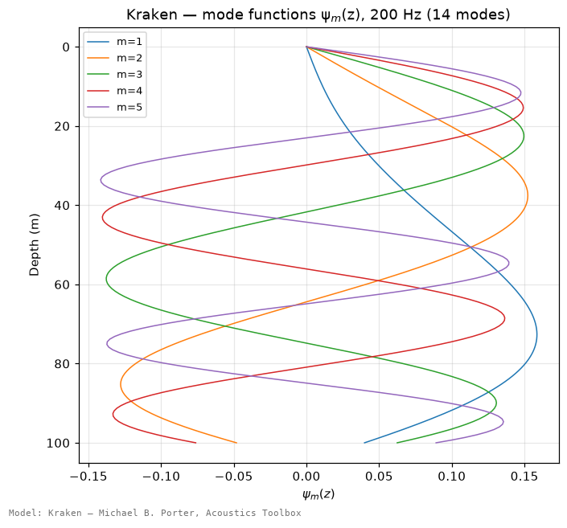
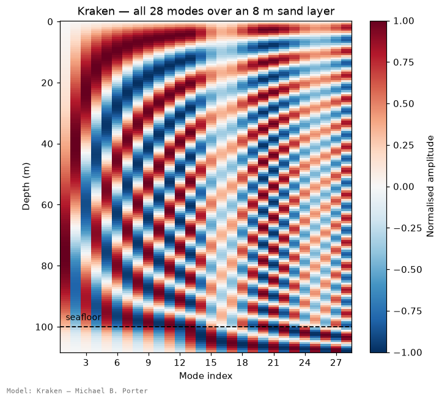
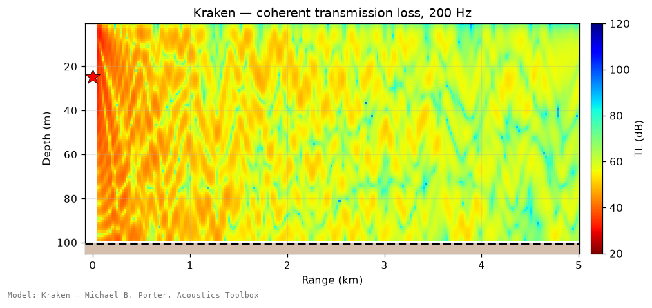
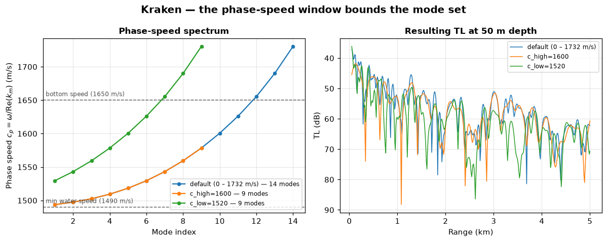
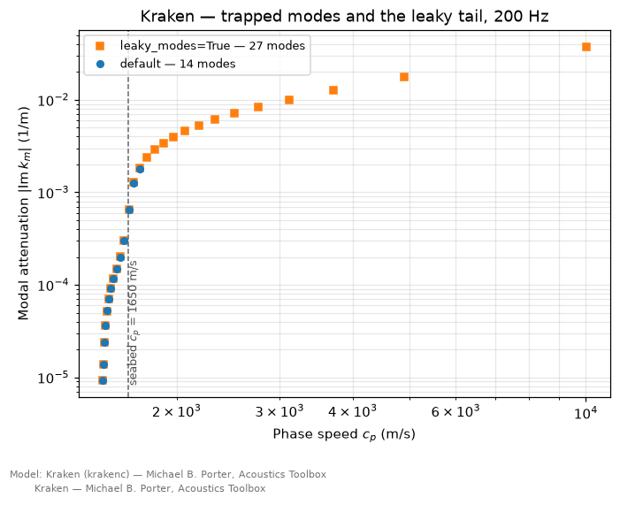
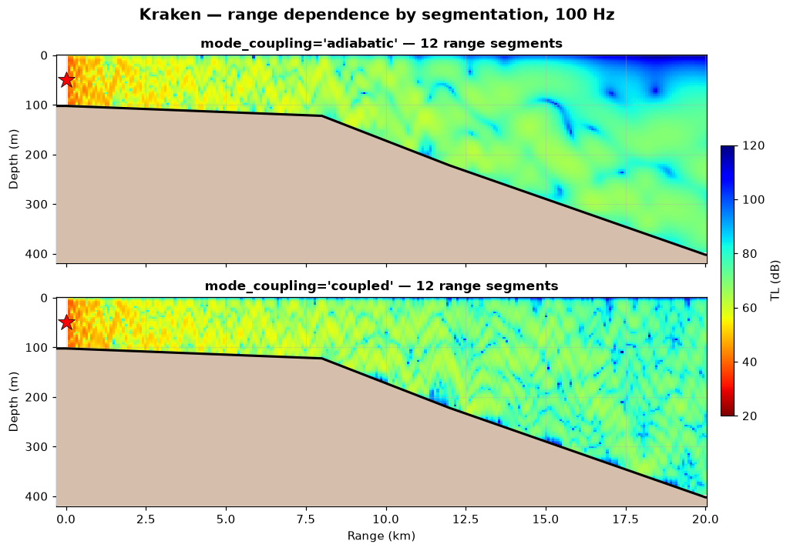
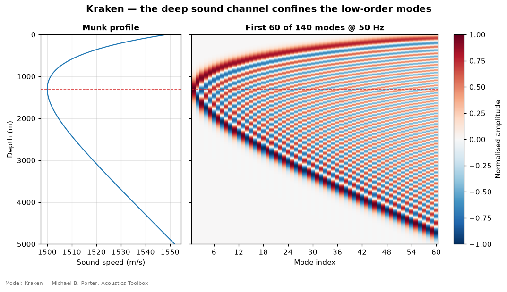

# Kraken — normal-mode propagation

> `uacpy.models.Kraken` · wraps Michael B. Porter's KRAKEN (Acoustics Toolbox)
> · backends: `kraken`, `krakenc`

Kraken is the model to reach for when the water is shallow and the frequency is
low — the regime where a ray is not a meaningful object — and the only uacpy
model that hands you the **modes** themselves rather than just the field they
sum to.

It is the exact complement of [Bellhop](bellhop.md). Bellhop is asymptotic in a
regime where modes are unusable because there are too many of them; Kraken is
non-asymptotic in a regime where rays are meaningless. Between them they cover
the frequency axis.

---

## 1. What it solves

In a horizontally stratified waveguide the Helmholtz equation **separates**.
Kraken solves the depth half of it as an eigenvalue problem, by finite
differences on a mesh:

```
ρ(z) · d/dz ( (1/ρ(z)) · dψ_m/dz ) + ( ω²/c(z)² − k_m² ) ψ_m(z) = 0
```

subject to the surface and seabed boundary conditions, with the normalisation
`∫ |ψ_m(z)|² / ρ(z) dz = 1`. The `ρ` weighting is what carries a mode across a
density jump — the water-to-sediment step in every example below — and it is
what Kraken discretises (`1/(h·ρ)` off-diagonals, `kraken.f90:564`). Only where
`ρ` is constant does it collapse to a plain `d²ψ_m/dz²`. Each eigenvalue `k_m`
is a horizontal wavenumber; each eigenfunction `ψ_m(z)` is a standing wave
across the water column. The field is their sum, every term travelling in range
with its own phase speed `c_p = ω / Re(k_m)` and its own decay `Im(k_m)`:

```
p(r, z) ≈ i·e^(−iπ/4) / ( ρ(z_s)·√(8πr) ) · Σ_m ψ_m(z_s)·ψ_m(z)·e^(i k_m r) / √k_m
```

The sum is written in the `e^(−iωt)` convention, where a decaying mode has
`Im(k_m) > 0`. `Modes.k` is in the Acoustics Toolbox's `e^(+iωt)` convention,
where decay is `Im(k_m) < 0` — what Kraken writes and what
`Modes.with_attenuation` writes too — so a hand-written sum over `modes.k` uses
`e^(−i k_m r)`, or the conjugate of the sum above. The package's modal sums
(`Modes.modal_pressure_field`, `uacpy.acoustics.modal_field`) also decay a mode
by `|Im(k_m)|` when a `Modes` built by hand carries the other sign.

**Nothing in that sum is a high-frequency approximation.** A mode is an exact
solution of the wave equation for the stratified problem — it has no
wavelength-scale validity condition to violate, which is precisely why it
survives where a ray does not.

What Kraken *does* approximate is which part of the spectrum it keeps: the
**discrete, trapped** modes. The continuous spectrum — steep-angle energy that
radiates into the seabed instead of reflecting off it — is not in the sum. That
is one of the two things that make the modal sum a far-field method; the other
is that the sum above is already the large-argument form of `H₀⁽¹⁾(k_m r)`,
valid only for `k_m r ≫ 1`. Widening the phase-speed window addresses the first
and cannot touch the second, which is why the near field is
[Scooter](scooter.md)'s job rather than a Kraken setting.

### The cost is the mode count

The number of trapped modes grows with the product of frequency and depth:

```
M ≈ 2 f D · √( 1/c_w² − 1/c_b² )
```

That counts only what is trapped below the bottom speed. Kraken's default
ceiling sits 5 % past it, so to predict what the solver returns, substitute
`c_high = 1.05 c_b` for `c_b` — for the table below that is 1732.5 m/s, and it
is the difference between 55 modes and 67 in the 100 m / 1 kHz cell.

Measured mode counts, for an isovelocity 1500 m/s channel over a 1650 m/s
half-space with the default phase-speed window:

| Depth | 50 Hz | 200 Hz | 1 kHz |
|---|---|---|---|
| 20 m | 1 | 3 | 13 |
| 100 m | 3 | 13 | 67 |
| 1000 m | 33 | 133 | 667 |

Compare that table with the `D/λ` table on the [Bellhop](bellhop.md) page: for
this water-to-seabed speed ratio the two happen to land on nearly the same
numbers. The coincidence is arithmetic, not a law, but it makes the trade
concrete — the regime where Bellhop is accurate (`D/λ ≳ 20`) is exactly the
regime where the modal sum has tens to hundreds of terms, and the regime where
Kraken has a handful of modes to add up is exactly where a ray answer is
nonsense.

---

## 2. When to use it — and when not to

**Use Kraken when:**

- the frequency is low or the water shallow — below `D/λ ≈ 5` the ray
  approximation is simply invalid, and between 5 and 20 a modal answer is the
  cross-check that tells you whether the ray one can be trusted;
- you want the **modes**, not just the field: eigenvalues, mode shapes,
  phase and group speeds, a modal basis for matched-field work. No other
  uacpy model produces them. Group speeds come from
  `modes.group_speeds_between(other)` on a second solve at a nearby
  frequency; `modes.group_speeds` holds the solver's own only on the
  `krakenc` backend (`Kraken(backend='krakenc')`, no `leaky_modes` needed:
  `krakenc.f90:819`) and is `None` on the default `kraken`, which leaves
  that column unfilled (`kraken.f90:815-819`);
- the environment is range-independent, or range-dependent gently enough for
  adiabatic mode theory;
- you want **broadband** cheaply: one multi-frequency `.mod` file covers the
  whole band in a single `field.exe` pass, instead of one solve per bin.

**Reach for something else when:**

| Situation | Why Kraken struggles | Use instead |
|---|---|---|
| High frequency / `D/λ ≳ 20` | Hundreds of modes; Bellhop is far cheaper | [Bellhop](bellhop.md) |
| You need ray paths or arrival times | A mode has no geometry | [Bellhop](bellhop.md) |
| Near field, or below the modal cutoff | The continuous spectrum is not in the sum | [Scooter](scooter.md), [OASES](oases.md) |
| Steep slopes, long range, strong range dependence | Segmentation + adiabatic/coupled is an approximation | [RAM](ram.md) |
| A rough or moving sea surface | Altimetry is dropped | [Bellhop](bellhop.md) |
| A true elastic *modal* decomposition | `krakenc` handles elastic media with complex wavenumbers, but AT's elastic-mode solver `krakel.exe` is not wrapped | [OASES](oases.md) |

---

## 3. Environment support

| Feature | Native? | Note |
|---|:--:|---|
| Range-dependent bathymetry | ✅ | segmented into per-range profiles |
| Range-dependent SSP | ✅ | as above; the `MODES` path takes `r = 0` (the package default) unless `collapse=` sets `'ssp'` |
| Layered bottom | ✅ | meshed as extra media — modes continue into the sediment |
| Elastic media (shear) | ✅ | requires `backend='krakenc'`, auto-selected |
| Rough surface / bottom (`sigma`) | ✅ | |
| Source beam pattern | ✅ | staged as an `.sbp` |
| Range-dependent bottom | ✅ | each profile block carries the seabed column at its own range, layers included (every block is a full environment, `kraken.f90:42-46`); the `MODES` path takes the track median (the package default, as every engine) unless `collapse=` sets `'bottom_range'` |
| Sea-surface altimetry | ❌ | dropped; flat surface |
| Multiple source depths | ✅ (TL modes) | `field.exe` sums every depth of the `.flp` from the one `.mod` — the mode solve reads no source depth — so `COHERENT_TL` / `INCOHERENT_TL` launch once and the `.shd` reader puts the `NSz` axis on the Field's `source_depth` axis (measured 4.4× at eight depths). `BROADBAND` / `TIME_SERIES` loop through `run()`, one deck per depth; `MODES` returns one `Modes` whose `source_depths` lists every depth. Each depth's plane equals that depth's stand-alone run exactly: the receiver depths sit on the mode-tabulation grid and are written to the `.flp` in full, so no source depth can reach another depth's answer |

The ❌ row is *collapsed* with a `FallbackWarning` naming what was dropped; the
mechanism, and the `collapse=` dict that overrides it, is in the
[environment guide](../guide/environment.md). Kraken declares no per-model
collapse default: bathymetry, SSP and bottom are all segmented on the field
path, and `compute_modes` reduces each range-dependent quantity by the
`collapse=` method you set for it, else by the package defaults every engine
uses — the seabed by its track median, the bathymetry by its deepest point,
the SSP and the surface at `r = 0`. Each segment's seafloor is the
bathymetry's depth at its range as the deck writes every depth, to 1e-6 m.
`Bottom.at` takes
the nearest column, so a profile carries whichever column lies closest to its
own range. On the example-18 transects (a two-column layered seabed) the
segmented run agrees with RAM to 1.9 / 1.9 dB RMS at 103 m, hard / soft; one
collapsed column standing in for the whole run would differ by 8.4 / 16.0 dB.

### Real or complex arithmetic: `kraken` vs `krakenc`

The Acoustics Toolbox ships two mode solvers, and `backend=` picks between
them:

| `backend` | Binary | Handles |
|---|---|---|
| `'kraken'` | `kraken.exe` | real eigenvalues; attenuation added by perturbation |
| `'krakenc'` | `krakenc.exe` | complex eigenvalues: shear, leaky modes |
| `None` (default) | auto | `krakenc.exe` when the environment carries shear, `leaky_modes=True`, or a tabulated reflection coefficient (a `'file'` / `'precalc'` boundary or `top_reflection_file=`); `kraken.exe` otherwise |

Real-arithmetic `kraken.exe` will *run* an elastic bottom — it has first-class
elastic branches — but it computes the trapped, shear-lossless part of the
answer only, for two reasons the manual states:

- It clamps the upper phase-speed bound to the half-space **shear** speed
  (`kraken.f90:209`, `cHigh = MIN(cHigh, HSBot%cS)`; `kraken.htm`: "KRAKEN will
  (if necessary) reduce CHIGH so that only trapped (non-leaky) modes are
  computed"), discarding every mode above it. Over the `granite` preset that
  cap is its 3000 m/s shear speed, well below its 5750 m/s compressional
  speed, and `krakenc.exe`'s window keeps the modes in between.
- Its absorption perturbation loops only over **acoustic** media
  (`kraken.f90:728`), so an elastic medium's material loss is left out of
  `Im(k)` (`kraken.htm`: "KRAKEN does not at allow for losses in elastic media
  due to material attenuation. Thus, for attenuating elastic media, KRAKENC
  should be used"); the loss of the acoustic layers and of the water still
  enters.

`krakenc.exe`'s complex eigenvalues carry that loss, so the default
`backend=None` detects shear and dispatches there for you. Forcing
`backend='kraken'` on an elastic environment runs kraken.exe, with one
`ValidityWarning` quoting both sentences; under a half-space whose shear speed
is below the water's, the window up to that shear speed holds no mode and the
run stops with kraken.exe's "No modes for given phase speed interval"
(measured: 100 m of water over cp 3000 / cs 1400 m/s at 50 Hz).
`backend='kraken'` beside `leaky_modes=True` is refused, naming both.

```python
env = uacpy.Environment(
    bathymetry=100.0,
    ssp=[(0.0, 1500.0), (100.0, 1490.0)],
    bottom=uacpy.SeabedColumn.from_presets(
        layers=[('sand', 8.0)], halfspace='granite', elastic=True),
)
Kraken().select_backend(env)      # 'krakenc'
```

`select_backend(env)` reports the dispatch without running anything.

KRAKENC's root-finder restart option (`TopOpt(5:5) = '.'`,
`krakenc.f90:323-327`, up to `max(10, N/50)` restarts) is not offered: each
restart starts from `RANDOM_NUMBER` draws (`krakenc.f90:393-395`) and the
toolbox sets no seed, so uacpy writes the deck with it off.

Note the `elastic=True` above: `from_presets` fluid-approximates its presets by
default, so `halfspace='granite'` on its own gives you granite's compressional
speed with the shear dropped — and stays on `kraken.exe`.

**Over a fluid seabed the two binaries part above the seabed speed.** The
derived window reaches past the seabed's compressional speed — `c_high` is 1.05
× the fastest of the water and the seabed — as the KRAKEN manual asks for the
near field: "rays refracted in the bottom may contribute significantly to the
field and CHIGH should be chosen to include such ray paths" (`kraken.htm` (7)
Phase Speed Limits). "KRAKENC will attempt to compute leaky modes if CHIGH
exceeds the phase velocity of either the S-wave or P-wave speed in the
half-space"; kraken.exe's real arithmetic sets the half-space's vertical
wavenumber to its real part, 0 — the rigid seabed's condition
(`Kraken/BCImpedanceMod.f90:83-88`) — so its roots there radiate nothing into
the seabed. The manual's other sentence, "KRAKEN will (if necessary) reduce
CHIGH so that only trapped (non-leaky) modes are computed", is not what the
vendored source does over a fluid half-space: that clamp is commented out
(`kraken.f90:212`). `backend=None` runs kraken.exe for a fluid environment,
on a derived window that reaches above the seabed speed, and says nothing of
it; `run_settings(...).engine.backend` records which program ran. A run that
chose kraken.exe (`backend='kraken'`) or a `c_high` above the slowest fluid
seabed speed on the track says so once in a `ValidityWarning`;
`backend='krakenc'` computes the leaky modes, and a `c_high` at or below the
seabed speed keeps the trapped modes alone. Neither binary is better
everywhere, as the measurements below show; they are illustrations to choose
by, not rules.

*Illustration (measured, not a rule):* mean `|ΔTL|` (dB) over the receiver
depths at four ranges, against RAM on the tracks and Scooter on the
range-independent cases, on the derived window unless noted:

| case | kraken.exe | krakenc | kraken.exe, `c_high` at the seabed speed |
|---|---|---|---|
| example 05's track: mud 1500 → sand 1700 m/s, 100 → 150 m, 100 Hz | 7.4-16.9 | 1.3-5.9 | 13.2-19.6 |
| the same track reversed (sand → mud) | 1.4-16.5 | 0.7-4.0 | 19.3-28.7 |
| mud 1500 m/s under 100 m, 100 Hz | 2.4-2.8 | 1.1-1.7 | 6.5-11.5 |
| sand 1700 m/s under 150 m, 100 Hz | 0.1-0.4 | 0.1-0.3 | 0.4-2.1 |
| a seabed at 1450 m/s under 1500 m/s water | 3.6-27.6 | 0.5-0.6 | no mode |
| sand 1650 m/s under 100 m, 200 / 1000 Hz | 0.2-0.5 / 0.2-0.3 | 0.1-0.3 / 0.0 | up to 1.9 / 2.9 at 0.5 km |
| Munk over 1600 m/s, 50 Hz, 10-100 km | 0.2-0.6 | 0.1-0.2 | 0.7-4.4 |

RAM and Scooter themselves differ by 1.1-3.7 dB on the mud case and 0.2-1.3 dB
on sand. krakenc took 0.9-1.9 times kraken.exe's time (0.049 against 0.029 s
on the 1000 Hz shelf, 0.19 against 0.10 s on Munk). A window capped at the
seabed speed keeps the trapped modes alone and loses the steep paths the faster
ones carry; on a track the slowest profile caps every profile, and the
adiabatic sum keeps only the modes of the poorest one (one mode on example
05's track).

*Illustration (measured, not a rule):* on the published range-dependent
benchmarks kraken.exe is the closer of the two on three of the four. PE
Workshop case 4c (coupled): krakenc keeps the shelf within 6 dB RMS of the reference,
where kraken.exe reads 21.8 dB loud. The ASA wedge (coupled and adiabatic):
krakenc finds no mode at 25 Hz in profile 13 of 15 (seafloor 28.7 m) and the
run is refused, where kraken.exe's rigid-bottom roots carry the track within
the methods' error. The corrugated seafloor (coupled, at the reference's water
density 1.0): the mean TL offset beyond the corrugation from COUPLE07's two-way
solution is −5.67 dB on krakenc against +2.83 dB on kraken.exe at its automatic
decomposition (+4.02 dB with `n_segments=209`, the count the quarter-wavelength
criterion asks for), where COUPLE07's own one-way run lands at +1.13 dB. PE
Workshop case 3b (at the reference's water density 1.0): a 90th-percentile
`|ΔTL|` of 1.274 dB on krakenc against 0.555 dB on kraken.exe.

---

## 4. Run modes

```python
from uacpy.models import Kraken, RunMode
```

| `RunMode` | Returns | What you get |
|---|---|---|
| `MODES` | `Modes` | eigenvalues `k` and mode shapes `phi(z)` |
| `COHERENT_TL` | `Field` | complex modal sum; keeps interference nulls |
| `INCOHERENT_TL` | `Field` | mode *magnitudes* summed; real dB, no phase (on one profile with krakenc, see below the table) |
| `BROADBAND` | `Field` | `H(d, r, f)` from one multi-frequency `.mod` |
| `TIME_SERIES` | `Field` | `p(d, r, t)` |

Default is `COHERENT_TL`, or `BROADBAND` when `frequencies=` has more than one
element.

**A line source is normalised per frequency.** With
`Source(source_type='line')` each bin of `H(f)` is scaled to unit amplitude at
1 m in free space by its own `√k0`, `k0 = 2πf/c(z_s)` (JKPS §5.2.2's
`p/p0(r = 1)`, applied to field.exe's `Σ ψψ e^{ikx}/k_x`,
`EvaluateMod.f90:36`), so a `TIME_SERIES` pulse is the one whose 1 m
free-field spectrum is the `source_waveform`'s — the convention Bellhop's
frequency-independent line factor and Scooter follow too. JKPS warns that this
"scale factor is frequency dependent and if it is not removed during the
frequency synthesis, the pulse will be distorted": compared with a pulse
synthesised from the un-normalised line field, it is tilted by `√k0`,
3.01 dB per octave on pressure.

**`INCOHERENT_TL` on one profile with krakenc is not a strict energy sum.**
field.exe's single-profile evaluator computes `SQRT(SUM(z**2))` over the modes'
contributions (`EvaluateMod.f90:66`), which is the energy sum
`SQRT(SUM(|z|**2))` only for real mode functions; krakenc's are complex, and
the run says so in a `ValidityWarning`. `COHERENT_TL` is exact either way, and a
range-dependent run's adiabatic evaluator sums the magnitudes
(`EvaluateADMod.f90:110`). *Illustration (measured, not a rule):* the two sums
formed from each binary's own modes differ by 0.00 dB on kraken.exe; on krakenc
by at most 0.02 dB (mean over depth) over sand and on 200 and 1000 Hz shelves
and 0.1 dB on the Munk profile, but 1.5 dB (4.4 dB at worst) at 250 m over a
1500 m/s mud seabed and 2.2 dB (10.0 dB) at 250 m over a seabed slower than
the water, falling with range (0.3 dB and 0.01 dB at 3 km).

### Two pipelines behind one model

Kraken is a two-stage pipeline, and which stages run depends on what you asked
for:

```
env, source ──► kraken.exe / krakenc.exe ──► .mod ──► field.exe ──► .shd
                                             │                       │
                                    compute_modes → Modes      run() → Field
```

`compute_modes(env, source)` stops at the `.mod`. It is the one `compute_*`
wrapper that takes **no receiver** — normal modes are receiver-independent
depth eigenfunctions, so there is nothing to position — and it takes no third
argument: the mode cap is the constructor's `Kraken(n_modes=)`. A
`MODES`-only Kraken never needs `field.exe` installed.

Everything that produces a field chains `field.exe`, which does the modal sum
onto your receiver grid. `Kraken(n_modes=N)` caps how many modes it sums
(`MLimit` in the `.flp` deck), and a `MODES` run's `Modes` result is truncated
to the same first `N`, so the modes you hold are the ones the field used. To
trim an existing `Modes` result instead, use `modes.first_n(N)`.

The `Modes` result is documented with the other result types in the
[results guide](../guide/results.md). Beyond `k`, `phi` and `depths` it carries
`phase_speeds`, `group_speeds_between(other)` (from a second solve
at a nearby frequency), `first_n(n)`, `with_attenuation(alpha_dB_per_m,
sound_speed_z=…)` for a first-order perturbation (the water's `c(z)` on
`modes.depths` is required, as a `Modes` records none; the mode normalisation
has to run into the half-space, and the seabed's own loss comes from it;
without them the returned attenuation is
the water-column term alone, with no seabed loss: over a fluid half-space
directly under the water column it uses the speed, density and attenuation
the `.mod` records, and for any other seabed pass `bottom=`), and
`modal_pressure_field(...)` to build a field from the modal
sum in Python.

---

## 5. Constructor knobs

Everything is configured on the constructor; `run()` has a fixed signature.

**The mode search**

| Name | Default | Meaning |
|---|---|---|
| `c_low` | `None` | Lower phase-speed bound (m/s). `None` → `0.0` for a fluid environment, which hands the floor to KRAKEN; → the slowest compressional speed when the bottom **or the surface** carries shear (an elastic ice canopy drags KRAKEN's automatic floor down exactly as an elastic seabed does). `0` is the manual's own automatic floor (`doc/kraken.htm`, phase speed limits: "CLOW will be computed automatically if you set it to zero"); the slowest compressional speed is uacpy guidance — the manual uses a nonzero CLOW "to exclude interfacial modes (e.g. a Scholte wave)" and names no value. |
| `c_high` | `None` | Upper bound (m/s). `None` → `1.05 ×` the fastest speed among the SSP and the seabed; `10 ×` the fastest water speed over a `'file'` / `'precalc'` reflection-table seabed (`_TABLE_BOTTOM_C_HIGH_FACTOR`) and over a rigid or vacuum floor on krakenc; unbounded (`1e9`) over a rigid or vacuum floor on kraken.exe; `10 ×` the fastest speed in the profile with `leaky_modes=True`. `run_settings(...).engine` records the window and the rule that set it. The manual leaves CHIGH to "a matter of experience" — in the far field "one may set CHIGH to the sound speed at the ocean bottom", in the near field higher (`doc/kraken.htm`, phase speed limits); `1e9` is the toolbox's "no upper limit" (`doc/bounce.htm`: "CMax to 1.0E9"); the `1.05 ×` and `10 ×` factors are uacpy guidance, measured (`kraken/_window.py`, §6.4). |
| `leaky_modes` | `False` | Raise `c_high` to `10 ×` the fastest speed in each profile so the solver attempts leaky modes (§6.5). Forces `backend='krakenc'`. The `10 ×` is uacpy guidance, measured: an unbounded `1e9` made KRAKENC's secant search fail (`kraken/_window.py`); the toolbox's own leaky test deck runs 20000 m/s over a 1600 m/s seabed (`tests/MunkLeaky/MunkKleaky.env`). |
| `n_modes` | `None` | Cap on the modes `field.exe` sums (`MLimit` in the `.flp`); a `MODES` run's `Modes` is cut to the same first `N`. `None` sums every mode the solver kept (§7, *`n_modes` truncates*), as `doc/field.htm` does with a large count: "If the number of modes specified exceeds the number computed then the program uses all the computed modes." |
| `range_offsets` | `None` | Receiver range offsets (m), one per receiver depth, shallowest first (`Rro` in the `.flp`, `field.f90:147-152`). `doc/field.htm`: "The field is computed by stepping through the ranges, Rr(1:NR), and adding in the range displacements, Rro() before computing the field on the array. Nonzero values are used to tilt or distort the receiving array, thereby simulating the distortion which occurs on an array deployed in the ocean." The receiver at depth `z_i` and range `r` reads the field at `r + ro_i` (`EvaluateMod.f90:47`, `:72-73`). `None` writes zeros, a vertical array. `field.exe` sorts the offsets ascending as it sorts the depths (`misc/SourceReceiverPositions.f90:224`, `:267-268`), so offsets that decrease with depth — an array leaning toward the source as it deepens — are refused: the binary would pair them with other receivers. Only the range-independent sum reads them (`Evaluate`, `field.f90:214-215`); a range-dependent run and `compute_modes` give a notice that they are not used. |
| `n_mesh` | `None` | Finite-difference points **per medium** — a total count, not a per-wavelength density, and the *initial* mesh that `rmax` then doubles. `0` lets Kraken size it: 20 points per wavelength, taken from the medium's **shear** speed wherever one is set (`ReadEnvironmentMod.f90:101-104`), which is far finer than the compressional wavelength would ask for. A value below half of what it would have chosen is not silently accepted — it aborts with *Mesh is too coarse*. `0` is the manual's automatic mesh (`doc/EnvironmentalFile.htm`: "If you type 0 for the number of mesh points, the code will calculate NMESH automatically"). A count is the mesh at the deck's frequency line, `source.frequencies[0]`; a band deck (`TopOpt(6)='B'`) solves each frequency f on that count × f / freq0 (`kraken.f90:75`, `krakenc.f90:77`). With `0`, a band-deck medium whose own count would leave fewer than AT's 10 points at the band's lowest frequency is written with the least count that leaves 10 there, and every other medium is left to the binary (§7, *A band deck's mesh at its lowest frequency*; `run_settings(...).engine.launches[0].n_mesh` shows the counts). `None` is that rule: `0`, with the band-deck counts. A set value is written as given — one count for every medium, or one per medium, water first, on a range-independent run (a track's deck takes one count for every medium) — and a set `0` on a band deck that leaves a medium under 10 points at its lowest frequency gives a `NumericsWarning`. |
| `interp_ssp` | `None` | SSP connection scheme: `'linear'` (the default), `'n2linear'`, `'pchip'`, `'spline'` (cubic spline). `'quad'` (Bellhop-only) is refused with `UnsupportedFeatureError` — a capability limit, not a bad argument — and `'analytic'` (the Acoustics-Toolbox hard-coded Munk curve, which would ignore `env.ssp`) and any other name with `ConfigurationError`, when the run writes its deck. `'linear'` (AT `'C'`) is the manual's choice when unsure (`doc/EnvironmentalFile.htm`: "If your not sure which option to take, I'd suggest you use 'C'."). |
| `rmax` | `None` | `RMax` written into the deck (m, converted to km) — the range at which the eigenvalues must be accurate. Kraken solves on successively doubled meshes (multipliers 1, 2, 4, 8, 16), Richardson-extrapolates, and stops once `Error × RMax < 1` (`kraken.f90:80`). `None` → the farthest receiver range, narrowband or band, the manual's value: "the largest range for which a field calculation will be desired" (`doc/kraken.htm` (8)); 100 km when no receiver range is positive (`compute_modes`), uacpy guidance, measured: the manual's 0 ("If you set it to zero, then no mesh doublings will be performed") gave 0.27 dB median and 3.7 dB max \|ΔTL\| to 10 km on a 100 m Pekeris guide at 100 Hz, and a 1.09 rad mode phase error at 10 km, against a converged run. A set value is written as given; 0 runs with a `NumericsWarning` that no mesh doubling follows, and a negative value is refused. |

**How the modes are sampled**

| Name | Default | Meaning |
|---|---|---|
| `mode_points_per_meter` | `None` (derived: 10 pts/wavelength, floor 1.5) | Density of the depth grid `ψ_m(z)` is returned on, spanning water plus sediment. The caller's receiver depths join that grid, so a range-independent or adiabatic **field** does not interpolate between tabulated points and this knob does not move it (measured 2.9e-7 relative between 2 and 20 pts/m). It sets the accuracy of `compute_modes`' own output, and of a **coupled** run, whose coupling integrals `EvaluateCMMod` forms from the tabulated shapes (2.6e-2 dB across the same pair). The 10 points per wavelength are the manual's coupled-mode sampling (`doc/kraken.htm`: "Fine sampling (about 10 points/wavelength) is needed to calculate the coupling integrals accurately"; `doc/field.htm`); the 1.5 points/m floor is uacpy guidance (unmeasured). A `MODES` run with a receiver (tabulated on the receiver depths) or a pinned `mode_depths` does not use it, and says so. |
| `mode_depths` | `None` | Pin the grid of a `MODES` run with no receiver (`compute_modes`) explicitly instead. Any other run does not use it, and says so. |

**Range dependence**

| Name | Default | Meaning |
|---|---|---|
| `mode_coupling` | `None` | `'adiabatic'` or `'coupled'` — see §6.6. `None` is `'adiabatic'`, `field.exe`'s own default (`doc/field.htm`: "'A' Adiabatic mode theory (default)."). A range-independent run has one profile, which `field.exe` evaluates whatever the option (`field.f90:214-215`; the deck writes `'A'`), and a `MODES` run sums no field: a value set there is not used, and the run says so in a `FallbackWarning`. |
| `n_segments` | `None` | `None` puts segment edges at the bathymetry / SSP / bottom change points and inserts intermediates so that no segment exceeds 2 km, spans a seafloor depth change of more than a quarter of the shortest water wavelength, or (on a range-dependent SSP) a sound-speed change of more than `0.5·c/f`, both at the run's highest frequency. The automatic count is capped at 200 profiles, thinned evenly with a `NumericsWarning` naming the depth step reached when the criteria ask for more. An int (at least 2) forces a uniform split. uacpy guidance (the manuals name no segment spacing): the quarter-wavelength and `0.5·c/f` criteria are measured (`kraken/_segments.py`); the 2 km spacing and the 200-profile cap are unmeasured choices. A range-independent or `MODES` run does not use it, and says so. |

**Boundaries and execution**

| Name | Default | Meaning |
|---|---|---|
| `top_reflection_file` | `None` | A `.trc` reflection table; overrides the surface condition and is staged next to the `.env`. |
| `backend` | `None` | `'kraken'`, `'krakenc'`, or `None` to auto-select (§3): kraken.exe for a fluid environment, whose real arithmetic solves a fluid seabed as rigid above its speed (`Kraken/BCImpedanceMod.f90:83-88`), where KRAKENC computes leaky modes; a default run says nothing of it, and `backend='kraken'` or a `c_high` above the seabed speed gives one `ValidityWarning`. `run_settings(...).engine.backend` records the program that ran. |
| `executable`, `field_executable` | `None`, `None` | Paths to the modes binary and `field.exe`; auto-detected. A relative path resolves against the working directory at construction. |
| `work_dir` | `None` | Pin the scratch dir to keep the `.env` / `.mod` / `.shd` / `.prt`. |
| `cleanup` | `None` | Defaults to *keep* when `work_dir` is pinned. |
| `use_tmpfs` | `False` | Stage scratch files in RAM. |
| `timeout` | `600.0` | Subprocess timeout (s). uacpy guidance: a wall-clock guard on the host; no engine reads a time limit. |
| `verbose` | `False` | `True` / `'info'` / `'debug'`. With `'info'` the resolved `c_low` / `c_high` are logged. |
| `collapse` | `None` | Per-feature collapse overrides; Kraken declares no default of its own (§3). |

---

## 6. Worked example

Every figure on this page comes from
[`docs/figure_scripts/kraken.py`](../figure_scripts/kraken.py) — the code below
is that code, so it cannot drift from what you see. The shallow-water channel
is the same one the [Bellhop](bellhop.md) page draws, so the two are comparable
picture for picture:

```python
import numpy as np
import uacpy
from uacpy.models import Kraken, RunMode

env = uacpy.Environment(
    name='Shallow-water channel',
    bathymetry=100.0,
    ssp=[(0.0, 1500.0), (30.0, 1495.0), (100.0, 1490.0)],
    bottom=uacpy.BoundaryProperties(
        acoustic_type='half-space',
        sound_speed=1650.0, density=1.8, attenuation=0.6,
    ),
)
source = uacpy.Source(depths=25.0, frequencies=200.0)
receiver = uacpy.Receiver(
    depths=np.linspace(1.0, 99.0, 100),
    ranges=np.linspace(50.0, 5000.0, 250),
)
```

### 6.1 The modes

```python
modes = Kraken().compute_modes(env, source)
fig, ax = modes.plot(
    n_modes=5, figsize=TALL,
    title=f'Kraken — mode functions ψ$_m$(z), 200 Hz '
          f'({modes.n_modes} modes)')
```



Fourteen modes at 200 Hz in 100 m of water — eleven trapped, plus three that the
default ceiling's 5 % overshoot keeps past the 1650 m/s bottom speed, and which
are therefore leaky in the sense of §6.5. The repr counts them apart, `14 modes
(11 trapped, 3 above the 1650 m/s seabed)`, from the half-space speed the `.mod`
file records (`modes.media.halfspace_sound_speed`); over an elastic, rigid or
vacuum seabed that speed is `None` and the count is plain. Mode `m` has `m − 1` zero crossings,
and the higher the index the steeper the equivalent ray and the more
of the mode's energy sits near the seabed — which is why high-order modes
attenuate fastest. All five go to zero at the pressure-release surface; none of
them goes to zero at the seafloor, because the sediment is not rigid and the
mode leaks into it.

### 6.2 All of them at once

Plotting fourteen curves is already crowded; sixty is hopeless. The heatmap
renders `ψ_m(z)` as an image over (depth, mode index), each column rescaled to
peak `±1` so the high-order modes stay visible:

The seabed here is `layered_elastic()`, the shared 8 m-sand-over-granite
scenario from [`_common.py`](../figure_scripts/_common.py) that the
[Bounce](bounce.md) page dissects boundary-first:

```python
from uacpy.plot import plot_modes_heatmap

env, source, _ = layered_elastic()
modes = Kraken().compute_modes(env, source)
fig, ax = plot_modes_heatmap(
    modes, figsize=TALL,
    title=f'Kraken — all {modes.n_modes} modes over an 8 m sand layer')
```



Two things to read off it. First, the depth axis runs past the dashed seafloor
line to 108 m: Kraken **meshes through the sediment**, so a layered seabed is a
medium the modes live in, not a boundary condition bolted on. Second, there are
28 modes here against 14 for the same water column over a plain sand
half-space — the granite basement is fast (5750 m/s compressional), the auto
`c_high` follows it up to 6037.5 m/s, and the extra modes are steep ones that
only exist because the basement supports them.

### 6.3 The field

```python
tl = Kraken().run(env, source, receiver, run_mode=RunMode.COHERENT_TL)
fig, ax = tl.plot(env=env, source=source, figsize=WIDE,
                  title='Kraken — coherent transmission loss, 200 Hz')
```



The modal sum done for you by `field.exe`. Pass `env=` to draw the seabed and
span the full water column, and `source=` / `receiver=` to overlay the geometry
— a result carries no environment of its own. The interference pattern is the
beating of fourteen modes against each other; put this beside the Bellhop TL
figure for the same water and the large-scale structure agrees, which is the
cross-check worth doing anywhere in the `D/λ ≈ 5–20` transition band.

### 6.4 The phase-speed window

`c_low` and `c_high` bracket which eigenvalues the solver even looks for, so
they decide the size of the mode set — and therefore the answer.

```python
line = uacpy.Receiver(depths=50.0, ranges=np.linspace(50.0, 5000.0, 400))
cases = [
    ('default (0 – 1732 m/s)', {}, 'C0'),
    ('c_high=1600', {'c_high': 1600.0}, 'C1'),
    ('c_low=1520', {'c_low': 1520.0}, 'C2'),
]
for label, kwargs, colour in cases:
    model = Kraken(**kwargs)
    modes = model.compute_modes(env, source)
    tl = model.run(env, source, line)
```

The left panel plots each set's `modes.phase_speeds`; the right
panel plots each `tl`.



Left, the phase-speed spectrum: mode 1 is the slowest and best trapped, and
`c_p` climbs monotonically with mode index. Capping `c_high` at 1600 m/s — below
the 1650 m/s bottom speed — throws away the five fastest modes, the ones that
graze the seabed. Raising `c_low` to 1520 m/s instead throws away the five
*slowest*, the well-trapped ones that carry the field to long range.

Right, what that does to the TL along a 50 m track. Dropping the near-cutoff
modes (orange) leaves the long-range level and the broad interference pattern
intact — median `|ΔTL|` of 2 dB past 1 km, with a bias under 1 dB (+0.65 dB
median), because those modes attenuate away anyway. Dropping the well-trapped ones (green)
disturbs the pattern everywhere and over-predicts loss by about 3 dB. The
lesson is asymmetric: **tightening `c_high` is usually survivable, tightening
`c_low` usually is not.**

The survivable half has a bound worth knowing, because `c_high` is also what
decides how deep into the seabed the field is allowed to turn — Porter's rule is
that rays are included which turn at the depth matching `c_high` in the SSP. At
long range and high frequency those bottom-refracted paths are attenuated away
and `c_high` at the seabed speed loses nothing, which is the case measured
above; near the source and at low frequency they still carry energy, and
tightening `c_high` there does cost you.

A mode of phase speed `c_p` carries energy up to grazing angle
`arccos(c/c_p)`, so `c_high` also bounds the steepest path the modal sum
holds; a run whose receivers see a steeper direct or surface-reflected path
says so in a notice. *Illustration (measured, not a rule):* on a 100 m
Pekeris guide (`c_b` 1650 m/s, 200 Hz, source at 50 m, receiver at 75 m)
the default window read 11.9 dB above Scooter (`c_high=1e9`,
`taper=0.05`) at 200 m and 1.0 dB at 400 m; `leaky_modes=True` (krakenc,
ten times the window) was within 0.04 dB at every range.

### 6.5 Leaky modes

A mode with `c_p` above the bottom speed is not fully trapped: it radiates into
the seabed as it travels. `leaky_modes=True` raises `c_high` to 10 × the
fastest speed in each profile so the solver keeps going up the spectrum, and
forces `krakenc.exe` because those eigenvalues are genuinely complex. The case
below returns 27 modes in under a second, the same 27 as with `c_high = 1e9`.
The ceiling is finite because KRAKENC's root finder is not robust over an
unbounded window: at `1e9`, 200 m of water over a 1700 m/s seabed at 25 Hz kept
no modes with a 0.1 m or 20 m sediment layer on top and came out 21-42 dB too
quiet with a 0.5 m one, and an elastic half-space (cp 1600 / cs 400 m/s,
100 Hz) kept no mode after 27 s; at 10 × it returns 13 modes in 0.1 s. Every
range-dependent deck carries such a thin layer (the pad to the deck's common
depth), so `1e9` failed on all of them. A profile too shallow for the search
to find any mode still stops the run: KRAKENC ends at the first one, and
Kraken refuses with that profile's range and depth and the frequency (§7).

`leaky_modes=False`, the default, is **not** "no leaky modes". kraken.htm says
KRAKEN "will (if necessary) reduce CHIGH so that only trapped (non-leaky) modes
are computed", but in the vendored source that clamp is live only for an
*elastic* half-space (`Kraken/kraken.f90:209`); one branch below, the acoustic
one is commented out — `kraken.f90:212`,
`! cHigh = MIN( cHigh, DBLE( HSBot%cP ) )`. Over a fluid seabed the ceiling
therefore stands where uacpy wrote it, 5 % past the bottom speed, and the
default run keeps whatever modes fall in that 5 % slice — the three of fourteen
in §6.1. `Kraken(verbose='info')` logs how many. Real `kraken.exe` cannot
represent those properly: above the half-space speed
`Kraken/BCImpedanceMod.f90:83-89` collapses to the rigid-bottom condition, so
what comes back is a rigid-bottom eigenvalue plus a first-order radiation-loss
perturbation. `leaky_modes=True` is the way to get the real ones.

```python
trapped = Kraken().compute_modes(env, source)
leaky = Kraken(leaky_modes=True).compute_modes(env, source)
```



Modal attenuation — `np.abs(np.imag(leaky.k))`, in 1/m — against phase speed,
both axes logarithmic. The default run
finds 14 modes; asking for leaky ones finds 27, and every extra one sits to the
right of the bottom-speed line with an attenuation one to three orders of
magnitude above the trapped set. That is the point: leaky modes exist, but they
die as `e^(−|Im k|·r)`, and the thirteen extra ones here span `|Im(k)|` from
6×10⁻⁴ to 4×10⁻² m⁻¹ — 20 dB down by 60 m at the fast end, but not until 3.6 km
at the slow end. So they matter for the **near field**, where the trapped sum
alone under-predicts; how far "near" reaches depends on which of them you care
about, and it is kilometres rather than metres if it is the slowest.

If the near field is what you actually care about, the honest tool is
[Scooter](scooter.md), which integrates the whole wavenumber spectrum instead
of sampling poles out of it.

### 6.6 Range dependence: adiabatic versus coupled

Normal modes are defined for a stratified waveguide, so a sloping bottom is
handled by cutting the track into range-independent segments, solving each, and
joining them:

```python
env = uacpy.Environment(
    name='Continental shelf',
    bathymetry=[(0.0, 100.0), (8000.0, 120.0), (12000.0, 220.0),
                (20000.0, 400.0)],
    ssp=[(0.0, 1520.0), (50.0, 1505.0), (200.0, 1490.0), (400.0, 1485.0)],
    bottom=uacpy.BoundaryProperties(
        acoustic_type='half-space',
        sound_speed=1700.0, density=1.9, attenuation=0.5,
    ),
)
source = uacpy.Source(depths=50.0, frequencies=100.0)
receiver = uacpy.Receiver(
    depths=np.linspace(1.0, 395.0, 110),
    ranges=np.linspace(100.0, 20_000.0, 260),
)

fig, axes = plt.subplots(2, 1, figsize=(9.0, 6.6), sharex=True, sharey=True)
for ax, coupling in zip(axes, ('adiabatic', 'coupled')):
    tl = Kraken(mode_coupling=coupling, n_segments=12).run(
        env, source, receiver)
    tl.plot(env=env, source=source, ax=ax, show_colorbar=False)
shared_colorbar(fig, axes, label='TL (dB)')
```



(`shared_colorbar` is `uacpy.plot.shared_colorbar` — see
[plotting](../guide/plotting.md). One bar for the pair, rather than one drawn
inside the upper panel: that would take its width alone and leave the two
panels' range axes offset from each other, which is the one thing this figure
must not do.)

**Adiabatic** mode theory assumes each mode keeps its identity as the waveguide
changes: mode 3 stays mode 3, its shape stretching to fit the local depth, its
energy conserved. No energy moves between modes. It is cheap and it is right
when the bottom changes slowly compared with a mode's cycle distance: the
cycle distance `D` must be small against the horizontal scale `M` over which
the waveguide changes, `D/M ≪ 1` (Brekhovskikh & Lysanov, *Fundamentals of
Ocean Acoustics*, §7.2.3; on a slope `M` is the depth over its gradient).
That is an order-of-magnitude criterion with no threshold to test, so no run
warns on a slope's steepness; compare a sloping run with [RAM](ram.md).

**Coupled** mode theory solves for the exchange at every segment boundary,
which is what happens when consecutive segments' local modes are no longer
nearly orthogonal. `field.exe`'s implementation of it is not that theory in
full, though, and on this page's own shelf it is the less accurate of the two
(below).

Over the flat inshore shelf the two panels are the same picture — mean TL in
the upper 100 m agrees to 0.1 dB (median over range; 0.9 dB at worst) out to
7 km. They separate past the shelf
break, and in opposite directions: in the upper 100 m past 15 km the coupled
run is the louder one, below 150 m the adiabatic one. A refined
[RAM](ram.md) run (`dr=2`, `dz=0.1`) on the same environment says which is
right. Averaging the power over 15–20 km, the adiabatic run sits 0.15 dB
below RAM in the upper 100 m and 0.6 dB below it between 160 and 380 m
(sediment cells included, which both models return); the coupled run sits
**7.4 dB above** RAM in the upper 100 m and 1.7 dB below it in the deep band. The shallow field the coupled picture fills in is not in
the reference solution. (RAM's own default grid sits 0.4 dB below the
refined one in the upper 100 m there, so refine RAM before using it as the
arbiter.)

So do not read a coupled/adiabatic disagreement as the coupled answer
carrying physics the adiabatic one drops: with this `field.exe`, check both
against RAM. The next two paragraphs are why the coupled option goes wrong.

With one caveat that RAM does not lift: `field.exe`'s coupled option marches
*forward* only (`KrakenField/EvaluateCMMod.f90:66`), projecting the pressure
onto each new segment's modes with no back-travelling amplitude. RAM is a
one-way parabolic equation and drops the same term by construction. So neither
model returns energy backscattered off a slope or a seamount face, and no uacpy
model does — the two-way models collapse range dependence before they run. A
coupled run that looks plausible is therefore not evidence that there is no
backscatter; it is a calculation in which there cannot be any.

`field.exe`'s coupling also projects only the **pressure** onto each new
segment's modes (`EvaluateCMMod.f90`, `NewProfile`), where the mode-coupling
equations match pressure *and* radial velocity at each boundary (Jensen et al.,
*Computational Ocean Acoustics*, §5.11.1). A pressure-only staircase does not
conserve energy (Collins & Siegmann §2.6 call it "often" significantly wrong),
and its error grows with the number of steps. Measured on the ASA wedge
geometry (200 → 20 m over 3.6 km, 25 Hz, 1700 m/s seabed), the coupled TL was
2.8, 2.9 and 3.7 dB rms from a refined RAM run at 10, 40 and 160 segments — it
does not converge — while the adiabatic answer sat at 2.4 dB. The same holds
at 100 Hz on a 200 → 20 m slope over 4 km: against a converged RAM run,
the depth- and 500 m-averaged level near the surface (5–20 m) was 1.2–2.1 dB
low for the default segmentation and 1.5–2.6 dB low at 200 segments, against
0.4–1.0 dB for the adiabatic run. So `n_segments`
is **not** a knob to raise until the picture stops changing on a slope: compare
two segment counts and RAM, and treat a coupled answer that moves with
`n_segments` as unconverged. `None` chooses edges from the environment's own
change points and the wavelength rules of §5, at most 2 km apart.

The projection can also go wrong by tens of dB. Modes with a phase speed at or
just below the half-space's are normalised by `kraken.exe` with the real part
of the lossless tail (`Kraken/kraken.f90`, `Normalize`), while `field.exe`
projects them with the lossy complex one (`EvaluateCMMod.f90`,
`CalculateTail`). Projecting such a mode set onto itself, which should change
nothing, amplifies it by up to 7 % per boundary on the PE Workshop 4c column,
and over many short segments the field runs away: 4c's automatic decomposition
put the shelf 22 dB above COUPLE07, and 401 identical Pekeris profiles came out
62 dB too quiet. Which mode sets do this cannot be told from the window or the
segment lengths; a coupled run compared with `mode_coupling='adiabatic'` on the
same track, and with [RAM](ram.md), shows it. *Illustration (measured, not a
rule):* the pathological runs' far fields sat 27.5-74 dB from the adiabatic sum
of the same modes, the right or merely approximate ones 3.3 dB at most.

When the projection behaves, what is left is the method's own error, not
uacpy's. COUPLE07 run with the same one-way pressure matching (its `IOUT = 1`,
300 modes) on PE Workshop Test Case 4c sits 4.1 dB below COUPLE's
single-scatter reference on the shelf at 150 m (2.5 dB at 700 m), and 1.1 dB
on the slope; a coupled Kraken run whose projection is well behaved lands 2.0
to 4.4 dB below that reference on the shelf (mean of the 5 km averages, at the
reference's water density 1.0), depending on the segmentation (60, 200 and
400 uniform segments: 2.95, 4.39 and 1.99 dB). On Evans & Gilbert's
corrugated seafloor (at the reference's water density 1.0) the same COUPLE run
is 1.13 dB above its two-way solution and Kraken's coupled run 2.83 dB at its
automatic segmentation, 4.02 dB with `n_segments=209`: there too the answer
moves with the segmentation.

### 6.7 Deep water

Nothing about normal modes is restricted to shallow water — the constraint is
the mode *count*, and at 50 Hz even a 5000 m column is tractable:

```python
from uacpy.core.ssp import SoundSpeedProfile

env = uacpy.Environment(
    name='Deep water (Munk)',
    bathymetry=5000.0,
    ssp=SoundSpeedProfile.from_munk(5000.0),
    bottom=uacpy.BoundaryProperties(
        acoustic_type='half-space',
        sound_speed=1600.0, density=1.8, attenuation=0.2,
    ),
)
source = uacpy.Source(depths=1000.0, frequencies=50.0)
modes = Kraken().compute_modes(env, source)
```



The right panel is `plot_modes_heatmap(modes, n_modes=60)`, drawn beside the
profile.

The Munk profile's sound-speed minimum at 1300 m (dashed) is a waveguide in its
own right, and the mode shapes show it directly: the low-order modes are
confined to a narrow band around the axis and are evanescent above and below it.
That is the deep sound channel, derived rather than asserted. As the index rises
the turning points spread outward until, past mode 60 or so, the modes span the
whole column and interact with the seabed. 140 modes at 50 Hz — at 500 Hz it
would be over a thousand, which is the point at which you switch to
[Bellhop](bellhop.md).

---

## 7. Gotchas

**uacpy returns what KRAKEN computes.** Each launch runs the modes binary once
and `field.exe` once on the `.mod` it wrote; the field is `field.exe`'s `.shd`
with the package's conventions applied (the overall −1 against Scooter's
Hankel path, the `1/ρ(z_s)` that `EvaluateMod.f90:34` leaves out) and nothing
else. No second solve checks, diagnoses or replaces the binary's answer. The
only further launches obtain the binary's own answer after it stopped: a band
deck runs again without the bins it stopped on, and a bin the deck left
without a field is solved on a deck of its own. Judging the result is the
user's; this section gives what theory says about reading it, and how to
check it.

**Trapped modes and the first cut-off.** A lossless mode needs a phase speed
below the seabed's half-space speed — a root with `k_r < ω/c_b` radiates into
the bottom, a leaky mode (Computational Ocean Acoustics §2.4.5.1) — and mode
`m` is cut off at `f_0m = (m − 0.5)·c_w c_b / (2D·√(c_b² − c_w²))`
(§2.4.5.2), so below `f_01` the waveguide holds no trapped mode and the field
is the continuous spectrum, which a mode sum does not hold. Cut-off is a
gradual process (§2.4.5.2): just above `f_01` a barely trapped mode reaches
deep into the seabed and the continuous spectrum still carries much of the
field. For the 100 m channel above `f_01` falls between 9 and 10 Hz, which
brackets the Pekeris estimate — 8.7 Hz on the 1490 m/s speed at the bottom of
the column, 9.0 Hz on the 1500 m/s at the top. Kraken's window decides what
the binary keeps: the default ceiling sits 5 % past the bottom speed, so
between about 7.5 and 10 Hz kraken.exe still returns a root, one mode at
`c_p` = 1699.9 m/s at 8 Hz. On real-arithmetic kraken.exe a root above the
bottom speed is a rigid-bottom eigenvalue (`Kraken/BCImpedanceMod.f90:83-89`
keeps the real part of a pure-imaginary `gammaP`, 0, the rigid case), not a
leaky mode; krakenc's leaky modes are complex roots (§6.5).

*Illustration (measured, not a rule).* Kraken's transmission loss minus
Scooter's at 250 m-4 km (source and receiver at 15 m), 30 m of water over a
lossless 1650 m/s seabed, kraken.exe:

| `f / f_01` | 1.001 | 1.01 | 1.03 | 1.06 | 1.10 | 1.15 | 1.20 |
|---|---|---|---|---|---|---|---|
| dB | +19.4 to +29.7 | +5.3 to +14.9 | −0.4 to +7.4 | −1.1 to +3.7 | −0.9 to +1.8 | −0.6 to +0.7 | −0.4 to +0.1 |

Below the cut-off, on 30 m of water over sand (`f_01` = 30.0 Hz), krakenc's
leaky modes read 25-50 dB louder than Scooter at 20 Hz and kraken.exe's roots
up to 130 dB quieter at 26 Hz.

**What a run reports from the binary's own output.**

- *No mode in the window.* Where the modes binary finds no mode between
  `c_low` and `c_high` it stops: the ERROUT 'No modes for given phase speed
  interval' (`kraken.f90:962`, `krakenc.f90:445`), or on the deck's first
  solve a gfortran error re-OPENing the mode file it holds open
  (`kraken.f90:954-955`, `krakenc.f90:437-439`); krakenc can also run
  through printing an empty mode table. A narrowband `run()` or
  `compute_modes` raises a `ConfigurationError` carrying the binary's words
  and its window; the remedy names the theory — below the first cut-off the
  field needs a model that holds the continuous spectrum,
  [Scooter](scooter.md), or [RAM](ram.md) on a track — and, for a pinned
  `c_low` / `c_high`, the window derived from the environment.
- *A band deck's mesh at its lowest frequency.* AT sizes each medium's mesh
  once, at the deck's frequency line — 20 points per wavelength, 10 at least
  (`ReadEnvironmentMod.f90:101-108`) — and solves every frequency of a band on
  that count × f / freq0 (`kraken.f90:75`, `krakenc.f90:77`), so a frequency
  far below the line falls under the reader's floor: a 5 m sediment layer on a
  53 Hz line keeps 0 points at 5 Hz. With `n_mesh` unset, a medium that would
  is written with the least count that keeps 10 points at the band's lowest
  frequency, and the others keep `0`, the binary's own mesh.
  *Illustration (measured, not a rule):* 100 m of water over
  1800 m/s, source frequency at the band's centre. A 5 m layer at 1600 m/s,
  5-100 Hz: both binaries ran past a 300 s timeout on the binary's own mesh
  and finish in 0.06 s (kraken.exe) and 0.13 s (krakenc) on the written one,
  0.07 and 0.06 dB from Scooter (median over the bins). 2-40 Hz: krakenc ran
  past 300 s and finishes in 0.16 s; below the first cut-off (6.8 Hz) it keeps
  no mode at some bins and leaky modes summing to effectively nothing (600 dB)
  at others, where Scooter holds the continuous spectrum. kraken.exe runs both
  bands on its own mesh too; on the 2-40 and 6.5-40 Hz bands the written mesh
  moves its bins by at most 0.63 dB (at 6.5 Hz, next to the cut-off), with the
  same distance from Scooter (0.07 dB median). krakenc's answer on the
  6.5-40 Hz band moves at three bins by 4-19 dB, one closer to Scooter and two
  further: its roots follow the mesh, as the `n_mesh` ladder in §5 shows. A
  50-200 Hz band, whose bins all keep the floor, writes the binary's own mesh.
- *A band's bins with no mode.* A multi-frequency `.mod` holding a zero-mode
  record cannot be read by `field.exe`, so the band deck runs again without
  each bin the binary stopped on (one extra solve per such bin) and without
  the bins whose table it printed empty. A bin above the first summed one
  that the deck left without a field (no level at any receiver, or not
  summed) is solved again on a deck of its own — krakenc kept only a
  579 m/s root at 35 Hz on a 31-1999 Hz deck over sand, zeroed its
  eigenvector (an empty sum), and solved the bin alone;
  `result.run_settings.notes` names the bins solved that way. Every bin the
  binary found no mode at, wherever it sits in the band, is `NaN` in H(f),
  listed in `result.no_mode_bins` and named in one `ValidityWarning`; every
  synthesis from that H(f) — a `TIME_SERIES` run, `impulse_response`,
  `to_time_trace`, `synthesize_time_series`, `sound_exposure_level`,
  `peak_sound_pressure_level` — takes them as zero, the empty modal sum
  (krakenc over sand, 0.5-60 Hz: its search keeps spurious roots at 0.5
  and 1 Hz and none at 41 bins above them, all zero in a synthesis). A bin
  whose own solve sums no field either keeps the deck's and is named in a
  `NumericsWarning`. A band with no bin left is refused.
- *Every mode faster than the seabed.* Where every mode the binary kept is
  faster than the bottom half-space's compressional speed — a fluid
  half-space's as its `.mod` records it (`kraken.f90:602-605`), an elastic
  one's from the environment — none is trapped: the run returns `field.exe`'s sum
  and one `ValidityWarning` names the frequencies (§2.4.5.1; over an elastic
  half-space the continuous spectrum lies above that speed, §4.10.1; on a
  track, the profiles from which every mode is cut off, §6.9.2).
  `compute_modes` returns every mode the binary kept, logs how many lie above
  the seabed speed at `verbose='info'`, and its repr counts the trapped ones.
- *An empty sum.* Where inverse iteration does not converge the binary
  zeroes the eigenvector and keeps the root (`krakenc.f90:708-711`); its
  `.prt` warning is passed on as an `IOWarning`, with the mode number the
  binary writes beside it and a note that the mode adds nothing. `field.exe`'s sum of such a
  mode is zero, which the field holds as written; a sum with no level above
  the no-energy floor at any receiver is warned of.
- *A track the binary stops on.* A later profile in which the binary finds
  no mode stops the solve on both binaries, leaving every later profile out
  of the `.mod` (krakenc also overwrites the first profile's header,
  `krakenc.f90:443-444`): a narrowband run is refused naming that profile,
  its range and depth, the frequency and the binary's words; a band leaves
  that bin `NaN` and names it: the source's profile holds modes, so it is no
  no-mode bin, and past the stopped profile the field has no answer, which
  makes a synthesis over the band `NaN`. The remedy names the profile before
  it, where
  the track can end — every deck carries a profile at its track's end, so a
  track ended past it reaches the stopped one again (40 → 20 m upslope over
  1650 m/s, 40 Hz on krakenc: ended at 2999 m, refused at its new end; at
  the 2000 m the refusal names, it sums) — or RAM. A mode must exist at the
  source to be excited (§5.11.3), and a mode cut off upslope radiates into the
  bottom (§6.9.2). *Illustration:* against RAM at 2.9 km (`n_segments=4`),
  40 → 20 m upslope over 1650 m/s, the sum is 16.8 dB quieter at 32 Hz, where
  profiles 3-4 keep only modes faster than the seabed.

**Over an elastic seabed** the spectrum has three parts (Computational Ocean
Acoustics §4.10.1): the continuous spectrum above the half-space's
compressional speed (`k_r < 2πf/c_p`), the water-borne modes below it — leaky
in shear where faster than the shear speed, "the shear waves are propagating
in the bottom ... moving both poles away from the real wavenumber axis" — and
one interface (Scholte) wave, "evanescent in both the water column and the
bottom", slower than every shear and water speed (§8.5.4: it has no
low-frequency cut-off). A root between the slowest shear speed and the
slowest water speed is evanescent in the water: over a half-space it radiates
shear; over a layered seabed it can be a mode "trapped in the sediment layer"
(§5.10.5). `field.exe` sums every root the solve keeps, whatever its kind.

*Illustration (measured, not a rule).* krakenc's roots and sums against
Scooter (TL at 250 m / 1 km / 4 km, source and receiver 15 m, 30 m of water):

| seabed | f | krakenc root(s), m/s | summed (dB) | Scooter (dB) |
|---|---|---|---|---|
| cp 1700 / cs 300 | 5 Hz | 547, 799, 1500 (between cs and water) | 102 / 252 / NaN | 66.5 / 80.6 / 107.3 |
| cp 1700 / cs 300 | 20 Hz | 1755.8 (above cp) | 52.6 / 124.9 / 395.7 | 52.8 / 68.9 / 82.8 |
| cp 1700 / cs 300 | 30 Hz | 1686.8 | 43.7 / 53.4 / 74.3 | 42.6 / 53.9 / 76.3 |
| cp 3500 / cs 1800 | 20 Hz | 1390.5 (Scholte) | 46.4 / 53.8 / 65.3 | 43.2 / 53.8 / 65.3 (`c_low=100`) |
| cp 1800 / cs 800 | 10 Hz | 1421.0 (between cs and water) | 82 / 191 / 609 | 60 / 78 / 102 |

The window uacpy derives over shear starts at the slowest compressional speed
(`c_low` below), which leaves the interface wave out; over a seabed whose
shear speed nears the water's every water-borne mode leaks into shear and the
field at range is that wave's. *Illustration:* the limestone preset (cp 3000 /
cs 1500 m/s) at 30 Hz sums to 140.9 / 231.2 dB at 1 / 2 km without its
1242 m/s wave, against OAST's 66.6 / 72.8.

**Eigenvectors are computed on the first mesh only.** KRAKEN solves on a
ladder of meshes and Richardson-extrapolates the eigenvalues over them, but
computes each mode's eigenvector on the first mesh (`kraken.f90:269`,
`krakenc.f90:263`), so a sum can move with the mesh at an unmoved wavenumber.
*Illustration:* 30 m over 10 m of cp 1650 / cs 300 m/s sediment over cp 2400
/ cs 1000, 30 Hz: one root, 1783.8+69.9i m/s, on every mesh; 63.7 / 96.6 dB
at 250 m / 1 km on the automatic mesh against 44.5 / 77.4 at twice and four
times finer (OAST 44.8 / 79.2). Over a hard elastic seabed krakenc can lose
modes as its mesh is refined (the `n_mesh` knob, §5).

**Settings Kraken does not handle are refused before the run.** An elastic
sediment layer over a fluid half-space: KRAKENC's fluid half-space condition
sets only `f, g` (`Kraken/BCImpedancecMod.f90:84-86`) and leaves unset the
five-component vector it shoots up through the elastic layers (`:124-127`).
Over a rigid or a vacuum floor it sets that vector (`:58-66`), so an elastic
layer there runs, as does `backend='krakenc'` or `leaky_modes=True` over a
rigid or vacuum floor. *Illustration (measured, not a rule):* a 20 m layer (cp
1800 / cs 400 m/s) under 100 m of water over a rigid or vacuum floor, 50 and
200 Hz, ran 0.8-1.7 dB (median) and 4-6 dB (90th percentile) off Scooter,
where the same layer over an elastic half-space agrees with it; KRAKENC over
a fluid column on a rigid or vacuum floor ran 0.7-9 dB (median) off
`uacpy.analytic.ideal_waveguide` at `c_high` from 3000 to 1e5 m/s, where
kraken.exe's unbounded window is within 0.05 dB; `leaky_modes=True` under an
elastic ice canopy over those floors returned the finite window's field
(0.011-0.012 dB median against Scooter) in 8-10 s against under 0.1 s, or did
not finish in 240 s (rigid, 50 Hz), or kept no mode (vacuum, 200 Hz).

**How to judge a result.**

- *Vary `n_mesh`* (0, then two and four times the mesh the run used, from
  `run_settings(...).engine`): a sum that moves with the mesh at the same
  wavenumbers has eigenvectors that have not converged (above).
- *Vary the window.* A mode at the edge of a pinned `c_low` / `c_high` can
  fall out of it — kraken.exe counts its modes on its coarsest mesh,
  where they are slower than the speed it reports (30 m of 1500 m/s water
  over a 1650 m/s, 1.5 g/cm³, 0.5 dB/λ half-space, 40 Hz: the mode at
  1619.176 m/s is kept with `c_low` = 1619.12 and lost at 1619.14). `leaky_modes=True`
  adds the leaky spectrum; `c_low` below the interface wave adds it, on
  krakenc at the cost of the water-borne roots (cp 1800 / cs 800 m/s,
  30 Hz, `c_low=100`: the wave alone, 103 dB against OAST's 46).
- *Compare the binaries.* kraken.exe's attenuation is a first-order
  perturbation of a real root (`kraken.f90:766-773`) and krakenc's root is
  exact, so next to the cut-off one can keep a mode the other loses (30 m
  over a lossless 1650 m/s seabed at 30.035 Hz, `f_01` = 30.005 Hz:
  kraken.exe keeps one at 1649.999 m/s, krakenc none).
- *Compare a model that holds the continuous spectrum*: [Scooter](scooter.md)
  (wavenumber integration), [OASES](oases.md)' OAST over shear, [RAM](ram.md)
  on a track.
- *Read the `.prt`* (`work_dir=`, `cleanup=False`): the binary's warnings
  reach you as `IOWarning`s, and its mode table lists every root's phase
  speed.

**`c_low` is not a tuning knob to leave alone by accident.** The default `0.0`
lets KRAKEN choose, which is correct for a fluid environment. It is not correct
once shear is present: `krakenc` folds shear speeds into its minimum and the
search floor lands below the slowest shear speed, so the solver returns
interfacial (Scholte / Stoneley) modes instead of the waterborne field, and TL
comes back hundreds of dB. uacpy therefore sets `c_low` to the slowest
compressional speed automatically whenever the bottom — or the surface, an
elastic ice canopy counting exactly like an elastic seabed — carries shear.
That window leaves out the seabed interface wave (above); where the wave
carries the field, OAST holds it.

**`n_modes` truncates, it does not converge.** `Kraken(n_modes=N)` caps the
sum at N modes. Dropping the high-order ones removes the steep energy, which
matters most near the source; it is a speed knob for long-range work, not an
accuracy knob.

**One combination is rejected outright.** Coupled modes have no incoherent
path in `field.exe`, so `mode_coupling='coupled'` with `INCOHERENT_TL` raises.

**A range-dependent `BROADBAND` run loops.** The multi-profile deck carries
one frequency, but that is the deck's limit and not the physics': KRAKEN
solves the modes of whatever environment it is given at one frequency, so a
band is those runs stacked on a trailing frequency axis. uacpy does that for
you and logs that it is doing it. The cost is linear in the band — one full
mode solve over every profile per bin, of order 0.3 s each on a 41-node
section — so a 200-bin band is a minute of work, not a free axis. Each bin
is bit-identical to running that frequency on its own.

**Receivers below the local seafloor are computed, not refused.** On a sloping
track a fixed depth grid will dip into the seabed inshore. Kraken returns the
below-seafloor field there rather than raising; a rectangular grid's cells
under the bed are logged (`verbose='info'`, with their count and the first of
them), and a `ValidityWarning` comes only for a paired grid's receiver below
its seafloor or a range column whose every depth lies below it. If
the seabed is elastic, `field.exe` has no elastic component to evaluate and
those depths come back as `NaN`, again with a warning.

**Several source depths.** In the TL modes (`COHERENT_TL`,
`INCOHERENT_TL`) one deck carries every depth and `field.exe` evaluates them
from the one `.mod`; in `BROADBAND` / `TIME_SERIES` `run()` writes one deck
per depth. Either way the result is one `Field` over `source_depth`, whose
`superpose()` adds the sources with `Source.weights`. `MODES` has no per-source
sum and needs none — the modes do not depend on the source depth — so a
multi-depth `Source` returns one `Modes` whose `source_depths` lists every
depth, where `Modes.excitation(source)` reads the shapes.

**`compute_modes` on a range-dependent environment solves one profile.** Modes
are a stratified concept, so the modes path reduces each range-dependent
quantity by the `collapse=` method you set for it, else by the package
defaults (seabed: track median; bathymetry: deepest point; SSP and surface:
`r = 0`), as every stratified engine does, and warns, naming what each was
reduced by. `collapse={'bottom_range': 'r0', 'bathymetry': 'r0'}` takes the
source's column. Only the *field* path segments.

**Adiabatic mode theory is not reciprocal.** Swapping source and receiver depth
on a range-dependent track does not give the same TL — the adiabatic sum weights
the receiver's *local* wavenumber (Jensen et al., COA §5.11.3, the adiabatic result, `√k_rm(r)`), so the
environment is implicitly rebuilt around whichever end you call the source. On
§6.6's shelf at 100 Hz the swap moves mean TL by 3 dB between 25 m and 75 m and
by 12 dB between 10 m and 90 m; `'coupled'` cuts the bias to about 1 dB but does
not remove it. The same swap on a range-independent channel reproduces to
0.000 dB, so this is the range dependence, not the solver. If your workflow
computes TL once and reuses it in both directions, compute it in the direction
you actually need.

**`field.exe` sometimes exits non-zero on a successful run.** That is a known
Fortran teardown issue upstream; uacpy warns and reads the `.shd` anyway. A
*missing* `.shd` is a real failure and raises.

Kraken's measured agreement with closed forms and the published benchmarks, and its known limits there, are on the [validation page](validation.md).

---

## 8. References

- Porter, M. B., *The KRAKEN Normal Mode Program*, 2001 — vendored at
  [`docs/other/KrakenNormalModeProgram_2001.pdf`](../other/KrakenNormalModeProgram_2001.pdf).
- Porter, M. B. & Reiss, E. L., "A numerical method for ocean-acoustic normal
  modes", *JASA* 76(1), 1984 — the finite-difference algorithm.
- Porter, M. B. & Reiss, E. L., "A numerical method for bottom-interacting
  ocean acoustic normal modes", *JASA* 77(5), 1985 — the elastic extension that
  `krakenc` implements.
- Jensen, Kuperman, Porter & Schmidt, *Computational Ocean Acoustics*, 2nd ed.,
  Springer, 2011 — chapter 5 for normal modes, including the adiabatic and
  coupled-mode treatments of range dependence.
- Local modifications to the vendored source, including the
  `KrakenField/field.f90` out-of-bounds fix that every range-dependent run with
  three or more segments depends on:
  [`uacpy/third_party/MODIFICATIONS.md`](../../uacpy/third_party/MODIFICATIONS.md).

---

**See also:** [Bellhop](bellhop.md) · [Scooter](scooter.md) · [RAM](ram.md) ·
[OASES](oases.md) · [model index](README.md) ·
[results and slicing](../guide/results.md)
