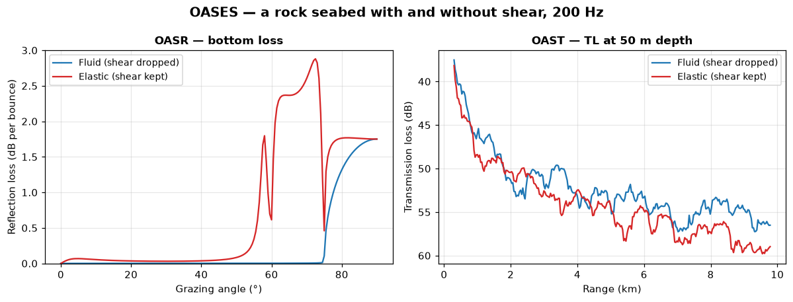
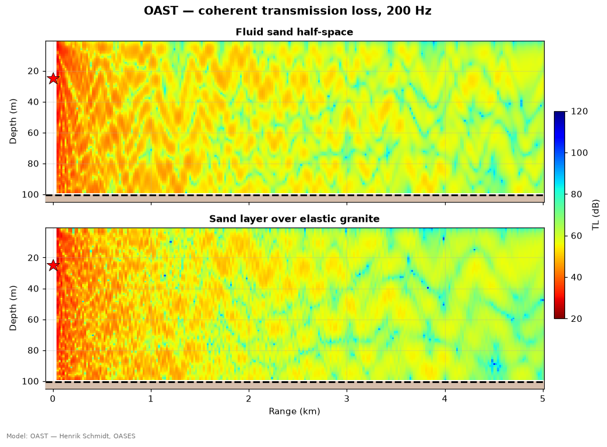
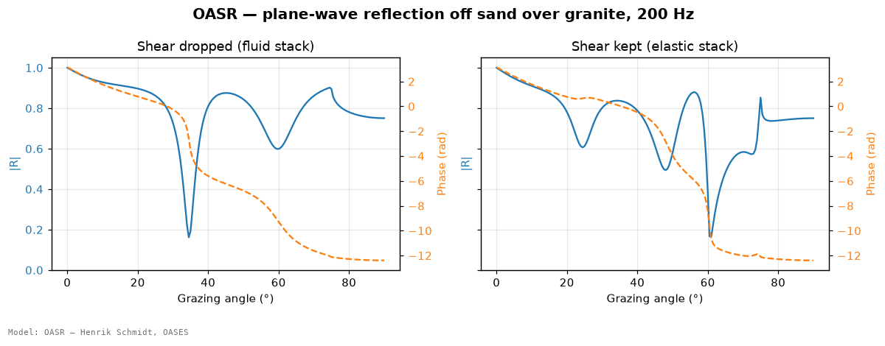
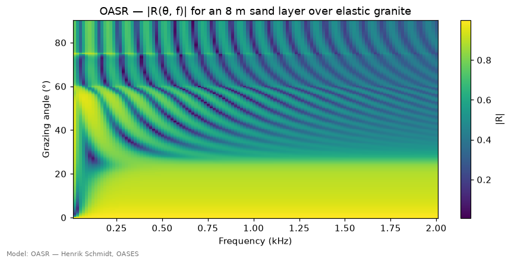
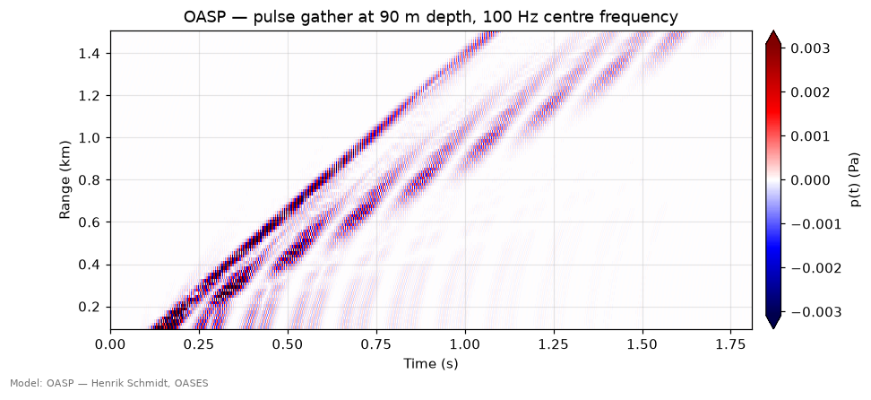
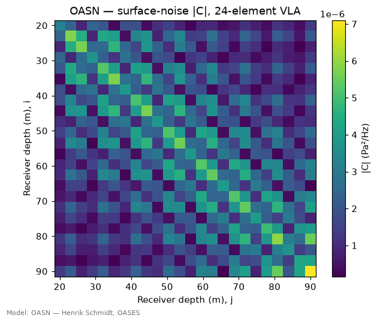
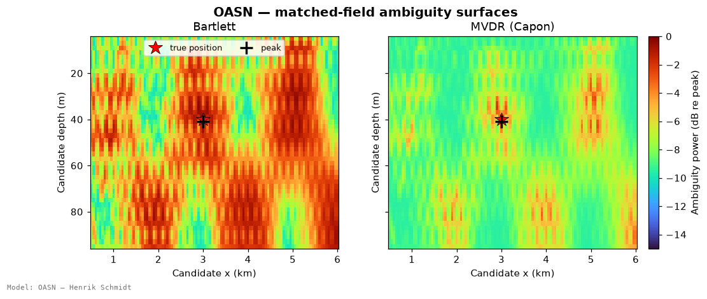

# OASES — seismo-acoustic wavenumber integration

> `uacpy.models.OAST` · `OASP` · `OASR` · `OASN` · `OASS` · `OASSP` · wraps Henrik Schmidt's
> OASES (MIT) · **not redistributable — [see §9](#9-licensing-and-installation)**

OASES is the package's most complete seabed physics. It solves the full
**elastic** wave equation in a stratified medium: compressional *and* shear
waves in every layer, converting into each other at every interface, plus the
**Scholte** interface wave that lives on a fluid–solid boundary and nowhere else
(Rayleigh on a free solid surface, Stoneley between two solids). It is evanescent
in both media, so only sources and receivers within a wavelength or so of the
seafloor see it — and because it exists at every frequency, an elastic waveguide
never truly cuts off.
[Scooter](scooter.md) shares the method and also accepts elastic layers; what
only OASES gives you is the rest of the seismo-acoustic toolkit built on that
kernel — reflection and transmission coefficients swept over frequency,
per-interface roughness, and the array covariance and matched-field replicas of `OASN`.

It is not one program but a suite, and uacpy wraps six of its executables —
they share an engine and an environment description, and differ only in what
they ask the engine for: [`OAST`](#5-oast--transmission-loss) for transmission loss,
[`OASP`](#7-oasp--pulses-and-broadband) for pulses,
[`OASR`](#6-oasr--reflection-coefficients) for reflection coefficients,
[`OASN`](#8-oasn--array-covariance-and-mfp-replicas) for array covariance and
matched-field replicas, and `OASS` / `OASSP` for rough-interface scattering.

---

## 1. What it solves

OASES computes the exact field in a **horizontally stratified**
seismo-acoustic medium by wavenumber integration, the same method
[Scooter](scooter.md) uses.

Each layer's displacement potentials are expanded in horizontal wavenumber.
For a given `k_r`, the depth-separated wave equation has closed-form
solutions in every layer, and the layers are stitched together by imposing
continuity of displacement and stress at each interface. That gives the depth
Green's function `G(k_r, z)`; the field follows from the Hankel transform

```
p(r, z) = ∫ G(k_r, z) · J₀(k_r · r) · k_r dk_r
```

evaluated by FFT. Turning the Hankel transform into a Fourier transform means
replacing `J₀` by its large-argument asymptotic form — the *fast field*
approximation — which is accurate except at ranges shorter than a few
wavelengths and at very steep propagation angles. Subject to that, and to the
wavenumber sampling and the truncation of the `k_r` interval, there is no ray
approximation, no one-way approximation and no mode truncation: **the answer is
the answer**. That is why OASES and Scooter are the two models to reach for when
you need to check something — and why you should not do the checking at 50 m
range.

The physics that makes this worth paying for happens *inside* the solid
layers. Sound reaching a solid seabed can be converted into a shear wave in
the solid, a **loss mechanism** for the water-borne field that a fluid seabed
does not have (Ainslie, *Principles of Sonar Performance Modelling*,
§8.1.3.1.2). In a rock whose shear speed exceeds the water's, the shear wave
is generated only above the shear critical angle, and below both critical
angles a lossless rock reflects totally (Ainslie §8.1.3.3); there the loss
comes from the rock's attenuations, and with `c_s > c_w` the shear
attenuation is an important parameter (Jensen et al., *Computational Ocean
Acoustics*, §1.6.2). Fluid-approximate the seabed and both the conversion and
the shear attenuation disappear:



Left: the plane-wave bottom loss of a granite seabed, computed twice — once
with the granite's shear speed dropped (what `from_preset` hands you unless
you ask for `elastic=True`) and once kept. Below its compressional critical
angle, `arccos(1490/5750) = 75°`, the wave is evanescent in the fluid rock and
the granite's small `αp = 0.1 dB/λ` costs only ~0.0015 dB per bounce — near
enough a perfect mirror, though it is the small `α` that makes it so, not the
evanescence. The elastic rock loses more than twenty times as much, ~0.035 dB:
below the shear critical angle no shear wave is generated, so that loss comes
from the attenuations, `αs` included. Above ~55° the loss climbs by more than
an order of magnitude, peaking near fifty times the sub-critical level either
side of the shear critical angle `arccos(1490/3000) = 60°`, above which a
propagating shear wave is generated — but dipping at 60° itself.

Right: the transmission loss that follows, averaged in intensity over 500 m so
you read the trend rather than the interference pattern. Hundredths of a dB
per bounce sounds like nothing until you count the bounces: a shallow-water
path reflects tens of times over 10 km, and the elastic answer ends up ~3 dB
darker. No amount of tuning a fluid model's attenuation reproduces the
*shape* of that curve, because the angular dependence is wrong.

**The price is stratification.** OASES is range-independent. Everything about
it — the closed-form layer solutions, the single Hankel transform — assumes
the medium varies only with depth. A sloping bottom or a range-varying SSP is
collapsed to one representative column, with a `FallbackWarning` naming what was
dropped. If your problem's range dependence matters more than its seabed
physics, use [RAM](ram.md) or [Bellhop](bellhop.md).

---

## 2. The six sub-models

| Class | `RunMode` | Returns | What it is for |
|---|---|---|---|
| `OAST` | `COHERENT_TL` | `Field` (`unit='dB'`) | Transmission loss over a depth × range grid |
| `OASP` | `COHERENT_TL` | `Field` (`kind='pressure'`) | Complex narrowband pressure |
| `OASP` | `BROADBAND` | `Field` (complex, `frequency` axis) | `H(d, r, f)` across a band |
| `OASP` | `TIME_SERIES` | `Field` (real, `time` axis) | `p(d, r, t)` — a synthetic seismogram |
| `OASR` | `REFLECTION` | `ReflectionCoefficient` | `R(θ)` or `R(θ, f)` off the layer stack |
| `OASN` | `COVARIANCE` | `Covariance` | `C(f, i, j)` across array elements |
| `OASN` | `REPLICA` | `Replicas` | Array response per candidate source position |
| `OASS` | `REVERBERATION` | `Field` (`kind='reverberation'`) | Reverberation loss vs range off a rough interface (larger = weaker scattered field, like TL) |
| `OASS` | `COVARIANCE` | `Covariance` | Spatial covariance of the reverberant field |
| `OASSP` | `BROADBAND` | `Field` (complex, `frequency` axis) | Scattered `H(d, r, f)` for one roughness realization |
| `OASSP` | `TIME_SERIES` | `Field` (real, `time` axis) | Scattered `p(d, r, t)` |

**`OASS` and `OASSP` are post-processors, and `run()` drives two binaries.**
Neither computes a field of its own: they integrate a *scattered* field over
the mean-field boundary operators a producer run leaves in a `.rhs` file
(written on unit 45 with option `'s'`). uacpy owns that chain — the producer
runs first into the same work dir, and its `.rhs` becomes the consumer's
`FOR045`. That is why `mean_field=` takes a whole configured model rather than
a file path: three of the guards (single frequency, frequency match to 0.1 %,
and a rough target interface **in the producer's deck**) cannot be checked
from a path alone, and each failure is one the binary reports as a Fortran I/O
error or a division by zero rather than as a diagnosis.

`OASS`'s reverberation `Field` is tagged `kind='reverberation'`, not left to
derive. It shares transmission loss's dB representation but is a different
quantity, so it must not land on one colour scale with a TL field — see
[results](../guide/results.md#2-field--one-container-described-on-three-axes).

Two knobs are physically significant rather than numerical:

- **`c_low`** defaults to the mean field's own and warns when it differs.
  Lowering it below the producer's is inert (measured 1e-4 dB) because
  `REVINT`/`REVCOV` bound their own buffer reads; **raising** it truncates the
  scattering integral and moved a measured case by **30 dB**.
- **`interface`** names the layer the roughness spectrum attaches to. Get it
  wrong and the interface carries a *positive* RG, which OASES reads as an
  infinite correlation length — `P(k)` collapses to a delta at `k=0`, so there
  is no back-scatter at all, from a run that exits 0 and writes a full set of
  curves. uacpy refuses an interface that names no rough boundary rather than
  let that through: the sea surface (deck layer 2) is accepted when the
  surface itself carries roughness, and every other non-bottom layer is
  rejected.

Volume scattering is deliberately unsupported: `OASSP` raises
`UnsupportedFeatureError` naming the SKW/M/RMS/GAM parameters instead of
half-implementing the 12-token record.

**The scattering writers refuse values the deck format cannot carry.** `RG` and
`CL` are written with `%.4f`, and OASES acts on what it reads, not what you
asked for: below 5e-5 m both round to zero, which OASES takes as a *smooth*
interface with an *infinite* correlation length — the exact opposite of the
request, returning a flat level with no error. A negative `correlation_length`
is refused too; OASES reads it as the flag for a longer volume-scattering
record and over-reads the deck. `OASR` inherits both through
`interface_roughness=`.

`OASS` also refuses two scattered-field products in one run — asking for the
covariance alongside a reverberation curve returns a silently **zero**
covariance — and a kernel plot (`I`/`S`/`c`) alongside any reverberation
letter, which OASES accepts and then never computes.

They subclass a common `OASES` base, so `isinstance(model, OASES)` is true for
any of them, but `OASES` itself is abstract: instantiate the program the table
above gives for the run mode (`uacpy.OASR()` for `REFLECTION`, …).

**OAST or OASP for transmission loss?** OAST writes only real TL in dB to its
`.plt` file — there is no complex pressure on disk, so there is no phase and
no way to interpolate cleanly through a sharp null. OASP writes complex
pressure to a `.trf`. Use OAST when you want a TL picture; use OASP when a
consumer needs phase — coherent array processing, or receiver ranges that do
not land on OAST's native FFT grid.

---

## 3. When to use it — and when not

**Use OASES when:**

- the seabed has **shear** — rock, consolidated sediment, ice — and you cannot
  honestly fluid-approximate it;
- the seabed is a **layer stack** and the layering matters (thin-layer
  resonance, a buried hard reflector);
- you want a **reference answer** with no ray, modal or one-way
  approximation in it;
- you have a **hydrophone array** and need the noise covariance or MFP
  replicas that go with it — OASN is the only model in uacpy that produces
  them.

**Reach for something else when:**

| Situation | Why OASES struggles | Use instead |
|---|---|---|
| Sloping bathymetry, range-varying SSP | Stratified solver; collapses | [RAM](ram.md), [Bellhop](bellhop.md) |
| You want ray paths or arrival stems | No geometry in the output | [Bellhop](bellhop.md) |
| You want the modes themselves | No modal decomposition | [Kraken](kraken.md) |
| Fluid seabed, high frequency (`D/λ ≳ 20`) | Wavenumber sampling grows with frequency; the ray answer is accurate here | [Bellhop](bellhop.md) |
| Only the boundary matters, and it is fluid or simply elastic | Overkill | [Bounce](bounce.md) |
| Commercial work | Licence — [§9](#9-licensing-and-installation) | [Scooter](scooter.md) for the fluid case |

---

## 4. Environment support

All six sub-models consume the same environment, and they all consume the
seabed the same way:

| Feature | Native? | Note |
|---|---|---|
| Layered bottom | ✅ | any number of layers, written verbatim |
| Elastic media (shear) | ✅ | **the reason this model exists** |
| Rough surface / bottom (`sigma`) | ✅ | both interfaces; `OASR` also takes an explicit per-interface `interface_roughness` |
| Range-dependent bathymetry | ❌ | collapsed to `max` depth |
| Range-dependent SSP | ❌ | collapsed |
| Range-dependent bottom | ❌ | collapsed to the median column |
| Sea-surface altimetry | ❌ | dropped |
| Rigid sea surface | ❌ | refused (`UnsupportedFeatureError`) by `run()`, `run_settings()` and `validate_inputs()` alike, as a rigid seabed is: OASES has no rigid boundary. Pass a vacuum surface, an explicit fluid/elastic half-space, or use Kraken / Scooter / Bellhop, which take a rigid boundary |
| Multiple source depths | ❌ | one depth per deck; `run()` loops and stacks in the field modes (OAST / OASP / OASSP), OASN / OASR / OASS raise |

Collapse defaults, where they differ from the package-wide ones: `OAST`,
`OASP`, `OASN`, `OASS` and `OASSP` take the **mean** SSP (`ssp='mean'`); `OASR`
takes the package-wide `'r0'`, and every sub-model the package-wide
`bottom_range='median'`.

OASR leaves the SSP alone because the water sound speed barely enters a
reflection coefficient; the layer stack is the whole answer. The layer stack
itself is **never** collapsed — `bottom_layers` stays intact for every OASES
sub-model.

### Keeping shear on the environment

`uacpy` drops shear by default when you build a seabed from presets, so that
the same `Environment` works with every model. Pass `elastic=True` to keep it:

```python
env = uacpy.Environment(
    name='Sand over granite (elastic)',
    bathymetry=100.0,
    ssp=[(0.0, 1500.0), (100.0, 1490.0)],
    bottom=uacpy.SeabedColumn.from_presets(
        layers=[('sand', 8.0)], halfspace='granite', elastic=True,
    ),
)
```

Without `elastic=True` the granite is a fast fluid: right compressional
speed, right density, no shear. That is a perfectly good approximation for
many problems, and it is what the shared `layered_elastic` scenario in
[`docs/figure_scripts/_common.py`](../figure_scripts/_common.py) uses. It is
not what you want from a page about OASES.

### Receivers inside an elastic layer

`OAST`, `OASP` and `OASSP` ask OASES for its output parameter `K`, the bulk
pressure: in a fluid the kernel sets it to minus the normal stress, the
acoustic pressure (`oasaun31.f:1448-1449`, `:1471-1472`), and in a solid it is
the bulk pressure of the compressional potential alone (`oasaun31.f:1509-1513`;
oasp.tex:178-183). uacpy returns it as the pressure, in the water and in the
seabed. (oast.tex:161-165 and oassp.tex:145-150 describe `K` as the bulk
*stress*, the negative of the pressure; the vendored kernel computes the
pressure, `:1510` "changed to pressure from stress", and a run confirms it:
OASP's `K` equals minus its `N` in the water, bit for bit.)

A raw `options` line may ask for the normal stress `N` instead: σzz, −p in a
fluid (oasp.tex:185), which uacpy negates. In the water the two are the same
numbers. Inside an elastic layer or half-space they are not: OASES builds σzz
in a solid from both the compressional and the shear potentials
(`oasaun31.f:1489-1491`). Measured on 100 m of 1500 m/s water over a
half-space with cp 2000 m/s, cs 800 m/s, ρ 2.0 g/cm³ and 0.5 dB/λ on both
attenuations, source at 50 m, 100 Hz, ten ranges 200-2000 m: OAST's `N` and
`K` TL agree to 0.000 dB at 20, 50 and 90 m depth and differ by a median
3.65 dB (max 18.5 dB) 10 m into the seabed and 3.89 dB (max 15.2 dB) 30 m
into it; OASP's complex field over 80-120 Hz differs by a median 3.2 and
5.7 dB there. The
gap depends on the seabed attenuation (with both attenuations 0 the medians
are 2.55 and 2.85 dB). A raw line asking for a velocity or another stress
(`V`, `H`, `R`, `S`), or for `N` and `K` together, is refused on every model:
its numbers would be labelled `kind='pressure'`.

`OASN` and `OASS` have no `K`: they take the output parameter from the
receiver type, and a hydrophone selects the normal stress (`oasnun22.f:100-105`;
OASS's option scan ends on it, `unoass21.f:694-696`). Both return −σzz: the
pressure in the water, and inside an elastic layer the negated normal stress,
not the pressure — the gap measured above for OAST's `N` applies to a buried
OASN array's covariance and replicas and to an OASS covariance there.

---

## 5. OAST — transmission loss

Every figure on this page comes from
[`docs/figure_scripts/oases.py`](../figure_scripts/oases.py) — the code below
is that code, so it cannot drift from what you see.

```python
import numpy as np
import uacpy
from uacpy.models import OAST, RunMode
from figure_scripts._common import shallow_water

env, source, receiver = shallow_water()
tl = OAST().run(env, source, receiver, run_mode=RunMode.COHERENT_TL)
tl.plot(env=env, source=source)
```



The top panel is the same 100 m channel at 200 Hz that the
[Bellhop](bellhop.md) and [Kraken](kraken.md) pages draw — flip between them
and you are comparing three methods on the same water, not three setups. The
bottom panel swaps in an 8 m sand layer over an elastic granite basement.
Same source, same receivers, same water column; the interference structure
inside 2 km is visibly finer, because the hard basement supports more trapped
paths, and beyond 3 km the median TL is ~1.5 dB darker as shear conversion
drains them.

`OAST` returns a **real-dB** `Field` (`unit='dB'`). Every other TL mode in
uacpy — including `OASP`'s — hands back complex pressure, so this is the one
result you cannot take a phase from. Use `OASP` when you need one.

---

## 6. OASR — reflection coefficients

`OASR` computes the plane-wave reflection coefficient of the layer stack
alone. No propagation, no source, no range axis — just `R(θ)`, or `R(θ, f)`
when you sweep frequency.

```python
from uacpy.models import OASR, RunMode

angles = np.linspace(0.0, 90.0, 181)
rc = OASR(angles_deg=angles).run(env, source, receiver,
                             run_mode=RunMode.REFLECTION)
rc.plot(show_phase=True)
```



The same 8 m sand layer over granite, computed with shear dropped (left) and
kept (right). Both show the layer's own interference structure — the deep null
at 34.5° in the fluid case is the sand layer resonating, and it slides along
the angle axis if you change the thickness. Keeping shear rearranges the whole
pattern: the deepest null moves to 60.5°, essentially the granite's shear
critical angle (`arccos(1490/3000) = 60.2°`), and it tracks the *shear
speed* rather than the layer thickness. Across 20°–60°, the angles that carry
energy in a shallow-water waveguide, the elastic seabed reflects markedly
less — `|R|` at 45° falls from 0.88 to 0.62.

Sweep frequency and the layer's resonances become a fan. OASR reads its band
from the source:

```python
band = uacpy.Source(depths=source.depths,
                    frequencies=np.linspace(20.0, 2000.0, 120))
rc = OASR(angles_deg=angles).run(env, band, receiver,
                             run_mode=RunMode.REFLECTION)
rc.plot()
```



`ReflectionCoefficient.plot()` switches from line to heatmap on its own when
the result is broadband. `R` is stored `(angle, frequency)`, and the plotter
reads that layout rather than inferring it from which axis length happens
to match, so `angle_on_x=True` transposes safely — use it to stand the map
beside a single-frequency \|R(θ)\| panel on one shared abscissa, with
`frequency_unit='Hz'` when the band is tens to thousands of hertz rather
than kilohertz. Read the picture as: above about 300 Hz and below the
sand's critical angle, `arccos(1490/1650) = 25.4°`, the stack is a near-perfect
mirror; past the critical angle each fringe is another half-wavelength fitting
into the 8 m layer, so the fringes crowd together as frequency rises. A seabed's
*thickness* is written all over its reflection coefficient, and that is what
geoacoustic inversion keys on.

The dark patch at the left edge is physics, not noise: below ~300 Hz the 8 m of
sand is thin compared with the wavelength, the wave reaches the elastic granite
beneath, and shear conversion there leaks hard even at sub-critical angles —
`|R|` falls to ~0.35 near 100 Hz where its high-frequency limit is ~0.95. A
homogeneous half-space has no length scale and would show none of this.

**OASR versus [Bounce](bounce.md).** Both return a `ReflectionCoefficient`.
Bounce comes from the Acoustics Toolbox and is what [Bellhop](bellhop.md)
calls automatically when it meets a seabed it cannot represent. On a **fluid**
seabed the two are interchangeable: over the shared sand half-space their
`|R(θ)|` differ by at most 0.0012 across the whole angle range, and by 0.005
over the fluid sand-over-granite stack — and there the disagreement is
concentrated on the flank of the null, where the two angle grids differ most.
Shear is where they part company: both accept elastic layers and both return
the P-P coefficient (a P-SV coefficient reflected into the water is identically
zero, so OASR refuses it — see §10), but where the seabed has shear, do not
assume the two agree to the fluid tolerance; run both. OASR also returns the
transmission coefficient and sweeps frequency in one run, which BOUNCE does
not.

---

## 7. OASP — pulses and broadband

`OASP` runs the same wavenumber integration across a frequency sweep and
inverse-transforms it, which makes it uacpy's exact transient solver for a
stratified elastic medium.

```python
from uacpy.models import OASP, RunMode

source = uacpy.Source(depths=25.0, frequencies=100.0)
receiver = uacpy.Receiver(depths=90.0,
                          ranges=np.linspace(100.0, 1500.0, 96))

sample_rate = 800.0
t = np.arange(96) / sample_rate
t0 = t[len(t) // 2]
pulse = (np.sin(2 * np.pi * 100.0 * (t - t0))
         * np.exp(-((t - t0) ** 2) / (2 * 0.012 ** 2)))

ts = OASP(n_time_samples=512).run(
    env, source, receiver, run_mode=RunMode.TIME_SERIES,
    source_waveform=pulse, sample_rate=sample_rate, output_duration=1.2)
ts.at(depth=90.0).plot()
```



Slicing the time-series `Field` at one depth leaves a `(range, time)` gather —
a synthetic record section. Each band is one multipath family, and they all
advance at roughly the water sound speed, so the bands run near-parallel; the
later ones are higher-order bounces, and the spread between first and last
arrival grows from about 0.28 s at 200 m to 0.66 s at 1.5 km. Pass
`stacked=True` instead of the default heatmap to draw it as offset traces, the
classic seismic waterfall.

`RunMode.BROADBAND` returns the transfer function `H(d, r, f)` without
synthesising anything. Slice it to a point and `.plot_transfer_function()`
behaves exactly as it does for [Bellhop](bellhop.md), and
`.to_time_trace(sample_rate=fs).plot_impulse_response()` draws its `h(t)`. See
[broadband and time series](../guide/results.md) for how the two modes relate.

**On frequency grids.** OASP expresses its band as `(freq_min, freq_max, N)`, so it
always runs an *equispaced* sweep. A single-frequency `COHERENT_TL` run
narrows it to the bin OASP's ladder puts on the source frequency (`FR1 = f`,
`unoasp22.f:237-248`), so it integrates one or two bins and returns complex
pressure, where [`OAST`](#5-oast--transmission-loss) returns real dB. In `TIME_SERIES` mode uacpy derives that
band from the source waveform's own spectrum and tells you what it picked;
pass `frequencies=` to pin it yourself. A non-equispaced `frequencies=` vector
(OASP) or `source.frequencies` (OASR) is refused, with a remedy naming the
`np.linspace` grid, because the deck carries a sweep as its edges and a count
(`unoasp22.f:176`, `unoasr21.f:116`); under OASR's option `'C'` a vector that
is not log-spaced is refused with an `np.geomspace` remedy. The default sweep
starts at `0`, so its lowest bins are computed too: on example 13's case (100 m
of water over a 400 m/s-shear half-space, `n_time_samples=1024`,
`freq_max=120`, the derived `c_low` 340 m/s), the 1.406 Hz bin returned
\|H\| of 3.5e22 to 2.4e23 Pa at the receiver 5 m above the seabed, against at
most 0.0087 Pa everywhere else; `c_low=1350` or `freq_min=2` removes it (largest
\|H\| 0.0065 Pa). Example 13 starts its band at its pulse's lower edge
(`freq_min=30`).

---

## 8. OASN — array covariance and MFP replicas

`OASN` is the sub-model with no counterpart anywhere else in uacpy. It models
an **array**, not a field, and it produces the two frequency-domain quantities
array processing runs on.

### Covariance — what the array measures

`RunMode.COVARIANCE` gives `C(f, i, j)`, the element-by-element cross-spectral
matrix, built from a noise field you specify: surface-generated noise, a deep
broad-area sheet, uncorrelated white noise per hydrophone, and any number of
discrete point sources.

```python
from uacpy.models import OASN

array = uacpy.Receiver(depths=np.linspace(20.0, 90.0, 24), ranges=0.0)
cov = OASN(surface_noise_level_dB=60.0,
           white_noise_level_dB=20.0).compute_covariance(env, source, array)
cov.plot()
```



The covariance is in Pa²/Hz, the unit of a `csdm()` of Field pressures, and
the diagonal is each element's power. Off the diagonal is the vertical spatial
coherence of the noise field, and it does not simply decay — it oscillates with
separation. Normalised as `|C_ij| / √(C_ii C_jj)` and averaged over the element
pairs at each spacing, it runs 1.00, 0.61, 0.32 and 0.80 at 0, 3.0, 6.1 and
9.1 m, and peaks again every third element, at 9.1 and 18.3 m, which is the
checkerboard you see. The normalisation matters here: this array's diagonal is
not flat (it varies by 3.6 dB, also every third element), so dividing the
first row by `C₀₀` instead gives a visibly different 1.00, 0.74, 0.28, 0.78. A noise field
with vertical structure looks nothing like the white `σ²I` a naive beamformer
assumes, and that difference is where array gain is won or lost — see
[array processing](../guide/arrays.md) for what to do with it.

### Replicas — what the array *would* measure

`RunMode.REPLICA` sweeps a grid of candidate source positions and, for each,
returns the array response. Those are matched-field templates.

```python
replicas = OASN(replica_xmin=500.0, replica_xmax=6000.0, replica_nx=111,
                replica_zmin=5.0, replica_zmax=95.0, replica_nz=46).compute_replicas(env, source, array)
```

The grid is a **constructor** argument, not a `run()` argument — like every
model knob in uacpy. Sweep it with `model.copy(replica_nx=...)`.

### Matched-field processing

Contract a measured covariance against the replica field and you have located
the source. `Covariance` carries both standard processors:

```python
cov = OASN(
    white_noise_level_dB=40.0,
    discrete_sources=[{'depth': 40.0, 'x': 3000.0, 'y': 0.0, 'level_dB': 100.0}],
).compute_covariance(env, source, array)

bartlett = cov.bartlett(replicas)   # ambiguity Field on (frequency, depth, x, y)
capon = cov.mvdr(replicas)
```



Both surfaces peak on the true source — 3 km out, 40 m deep — but they are
not equally sharp. Bartlett is the matched filter: robust, and broad, with a
−3 dB main lobe spanning most of the range axis. MVDR (Capon) puts nulls on
everything that is not the replica, tightening the peak to about 2 km of range
at the cost of being far more sensitive to environmental mismatch. That is the
whole trade in MFP.

[`uacpy.sonar`](../guide/sonar.md) owns matched-field processing proper —
replica banks from any model and mismatch, one frequency per surface (a
broadband processor combines the per-frequency surfaces itself). OASN
is where the replicas come from when you want them computed by a full elastic
model.

---

## 9. Licensing and installation

**OASES is not redistributable.** It is Henrik Schmidt's code, released under
an academic arrangement with no formal open licence, and uacpy neither bundles
nor ships the binaries. Every other engine in the package is installed by
`./install.sh`; OASES is downloaded from MIT and built locally, and only if
you ask:

```bash
./install.sh --oases yes
```

That fetches `oases.tar.gz` from
[acoustics.mit.edu](https://acoustics.mit.edu/faculty/henrik/oases.html),
verifies it, builds it, and installs the executables to `uacpy/bin/oases/`.

Constructing any OASES sub-model emits a one-time `ProvenanceWarning` naming the
licence and the citation. It is deliberate: **verify the terms yourself before
using OASES in commercial work.** For a fluid seabed, [Scooter](scooter.md)
solves the same wavenumber integral under a permissive licence.

If the binaries are absent, the **constructor** raises
`ExecutableNotFoundError` — not `run()`:

```
ExecutableNotFoundError: OAST executable not found: oast_bash

Searched in:
  • .../uacpy/bin/oases/oast_bash
  • .../uacpy/bin/oases/oast
  ...
```

which is the answer to "why does `OAST()` fail on a machine where Bellhop
works". Rerun `install.sh --oases yes`. uacpy prefers the `<name>_bash`
wrapper OASES ships and falls back to the bare binary, searching
`uacpy/bin/oases/`, `uacpy/bin/oalib/`, `uacpy/third_party/oases/bin/` and
finally `PATH`.

---

## 10. Constructor knobs

Everything is configured on the constructor; `run()` has a fixed signature.

**Shared by all six** — `executable`, `options`, `work_dir`, `cleanup`,
`timeout`, `verbose`, `use_tmpfs`, `collapse`. `timeout` is the wall-clock
limit (s) of each binary launch, 600 by default (uacpy guidance), positive and
finite or `None` for no limit.

`options` is the raw OASES option line. On `OAST` and `OASR` it *replaces* the
derived line, so passing it alongside a typed flag that would have contributed
a letter (`complex_contour`, `compute_contour`, `compute_depth_average`,
`reflection_type`) raises `ConfigurationError` rather than silently discarding
one. An OAST line without `'T'` is refused: OAST writes the TL table uacpy
reads only under `'T'` (`unoast31.f:1036-1038`, `:629`).

On `OASN` it is additive: the line you pass is written as given, with the run
mode's own letter (`N` for covariance, `R` for replicas) appended when the line
lacks it. The order is kept because OASN takes the source directionality order
from the first digit on the line (`unoasn22.f:719-725`). A replica run gets no `N`:
under it OASN integrates the noise covariance (`unoasn22.f:172-174`), which a
replica run does not return, so a noise field given to a replica run is
noticed as unused.

**`OAST`**

| Name | Default | Meaning |
|---|---|---|
| `complex_contour` | `None` | The `'J'` option — complex integration contour; unset → `True`, giving the option line `K T J`: the manual's worked OAST deck `N I T J Z` (`oast.tex:476`) with the bulk pressure `K` in place of the normal stress (§4 "Receivers inside an elastic layer") and without its plot-only letters. |
| `compute_contour` | `None` | `True` is refused (`ConfigurationError`): `'C'` writes range–depth contour files on units 28/29 (`unoast31.f:332-334`) that hold, decimated in range, the TL the returned Field already holds (`unoast31.f:776-797`), and uacpy reads none of them. Unset or `False` adds no `'C'`. |
| `compute_depth_average` | `None` | `True` adds `'A'`: OAST also computes the depth-averaged TL, `-10·log10` of `|p|²` averaged with equal weights over every receiver depth (`oasfun22.f:209-242`; "the averaging is performed over the specified number of receivers", `oast.tex:144-146`), returned as `result.components['depth_average']` — a real dB Field on `range`, OAST's native range grid. Unset → `False`. |
| `integration_offset` | `0.0` | Wavenumber-contour offset (dB/wavelength). `0` asks OASES for its own offset, 60 dB at the longest FFT range, which the manual recommends: "This value is the default which is applied if COFF is specified to 0.0." (`oast.tex:293-303`). |
| `n_wavenumbers` | `None` | Wavenumber samples; `None` lets OASES choose: `NW = -1`, the automatic sampling the manual offers "to obtain correct answers in the first attempt without the usual convergence testing" (`oast.tex:543-550`). The manual requires a power of two (`NW = 2^M`, `oast.tex:73`); another count is refused with a `ConfigurationError` naming the two neighbouring powers, since OAST cuts the integral at the deck's count before rounding its grid up (`unoast31.f:441-458`). A pinned count is written as given, with an info-level note (`verbose='info'`) that the manual leaves it to the convergence test; OASP and OASSP say the same of theirs (`oasp.tex:671-674`, `oassp.tex:511-515`). |
| `integration_window` | `None` | `(IC1, IC2)`, the first and last wavenumber samples integrated: the samples outside are zeroed and the edge smoothed (`oast.tex:528-538`); two whole numbers with `1 ≤ IC1 ≤ IC2 ≤ n_wavenumbers` (`oast.tex:74-75`), refused otherwise, since OAST would clamp them without a word (`unoast31.f:436-437`). It applies with a pinned `n_wavenumbers`; under automatic sampling "the parameters IC1 and IC2 have no effect" (`oast.tex:548-549`) and the run says so. `None` integrates the whole window, `1 NW`. `run_settings.engine.integration_window` records the pair the deck carries. |
| `c_low`, `c_high` | `None`, `None` | `CMIN` / `CMAX` (m/s), the phase-speed window. `None` derives `c_low` by the rule every wavenumber-integration engine shares: 0.90 × the slowest wave of the problem — the water, each sediment layer, each half-space, a shear speed wherever it is non-zero, and every Scholte wave a liquid carries against a solid, solved from Brekhovskikh & Lysanov §3.4.2, eq. 3.4.29 (the margin of `scooter.f90:258`, "some 10% below"; Jensen et al., *Computational Ocean Acoustics*, ch. 4 App. 1, call `k_max ≈ 1.1 ω/c_min` "in general, conservative"; the OASES manual states no rule and its worked decks pin CMIN by hand), so an elastic seabed's shear and interface branches enter the integral; a Stoneley wave (between two solids) is not solved. `c_high` is `1e8`, the CMAX of the manual's worked decks (`oast.tex:487`, `:568`). `run_settings.engine.c_low_origin` names the medium or wave the derived value came from. A pinned window whose lower edge lies above a solved Scholte wave gives a `NumericsWarning` when the source or a receiver lies within one of its wavelengths of the interface. That edge is `c_low` itself under a pinned `n_wavenumbers` (`unoast31.f:432-433`); under automatic sampling it is the `CMIN` OAST's AUTSAM settles on for the deck (`unoast31.f:1202-1224`: `2π f / WNMAX`, from `c_low`, the range axis `range_min`–`range_max`, the source layer's speed and a power-of-two count), which on a short range axis lies far under `c_low` — 187.5 m/s for `c_low = 1380` over limestone, ranges to 2 km at 30 Hz — and a wave between `c_low` and that edge sits inside the taper zone OAST integrates past `ω/c_low` (`oaseun31.f:2157-2159`): it is attenuated by the taper, not left out, and is not told. OASP gives the same notice on the edge its deck reaches at the band top FREQM — AUTSAM's window `2π·FREQM/c_low` plus its taper (`unoasp22.f:1125`), or `c_low` under a pinned count, fixed in wavenumber over the band, so the notice also names the frequency below which the wave is inside — and OASN on each integration its deck carries: `c_low` for the surface- and deep-noise sheets (`oasnun22.f:284`, `:333`), AUTSMN's `CMIN` on the farthest discrete source (`oasnun22.f:422-447`), `c_low` for replicas under a pinned count (under automatic sampling the replica edge rests on a range minimum OASN never sets, `unoasn22.f:233-234`, and is not stated); OASS and OASSP keep their own rules. |
| `range_min`, `range_max` | `None` | First and last range (m) of OAST's native TL grid, `XLEFT` / `XRIGHT`; `None` → 0, the manual's worked deck (`oast.tex:489`), and the farthest receiver, the range OAST's automatic sampling sizes its wavenumber step against (`unoast31.f:427-430`). |
| `vrec` | `0.0` | Source/receiver velocity (m/s) of the dynamics option `'d'` (Block III `V`, `oast.tex:37`: source and receiver move at the same speed, `V` its projection on the line joining them, `oast.tex:215-222`); read only under a raw `options` carrying `'d'`, refused non-zero otherwise. `0` is uacpy guidance: a stationary source and receiver (the manual gives no value). |
| `dip_angle_deg` | `None` | Fault dip angle (degrees) of the dip-slip source option `'4'`; refused without it. |

**`OASP`**

| Name | Default | Meaning |
|---|---|---|
| `n_time_samples` | `None` | FFT length, a power of two (`oasp.tex:129`: NT = 2^M; any other count is refused). `None`: 4096 for the default sweep (uacpy guidance: the manual's worked decks use 2048, `oasp.tex:583`, and 1024, `oasp.tex:773`); for a requested band (`frequencies=`, a TIME_SERIES pulse, COHERENT_TL's source frequency) the smallest power of two whose bins are as fine as the requested spacing. A value set is written as given on every sweep; when its bins are coarser than the requested spacing, a `NumericsWarning` names the count that reaches it. |
| `freq_min`, `freq_max` | `None`, `None` | Sweep edges (Hz); `None` derives `0` and `2.5 × fc`. A pinned edge that differs from a band the call names (`run(frequencies=)`, a multi-frequency `Source`) is refused, naming both; beside a band the run derives (a `TIME_SERIES` pulse, `COHERENT_TL`'s source frequency) it gets a notice that it is not used. `0` and `2.5 × FRC` are the manual's worked OASP deck (FRC 5 Hz at `oasp.tex:572`, `0.0 12.5` at `oasp.tex:583`). |
| `fc` | `None` | Pulse carrier; defaults to the midpoint of the run's frequency band (a single frequency is its own centre). The manual's FRC, "Center frequency of source" (`oasp.tex:84`); OASP only records it (`oasp.tex:278-280`), uacpy derives `freq_max` from it. |
| `integrand_plot_step` | `None` | `INTF`, the integrand-plot decimation (`unoasp22.f:591`); does **not** thin the `.trf`. `None` writes 0, the manual's worked deck (`oasp.tex:582`; `:772` writes 1): no integrand plots and none of the `.plp`/`.plt` plot files a value > 0 turns on (`unoasp22.f:173`). A whole number ≥ 0. |
| `integration_offset`, `n_wavenumbers` | `0.0`, `None` | As OAST. |
| `integration_window` | `None` | As OAST: the transform is Hanning-windowed outside `IC1..IC2` (`oasp.tex:652-660`, bounds `:123-124`); no effect under automatic sampling (`oasp.tex:677-678`). |
| `c_low`, `c_high` | `None`, `None` | As OAST: the derived `c_high` is `1e8`, the CMAX every worked OASP deck in the manual writes (`oasp.tex:581`, `:695`, `:771`). |
| `dip_angle_deg` | `None` | As OAST. |

**`OASR`**

| Name | Default | Meaning |
|---|---|---|
| `angles_deg` | `linspace(0, 90, 181)` | Angle grid, degrees: the grid of the manual's worked OASR deck (`0 90 181 0`, `oasr.tex:373`). |
| `angle_type` | `'grazing'` | `'grazing'` (native, OASR's default axis: `oasr.tex:151-152`) or `'incidence'`. |
| `reflection_type` | `None` | `'P-P'` (unset → this, OASR's default: `oasr.tex:138-140`), `'transmission'` (P-P, letter `'t'`) or `'P-SV transmission'` (letters `'S t'`); `'P-SV'` / `'P-Slow'` (Biot) are refused — see below. |
| `plot_angle_step` | `None` | Decimation of the angle axis of OASR's **plot** (the `.rco` / `.trc` tables carry every angle); `None` → `max(1, n_angles // 10)` (uacpy guidance: plot only, `unoasr21.f:160-168`); a whole number ≥ 0, `0` leaving the plot out. |
| `plot_frequency_step` | `None` | `NFOU` (`unoasr21.f:116`), the same decimation for OASR's reflection-vs-frequency **plot**; `None` → `max(1, n_frequencies // 10)` (uacpy guidance); a whole number ≥ 0, `0` leaving the plot out. |
| `interface_roughness` | `None` | Per-interface RMS roughness (m), top → bottom. |

`reflection_type='P-SV'` and `'P-Slow'` raise `UnsupportedFeatureError` at
construction. `'P-Slow'` selects the Biot slow wave, and **no uacpy carrier
can express a poro-elastic medium** — `SedimentLayer` and
`BoundaryProperties` carry no porosity, permeability, tortuosity, frame
moduli or pore-fluid modulus. `'P-SV'` asks for an SV wave reflected back
into the incident medium, and at the seabed that medium is the water column,
a fluid, which carries none. Either way OASES would return a column of zeros
dressed as a result, so the refusal is up front. The raw `options='S T'`
escape hatch still runs P-SV: the deck is written verbatim, with a
`ValidityWarning` that the zeros are coming. The P-SV *transmission*
coefficient into the seabed is not zero: `reflection_type='P-SV transmission'`
writes `'S t'` (oasr.tex:142-145, `unoasr21.f:356-376`), and the result — or
a raw `options='S t T'` run — is labelled `reflection_type='P-SV
transmission'`, apart from the P-P `'transmission'`.

**`OASN`**

The array is written as hydrophones (receiver type 1): OASN exposes no
geophone type of its receiver block (`oasn.tex:225-246`); `receiver_gains_dB`
sets its gains. `run_settings(...).engine` records every value the deck
is written from: the phase-speed window with `c_low_origin` / `c_high_origin`,
the deep sheet's depth and, on a `REPLICA` run, the replica grid's bounds and
counts.

| Name | Default | Meaning |
|---|---|---|
| `surface_noise_level_dB` | `0.0` | Surface-generated noise (dB re 1 µPa²/Hz), written exactly as given; a magnitude below 0.01 (OASN's single-precision gate, `oasnun22.f:183`) disables it, so 0.03 dB is on. A negative level at or beyond −0.01 is refused: OASN reads it as a spectrum-file unit (`oasnun22.f:191-193`). |
| `white_noise_level_dB` | `None` | Uncorrelated per-hydrophone noise. OASES adds it to the covariance diagonal unconditionally, so an explicit `0.0` is a literal 0 dB per sensor; `None` writes −200 dB (numerically nil; uacpy guidance — the manual gives no level, its worked deck writes 50 dB, `oasn.tex:475`). |
| `deep_noise_level_dB`, `deep_source_depth` | `0.0`, `None` | Deep broad-area sheet; `deep_source_depth=None` → half the water depth, uacpy guidance (the manual names DPSD only as "the depth of the deep noise source sheet", `oasn.tex:334-335`). OASES computes the sheet with two defects in its deep loop, which uacpy keeps. The plane-geometry flag `ICDR = 1` is set only for surface noise (`oasnun22.f:509-511`), while the deep loop divides by `SQRT(FREQ/V)` as for plane geometry (`:705`; `PINIT2` multiplies by it only under `ICDR = 1`, `oaseun31.f:1701-1709`): with surface noise off, the level reads `10·log10(c/f)` dB high, `c` the sound speed at the sheet (11.8 dB at 100 Hz in 1500 m/s water). The deep loop also sets `ICUT1` / `ICUT2` but not the taper window `ICW1` / `ICW2` (`:713-714`; the surface loop sets both, `:591-594`), so `CALIN3` tapers each deep band from a stale index (`oaseun31.f:2157-2158`) — as a measured illustration, 3.5-5.3 dB at a receiver 30 m above a mid-depth sheet, moving with `c_low`. Against the same sheet computed without both defects, whose depth shape then matches a normal-mode sum to 0.04 dB, a deep-only run reads −12 to +10 dB (100 m and 2000 m columns, 25-400 Hz). The deep block's discrete band spans `1/CMX` to `1/CMX` (`oasnun22.f:349`; the surface block's ends at `1/CMN`, `:299`), so its samples are weighted by zero. |
| `discrete_sources` | `None` | List of `{'depth', 'x', 'y', 'level_dB'}`, metres and dB. Any other key raises — OASES carries no per-source phase. `'depth'`, `'x'` and `'level_dB'` are required (NOIPAR reads a position and level for every source, `oasnun22.f:380`, and they have no default); a missing `'y'` is 0, the source on the array's x axis (uacpy guidance). The deck lists them farthest from the array origin first, whatever their order here: under automatic sampling (`n_wavenumbers=None`) OASN sizes the discrete-source wavenumber step from the FIRST record only (`oasnun22.f:426-428`, AUTSMN `:1693`), so a source listed after a nearer one could lie beyond the range period `2π/Δk` of the wavenumber sum and wrap back into the window (JKPS §4.5.3); the covariance is a sum over the sources (`oasnun22.f:1291`), and each source's depth, position and level move with its record. The first record also sets AUTSMN's `RMIN` (a tenth of its range, `:428`) and with it `WM = 2π/DR` (`:1697-1698`), which can carry the top wavenumber past the `c_low`..`c_high` window but never under it (`:1702`). Measured (100 m water over a 1700 m/s fluid half-space, 100 Hz, 9-element VLA, 100 dB sources at 0.5 and 6 km): with the nearer source listed first, OASES returned a covariance diagonal 12.6-31.7 dB above the farthest-first one, which matches the sum of the two single-source runs within 0.53 dB. |
| `receiver_gains_dB` | `None` | Per-element gain (dB) of the array records' `GAIN` column (`oasnun22.f:36`), one value or one per element; `None` writes 0 dB. OASN applies `10^(GAIN/20)` to the signal and the ambient noise (`oasnun22.f:99`, `:1084`, `:1108`, `:1247`, `:1259`) but not to the white noise ("Note that the gain is not applied to the white noise!", `oasn.tex:242-244`); on the replicas only the direct (Filon) integration applies it (`oasmun21_bin.f:136`; the FFT-interpolation branch, `:127`, does not). |
| `replica_xmin`/`replica_xmax`/`replica_nx` | `None`/`None`/`None` | Replica grid in x (m); `None` → 100 m / 10 km / 50 points, uacpy guidance like the z values below (OASN reads the whole grid from the deck and has no default, `unoasn22.f:184-186`). A pinned count `replica_nx` / `ny` / `nz` is a whole number ≥ 1; any replica knob pinned on a `COVARIANCE` run, which reads no replica grid, is noticed. Under automatic sampling (`n_wavenumbers=None`) the replica integration's lower edge is not known: AUTSMN takes `RMIN` from `rmins`, which OASN reads in its `MIN` before ever setting it (`unoasn22.f:233-234`), so uacpy gives no Scholte-wave notice there — the vendored build integrated the replicas only down to 293.04 m/s for `c_low = 600` on the default 10 km grid, above the 265.8 m/s Scholte wave of a cs 300 m/s sediment. Pin `n_wavenumbers` for replicas over an elastic seabed: the replicas are then integrated from `c_low` as given (`unoasn22.f:243-244`) and a wave above it is told. |
| `replica_ymin`/`replica_ymax`/`replica_ny` | `None`/`None`/`None` | Replica grid in y (m); `None` → 0 / 0 / 1 point, as the manual's worked deck (`oasn.tex:491`). |
| `replica_zmin`/`replica_zmax`/`replica_nz` | `None`/`None`/`None` | Replica grid in depth (m); `None` → 10 m / `depth − 10` / 20 points, uacpy guidance; in 20 m of water or less an unset end stands a tenth of the column off instead, with a `FallbackWarning` notice of the run. |
| `c_low`, `c_high` | `None` | Phase-speed bounds for the integrations (m/s); `None` → 0.90 × the slowest wave of the problem, shear speeds and Scholte waves included, the rule of OAST (`scooter.f90:258`; Brekhovskikh & Lysanov eq. 3.4.29; Jensen et al., ch. 4 App. 1 — the OASN manual asks only that "CMINS should be chosen small enough to include all important evanescent components", `oasn.tex:286-287`, and gives no value) and `1e8`, which the manual asks for surface noise: "CMAXS must be specified to a large number (e.g. $10^8$) to include the steep propagation angles" (`oasn.tex:283-285`). |
| `integration_offset` | `0.0` | Wavenumber-contour offset (dB/wavelength); a value below 1e-10 asks OASES for its own default ("Option J and COFF = 0 will invoke the default integartion offset", `oasn.tex:212-213`). |
| `n_wavenumbers` | `None` | `None` lets OASES choose (AUTSMN: the step set by the replica grid's far edge, the kernel tapered at the phase-speed bounds). A pinned count is placed equidistantly over the whole window between the wavenumbers of `c_high` and `c_low` and integrated in full (`doc/oast.tex:522-526`), with an info-level note (`verbose='info'`), as on the three other programs: the manual leaves such a sampling to the usual convergence test — increase it until the replica and covariance levels stop changing (`doc/oast.tex:543-546`). The surface- and deep-noise blocks have no automatic sampling: each reads three counts, for its continuous, discrete and evanescent bands. `None` writes 1600 / 63836 / 100 for surface noise (uacpy guidance, measured; table below) and the manual's worked-deck 400 / 400 / 100 for deep noise (`oasn.tex:480`). A pinned `n` writes `n`, `n` and `max(1, n // 4)` to the three bands of either block, as given, with a `NumericsWarning` below 10 discrete samples (uacpy guidance, not an OASES rule: under `'J'` with no offset given, the count divides OASES' default contour offset, `unoasn22.f:283-291`, which JKPS §4.5.5 says must stay small against the integration span; a count of 1 runs the block as one equidistant band, `oasnun22.f:305-310`); in the deep block the middle band has zero width, so the trapped modes take the `n // 4`. |
| `integration_window` | `None` | `(IC1, IC2)` of the discrete-source and replica integrations (`oasn.tex:103-105`; the noise blocks read band counts instead, `oasnun22.f:278`, `:327`), as on OAST; "insignificant" under automatic sampling (`oasn.tex:357-358`, `:374-375`) and on a run with neither integration, which the run says. |

Surface-noise sampling, measured (surface noise 50 dB; the worst covariance
element in dB against the integral taken on the real axis with
`integration_offset=1e-9`; both decks read low):

| Column | f (Hz) | 400 / 400 / 100 | 1600 / 63836 / 100 | time per frequency (1600 / 63836 / 100) |
|---|---|---|---|---|
| 100 m Pekeris (1500 over 1700 m/s, 0.5 dB/λ) | 50 | 2.93 | 0.05 | 0.11 s |
| same | 100 | 3.80 | 0.16 | 0.11 s |
| same | 400 | 5.42 | 0.47 | 0.12 s |
| 2000 m sound channel | 25 | 10.23 | 3.12 | 0.80 s |
| same | 50 | 8.43 | 1.24 | 0.78 s |
| same | 100 | 9.40 | 3.46 | 1.53 s |

OASES adds an artificial attenuation of `60·c·(1/CMN − 1/CMX)/NWSD` dB/λ to the
discrete band (`unoasn22.f:288-289`), which lowers the level as `1/NWSD`, so the
default gives that band every sample left under OASES's 65 536 limit. On the
2000 m column the real-axis integral itself does not converge within that limit
(the channel modes are lossless), so those rows are indicative. 400 / 400 / 100
takes 0.01-0.05 s per frequency.

**`OASS`**

| Name | Default | Meaning |
|---|---|---|
| `correlation_length` | `None` | `CL` (m) of the scattering interface's roughness. Required: the roughness statistics "must be specified. These are not adopted from OASR or OAST" (`oass.tex:182-183`). A positive finite length: zero, NaN and infinity raise `ConfigurationError` (OASSP forms `r_l = |CLEN|` for its spectrum, `unoassp30.f:606-614`), a negative value is OASES' volume-scattering switch and raises `UnsupportedFeatureError`. |
| `rms_roughness` | `None` | `\|RG\|` (m) at the scattering interface in the OASS deck; `None` takes the environment's own. |
| `spectral_exponent` | `None` | `M`, the roughness power-spectrum exponent; must exceed 1.5. `None` is 2.5, OASES' own Goff-Jordan exponent (`oaseun31.f:103-104`), the "very smooth variation" end of the manual's realistic range `1.5 < M ≤ 2.5` (`oassp.tex:356-358`); the default Gaussian spectrum does not read it (`oaseun31.f:3689-3692`), so a pin under it gets a notice. |
| `roughness_spectrum` | `'gaussian'` | `'gaussian'` or `'goff-jordan'` (option `'g'`). Gaussian is OASES' own default (`oass.tex:136-137`). |
| `interface` | `None` | `INTFC`, the deck layer of the scattering interface (a whole number ≥ 1); `None` selects the seafloor. |
| `multiple_scattering` | `False` | Option `'p'`: the perturbed boundary operator, re-scattering loss included. Off is OASS's default, which "ignores re-scattering and therefore yields upper bound" (`oass.tex:165-166`). |
| `mean_field` | `None` | The producer run; `None` builds `OAST(options='K J T s')`. A supplied producer keeps its own configuration, `verbose` and `timeout` included; only `work_dir`, `cleanup` and `use_tmpfs` follow this run, whose directory holds the `.rhs`. A producer whose option line has no `'s'` writes no `.rhs` and is refused. |
| `c_low`, `c_high` | `None`, `None` | `CMIN` / `CMAX` (m/s); `c_low=None` takes the mean field's own, and a value that differs from it warns; `c_high=None` is `1e8`, OASES' "no upper limit" (`oast.tex:487`, `:568`). uacpy guidance, measured: a `CMIN` above the mean field's truncates the scattering integral (30 dB on one `.rhs`), one below it changes nothing; the manual adopts only the sampling from the mean field (`oass.tex:239-243`). |
| `receiver_gains_dB` | `None` | Per-element gain (dB), one value or one per element. Every element is a hydrophone (receiver type 1): OASS and OASN expose no geophone type (`oasn.tex:225-246`). |
| — | — | OASS takes no `n_wavenumbers`, `integration_offset` or `integration_window`: its reverberation sampling and offset are the mean field's (`unoass21.f:209-215`), "NW, IC1, IC2 are only used for kernel computations" (`oass.tex:238-243`); set them on `mean_field=`. |

**`OASSP`**

| Name | Default | Meaning |
|---|---|---|
| `correlation_length` | `None` | As OASS; required. |
| `rms_roughness` | `None` | As OASS. |
| `spectral_exponent` | `None` | As OASS. |
| `roughness_spectrum` | `'gaussian'` | As OASS. |
| `interface` | `None` | A cross-check on the scattering layer, which OASSP reads from the `.rhs`; a value that disagrees with the file raises (a whole number ≥ 1). |
| `realization` | `0` | Realisation index `k` (a whole number ≥ 0); the OASES seed is `-123 - k`, so a given `k` repeats. In cylindrical geometry (a point `Source`) the same token sets the azimuthal Fourier order `k/2` (`unoassp30.f:171`): `k` = 0 and 1 are two draws of order 0, `k ≥ 2` a higher order — as a measured illustration, on a 100 m Pekeris guide `k` = 0 and 1 lie within 1 dB of their mean and `k` = 2-7 sit 2-8 dB below it. |
| `scattered_only` | `True` | Option `'s'`: the `.trf` holds the scattered field alone — as both of the manual's worked OASSP decks (`oassp.tex:592`, `:653`); the program's own default is the total field (`oassp.tex:231-233`). |
| `mean_field` | `None` | The producer `OASP`; `None` builds one (option line `'K J s'`) from the four band knobs below and the wavenumber knobs. A supplied producer keeps its own `verbose` and `timeout`; its files share OASSP's directory and `cleanup`. Its option line must carry `'s'` (e.g. `OASP(options='K J s')`), or it writes no `.rhs` (`unoasp22.f:250-254`) and is refused, as on `OASS`. |
| `n_time_samples`, `freq_min`, `freq_max`, `fc` | `None`, `None`, `None`, `None` | Passed to the mean-field `OASP`; exclusive with `mean_field=`. |
| `integration_offset`, `n_wavenumbers` | `0.0`, `None` | As OASP, on both decks of the chain. |
| `integration_window` | `None` | As OASP, on the OASSP deck alone (`oassp.tex:490-500`); a mean field takes its own through `mean_field=OASP(integration_window=…)`. |
| `c_low`, `c_high` | `None`, `None` | As OASP, on both decks; `c_high` is inert in cylindrical geometry (a point Source): OASSP replaces `CMAX` with 1e12 (`unoassp30.f:205-217`), which `run_settings.engine.c_high_origin` states, and a `c_high` you set there — the 1e8 an unset one writes included — is warned as unused (`FallbackWarning`) when `run` writes the deck, once; `write_oassp_input` warns on any `c_high` it is given without `'P'`. When the derived `c_low` makes `oassp2` integrate on more than the 4096 wavenumbers its roughness branch holds (see Gotchas), the unpinned value is the lowest whole m/s whose count fits, at most 0.90 × the slowest compressional speed, on both decks; a `NumericsWarning` names the bound and where the window stops: `oassp2` fixes it in wavenumber at the band's top frequency, `WKMAX = 2π·FREQM/CMIN` (`unoassp30.f:351-352`), so it reaches down to `CMIN` at FREQM and to `CMIN·f/FREQM` at a lower frequency `f`, and each solved Scholte wave (Brekhovskikh & Lysanov eq. 3.4.29) slower than `CMIN` is named with the frequency below which it is inside the window. Over a seabed without shear that ceiling is the derived value itself, so nothing is fitted. A pinned `c_low` or `n_wavenumbers` is written as given. |

---

## 11. Gotchas

**OAST's native range grid.** OAST evaluates its Hankel transform on an FFT
grid of its own choosing, and writes only real TL in dB. If your
`receiver.ranges` do not land on that grid, uacpy interpolates **in dB** and
warns — which over-fills sharp interference minima, since a true −80 dB null
between −40 dB neighbours reads back around −50 dB. The TL OAST computed, on
its own grid, is `result.components['native']`: read it, align to its ranges,
or use OASP when null depth matters. `OASS` evaluates exactly the equispaced
range axis its deck names (`unoass21.f:262-271`), so a non-equispaced
`receiver.ranges` is refused with the `np.linspace` remedy, as on `OASP`. The step is `2π` over the wavenumber window, about
half a wavelength by default; uacpy warns past one wavelength, its guidance. As
a measured illustration (100 m Pekeris guide at 100 and 400 Hz, a 0.5 m Scooter
field as the dense reference, sampled at OAST's native positions and
interpolated in dB), the p90 error is at most 0.09 dB at the native step,
0.13–0.35 dB at one wavelength, 0.5–1.3 dB at two and 1.8–3.8 dB at four, with
the deepest nulls reading up to 20–34 dB shallow.

**Every deck carries one source depth, and (for OAST) one frequency.** A
multi-frequency `Source` on `OAST.run` raises `UnsupportedFeatureError` naming
OASP: OAST rebuilds its range grid for every frequency and writes only real TL,
so no single Field can carry the sweep, while OASP returns complex pressure on
one range grid. A multi-depth `Source` on the
field models (OAST, OASP, OASSP) runs once per depth inside `run()` and comes
back as one `Field` over `source_depth`. OASP and OASSP hold complex
pressure, so `field.superpose()` adds the sources with `Source.weights`; OAST
returns transmission loss in dB with no phase, so its field holds every
source but only `superpose(coherent=False)` adds them. OASN, OASR and OASS take
a single source depth per run and raise, naming the field modes that take
several.

**OASSP holds at most 4096 wavenumbers.** Its roughness branch rounds the
wavenumber count up to a power of two and then indexes arrays sized for half of
8192, so a count above 4096 crashes the binary or corrupts the `.trf`. The
automatic count grows with `min(cref·NX·DT + 2·r_max, 6·r_max)`: over a
200 m guide at 500 Hz band top, receivers out to 1.5 km need 2243, while out to
3 km they need 4216. `run()` predicts the count from the deck and raises
`ConfigurationError` before `oassp2` launches. The remedies are
`n_wavenumbers=4096` (fewer samples under-resolve the integral), a shorter
receiver range extent, or a shorter time window. Over a shear seabed the
derived `c_low` (0.90 × the slowest wave, there the Scholte wave under the
shear speed) multiplies the count: 100 m of water over a 400 m/s-shear
half-space, receivers out to 1.8 km, needs 6006 at 317.7 m/s (0.90 × its
353.1 m/s Scholte wave). An unpinned `c_low` then takes the lowest whole
m/s whose count fits (501 m/s, 4091 wavenumbers) on both decks, with a
`NumericsWarning` stating where the window stops — 406.7 m/s at the 248.05 Hz
band top, the window being fixed in wavenumber there (`unoassp30.f:351-352`),
so the 353.1 m/s Scholte wave is inside it below 215.3 Hz — and
`run_settings.engine.c_low_origin` states the fit; the refusal stays for a
pinned `c_low` or `n_wavenumbers` past the bound and when no value up to
0.90 × the slowest compressional speed fits.

**OASN ignores `receiver.ranges`.** OASN models a vertical array at
`x = y = 0`; only `receiver.depths` reaches the deck. Horizontal aperture is
expressed through the *replica* grid, not the receiver. Passing a non-zero
range warns, and OASN takes no `range_min` / `range_max` / `vrec` — its
deck has no range axis and no receiver-velocity field to put them in.

**OASN noise levels are not on a common scale with discrete-source levels.**
They enter through different blocks of the deck, so the numbers are not
comparable: in the case on this page a `surface_noise_level_dB=60.0` field puts
roughly 470× more power on the array than a discrete source at `level=100.0`,
which is enough to move the matched-field peak clean off the true source. When
you want a source-dominated covariance, background it with
`white_noise_level_dB` and leave `surface_noise_level_dB` at zero — then check the
eigenvalue spread of `cov.covariance[0]` before trusting the surface.

**`OASP` and `OASSP` option letters the models refuse.** `'V'`, `'H'`,
`'R'`, `'S'`, `'U'` ask for an output parameter other than the pressure, and
uacpy reads the bulk pressure `'K'` (the default) or the normal stress `'N'`
(negated) from the `.trf`, one of them — `'K'` with `'N'` writes two
components per record (`'F'` — Filon integration — is fine: it selects an
integration scheme and adds no `.trf` component); `'t'` (tau-p) replaces the range axis with
slowness; `'O'` moves the frequency integration onto a complex contour that
the time-series synthesis cannot undo. Each raises a `ConfigurationError`
rather than return a wrong answer, as does a custom `options` string without
`'J'` under automatic wavenumber sampling, which enables the same contour by
the back door. The default `'K J'` keeps a **real** frequency axis
(`OMEGIM = 0`) — deliberate and correct, not an oversight. These are valid
OASES decks, so the public writers `write_oasp_input` / `write_oassp_input`
write them; only the models, which read the `.trf` back, refuse them.

**Option letters whose deck block uacpy never writes.** A separate class: the
letter is valid OASES, but setting its flag makes the program read a block the
writer does not emit, so the run dies inside Fortran on an `End of file` naming
only a line number. These raise an `UnsupportedFeatureError` naming the letter and
the block, and offering the same option string with the letter dropped. (An
option letter that is not in the program's `GETOPT` table at all is a
different failure — a bad argument, so a `ConfigurationError`.)

| Program | Letters | What the deck then demands |
|---|---|---|
| `OAST` | `E` | Patch-scattering parameters (`unoast31.f:299`) |
| `OAST`, `OASP`, `OASSP` | `l` | An external source-array file on unit 2 (`oaseun31.f:1074-1087`) |
| `OAST` | `v` | A source transfer-function file through RDSTRF (`unoast31.f:182`) |
| `OAST`, `OASN` | `t`, `b` | A tabulated surface (`t`) or bottom (`b`) reflection coefficient on unit 23 (`oaseun31.f:3727-3728`, `:3757-3758`) |
| `OASP` | `d` | The Doppler frequency line's `ISTYP VSOU VREC` (`unoasp22.f:127`) |
| `OASP` | `G` | Dispersion curves — `NMODES` plus two axis rows (`unoasp22.f:387-390`) |
| `OASP`, `OASSP` | `T` | Two extra receiver-line tokens `ZREF ANGLE` for a tilted array (`oaseun31.f:1157-1158`) |
| `OASP` | `Z` | Two velocity-profile plot-axis rows (`unoasp22.f:466-467`) |
| `OASP` | `E` | Patch-scattering parameters (`unoasp22.f:479`) |
| `OASP` | `v` | A source transfer-function file through RDSTRF (`unoasp22.f:261`) |
| `OASN` | `Z`, `z` | Two velocity-profile plot-axis rows (`unoasn22.f:322-323`) |
| `OASS` | `Z` | Two profile-axis records (`unoass21.f:318-320`, `:668-671`) |
| `OASSP` | `d` | The Doppler frequency line's `ISTYP VSOU VREC` (`unoassp30.f:136`) |
| `OASSP` | `G` | Dispersion curves — `NMODES` plus two axis rows (`unoassp30.f:397-400`) |
| `OASSP` | `Z` | Two velocity-profile plot-axis rows (`unoassp30.f:469-470`) |
| `OASSP` | `v` | A source transfer-function file through RDSTRF (`unoassp30.f:253`) |
| `OASSP` | `b` | A third input file of bistatic data on unit 47 (`unoassp30.f:129`) |

`OAST` *does* write the velocity-profile block, so `'Z'` is supported there, and
its `'d'` (Doppler) frequency line carries `vrec`. `OASR` needs nothing uacpy
omits. Note the case distinction: on `OAST`, `'D'` is TL-vs-depth while `'d'` is
Doppler; on `OASN`, `GETOPT` accepts either case for the same flag.

**The layer stack survives, the range axis does not.** `bottom_layers` is
never collapsed for OASES, but a range-dependent bottom is reduced to its
median column. If both matter, you need [RAM](ram.md) with an `rams` backend
and you give up exact elasticity.

**Shear is opt-in on the environment.** `from_presets(...)` and
`from_preset(...)` drop shear unless you pass `elastic=True`. A "granite"
seabed that behaves like a fast fluid is usually this.

OASES's measured agreement with closed forms and the published benchmarks, and its known limits there, are on the [validation page](validation.md).

---

## 12. References

- Schmidt, H., *OASES Version 3.1 User Guide and Reference Manual*, Dept. of
  Ocean Engineering, MIT. LaTeX sources land in
  `uacpy/third_party/oases/doc/` when you install OASES — `oast.tex`,
  `oasp.tex`, `oasr.tex`, `oasn.tex` and `mfp.tex` document the input decks
  block by block.
- Schmidt, H. & Jensen, F. B., "A full wave solution for propagation in
  multilayered viscoelastic media with application to Gaussian beam reflection
  at fluid–solid interfaces", *JASA* 77, 813–825, 1985 — the SAFARI kernel
  OASES grew from.
- Schmidt, H. & Tango, G., "Efficient global matrix approach to the
  computation of synthetic seismograms", *Geophys. J. R. Astr. Soc.* 84,
  331–359, 1986 — the global-matrix layer solver.
- Schmidt, H. & Kuperman, W. A., "Estimation of surface noise source level
  from low-frequency seismoacoustic ambient noise measurements", *JASA* 84,
  2153–2162, 1988 — the noise field OASN builds.
- Baggeroer, A. B., Kuperman, W. A. & Schmidt, H., "Matched field processing:
  source localization in correlated noise as an optimum parameter estimation
  problem", *JASA* 83, 571–587, 1988 — the Bartlett and MVDR processors.
- Jensen, Kuperman, Porter & Schmidt, *Computational Ocean Acoustics*, 2nd
  ed., Springer, 2011 — chapter 4 for wavenumber integration, chapter 10 for
  matched-field processing.
- Ainslie, M. A., *Principles of Sonar Performance Modelling*, Springer, 2010 —
  §8.1.3 for the reflection loss of a solid seabed.

---

**See also:** [Scooter](scooter.md) · [Bounce](bounce.md) ·
[Kraken](kraken.md) · [RAM](ram.md) · [SPARC](sparc.md) ·
[array processing](../guide/arrays.md) · [sonar and MFP](../guide/sonar.md) ·
[model index](README.md)
