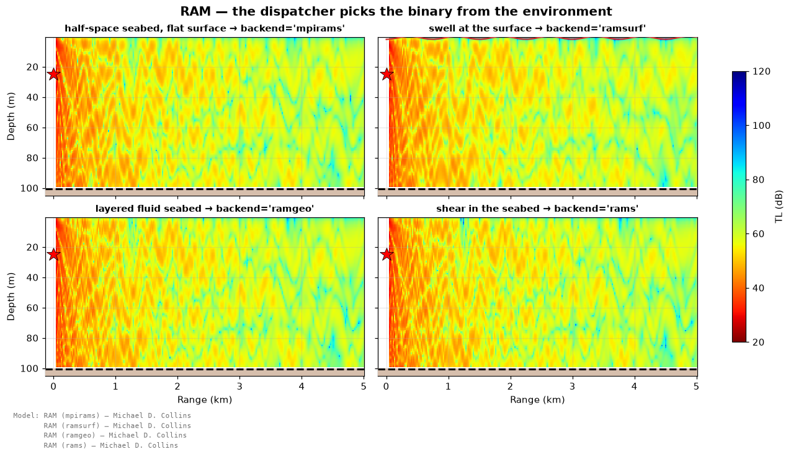
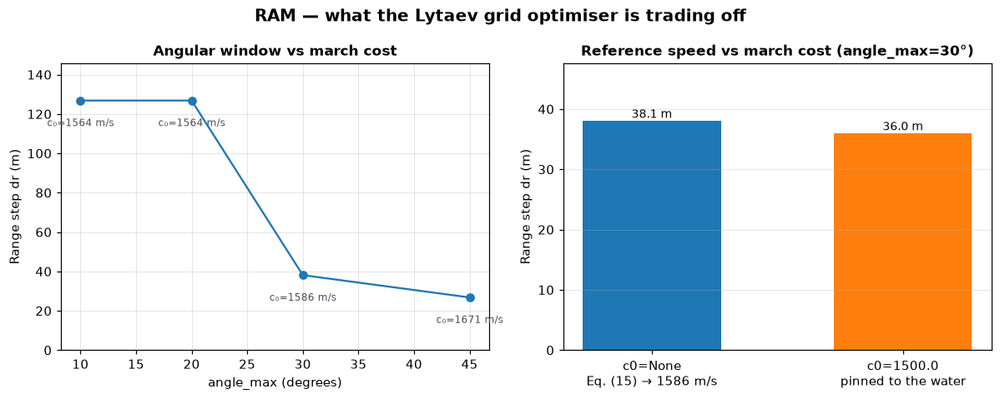
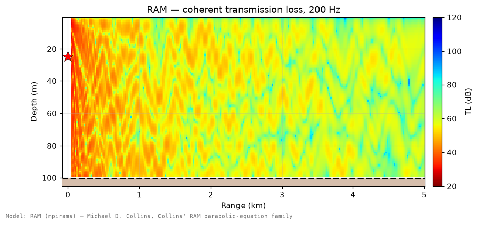
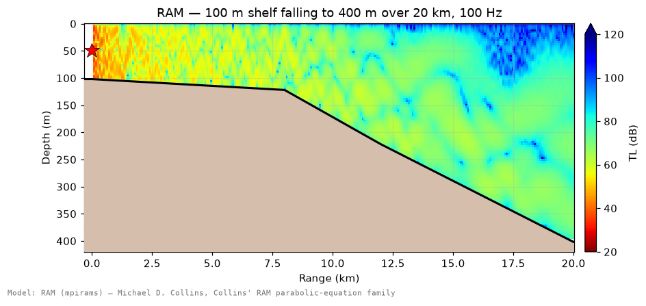
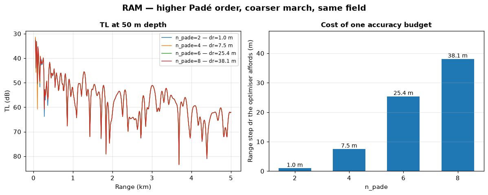
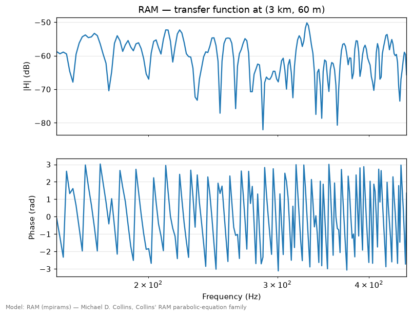

# RAM — the parabolic equation

> `uacpy.models.RAM` · wraps Michael D. Collins' RAM family of
> parabolic-equation codes
> · backends: `mpirams` (Dushaw's mpiramS), `ramgeo`, `rams`, `ramsurf`

RAM is the model to reach for when the environment *changes with range* — a
shelf break, a front, a sediment wedge — and when the range is long enough
that a full-field solver would be prohibitive. It marches the field outward
one range step at a time, which makes range dependence free and back-scatter
impossible.

It is also the most intricate model in the package: one Python class fronts
four different Fortran binaries, and which one runs is decided by your
`Environment`.

---

## 1. What it solves

Strip cylindrical spreading out of the pressure and the far-field wave
equation factors into an outgoing operator and an incoming one. The
**parabolic approximation** is the decision to keep only the outgoing factor:

```
∂p/∂r = i k₀ √(1 + X) · p        X = k₀⁻² [ ρ ∂/∂z (ρ⁻¹ ∂/∂z) + k² − k₀² ]
```

where `k₀ = ω/c₀` is a reference wavenumber and `k = ω/c(r, z)` the local one.

That factorisation is exact only where the medium is range-independent. There
`∂/∂r` and `√(1 + X)` commute and the product of the two factors reproduces the
wave equation. Where the environment changes with range they do not commute,
and the product leaves behind an extra term in the commutator
`[∂/∂r, √(1 + X)]` that the PE simply drops. So three approximations sit under
the equation above — the far field, a negligible commutator, and negligible
back-scatter — and the last two together are what "weak range dependence"
means (Jensen et al., *Computational Ocean Acoustics*, §6.2.2).

This is a one-way, forward-scattering wave equation. Three consequences follow,
and they are the whole character of the model:

- **It is first order in range, so you march it.** Step from `r` to `r + dr`
  using the environment *at that range*. Nothing is solved globally, there is
  no eigenvalue problem, and a bathymetry that changes every step costs
  nothing extra. Cost scales as (Padé terms) × (range steps) × (depth points)
  — Lytaev's `O(p/(Δr·Δz))`.
- **Energy that travels backwards is discarded.** There is no back-scatter
  off a steep slope, a seamount face or a buried scatterer, and no
  reverberation. If the answer depends on returning energy, RAM is the wrong
  model — see [Scooter](scooter.md) or [OASES](oases.md).
- **Slopes cost amplitude, not just back-scatter.** A naive one-way march has
  amplitude errors of order decibels on slopes of only a few degrees, and that
  error is *not* the missing back-scattered field. RAM marches Collins'
  energy-conserving variable `p̃ = p/α` with `α = (ρ/k)^½`, which conserves
  energy flux across the vertical interfaces between range-independent
  regions. It is structural rather than a flag, and it is what makes the shelf
  figure in §8 work.

### Padé approximants and wide angles

The formal solution of that equation over one range step is an exponential of
the square-root operator, which you cannot apply directly. Collins' **split-step
Padé** solution replaces the whole exponential with a rational function of `X`:

```
p(r + Δr, z) = exp(i k₀ Δr) · Πⱼ (1 + αⱼ X) / (1 + βⱼ X) · p(r, z)     j = 1 … p
```

`p` is `n_pade` (2–10, default 8), and the complex coefficients `αⱼ, βⱼ` come
from accuracy and stability constraints on the rational function. The family is
wide-angle from its very first term: at one term the split-step Padé reduces to
the Crank–Nicolson solution of the rational-linear PE, which is Claerbout's
equation — what Jensen et al. call the standard 40° PE, good to about ±35° at a
phase-error tolerance of 0.002. Each extra term widens the angular window over
which the rational function tracks the true propagator: the Padé series for the
square root reaches ±55° at two terms and ±75° at five on that same tolerance,
and nearly the full ±90° of forward propagation beyond it (Jensen et al.,
*Computational Ocean Acoustics*, Fig. 6.1). The default of eight is the order of
Collins' sample deck (`np = 8`, ram.pdf p.12 Fig. 2), the `[7/8]` of every table
in Lytaev (2023) and the Acoustics Toolbox's RAM writer (`write_ram_in.m:82`);
six terms already reproduce a mode set reaching 74° off the horizontal to
plotting accuracy, where four terms visibly drift (Collins & Siegmann, *Parabolic
Wave Equations with Applications*, Fig. 2.6).

The classical **narrow-angle** PE — the one accurate only within roughly ±10–15°
of horizontal — is the Taylor approximation `√(1 + X) ≈ 1 + X/2`, and is not a
member of this family at all.

Because the approximation is applied to the *step* rather than to the square
root, the same coefficients also absorb the range-integration error, which is
what lets you take a **much larger range step** for a given accuracy. The
angular figures above are not free of it: at a fixed order the aperture the
march actually delivers shrinks as the step grows, so order, step size and
angle are a single trade rather than three independent ones.

That trade is the single most important thing to understand about RAM's
numerics, and it is what `angle_max_deg` controls: you declare how wide an angular
window the answer needs, and the grid optimiser prices it.

**The validity condition is the one-way assumption**, not `D/λ`. There is no
frequency below which RAM stops being valid the way the ray approximation
does — only a grid that gets finer, and a march that gets more expensive, as
frequency rises. What RAM will not tolerate is a feature that reflects energy
back toward the source, or physics that lives outside the angular window you
asked for.

---

## 2. When to use it — and when not to

**Use RAM when:**

- the environment is **range-dependent** — bathymetry, sound speed, seabed, or
  all three — and you want that dependence solved rather than segmented;
- the range is **long**: a march is linear in range where a modal or spectral
  solver is not;
- the seabed is **layered**, or carries **shear**, or the surface has
  structure — RAM has a backend for each;
- you are at **low frequency in shallow water**, where the ray approximation
  has failed but you still need range dependence — [Bellhop](bellhop.md) is
  out, [Scooter](scooter.md) is stratified, and [Kraken](kraken.md) can only
  segment the track and approximate the coupling between segments.

**Reach for something else when:**

| Situation | Why RAM struggles | Use instead |
|---|---|---|
| Back-scatter, reverberation | The PE is one-way by construction | [Scooter](scooter.md), [OASES](oases.md) |
| You need ray paths or arrivals | RAM produces a field, not geometry | [Bellhop](bellhop.md) |
| You need the modes | No modal decomposition | [Kraken](kraken.md) |
| Reference-grade accuracy check | The PE is an approximation; a wavenumber integral is not | [Scooter](scooter.md), [OASES](oases.md) |
| Fast shear seabed (rock) | `rams` needs `dz ≤ λ_s/14` (the automatic grid refines to it) and diverges on a coarser pinned grid — see [Gotchas](#9-gotchas) | [OASES](oases.md), [Scooter](scooter.md) |
| Stepped bathymetry over a dense seabed | Every backend keeps the field across a step face, which loses energy in proportion to the density contrast: +4.4 to +5.8 dB too quiet past a corrugation over a density-2.5 seabed (`mpirams` +4.41 to +5.31 dB over its grids, `ramgeo` +5.82) — see [Gotchas](#9-gotchas) | No uacpy model is clean here; [Kraken](kraken.md) `mode_coupling='coupled'` lands +2.83 dB on that case (+4.02 dB with `n_segments=209`) |
| Several source depths in one deck | One `(zs, f)` per march; `run()` loops the depths and stacks them | [Bellhop](bellhop.md) marches all depths in one call |

---

## 3. Environment support

| Feature | Native? | Note |
|---|---|---|
| Range-dependent bathymetry | ✅ | every backend; this is the point of the model |
| Range-dependent SSP | ✅ | linear in range between the declared profiles, as `SoundSpeedProfile.eval`, Bellhop and Kraken read it. Every RAM binary marches the written profile *nearest* the current range, so uacpy writes intermediate profiles until adjacent ones differ by at most 0.5 m/s anywhere in the column (at most 128 profiles); two declared profiles 10 km apart would otherwise be a step at 5 km, measured 3.3 dB (median) off the gradient |
| Range-dependent bottom | ✅ | including a range-dependent layer stack |
| Layered bottom | ✅ | `ramgeo` and `ramsurf` both track the layers *parallel to the bathymetry* |
| Sea-surface altimetry | ✅ | `ramsurf` only |
| Elastic media (shear) | ✅ | `rams` only; the **top** sediment layer must itself carry `shear_speed > 0` — a fluid layer over an elastic half-space is refused (see [§4](#forcing-a-backend)) |
| Multiple source depths | ❌ | one march per depth; `run()` loops and returns one `Field` over `source_depth` |
| Source beam pattern | ❌ | raises; the march starts from Collins' self-starter, which is omnidirectional — use [Bellhop](bellhop.md) or [Kraken](kraken.md) |
| Water-column volume attenuation | ✅ | every backend, as a dB/wavelength profile on the water wavenumber — Thorp, Francois-Garrison, biological layers and a constant alike; per bin on a broadband sweep (uacpy-patched binaries) |
| Non-vacuum surface (rigid, fluid or elastic ice) | ❌ | collapsed to vacuum with a `FallbackWarning` naming the kind; every backend hard-codes a pressure-release surface and no deck carries a surface record |
| Rigid / vacuum / tabulated-reflection seabed | ❌ | raises `UnsupportedFeatureError` — the RAM decks express the seabed only as fluid geoacoustic layers, and the domain floor at `zmax` is an **absorbing layer**, not a Neumann wall |

See [collapse policy](../guide/environment.md) for what "collapsed" means and
how to control it.

---

## 4. The backend dispatcher

`RAM` is a façade. At `run()` time it inspects the environment and picks one
of four vendored binaries:

| Environment | Backend | What it is |
|---|---|---|
| fluid seabed, flat surface, half-space or broadband | `mpirams` | mpiramS, Dushaw's Fortran 90/95 rewrite of RAM, with a native broadband Q/T loop; seabeds slower than the surface water (soft mud) are supported |
| fluid seabed, flat surface, **layered**, narrowband | `ramgeo` | Collins' RAMGeo — sediment layers parallel to the bathymetry |
| **any** `shear_speed > 0` in the seabed | `rams` | Collins' RAMS elastic PE (rotated Padé) |
| `env.altimetry is not None` | `ramsurf` | Collins' rough-surface / beach-geometry PE |
| elastic seabed **and** altimetry | — | `UnsupportedFeatureError` |

The order matters: elasticity is tested before roughness, and the layered-vs-
half-space split only applies once fluid and flat has been established. The
last row is a genuine gap — no published Collins PE handles shear and a
variable surface together, and uacpy says so rather than quietly dropping one
of them.

You can inspect the choice without running anything:

```python
>>> RAM().select_backend(env)
'mpirams'
```

### Forcing a backend

`RAM(backend='rams')` and friends override the dispatch — but the choice is
still validated against the environment, and **an unsupported combination
raises instead of silently degrading**:

```
RAM(backend='mpirams') is a fluid PE and cannot model the elastic bottom
(shear>0) in this environment. Use backend='rams', or backend=None for
automatic dispatch.
```

The five rules, all `ConfigurationError`:

| Forced | Environment | Why it is refused |
|---|---|---|
| `mpirams` / `ramgeo` / `ramsurf` | elastic seabed | fluid PEs; shear would be dropped |
| `mpirams` / `ramgeo` / `rams` | `env.altimetry` set | they model a flat pressure-release surface |
| `ramsurf` | flat surface | its defining feature is absent |
| `rams` | fluid seabed | every sediment node has `mub = rhob·cs² = 0` (`rams0.5.f:204`) and the fluid–solid interface rows divide by it (`:593-600`) |
| `rams` (forced **or** auto-dispatched) | top sediment layer with `shear_speed=0` over an elastic stack | `rams0.5.f:593-600` divides by the shear modulus of the first sediment node below the seafloor, so a fluid top layer makes every sample NaN — no `dz`, `n_pade` or `rams_rotation_angle_deg` choice changes it |

The fourth is the reason the rule exists in both directions: a backend
whose defining feature is missing does not fall back gracefully. The fifth
is the one you will meet by accident: `SedimentLayer` defaults to
`shear_speed=0`, so "sediment over rock" written as a fluid layer over a
sheared half-space is an elastic environment (it dispatches to `rams`) that
`rams` cannot march. The two ways out are named in the error: give the top
layer a shear speed, or zero every shear so the layered fluid PE (`ramgeo`)
runs. A zero-shear layer *deeper* in the stack is fine — the solid-layer
rows only difference the modulus and never divide by it.

### Seeing the dispatch



Four environments over the same water, the same source and the same receiver
grid. The bottom two differ only by `elastic=`: identical geoacoustics, but
declaring shear moves the run from the layered fluid PE onto the elastic one.
The two fields agree to 0.1 dB in median level but differ by 0.85 dB sample by
sample (mean `|Δ|`; median 0.5 dB) — a shifted interference pattern, not a
level offset.

---

## 5. Run modes

```python
from uacpy.models import RAM, RunMode
```

| `RunMode` | Returns | What you get |
|---|---|---|
| `COHERENT_TL` | `Field` | complex pressure on a (depth, range) grid |
| `BROADBAND` | `Field` | `H(d, r, f)` transfer function |
| `TIME_SERIES` | `Field` | `p(d, r, t)` |

Default is `COHERENT_TL` — always. Unlike Kraken, RAM does **not**
switch to `BROADBAND` when you hand it a frequency vector: a multi-frequency
`Source` with `COHERENT_TL` raises, telling you which mode you wanted, and a
`run(frequencies=…)` argument on `COHERENT_TL` **raises** `ConfigurationError`
(it only means something on `BROADBAND` / `TIME_SERIES`, where it overrides
`source.frequencies` for that call).

There is no `INCOHERENT_TL`: the PE marches a complex field, and there is no
independent set of paths to sum intensities over.

Every mode works on every backend. `mpiramS` sweeps frequency inside the
Fortran; the Collins binaries are single-frequency codes driven by a
Python-side loop over uacpy's patched complex-envelope output (see
[`MODIFICATIONS.md`](../../uacpy/third_party/MODIFICATIONS.md)). Auto-dispatch
sends broadband work to `mpiramS` when it can, because the in-process sweep
shares its setup across the band.

### The `(fc, Q, T)` band

Neither `mpiramS` nor the Collins codes accept an arbitrary frequency list.
Their sweep is parameterised as

```
band = fc · [1 − 1/Q,  1 + 1/Q]          Δf = 1/T
```

so uacpy derives `(fc, Q, T)` from a **uniformly spaced** `frequencies` array —
`fc` is anchored on an actual array bin (the upper-middle one),
`Q = fc / half-width`, `T = 1/Δf` (logged at `verbose='info'`). The sweep the
binary marches can overshoot the request by a bin, but the returned `H(f)` is
trimmed to carry **exactly the frequencies you asked for**, bin for bin, so
this path warns nothing. A pinned `q_factor=` or `record_duration=` beside a frequency array
you pass is a second description of the same band: when the sweep it gives around the
array's centre bin marches the array's own bins it is used, and otherwise the run is refused
naming both (they contradict each other) — leave the knobs unset to march the array, or drop
the array to march the `(fc, q_factor, record_duration)` sweep. The grid a `TIME_SERIES`
pulse implies is a default, not a request: a pinned knob replaces what it names and the
pulse's grid supplies the other. mpiramS and
`TIME_SERIES` refuse non-uniform spacing; on `BROADBAND` the Collins backends
(`backend='ramgeo'` / `'rams'` / `'ramsurf'`) march any increasing list of
frequencies bin for bin, one subprocess each. `COHERENT_TL` always marches the
one bin at `fc` (`Q=1e6, T=1.0` in the deck), whatever `q_factor` / `record_duration` hold, so an instance
configured for broadband does not sweep a band on narrowband calls (a pinned value is not
used there, and the run gives a notice naming it); on the
broadband paths they are resolved from the source — see the `q_factor` and `record_duration` rows
of [§7](#7-constructor-knobs).

Note that `1/q_factor` is the **half** fractional width: `q_factor=2` spans `fc·(1 ± ½)`.
Bellhop's `bandwidth_factor` and the base default's
`DEFAULT_BROADBAND_BANDWIDTH_FACTOR` are the **full** fractional width
(`fc·(1 ± bandwidth_factor/2)`), so the same band is `Q = 2/bandwidth_factor`.

---

## 6. The grid: what `dr=None` actually does

Leaving `dr` and `dz` unset hands the grid to the **Lytaev (2023) mesh
optimiser**, which picks the coarsest `(dr, dz)` whose accumulated single-step
Padé error stays under `accuracy` over the whole marched range. The error is
scored on the **accuracy band** of the spectral variable `ξ = (k_r/k₀)² − 1`:
the water column, widened to contain `c0`, out to the wider of `angle_max_deg` and
the seabed's *critical angle* — every component that carries energy to the far
field. A 2400 m/s rock traps modes out to 51° whatever aperture you named, and
scored on the 30° aperture alone it read *better* than sand while measuring
3 dB rms worse at 1–5 km. The rest of the medium's `inf c … sup c` hull is a
**stability band** on which the operator is only held non-amplifying; scored
for accuracy too, a hard rock basement put the branch point `ξ = −1` inside the
interval and every grid was refused. It needs three things from you, and all
three have defaults:

| Knob | Default | What it means |
|---|---|---|
| `accuracy` | `None` | budget on the single-step Padé error accumulated over the march. Unset → the default chooser's target `1e-3` (Lytaev 2023 §5.1: "In all the examples, target accuracy ε is set to 10⁻³"), relaxed, floored and capped as below, each a log line; pinned → met as given (no relaxation, floor or cap), or refused when no grid on the ladders meets it |
| `angle_max_deg` | `None` | the widest propagation angle the spectrum must represent. Unset → Lytaev §5.5's `max(θ_src, θ_bottom)`: 30° (the aperture of Lytaev's §5.1 example) widened to the bathymetry's steepest slope; pinned → used as given, never narrowed (a notice citing §5.5 when it is below the slope) |
| `c0` | `None` | the PE reference speed; `None` → Lytaev **Eq. (15)** on the accuracy band |

`c0` deserves a note: it is the *algorithmic* expansion point — the speed
factored out as `exp(i k₀ r)` — not a physical input. Eq. (15) chooses the `c0`
that centres the accuracy band around zero: 1591 m/s on 1500 m/s water over
sand, 2047 m/s over hard rock, where the trapped-mode end of the band binds.



Both panels come from the same 100 m channel (1490–1500 m/s water over
1650 m/s sand) at 200 Hz over 5 km. Widening `angle_max_deg` from 10° to 45° costs
nearly a factor of five in range step (127 m to 27 m), because the rational
approximation has to stay accurate over a wider angular window — and `c0`
moves with it, since Eq. (15) centres the band for the angle you asked for;
below about 26° the trapped modes set the band's steep end instead (`c0` stays
at 1564 m/s), so 10°, 15° and 20° get the same 127 m step. On this slow seabed
the `c0` rule is nearly moot — 38.1 m against 36.0 m pinned to the water
speed; it earns its keep on the fast ones.

**What the score is, and what it is not.** The logged *predicted error* is
`τ·n_steps`: a bound on the accumulated error of the *steepest* scored
component. Measured against Kraken on a 9 × 19 receiver grid to 5 km (sand,
silt and rock half-spaces at 100–200 Hz) the field error is 3–10× below it,
because the steepest trapped modes carry the least energy. It does not cover
the **near field** — components steeper than the band are damped or garbled at
the chosen `dr` rather than propagated, which on the sand channel at 200 Hz
(mpiramS, which marches onto every receiver range) leaves the field wrong out
to about **15 range steps** — measured against the same march at an eighth of
the step, more than 0.1 dB out to 14 steps of 38 m and within 0.01 dB beyond
22 — nor the
**seafloor interface**, whose position to a
fraction of a cell sets the trapped modes on a fast seabed (hard rock, 5500 m/s,
at 200 Hz, `dz = λ/250`: 3.55 dB rms from Kraken with the seafloor on a node,
0.96 a quarter cell below it, 1.59 mid-cell, 3.70 three quarters down), which is
why the grid places it
(constraint 2 below, and [§9](#9-gotchas)). The grid line
also reports the stability band's growth (`max |P/Q| − 1` per step outside the
accuracy band), 1e-15 to 1e-10 on every case tried.

The near field has a geometric warning of its own. When a receiver's direct or
surface-reflected path is steeper than the band (the wider of `angle_max_deg` and
the fastest medium's critical angle), the run gives a `NumericsWarning` naming
the steepest path and the first range clear of it — the same geometry as
Kraken's and Scooter's `c_high` notice. On the sand channel at 200 Hz (source
25 m, receiver 60 m) RAM read 18, 10 and 20 dB from `Scooter(c_high=1e9)` at
5, 20 and 50 m, and within a dB from 100 m on.

### Scoring a grid yourself

The optimiser is exported (module `uacpy.models.pe_grid`, re-exported from
`uacpy.models`), so a pinned `(dr, dz)` can be scored before a run —
`uacpy.models.grid_error` returns the same `τ·n_steps` the log line quotes, and
`optimize_grid` the coarsest pair meeting `eps` as a `GridChoice` (`.dr`,
`.dz`, `.predicted_error`, …; it raises `GridInfeasibleError`, a
`ConfigurationError`, when none does). Both score RAM's own Padé order, 8, by
default (`p=`). The accuracy band's speeds are the water column's, widened to
contain `c0`:

```python
from uacpy.models import optimal_c0, grid_error

# 100 m of 1500 m/s water over 1600 m/s sand, 200 Hz, out to 5 km
c0 = optimal_c0(1500.0, 1500.0, 30.0, c_max_all=1600.0)          # 1591 m/s
kw = dict(frequency=200.0, c_min=min(1500.0, c0), c_max=max(1500.0, c0),
          x_max=5000.0, c0=c0, angle_max_deg=30.0, c_max_all=1600.0)
grid_error(dr=38.23, dz=0.5, **kw)     # 1.85 — the λ/15 floor: at or over 1, so RAM refines dz
grid_error(dr=38.23, dz=0.366, **kw)   # 0.993 — λ/20, the grid RAM picks (verbose='info')
grid_error(dr=38.23, dz=1.0, **kw)     # 7.39 — about twice the floor
```

Compare a pinned pair against the automatic grid's score rather than against
`eps`: the `dz` floor (constraint 1 below) routinely leaves the automatic grid
above the budget, and the score is a bound on the steepest component, not the
field error. For `rams`, `rams_dz_shear_cap(c_s, frequency)` gives the `λ_s/14` cap,
and `rams_stable_dr` / `rams_stable_theta` / `rams_growth_margin` (a
`GrowthMargin`) the range-step stability of constraint 3.

### What the optimiser is not allowed to do

Five constraints are applied *after* the optimiser has spoken, because its
error model does not know about them:

1. a **`dz` floor** of `λ_p/15` — the Acoustics Toolbox RAM writers' depth step
   (`write_ram_in.m:18` `nseg_lambda = 15`, `write_env_RAM.m:24`), the
   depth-grid cost floor — where the depth
   search *starts*, not where it stops. When the band's steepest scored
   component — the seabed's critical-angle mode, or the `angle_max_deg` aperture
   edge — scores at or above 1 on the floored grid (see below), `dz` is
   refined from the floor to the coarsest value that scores under 1 (the
   aperture edge binds on most kHz runs: on 100 m of water, 500 Hz over sand
   to 5 km reads 0.78 dB median |dTL| from Scooter on the floor and 0.08 dB
   refined, and 1 kHz over a 1700 m/s seabed to 10 km 2.87 against 0.11 dB,
   for 0.5 s and 1.2 s of march),
   within the 100 000-point depth budget (`MAX_DEPTH_POINTS`); silt at 50 Hz
   and clay at 100 Hz pass on the floored grid and keep it, and sand at
   200 Hz, flat or a sloping wedge, is refined to λ/20 by the same aperture
   edge (it scores 1.9 at the 38 m step). On `rams` a
   **`dz` cap** of `λ_s/14` also applies, so the shear wavelength stays
   resolved (a coarser grid diverges rather than losing accuracy: as a
   measured illustration, on Collins 1991's example D the march read 134 dB
   from OASES at `0.55 λ_s` and 0.83 dB at `λ_s/14`);
2. **seafloor placement in its cell** (`SEAFLOOR_CELL_OFFSET`): the
   *shallowest* seafloor depth is put a quarter of a cell below its last
   water node, `h/dz = n + 0.25`, on mpiramS, ramgeo and ramsurf (`rams`
   keeps it on the node, where its fluid–solid interface rows sit). Those
   codes take nodes `1..iz` as water and split the properties between `iz`
   and `iz + 1`, so an on-node seafloor has its Galerkin interface half a
   cell too deep; the quarter cell is measured, not derived — on every grid
   the automatic path marches, the node is never the best placement (sand
   at 200 Hz on the λ/15 grid: 1.0 dB rms far-field error on the node, 0.4
   a quarter cell down, 0.7 mid-cell; rock at 200 Hz on its λ/64 grid: 2.2 /
   0.7 / 3.1). On slower seabeds another fraction can win (0.375 on an
   80 m / 150 Hz / c_b 1600 m/s channel, and on the 50 m Pekeris guide of
   §6); no cited source explains why one placement wins, so the quarter is
   uacpy guidance. The shallowest column has the fewest water
   points, so its placement costs most (`env.depth` is the deepest, and only
   coincides on flat bathymetry);
3. a **`dr` tightening on `rams`** — `rams_dr_factor` (default 5×), an
   independent `dr ≤ c_min/(5f)` cap, and a **stability rule**, whichever is
   tightest. With the rotation on (the default, `rams_rotation=None`), `rams0.5` does not march the
   split-step Padé exponential the optimiser scores: its `rpade` builds
   Crank-Nicolson coefficients and the march is a Crank-Nicolson step in
   range of the rotated square root — second-order in `dr`, with real
   amplification (`|G| = 1.028` on the propagating band at the Lytaev `dr` of
   2.46 λ on a 1500/1800 case, where the march diverges; 0.41 / 2.45 / 14.1 dB
   rms against `krakenc` at 0.2 / 0.6 / 1.8 λ). The λ/5 cap is that
   operator's truncation requirement, and the "predicted error" logged for a
   `rams` grid is labelled as the split-step score it is, not this march's
   error. A `rams` band marches one `dr` sized at its lowest bin, so the bins
   above it step past the cap (0.6 λ at the top of a 3:1 band; the log line
   states the fraction): measured on a 100-300 Hz band over a `c_s = 400 m/s`
   seabed, the step sized at the top changed each bin by 0.26 dB rms (0.73 dB
   over the top ten) at three times the run time. Pin `dr` to march finer.

   The stability rule is where the amplification actually bites. Computed
   from the `rpade` coefficients themselves, the Crank-Nicolson step
   multiplies the steep propagating components just above cutoff (`ξ ≈ −0.9`,
   grazing ≈ 70°) by `1 + 2.4·10⁻⁴ (k₀ dr)³` per step at the default 45°
   rotation and order 6 — 1.5 % at `k₀ dr = 4`, 5 % at 6 — while the
   evanescent band decays and the trapped modes see under 10⁻⁵. Whether the
   march survives is a race per metre: those components leave the water on
   every bottom bounce, so the seabed's reflection loss at their grazing
   angle, paid once per `2h/tan θ`, is what drains them. Measured on a 100 m
   sand channel (`c_s = 300 m/s`), every grid whose growth rate was under
   that leak rate ran (1 kHz at `dr = 1 m`, 1.5 kHz at 0.5 m, 2 kHz at
   0.25 m, 5 kHz at 0.04 m) and every grid above it had blown up within the
   first few hundred metres (1.5 kHz at 1 m, 2 kHz at 0.5 m, 5 kHz at
   0.1 m); the threshold fell between 0.015 and 0.021 Np/m against a
   fluid-Rayleigh leak estimate of 0.0147 Np/m, and in 200 m of water
   1 kHz at 1 m diverged as the halved leak predicts. Because the growth per
   metre scales with `k₀` at a fixed fraction of a wavelength while the leak
   does not, the λ/5 cap alone stops sufficing above a few kHz and in deep
   water: 5 kHz over 100 m of sand needs 0.050 m against the 0.060 m cap,
   1 kHz over 1000 m needs 0.14 m against 0.30 m (measured there: 0.5 m
   diverged, the 0.30 m cap marched 3.4 dB from Kraken, 0.12 m 1.9 dB). The
   rule keeps the growth
   under half the leak (`RAMS_STABILITY_SAFETY = 2`); the leak is the
   fluid-fluid Rayleigh coefficient with the seabed's attenuation, which
   shear conversion only lowers, so it is conservative on an elastic seabed
   (a 2400 m/s, 2.2 g/cm³ bottom ran at 2.3× the estimate). A second term
   no step removes: the rotated square root itself maps the steepest
   propagating components slightly into the lower half-plane, a growth of
   3.7·10⁻⁴ Np/m per kHz at 45° and order 6 (2.3·10⁻⁴ at order 8) that is
   below 10⁻⁶ at 20°. At order 8, the default, the sand channel was marched
   again against a converged 0.2 m step: every grid at a growth/leak ratio up
   to 0.96 ran and every grid from 1.16 up grew, so the rule holds unchanged
   — and the higher order lowers the growth (2 kHz at 0.4 m: ratio 1.26 at
   order 6, 0.05 at 8). Where it exceeds the leak — 1 kHz in 4000 m of
   water, 20 kHz in 100 m — a `rams_rotation_angle_deg` left `None` (the default) takes
   the widest stable angle on the ladder 45°, 40°, 30°, 25°, 20°, 15°, 10°,
   5° for that frequency, with a warning naming it (and the run is refused
   when no angle on the ladder is stable); a pinned angle is marched as
   given, with a `NumericsWarning` naming the stable one. The same
   trade-off is the subject of Ren et
   al. (2025), who find the angle must shrink as frequency rises. A pinned
   `dr` is marched as given, but one the rule predicts to diverge is said so
   before the march, with the step the automatic grid would use, and the
   warning on the samples a blown-up march wrote as NaN/inf names that step
   rather than a Padé order or a depth step. On top of the stability rule, a
   **level-drift budget**: the same Crank-Nicolson step also changes the
   level of the *trapped* components by a second-order-in-`dr` amount per
   metre, largest on the horizontal ones once `c0` sits well above the
   water speed (Eq. (15) centres it on a fast seabed's critical-angle band).
   `dr` is held so that drift, accumulated over the march, stays within
   0.5 dB (`RAMS_CN_DRIFT_BUDGET_DB`). The per-metre rate predicts the
   measured drift: 100 m of water over a 3000/1500 m/s limestone at 200 Hz
   (`c0` = 1897 m/s) drifts -0.359 dB/km at the λ/5 cap of 1.5 m against
   -0.36 dB/km measured, level averaged over depth and 1 km bins against
   Scooter (Kraken and OAST within 0.04 dB of it); the budget puts `dr` at
   0.50 m over 10 km, where the drift at 9 km reads -0.37 dB instead of
   -3.33 dB, in 28 s instead of 10 s; a 2400/1000 m/s chalk goes from
   -1.57 to -0.32 dB;
4. a **100 000-point cap** on the depth grid, to keep runtimes sane (sized so
   10 kHz over 100 m of water converges inside it — the table below);
5. on the **Collins backends, an output-stride cap**: those binaries write the
   field only every `ndr·dr` and the receiver modulus is interpolated between
   writes, so both the automatic `dr` and `ndr` are held so that stride
   samples the modal beat `2π/Δk` (`Δk = 2πf (1/c_min − 1/c_max)` over the
   medium) six times per period — 20 m on sand at 200 Hz, 1.7 m on hard rock; a
   pinned `dr` is yours. Measured on ramgeo at 200 Hz over 5 km of the sand
   channel (beat 120 m, receivers beyond 1 km, against the same backend at
   `dr = 1 m`): 3.7 / 1.9 / 0.6 / 1.0 / 0.5 / 0.2 % relative field error at
   `stride/beat` = 0.33 / 0.25 / 0.22 / 0.17 / 0.12 / 0.08, and 0.0 % on
   mpiramS, which marches onto every receiver range.

One thing that is *not* on that list: a cap on `dr` at the output-range
spacing. mpiramS marches onto each requested range rather than writing on a
fixed stride, and its step-shrink test in `ram.f90` (patched in uacpy's copy,
see `third_party/MODIFICATIONS.md`) never sends a step past the range it is
aiming at, so **on mpiramS `dr` is the longest step the march takes, not the
step it takes everywhere**: a leg shorter than `dr` is
marched in one step of that leg's length, and the effective step is
`min(dr, leg)`. Nothing overshoots at any `dr` on any output grid, so nothing
needs to cap `dr` against the receivers — which matters, since the shortest
gap has no lower bound: capping at a legal 2 mm receiver pair would size a
5 000 000-step march to 10 km.

Any of these can push the delivered grid above the default `1e-3` target;
that is logged at `verbose='info'`, because the stability floor binds on
essentially every ordinary run and a warning there would be noise. **A pinned
`accuracy` is met as given instead:** the coarsest grid on the Lytaev ladders
whose score stays under it (a pinned `dr` or `dz` held while the other is
searched), refined only by the constraints that make a step finer — the rams
range-step rules, the Collins output stride, the seafloor placement rounded
to the finer side, the shear cap and the source row — with no `λ/15` floor
and no `MAX_DEPTH_POINTS` cap (a grid past it runs with a cost notice). On
the sand channel at 200 Hz to 5 km that is `dz = 0.034 m` at `1e-2` and
0.01 m at `1e-3`, against the default's 0.366 m. A pinned `accuracy` no grid
on the ladders meets, one a pinned step makes unreachable, or one whose
Collins depth grid would overrun the binary's `mz` is refused; beside a
pinned `dr` and `dz` it chooses nothing, and the run says so.

If no grid is feasible at all, uacpy triples `ε` while the next rung stays
below 1 (`EPS_LADDER_CEILING`, where the score saturates; from the default
`1e-3` the last rung tried is 0.729) and then steps `angle_max_deg` down
30° → 20° → 15°, restarting the `ε` ladder each time, before giving up with a
`ConfigurationError`. All of that is the default chooser: a pinned `accuracy`
is never relaxed, and a pinned `angle_max_deg` never narrowed. An `ε`-only
relaxation up to 0.5 is routine at and above ~500 Hz over a few km — the
marched `dz` is then the floor or its refinement — so it follows the floor's
policy: a log line. The 0.729 rung always warns, quoting the rescored error and the
band edge it bounds. It is what shallow water above ~1.5 kHz needs: 2 kHz
over 50 m of water on a 1700 m/s seabed to 2 km, and 1.5 kHz over 100 m to
10 km, march in 1 s and 6 s with a refined `dz` and read 0.32 and 0.10 dB
median |dTL| from Scooter (range-averaged levels within 0.13 dB), where a
0.5 ceiling refused both; 3 kHz over 50 m to 3 km marches in 0.8 s and reads
0.26 dB median (0.65 dB rms) from `Scooter(c_high=1e9)`. Narrowing `angle_max_deg` changes the physics you asked for and always
warns, naming the step. Either message quotes the returned grid's own
predicted error; a value at or above 1 is labelled *not resolved by the
model*, because the score saturates there and ranks nothing. The refusal
itself tells you how to converge a pinned grid by hand — see
[§9](#9-gotchas), *a very fast basement*.

**A fast seabed gets its `dz` refined, and a warning only where the budget
stops it.** When the accuracy band reaches the critical angle (a seabed faster
than the water and steeper than `angle_max_deg`), the steepest scored component is
a trapped mode that carries the far field, and the λ/15 floor cannot resolve
it: rock (51°) scores 9.3 at 100 Hz and 18 at 200 Hz on the floored grid,
measured 1.7 and 6.9 dB rms from Kraken at 1–5 km. On sand at 200 Hz the
steepest scored component is the 30° aperture edge, which scores 1.9 at the
38 m step, so that grid is refined too. A score at or above 1 (`TRAPPED_MODE_SCORE_LIMIT`)
means the mode's phase is lost over the march — the answer is wrong, not
"about a decibel" — so the automatic `dz` is refined from the floor to the
coarsest value that scores under 1 at the chosen `dr`, and the seafloor is
placed a quarter cell below its node (constraints 1–2 above). Measured on the
100 m channel (source 25 m; 9 receiver depths 10–90 m × 19 ranges 0.5–5 km),
mpiramS, rms dB from Kraken over all columns / beyond 1 km:

| seabed | f | floored grid (λ/15, on-node) | refined grid | wall |
|---|---|---|---|---|
| rock 2400 m/s | 100 Hz | 1.8 / 1.7 | **0.7 / 0.6** (λ/45) | 0.4 → 0.4 s |
| rock | 200 Hz | 6.6 / 6.9 | **0.9 / 0.7** (λ/64) | 0.4 → 0.5 s |
| hard rock 5500 m/s | 100 Hz | 5.5 / 5.6 | **1.0 / 1.0** (λ/104) | 0.4 → 1.0 s |
| hard rock | 200 Hz | 7.2 / 7.4 | **0.6 / 0.7** (λ/148) | 0.6 → 2.8 s |
| sand 1600 m/s | 200 Hz | 1.1 / 1.0 | **0.5 / 0.4** (λ/20) | 0.3 → 0.4 s |

The refinement stops at the `MAX_DEPTH_POINTS` budget (100 000 points over the
shallowest water column): past it the grid marched still cannot carry the mode,
and that — like a pinned grid that cannot — raises a `NumericsWarning` at the
default `accuracy` naming the `dz` the mode needs, its point count and the
budget. Hard rock at 200 Hz needs `dz ≈ λ/148` (5.1 cm), which the budget
holds over up to about 5 km of water.

**Kilohertz runs on the automatic grid.** Above 750 Hz the `Δz` search ladder
reaches `λ/200` (`uacpy.models.pe_grid.dz_ladder_end`; 0.01 m below that), so
the search finds a grid that meets the band's score where a 0.01 m ladder end
refused every candidate (5 and 10 kHz on 100 m of sand to 2 km). Measured on
that channel (a 1600 m/s, 1.6 g/cm³, 0.5 dB/λ sand half-space, Thorp
absorption, source 25 m, 19 × 16 receivers over 0.5–2 km, mpiramS) against
Kraken:

| f | `dr` | `dz` | depth points | wall | median / rms abs. dTL |
|---|---|---|---|---|---|
| 2 kHz | 5.70 m | 18.3 mm (λ/41) | 7 006 | 1.0 s | 0.36 / 1.09 dB |
| 5 kHz | 1.69 m | 4.64 mm (λ/65) | 23 981 | 5.2 s | 0.37 / 0.98 dB |
| 10 kHz | 1.13 m | 1.63 mm (λ/92) | 64 807 | 20.3 s | 0.37 / 1.02 dB |

Capped at 10 000 points instead, the same 5 and 10 kHz grids stop at 1 cm and
read 2.1 and 6.4 dB rms — which is what the budget is sized against.

**How far from converged does the default actually land?** Far enough to matter
in shallow water, and the `dz` floor is what is left. On a 200 m / 25 Hz
pressure-release waveguide (source 100 m, receiver 30 m, 121 ranges over
0.3–3.3 km), measured against a closed-form Dirichlet modal sum that Kraken
reproduces to 0.014 dB:

| grid | `dr` | `dz` | median &#124;ΔTL&#124; | wall |
|---|---|---|---|---|
| default | 458.7 m | 4.06 m (`λ/15` floor, placed) | 3.79 dB | 0.25 s |
| `accuracy=1e-3` | 458.7 m | 0.256 m (Lytaev's own) | 1.80 dB | 1.1 s |
| `angle_max_deg=65, accuracy=1e-3` | 45.1 m | 0.051 m | 0.024 dB | 6.1 s |
| `dr=25, dz=0.25` | 25 m | 0.25 m | 0.011 dB | 0.44 s |

The engine is capable of 0.011 dB on that problem; the default grid is over
300× coarser in accuracy and under twice as cheap, and **nothing warns** — the
floor binds on essentially every ordinary run, so warning on it would be noise.
At this coarse `dz` the step hardly matters (pinning `dr=150` on the default
`dz` gives 3.81 dB; on the `λ/16` one, orders 6, 8 and 10 at steps of 50–459 m
all read 3.3–3.7 dB). The 3.79 dB is
built up as follows: the same grid with the seafloor on a depth node, order 6
and a `λ/16` floor read 2.13 dB; placing the seafloor a quarter cell below its
node (constraint 2) costs +1.19 dB here — on this near-massless bottom the node
is the better placement at every `dz` tried (2.13 / 3.31 / 3.98 dB on the node,
a quarter cell below and mid-cell), the quarter cell having been measured on
fast seabeds; order 8 adds +0.35 dB and the `λ/15` floor +0.13 dB. Refining
`dz` alone from `λ/15` to `λ/120` takes the default step from 3.78 to 1.87 dB.

The rest is the aperture. Lytaev's criterion (2023 §4.1) bounds `τ·n_steps`,
the accumulated per-step error of each plane-wave component's complex amplitude
with `ξ` between `ξ_min = −sin²θ_max + (c₀/c_max)² − 1` and `ξ_max` — not a TL
error, and nothing about a component steeper than `θ_max`. §5.5 estimates
`θ_max = max(θ_src, θ_bottom)` from the source's antenna pattern and the bottom
slope; 30° is the angle of its §5.1 example. uacpy widens it for a slope and for
a fast seabed's critical angle, but a lossless soft bottom returns every angle:
this guide's six modes sit at 8.6–64.2°, the mid-depth source excites the odd
ones, and mode 5 at 48.6° lies outside the scored band (the default grid scores
0.17 on the 30° band, 7.5 out to 50° and 16 out to 65°). Lytaev's own grid at
`accuracy=1e-3` still reads 1.80 dB; **`angle_max_deg=65, accuracy=1e-3`**, the
aperture holding every mode the bottom returns, converges it — 0.024 dB median,
0.096 dB p90. On a guide whose bottom returns steep energy, set `angle_max_deg` to
the steepest mode you need and pin `accuracy`.

The shortfall is not a low-frequency corner: under a geometry scaled by water
depth the error tracks `f·H`, so 100 Hz in 200 m of water behaves like 25 Hz in
800 m. In deep refracting water (3000 m, 25 Hz, 60 km) the default sits 0.78 dB
from a converged grid.

**On a Pekeris guide the error grows with range.** Scored every 25 m from 1 to
10 km against the closed-form trapped-mode sum (water density 1.0 here and
below; validation.md §1.1's guide: 100 m, 50 Hz, c_b 1800 m/s, ρ_b 1.8,
lossless, source 25 m, receivers 30 / 50 / 75 m), the default grid reads 0.48 dB median and 1.88 dB p90 — 0.24 / 0.59 /
0.80 dB median over 1–4 / 4–7 / 7–10 km
(`test_benchmarks_analytic.py::test_ram_tl_on_a_dense_range_axis_matches_pekeris_modal_sum`);
the five ranges the coarser benchmark scores read 0.52. Other guides drift
further: 50 m / 150 Hz / c_b 1650 / ρ_b 1.8 (source 20 m, receiver 35 m)
reads 1.02 dB median, 4.27 p90, from 0.59 over 1–4 km to 1.53 over 7–10 km;
100 m / 50 Hz / c_b 1700 / ρ_b 1.5 (source 50 m, receiver 30 m) reads 0.95 /
3.71. On the 50 m guide the 1 km mean level agrees with the modal sum to
0.04 dB median, so it is the interference pattern that drifts, and the
seafloor's place in its cell sets most of it: at the default `dz` (0.396 m,
λ/25), 0 / 0.125 / 0.25 (the default) / 0.375 / 0.5 / 0.75 of a cell below
the node reads 3.18 / 2.29 / 1.02 / 0.18 / 1.35 / 3.23 dB median, while `dr`
(10 m or 51 m) and `c0` (1500–1591 m/s) change nothing; refining `dz`
converges it (0.198 / 0.099 / 0.050 m: 0.65 / 0.36 / 0.19 dB). Seabed loss
shrinks it (against Kraken: 0.1 dB/λ 1.12 dB median, 0.5 dB/λ 0.31 dB with
no growth). Nothing warns; on a shallow low-loss guide, pin a finer `dz`.

**Where the default really is safe is narrower than a mode count suggests**, and
it is set by `kH/π = 2fH/c`, the number of trapped modes (median |ΔTL| of the
default grid on the same waveguide, receiver 30 m, 0.3–3.3 km):

| `kH/π` | `f·H` (at 1500 m/s) | source at `H/2` | source at `0.3H` |
|---|---|---|---|
| 1.87 | 1400 | 0.29 dB | 0.45 dB |
| 2.13 | 1600 | 0.21 dB | 10.81 dB |
| 2.67 | 2000 | 0.16 dB | 4.58 dB |

**The safe corner is `kH/π < 2`, i.e. `f·H < c` (1500 Hz·m), for an ordinary
source depth** — below it a single mode propagates and there is no interference
to get wrong. A mid-depth source looks good far past that only because it
excites the odd modes alone: its own step is at `kH/π = 3` (`f·H = 3c/2 = 2250`
Hz·m), where the second odd mode appears. Do not read a mid-depth-source result
as the general case — at `f·H = 2000` the same waveguide is 0.16 dB with the
source at `H/2` and 4.58 dB with it at `0.3H`.

**If you need better than half a decibel in shallow water, pin `dz`** — the
floor is where the depth search starts, and only the trapped-mode check
refines it — or pin `accuracy`, which is then met with no floor (above). When
you pin `dz`, keep `h/dz = n + 0.25` on the
fluid backends (`n + 0` on `rams`): a pinned value places the seafloor wherever
it falls, and the placement is worth up to 3 dB on a fast seabed (constraint 2).

**The optimiser never looks at range dependence, and this one can bite.** Its
error model is stratified: frequency, the slowest and fastest speed anywhere,
the maximum range, the angle and the accuracy budget — and nothing about how
fast the environment changes along the track. Collins is explicit that the size
of the smallest range-independent region is an upper bound on `dr`. On the
Collins backends the deck writer enforces it — an automatic `dr` is bounded by
the closest pair of profile-section, bathymetry or altimetry markers; a pinned
`dr` is marched as given, unless it is wider than a region of the
environment past the first, which is refused naming it (uacpy's own
intermediate SSP sections are thinned to the pinned `dr` first, so they never
cause it) —
because those binaries consume
at most one marker per step (`ramgeo1.5.f:348, :359`): over a bathymetry broken every 10 m at 25 Hz the
optimiser alone returned `dr = 318.8 m` and the field landed 8.9 dB from the
converged answer at its worst point, where `dr = 10 m` recovers it to 0.06 dB.
mpiramS interpolates its environment instead of consuming it, so nothing
bounds `dr` there. **If your bathymetry or profile breaks are spaced more
finely than the `dr` you get back on mpiramS, pin `dr` yourself.**

The grid that actually ran is on the result's run settings:

```python
engine = tl.run_settings.engine
engine.grids[0].dr, engine.grids[0].dz, engine.c0, engine.grids[0].zmax
```

---

## 7. Constructor knobs

Everything is configured on the constructor; `run()` has a fixed signature.
Knobs tagged with a backend are ignored elsewhere — and uacpy warns when you
override one the selected backend cannot read.

**Grid and accuracy**

| Name | Default | Meaning |
|---|---|---|
| `dr` | `None` | Range step (m). `None` → Lytaev optimiser: the coarsest `(Δr, Δz)` whose accumulated Padé error stays under the accuracy target (Lytaev 2023 §4.1). The RAM guide itself asks for convergence tests rather than a value (`ram.pdf` p.8). |
| `dz` | `None` | Depth step (m). `None` → optimiser, floored at `λ/15` (the Acoustics Toolbox RAM writers' step), refined for the trapped modes, placed in its cell. |
| `zmax` | `None` | PE domain depth (m). `None` → seafloor + sediment stack (or a deeper source) + a pad of real seabed + absorbing layer; the pad holds the depth the continuous spectrum's bottom field reaches over the track (see *The domain floor absorbs*). On mpiramS the domain sits on the `dz` lattice (`peramx.f90:391, :404` space its output depths `zmax/(icount−1)` while its operator uses `dz`): an automatic `zmax` is snapped onto it, a pinned one keeps its value with the automatic `dz` chosen to divide it, and a pinned pair off the lattice is refused naming the nearest `zmax` on it. |
| `c0` | `None` | PE reference speed (m/s). `None` → Lytaev Eq. (15); Collins' own sample uses 1600 m/s "to obtain an accurate rational approximation for phase speeds between 1500 and 1700 m/s" (`ram.pdf` p.8). |
| `accuracy` | `None` | Optimiser error budget. Unset → the default chooser's `1e-3` target (relaxed / floored / capped, logged); pinned → met as given, or refused (§6). |
| `angle_max_deg` | `None` | Widest propagation angle, degrees. Unset → 30° widened to the steepest bathymetry slope (Lytaev §5.5); pinned → used as given, never narrowed. |
| `n_pade` | `8` | Number of Padé terms, 2–10. 8 is Collins' sample deck (ram.pdf p.12), Lytaev's `[7/8]` and the Acoustics Toolbox RAM writer's order. The binaries find the Padé roots with a Laguerre iteration that stops when it does not converge; at order 8 it did on a few small `k₀·dr` steps a pinned `dr` marched (36.5 Hz at 0.5 m and 75 Hz at 1 m on ramgeo, a 25–75 Hz band at 2 m on mpiramS) — the run raises naming the order and the step, and order 6 ran every one of them (half the step ran the ramgeo pair, not the band). |

**Stability**

| Name | Default | Meaning |
|---|---|---|
| `n_stability` | `None` | How many stability constraints, written as given (`0` turns them off). They annihilate the evanescent spectrum (`Re X < −1`) and are what keep the self-starter and the energy-conservation correction well-behaved. `None` → 1: "We have found that ns = 1 or 2 is effective for most problems" (ram.pdf p.3), and Collins' sample deck's `ns = 1`. rams0.5 takes `ns = 1` in its own `epade` call (`rams0.5.f:176`), so a value set there gives a notice. **[mpiramS, ramgeo, ramsurf]** |
| `stability_range` | `None` | Range (m) beyond which those constraints are switched off. They inject a little artificial attenuation — negligible on ordinary problems, but Collins notes it can matter in deep water at very long range, which is the case this knob exists for. On mpiramS with more than one output range the march compares `rs` against the distance to the *next* output range (`mpiramS/src/ram.f90:68,166,251`), so the receiver spacing, not `rs`, decides where the terms switch off and uacpy warns that the pin is largely inert. `None` keeps the constraints at every range on both kinds of backend, the RAM guide's default: "When rs is set to 0, the stability constraints are used for all ranges" (`ram.pdf` p.7). **[mpiramS, ramgeo, ramsurf]** |
| `rams_rotation_angle_deg` | `None` | Padé rotation angle, degrees. `None` takes 45° unless that angle's own growth on the steepest propagating components outruns the seabed's leak (§6 constraint 3), then the widest stable angle, per frequency, with a warning (refused when no angle is stable). A float pins it (marched as given; a `NumericsWarning` when unstable); a callable `f → θ` varies it across a band (the run record holds it as its repr, so `from_run_settings` refuses that record). 45° is the tuned angle of one Pekeris-elastic case (`tests/test_cross_model_agreement.py`, at order 6; order 8 reads 0.528 against 0.526 dB rms there), in line with the reference at four Padé terms and up in Milinazzo, Zala & Brooke (1997) Fig. 11. Taking the widest stable angle follows the same paper's "the ability of the Padé approximation to accurately represent the nonpropagating mode wave numbers is much improved" at larger angles; it also notes that higher angles need more terms, and NRL's RAMS guide raises theta only "to the point that you don't see NaN" (`ramsurf/readme.orig`) — the widest is uacpy guidance, measured with the stability rule. **[rams]** |
| `rams_rotation` | `None` | Padé branch-cut rotation. `None` = on, uacpy guidance: no source prefers the rotated coefficients; the 45° tuning and the stability rule were measured with rotation on. A set value (`True` included) on another backend gets the not-used notice. **[rams]** |
| `rams_dr_factor` | `None` | Divisor of the optimised `dr` (≥ 1), beside the `λ/5` cap and the stability rule; the tightest wins. `None` → 5.0 (uacpy guidance); a set value is used as given, `1.0` leaving the cap and the rule alone. It divides the automatic `dr` only: beside a pinned `dr`, or on another backend, it gives a notice that it is not used. **[rams]** |

**Environment handling**

| Name | Default | Meaning |
|---|---|---|
| `absorber_width_wavelengths` | `20.0` | Absorbing layer at the base of the PE domain (below the sediment stack and a pad of real seabed), in wavelengths `c0/f` (`freq_min` on the broadband paths). Sizes `zmax` on every backend. uacpy guidance, measured on lossless seabeds (§9, *The domain floor absorbs*); far thicker than the RAM guide's "the attenuation is increased over the lower few wavelengths of the grid" (`ram.pdf` p.7, about 3 wavelengths in Collins' sample deck) or Jensen et al.'s H/3 (*Computational Ocean Acoustics*, Sect. 6.5.3). |
| `absorber_attenuation` | `None` | Attenuation at the domain floor, dB/wavelength; drives the attenuation ramp on every backend. `None`: 10, the floor of Collins' sample ramp, `900.0 0.5` / `1000.0 10.0` (`ram.pdf` p.12, Fig. 2; upstream mpiramS used 5, `third_party/MODIFICATIONS.md:2431-2432`), raised to the seabed's own attenuation at the top of the absorbing layer where that is higher, so the ramp never decreases (`ram.pdf` p.7, "increased over the lower few wavelengths"). A set value is written as given; one below the seabed half-space's attenuation, which makes the ramp decrease, gives a notice. |
| `n_sediment_points` | `None` | Sediment-profile control points, written as given (≥ 4). `None` → one per depth cell over the sediment span, `ceil(sedlayer/dz) + 3`, and at least 1000 (uacpy guidance). **[mpiramS]** |
| `earth_curvature` | `False` | Earth-curvature correction of the water column (depths and speeds), bathymetry, altimetry and source depth (`peramx.f90:268-281`). Off by default so RAM models the flat Earth every other engine does (uacpy guidance; the vendored mpiramS sample deck also runs flat, `mpiramS/in.pe`); turn it on beyond about 56 km, where it moves the first convergence zone about 1 % closer and agrees better with data (Etter §5.5.2). mpiramS applies it inside the binary; the Collins decks get the same formulas from uacpy and their output depth axis is mapped back. **[all backends]** |
| `collapse` | `None` | Per-feature collapse policy. |

**Broadband**

| Name | Default | Meaning |
|---|---|---|
| `q_factor` | `None` | `fc / half-bandwidth` (the band spans `2·fc/q_factor`; `q_factor = 2/bandwidth_factor` for Bellhop's full-width `bandwidth_factor`). Broadband only: `COHERENT_TL` always marches one bin (a pinned value gives a notice there). Beside a frequency array you pass it must describe the array's own sweep, else the run is refused (§5); it replaces a pulse-derived TIME_SERIES grid's half-width. Unset it is resolved from what the source carries: a Source with a single frequency and neither `Q` nor `T` pinned → the default band (`DEFAULT_BROADBAND_N_FREQUENCIES` = 128 bins over `fc·(1 ± DEFAULT_BROADBAND_BANDWIDTH_FACTOR/2)`, as Bellhop, Kraken and Scooter), then derived from that array; `run(frequencies=[fc])` → `1e6` (one bin); a single frequency with `T` pinned → `4.0`, the default band's half-width; a multi-frequency source → the array's own half-width, `fc / ((n//2 + ½)·Δf)`. |
| `record_duration` | `None` | Time-window width (s), `Δf = 1/record_duration`. Unset, resolved alongside `q_factor`: a single frequency with `Q` also unset → the default band's own spacing (`1.0` for an explicit `run(frequencies=[fc])`, the single-bin band); a single frequency with `Q` pinned → the default band's spacing, `(DEFAULT_BROADBAND_N_FREQUENCIES − 1)/(fc·DEFAULT_BROADBAND_BANDWIDTH_FACTOR)`; a multi-frequency source → `1/Δf` from the array's spacing. |

**Execution**

| Name | Default | Meaning |
|---|---|---|
| `backend` | `None` | Force `'mpirams'`, `'ramgeo'`, `'rams'` or `'ramsurf'`. `None` routes by what each code can represent (uacpy guidance; `ramgeo1.5.f:3-4`, `ramsurf1.5.f:3-11`). |
| `depth_decimation` | `1` | Output depth decimation. `1` = none, as Collins' sample deck ("ndz depth decimation factor for tl.grid (1=no decimation)", `ram.pdf` p.12-13). |
| `executable` | `None` | Path to the binary of the backend named by `backend` (`s_mpiram` when `backend=None`); auto-detected. A relative path resolves against the working directory at construction. With `backend=None`, a run that dispatches to a Collins backend raises `ConfigurationError` — pin `backend` together with a Collins build. |
| `work_dir` | `None` | Pin the scratch dir to keep the input decks and outputs. |
| `cleanup` | `None` | Defaults to *keep* when `work_dir` is pinned. |
| `timeout` | `600.0` | Subprocess timeout (s). uacpy guidance: a wall-clock guard on the host; no engine reads a time limit. |
| `use_tmpfs` | `False` | Stage I/O on a RAM filesystem. |
| `verbose` | `False` | `True` / `'info'` / `'debug'`. `'info'` logs the resolved grid. |

---

## 8. Worked example

Every figure on this page comes from
[`docs/figure_scripts/ram.py`](../figure_scripts/ram.py) — the code below is
that code, so it cannot drift from what you see.

```python
import numpy as np
import uacpy
from uacpy.models import RAM, RunMode

env = uacpy.Environment(
    name='Shallow-water channel',
    bathymetry=100.0,
    ssp=[(0.0, 1500.0), (30.0, 1495.0), (100.0, 1490.0)],
    bottom=uacpy.BoundaryProperties(
        acoustic_type='half-space',
        sound_speed=1650.0, density=1.8, attenuation=0.6,
    ),
)
source = uacpy.Source(depths=25.0, frequencies=200.0)
receiver = uacpy.Receiver(
    depths=np.linspace(1.0, 99.0, 100),
    ranges=np.linspace(50.0, 5000.0, 250),
)

tl = RAM().run(env, source, receiver, run_mode=RunMode.COHERENT_TL)
fig, ax = tl.plot(env=env, source=source, figsize=WIDE,
                  title='RAM — coherent transmission loss, 200 Hz')
```



The same channel [Bellhop](bellhop.md) and [Kraken](kraken.md) draw on their
pages, so the three are directly comparable. Pass `env=` to draw the seabed and
span the full water column; a result carries **no** environment of its own.

### Range dependence — the case RAM owns

```python
# sloping_shelf() is the shared scenario from docs/figure_scripts/_common.py:
# 100 m of water falling to 400 m over 20 km, source at 50 m, 100 Hz.
env, source, receiver = sloping_shelf()
tl = RAM().run(env, source, receiver, run_mode=RunMode.COHERENT_TL)
fig, ax = tl.plot(env=env, source=source, figsize=WIDE,
                  title='RAM — 100 m shelf falling to 400 m over 20 km, '
                        '100 Hz')
```



Nothing special was configured. The march reads the local bathymetry at each
step and applies the energy-conservation correction at every range update, so
the mode stripping down the slope, and the beams that peel off into the deeper
water past the shelf break, come out of the march itself — you never declare a
segment. A stratified solver would need the environment collapsed to one
profile before it could touch this.

### What `n_pade` buys

```python
line = uacpy.Receiver(depths=50.0, ranges=np.linspace(50.0, 5000.0, 400))
orders = (2, 4, 6, 8)
dr = []
for order, colour in zip(orders, ('C0', 'C1', 'C2', 'C3')):
    tl = RAM(n_pade=order).run(env, source, line)
    dr.append(tl.run_settings.engine.grids[0].dr)
```



All four orders resolve this waveguide, so the TL curves lie on top of one
another — that is the point. What changes is the price: two Padé terms need a
1.0 m range step to hit the accuracy budget, eight need 38 m. Each Padé
term is one more tridiagonal solve per step, so eight terms cost 4× two terms
*per step* — but they buy a 38× longer step. Over this 5 km track that is about
10 000 tridiagonal solves at `n_pade=2` against about 1 050 at 8 — the default,
the order of Collins' sample deck and Lytaev's tables. On the default grids
measured against Kraken and the published references (sand 200 Hz and rock
100 Hz to 5 km, the PE Workshop 3b and ASA wedge references, Bucker's
waveguide, a Pekeris-elastic guide on `rams`), order 8 against order 6 moved
no figure by more than 0.04 dB; mpiramS took a 1.5–2.3× longer step on the
flat cases for 5–15 % more run time (31 % on the wedge, where the receiver
ranges set its legs), while the Collins backends, whose step is held by the
output stride or the `λ/5` rule, kept their step and ran 19–26 % longer.

### Broadband

```python
source = uacpy.Source(depths=25.0,
                      frequencies=np.linspace(150.0, 450.0, 192))
point = uacpy.Receiver(depths=60.0, ranges=3000.0)
H = RAM().run(env, source, point, run_mode=RunMode.BROADBAND)
fig, _ = H.plot_transfer_function(
    title='RAM — transfer function at (3 km, 60 m)')
```



The same point and band as [Bellhop's transfer function](bellhop.md#6-worked-example),
computed a completely different way: mpiramS marches the whole band in one
call instead of phasing a set of arrivals. `H` comes back on exactly the 192
frequencies requested — the internal `(fc, Q, T)` sweep is trimmed onto the
request. Feed it to
`Field.synthesize_time_series()`, or ask for `RunMode.TIME_SERIES` directly, to
get `p(t)`.

---

## 9. Gotchas

**There is no back-scatter, and there never will be.** This is not a tuning
parameter. Anything that depends on energy returning toward the source —
reverberation, a reflecting seamount face, a target echo — is absent from the
answer, silently and by construction.

**A stepped seafloor over a dense seabed comes out too quiet past the steps.**
At a range step RAM keeps the field and only re-forms its matrices (`updat` in
`ramgeo1.5.f`); Collins & Siegmann, *Parabolic Wave Equations with
Applications*, §2.6, show that conserving the field across stair-step faces
leaves an amplitude error that grows with the contrast, which an
energy-conserving or single-scattering face condition removes. Measured on
Evans & Gilbert's square-wave corrugation (100 m of water, 10 m steps every
50 m from 5 to 10 km, 25 Hz, 1704.5 m/s seabed) against COUPLE07's two-way
solution at the reference's water density 1.0, the mean offset over 10–18 km
with only the seabed density changed (`mpirams` dr 5 m, dz 0.25 m, Padé 6;
`ramgeo` dr 0.5 m; `rams` on its automatic grid):

| seabed density | `mpirams` | `ramgeo` | `rams` (50 m/s shear) |
|---|---|---|---|
| 2.5 | +4.70 dB | +5.82 dB | +5.81 dB |
| 1.5 | +0.69 dB | +0.94 dB | +0.81 dB |

(`mpirams` at density 1.0: −0.03 dB.) The `rams` energy-flux correction
does not remove it. Grid and Padé order move it by under a decibel: over
36 grids — dr 1, 2, 5 and 10 m × dz 0.1, 0.25 and 0.5 m × Padé 4, 6 and 8,
1 m step faces — `mpirams` lands at +4.41 to +5.31 dB. Kraken's
coupled modes land at +2.83 dB at density 2.5 (+4.02 dB with
`n_segments=209`), where COUPLE07's own one-way pressure matching gives
+1.13 dB, and at density 1.5 the coupled sum runs away to −12.9 dB ([Kraken §6.6](kraken.md#66-range-dependence-adiabatic-versus-coupled)
says how to check a coupled run). Over a gently sloping or a light
seabed the error is small; over steps onto a dense one, budget for several dB.

**A very fast basement gets a refined grid, and the seafloor's place in its
cell is half the answer.** Put a hard rock basement (`c_p = 5500 m/s`) under the 100 m
channel at 200 Hz over 5 km and the accuracy band reaches the 74° critical
angle: the chooser finds `dr = 1.92 m` (`ε` relaxed to 0.08), the λ/15 floor
would set `dz = 0.5 m` where the steepest trapped mode scores about 100
(7.4 dB rms from Kraken at 1–5 km on the table's receivers; 5.6 dB at 100 Hz,
where it scores 51), so `dz` is refined to λ/148 (λ/104 at 100 Hz) and the
seafloor placed a quarter cell below its node: 0.7 dB at 200 Hz and 1.0 dB at
100 Hz, in 2.8 / 1.0 s. The placement is the other half: at a fixed
`dz = λ/250` the same march reads 3.6 / 1.0 / 1.6 / 3.7 dB rms with the
seafloor 0 / ¼ / ½ / ¾ of a cell below its node (hard rock, 200 Hz), and
2.2 / 0.7 / 0.8 / 1.9 at 100 Hz — no per-step score sees the
interface, which is why the grid chooser places it rather than scores it. A
pinned grid is **unscored on every backend beyond the trapped-mode check** (a
pinned pair that still cannot carry the trapped modes warns; one that can is
silent, which is not the same as converged) and a pinned `dz` places the
seafloor wherever `h/dz` falls, so the first pinned pair you try is not an
answer — keep `h/dz = n + 0.25` and check against Kraken or OASES. Leave `c0`
alone: pinning it near the water speed helped only on the coarsest grid.

**`rams` diverges when the grid is too coarse for the elastic waves.** Sand over
hard rock (`c_s = 3000 m/s`) at 200 Hz is the case above with shear, so the
automatic grid refines `dz` to `λ_s/14` for it; on a pinned grid coarser than the elastic march can carry
the march blows up (`dz = 5 m` over a 5500 / 3000 m/s basement under 100 m of
water at 200 Hz, measured as an illustration: 72 of 171 receiver cells NaN, where
the binary wrote NaN/inf, and the other 99 at TL below 0 dB, down to −5793 dB;
at `dz = 1 m` every cell is finite and above 39 dB). The pre-march grid warning
names the blow-up before it happens. The case is clean from `dz = 1 m` down,
and `ramgeo` on the identical seabed is stable at every `dz` tried, so the
fragility belongs to the elastic solver rather than to the environment. The range step has its own limit, and it is the one a pinned
grid at a few kHz runs into: the rotated Crank-Nicolson step amplifies the
steepest propagating components faster than the seabed leaks them once `dr`
passes a threshold that tightens as `f^{-3/2}` and with water depth (§6
constraint 3) — 1.5 kHz over 100 m of sand diverges at `dr = 1 m` and runs at
0.5 m, 5 kHz at 0.1 m and 0.04 m. The automatic grid holds `dr` under it; a
pinned `dr` above it warns before the march and the divergence warning names
the step that holds. Stability is not convergence, though: successive halvings from
1 m still move the median field by 10.0, 4.1 and 1.4 dB, so budget about a
thirtieth of the water-column wavelength — 0.25 m in this case — for an answer
you mean to trust. The samples the binary wrote as NaN or inf come back as
**NaN** with a `NumericsWarning` counting them and naming the step that holds;
every finite sample is the march's own number, however far below 0 dB. No
level separates a blow-up from a field: a passive guide of depth `z_b` over a
bottom with critical grazing angle `θ_c` has a depth-averaged TL of
`10·log10(r·z_b / (2θ_c))` dB (Abraham §3.2.4.1, Eqs. 3.86–3.88, after Ainslie
§9.1.1.2), below −6 dB out to `r = θ_c / (2 z_b)` — 1.7 m in a 0.3 m guide over
a 3000 m/s bottom, where at 10 kHz `ramgeo` and Scooter both put about 235 of
854 cells (1–4 m) below −6 dB and agree there to 0.1 dB median. That formula is
also the yardstick for a suspect march: in the 100 m case above it gives about
40 dB at 250 m, so a TL below 0 dB there is a march that blew up, not a field.
uacpy never writes a level of its own over the march's: what lands in the
`Field` is either the number the model produced or no data.

**`ramsurf` only models surfaces at or below mean sea level.** The Fortran
takes a surface depression, so wave *crests* (`altimetry` height > 0) are
clamped to zero with a `FallbackWarning`. Ice keels and troughs are fine; a
two-sided wave field is not — use [Bellhop](bellhop.md). `ramsurf1.5` zeroes
every row down to `int(1 + zsrf/dz)` (`ramsurf1.5.f:115, :281-290`), so a
pinned `dz` that does not put the surface at `r = 0` on a depth node marches it
up to a cell higher, and the run warns with the `dz` that aligns it. As a
measured illustration, uniform 5–10 m depressions at 100–200 Hz read 3.1–5.5 dB
rms from Scooter off the node and 0.2–1.3 dB on it.

**The Collins binaries have fixed Fortran array bounds.** 505 range slots for
the bathymetry and altimetry profiles (504 usable — one is the list
terminator), and a per-backend depth-slot budget. uacpy checks both *before*
launching and raises a `ConfigurationError` naming the fix, because the binary
itself would stop without writing output and the failure would reach you as a
truncated-file read. `mpiramS` has no such limit.

**Every backend returns complex pressure.** `COHERENT_TL` gives
`Field.kind == 'pressure'` with `phase_reference='travelling_wave'` no matter
which binary ran — deliberately harmonised, so downstream code never has to
branch on dispatch. Under the hood the conventions genuinely differ:
`mpiramS` and `rams` bake the carrier into what they write, `ramsurf` returns
the bare envelope, and the wrapper reconciles them. What reaches you is already
normalised to a unit source at 1 m, cylindrical spreading included, so the
relation is simply `TL = −20·log10|tl.data|` — exactly, on every backend. Do
**not** reapply a `10·log10(r)` spreading term or the `4π` point-source factor:
the wrapper has already undone RAM's internal `ψ` scaling for you, and putting
either back costs you about 22 dB plus the spreading.

**Resampling a PE envelope is not ordinary interpolation.** The binary's output
grid is spaced for march accuracy, with nothing tying it to the envelope's
range Nyquist. uacpy therefore interpolates **modulus and unit phasor
separately** onto your receiver grid. Interpolating the raw complex field
instead averages across opposite-phase lobes and biases the level upward — 1.5
to 2.3 dB in median TL on the Pekeris reference case. If you post-process
`tl.data` onto a different grid yourself, do the same.

**Water-column absorption needs the patched binaries.** Collins' codes assume
a lossless water column (RAM guide: *"the density is assigned the value 1 g/cc
and the attenuation is assumed to vanish"*), so uacpy's build adds one more
profile block per section — `alpha(z)` in dB per local wavelength (a
`ConstantAbsorption` or a dB/wavelength table written as its value, exactly
as the Acoustics Toolbox decks carry it; every other law as
`alpha[dB/m](f, z)·c(z)/f`, sampled on every row of a Francois-Garrison
profile or a table as well as on its own grid), announced
by a fifth number on the `c0 np ns rs` row — and mpiramS reads a
depth × frequency table named on the last line of `in.pe`
(`third_party/MODIFICATIONS.md`, *water-column attenuation*). The Fortran
applies it to the water wavenumber exactly as it applies `attn` to the
seabed's, `k(1 + iηβ)`, and never learns which law produced the profile. A
deck written for a lossless environment carries no block, so stock RAM reads
it; a binary built from stock sources given a deck *with* the block misreads
it, so build the binaries with `install.sh`.
Without `env.absorption` RAM warns like the Acoustics Toolbox wrappers
when the omission is worth more than a decibel over the track.

**Seabed densities reach the binaries as ratios.** Every RAM code fixes the
water density at 1 and reads `rhob` relative to it, so uacpy divides each
seabed density by `env.water_density` (default 1.027 g/cm³) before writing
it. That is the same impedance contrast the Acoustics Toolbox and OASES decks
carry, where the water rows hold the density itself (BOUNCE gets the same
ratio treatment as RAM); pass
`Environment(water_density=1.0)` to reproduce a benchmark that takes ρw = 1
by convention.

**The real seabed above the absorber holds the continuous spectrum.** A
water-borne component the seabed transmits leaves into it at a grazing angle
`θ_b` (Snell) and keeps leaking along the track, so at range `r` its bottom
field reaches `r·tan θ_b`; a grid that cuts it there changes the component in
the water too. The automatic pad follows every component inside the source
aperture (`angle_max_deg`; a relief steeper than it widens the Padé bracket, not
the pad) until its leakage (`-20·log10|R|` per bounce) or the seabed's own loss along
its path has taken it 20 dB down, and never past the farthest receiver
(`uacpy.models.ram._domain.leaky_field_depth`); it is never thinner than two
seabed wavelengths. Bucker's waveguide (COA §4.10.2: 240 m of water over a
lossless 1505 m/s, ρ 2.1 half-space, 100 Hz; water density 1.0, the
reference's) is the case it is built on: its first leaky mode leaves at 3.6°
and loses only 1.21 dB/km, the pad comes to about 1.1 km (`zmax` 1689 m) and
the field reads 0.12 dB median |dTL| from a wavenumber integral over 2–20 km,
where a two-wavelength pad (`zmax` 588 m) read 2.45 dB. A lossy seabed bounds the pad by its own loss: sand at 100 Hz to
5 km takes `zmax` 544 m (451 m with the two-wavelength pad, same accuracy
against Kraken), silt at 200 Hz 325 m (275 m). A component that leaks less
than 1 % of its energy (0.0436 dB) over its reach needs no pad: a near-massless
half-space standing in for a pressure-release floor (`|R|` = 0.9998) keeps the
two-wavelength pad out to about 17 km at 30°.

**The domain floor absorbs.** `zmax` sits below the seafloor with an absorbing
layer (20 wavelengths of `c0` by default, ramping to 10 dB/wavelength) so
nothing reflects off the bottom of the computational box. RAM's attenuation is
per local wavelength, so the ramp absorbs 100 dB one way on sand and 37 dB on
hard rock; on a fast seabed nothing reaches the floor anyway and the width is
inert (hard rock moved 0.000 dB and rock ≤ 0.3 dB between 20 and 40 wavelengths,
whether counted in `c0` or basement wavelengths — the basement count was
measured and not adopted: ×2.3 depth nodes over hard rock at 25 Hz for no
decibel). On a slow **lossless** seabed the width is not inert, and the mechanism is the ramp's
gradient rather than the floor: the near-cutoff modes' evanescent tails run
into the ramp, and at a converged `dz` on lossless sand at 200 Hz the field is
1.38 / 1.23 / 1.04 dB rms from Kraken at 20 / 40 / 80 wavelengths — a 1/W
convergence. With the seabed's own attenuation (0.5 dB/λ sand) the same ladder
reads 0.74 dB throughout, so raise `absorber_width_wavelengths` only when you model
a lossless seabed. A truly rigid seabed cannot
be expressed — a bottom with `acoustic_type='rigid'` (or `'vacuum'`, or a
tabulated-reflection `'file'`/`'precalc'`) raises `UnsupportedFeatureError`
rather than silently modelling placeholder geoacoustics. Dropping
`absorber_attenuation` below 1 dB/wavelength lets
reflections leak back in, and uacpy warns if you do.

**RAM returns its sediment field, down to the absorbing layer.** The PE
marches through the seabed, and every backend returns what it computed there:
on a 100 m guide over a 50 m sediment layer at 100 Hz, |p| at 120 m and 2 km
is 5.7e-4 on mpiramS and 7.3e-4 on ramgeo, against Kraken 6.1e-4 and Scooter
6.1e-4. Only the absorbing layer is cut: its attenuation is artificial,
introduced "in an absorbing layer that is placed deep within the sediment to
prevent spurious reflections from the boundary" (Collins & Siegmann,
*Parabolic Wave Equations with Applications*, §1.2.5), so a sample inside it
(and below `zmax`) comes back `NaN`, with a `NumericsWarning` counting them
and naming the layer's top. The automatic `zmax` puts that top below the
deepest modelled layer and a pad of real seabed; a deeper `zmax=` moves it
down. On mpiramS the layer starts `sedlayer` under the local seafloor; on
ramgeo / ramsurf at `zmax − width` at the start of each profile section, at
a depth under the seafloor the binary then keeps as the seafloor moves; on
rams0.5 at `zmax − width`, fixed — each floored at the base of the modelled
sediment. For a water-only comparison with Bellhop,
call `field.mask_below_seafloor(env)`. `np.nanmedian`, not `np.median`.


**RAM refuses grids the binaries cannot solve.** The Collins codes have no
bounds checks of their own, so uacpy raises rather than returning the plausible
wrong answer:

| refused | measured cost if allowed |
|---|---|
| source shallower than one `dz` | ~46 dB too loud (vs Kraken), all four backends |
| `rams` where the track shoals below `2·dz` | out-of-bounds reads; a plausible finite field |
| `rams` with `zmax` too shallow for the seafloor | whole field `NaN`, exit 0 |

A pinned `zmax` close above the seafloor warns instead (27 dB at the seabed,
16 dB two metres below it), and bathymetry or SSP sampled finer than `dr`
silently loses its range dependence — so uacpy reduces an automatic `dr`, and
refuses a pinned one wider than a region of the environment. Both bite on the default path: auto `dz` at 10 Hz is 5.7 m, auto
`dr` at 25 Hz is 216 m.

**A source below the seafloor is computed.** Every self-starter plants the
source on any row of the depth grid and solves the full depth operator,
sediment rows included (`ramgeo1.5.f:389-393`, `mpiramS/src/ram.f90:110-114`),
so a buried source — at its own range or under a seafloor that deepens
downrange — runs, and the automatic `zmax` keeps a pad of real seabed below
it. Only a source past the last row the binary marches,
`floor(zmax/dz − 0.5)`, is refused (a pinned `zmax` above it). Receivers
below the seafloor get the PE field there, down to the absorbing layer.

RAM's measured agreement with closed forms and the published benchmarks, and its known limits there, are on the [validation page](validation.md).

---

## 10. References

- Collins, M. D., *User's Guide for RAM Versions 1.0 and 1.0p*, Naval Research
  Laboratory, Washington DC — vendored at
  [`docs/other/RAM.pdf`](../other/RAM.pdf).
- Collins, M. D., "A split-step Padé solution for the parabolic equation
  method", *JASA* 93(4), 1993.
- Collins, M. D. & Siegmann, W. L., *Parabolic Wave Equations with
  Applications*, Springer, 2019 — Fig. 2.6 for what the Padé order buys.
- Milinazzo, F. A., Zala, C. A. & Brooke, G. H., "Rational square-root
  approximations for parabolic equation algorithms", *JASA* 101(2), 760–766,
  1997 — the rotated Padé used by `rams`.
- Ren, Y. et al., *Stable rational approximations for parabolic equation
  methods*, arXiv:2510.18622, 2025 — the rotation angle's trade-off between
  the evanescent and the steep propagating spectrum in elastic waveguides,
  and why it must shrink with frequency.
- Porter, M. B., Jensen, F. B. & Ferla, C. M., "The problem of energy
  conservation in one-way models", *JASA* 89, 1058–1067, 1991; and Collins,
  M. D. & Westwood, E. K., "A higher-order energy-conserving parabolic equation
  for range-dependent ocean depth, sound speed, and density", *JASA* 89,
  1068–1075, 1991 — the energy-conservation correction that carries RAM across
  sloping interfaces.
- Lytaev, M., "Mesh Optimization for the Acoustic Parabolic Equation",
  *Journal of Marine Science and Engineering* 11(3), 496, 2023 — vendored at
  [`docs/other/RAM_optimal_mesh.pdf`](../other/RAM_optimal_mesh.pdf). The
  source of `c0`, `accuracy` and `angle_max_deg`.
- Jensen, Kuperman, Porter & Schmidt, *Computational Ocean Acoustics*, 2nd ed.,
  Springer, 2011 — chapter 6 for the parabolic equation.
- Local modifications to the vendored source, including the complex-envelope
  patch that gives the Collins binaries broadband output:
  [`uacpy/third_party/MODIFICATIONS.md`](../../uacpy/third_party/MODIFICATIONS.md).

---

**See also:** [Bellhop](bellhop.md) · [Kraken](kraken.md) ·
[Scooter](scooter.md) · [OASES](oases.md) · [model index](README.md)
