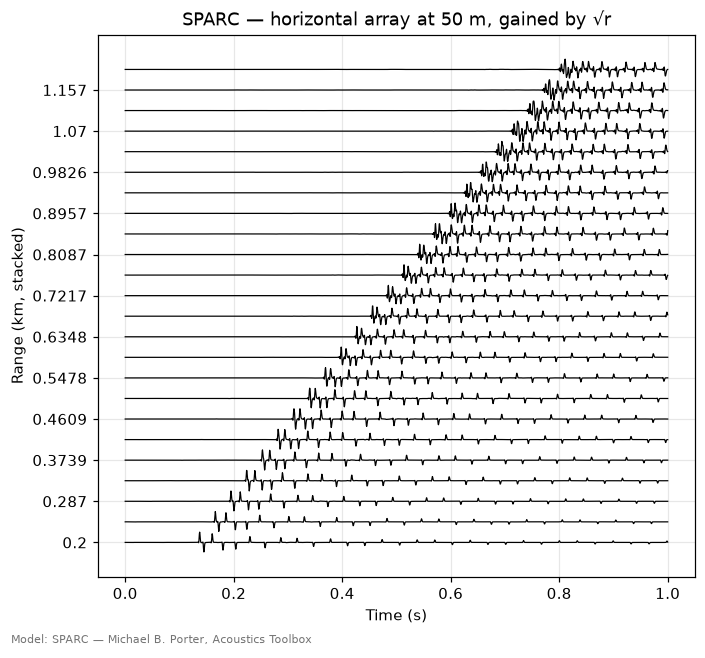
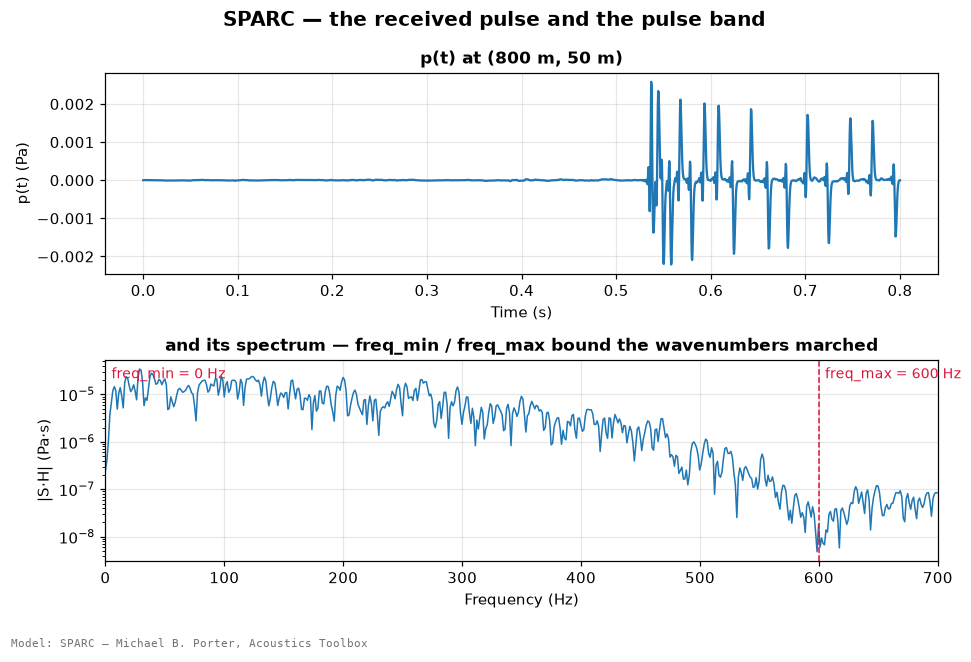
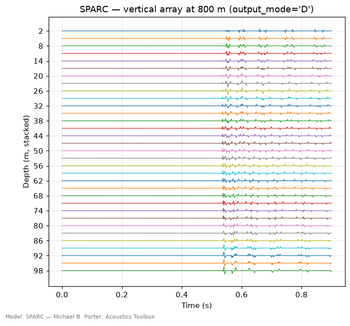
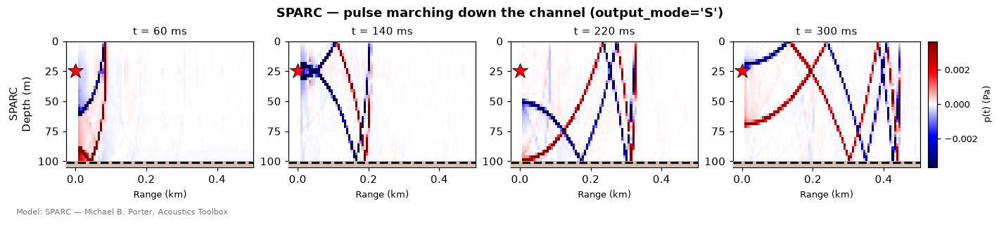
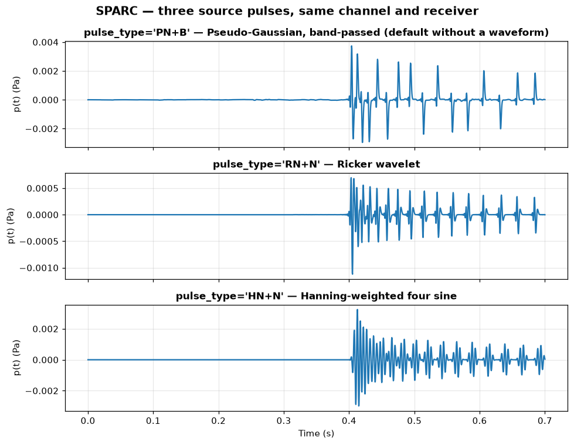
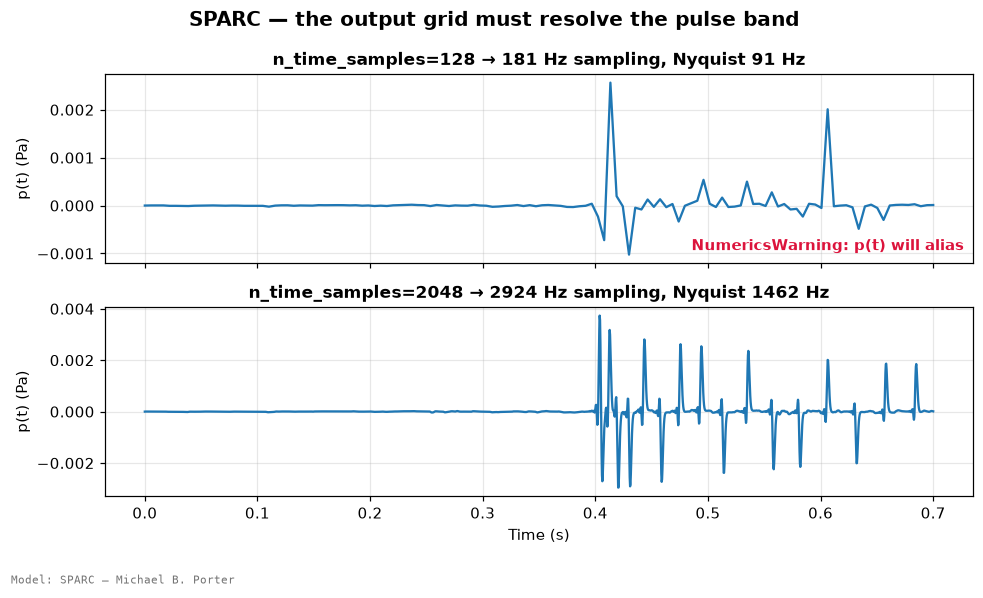

# SPARC — time-marched FFP

> `uacpy.models.SPARC` · wraps Michael B. Porter's SPARC (Acoustics Toolbox)
> · run mode: `TIME_SERIES` only

SPARC does not solve for a continuous-wave field and then synthesise a pulse
out of it. It marches an actual pulse forward in time. That makes it the model
to reach for when the **waveform is the answer** — how a transient spreads,
disperses and arrives — and the only one in uacpy that will draw you the
wavefront itself, mid-flight.

**SPARC has exactly one run mode: `TIME_SERIES`.** `RunMode.COHERENT_TL`
raises `UnsupportedFeatureError`. If you want transmission loss, use
[Scooter](scooter.md) — the same wavenumber-integration lineage, solved at a
frequency instead of marched in time — or [Kraken](kraken.md).

---

## 1. What it solves

SPARC solves the **wave equation**, not the Helmholtz equation. It transforms
range into horizontal wavenumber `k`, and for each `k` in a discrete set it
marches the depth-dependent wave equation forward in time on a
finite-element mesh:

```
(1/c²)·∂²ψ/∂t²  =  ρ·∂/∂z[ (1/ρ)·∂ψ/∂z ]  −  k²·ψ        one k at a time
```

The receiver pressure is then the sum of those marched solutions over `k` — an
inverse Hankel transform, taken in its far-field form.

That is the same decomposition [Scooter](scooter.md) uses. The difference is
what happens to each wavenumber: Scooter solves a boundary-value problem in
depth at **one frequency**; SPARC integrates the same operator **in time**
across a whole pulse band. Hence *time-marched FFP*.

Two consequences follow, and between them they explain most of the knobs on
this page.

**The wavenumber set is the cost.** The pulse band `[freq_min, freq_max]` bounds it,
`sparc.f90` samples it, and everything scales with how many samples that is:

```
kMin = 2π·freq_min / c_high        kMax = 2π·freq_max / c_low
Nk   = 1000 · RMax[km] · (kMax − kMin) / 2π
```

Widen the band, lower `c_low`, or push the receivers further out, and `Nk` —
and the runtime — grows in proportion. The upstream manual puts it bluntly:
*"FMax should be no higher than necessary since the runtime is proportional to
the bandwidth."* The `.prt` file prints the `Nk` it chose.

**The time step is a stability condition, not a choice.** Each wavenumber
marches on its own Courant step, `Δt = courant_factor / √(1/t_cross² + (½·c_max·k)²)`,
where `t_cross` is the shortest mesh-cell transit time (`sparc.f90:217,271`).
`courant_factor = 1.0` means *exactly* the maximum stable step; the default `0.999`
sits just inside it. Because the step shrinks as `k` grows, the highest
wavenumbers cost the most steps, and the runtime rises faster than `Nk` alone
suggests — which is why lowering `c_low` is the expensive knob. (The single
`Δt` printed in the `.prt` is the one for `k = kMax`, used for its flop
estimate.) This step has nothing to do with `n_time_samples`, which samples the
**output** — see [§7](#7-gotchas).

**There is almost no propagation approximation to violate.** No ray limit, no
one-way assumption, no modal truncation: the depth march itself is exact up to
numerics. The one approximation is the same one [Scooter](scooter.md) makes —
the wavenumber sum back to range uses the far-field (fast-field) form of the
inverse Hankel transform (`sparc.f90:595,623`), which loses accuracy within a
few wavelengths of the source and at very steep angles. SPARC's other limits
are structural — it is range-independent, it is fluid-only (`sparc.f90`
declares a shear array, hands it to `EvaluateSSP` and never reads it again:
`sparc.f90:193,211`, and only the compressional speed reaches the mass and
stiffness matrices at `:222-224`), and the seabed must terminate in a **rigid
or vacuum** boundary.

---

## 2. When to use it — and when not to

**Use SPARC when:**

- you want the **transient pressure itself** — the received waveform, computed
  in the time domain rather than assembled from `H(f)`;
- you want to **watch the field evolve**: `output_mode='S'` gives you the whole
  depth–range plane at a sequence of instants, out of a single march of the
  wave equation. [Bellhop](bellhop.md) `TIME_SERIES` hands back the same
  `(depth, range, time)` array, but synthesised by phasing the arrivals of one
  ray trace at the band centre — so it inherits the ray approximation, while
  SPARC's snapshot is the marched field itself, diffraction and continuous
  spectrum included;
- you want a **record section** — moveout across a horizontal array, where the
  arrival structure is the physics you are after;
- you are checking another model's broadband synthesis against a solver that
  never went through the frequency domain.

**Reach for something else when:**

| Situation | Why SPARC can't | Use instead |
|---|---|---|
| Transmission loss at a frequency | No CW mode at all | [Scooter](scooter.md), [Kraken](kraken.md) |
| A penetrable seabed | Bottom is rigid/vacuum only | [Scooter](scooter.md), [OASES](oases.md), [Kraken](kraken.md) |
| Shear / elastic seabed | The solver is fluid-only | [OASES](oases.md) |
| Sloping bathymetry, RD SSP | Stratified solver; the env is collapsed | [RAM](ram.md), [Bellhop](bellhop.md) |
| A dense depth × range grid | `'R'` runs one subprocess per depth | [Bellhop](bellhop.md), [Scooter](scooter.md) |
| Cheap broadband `H(f)` | Marching a band is not cheap | [Bellhop](bellhop.md) `BROADBAND` |

---

## 3. Environment support

| Feature | Native? | Note |
|---|---|---|
| Layered bottom | ✅ | one AT medium per sediment layer |
| Range-dependent bathymetry | ❌ | collapsed to a single depth |
| Range-dependent SSP | ❌ | collapsed — `'mean'` across range |
| Range-dependent bottom | ❌ | collapsed — `'median'` column |
| Sea-surface altimetry | ❌ | collapsed |
| Elastic media (shear) | ❌ | `sparc.f90` is fluid-only; shear is dropped up front |
| Rough surface / bottom (`sigma`) | ❌ | `sparc.f90` refuses a non-zero `sigma` outright |
| Multiple source depths | ❌ | one march per depth; `run()` loops and returns one time-domain `Field` over `source_depth` |
| Source beam pattern | ❌ | |
| Source geometry (`point`/`line`/`scaled`) | `'S'` only | `'R'` and `'D'` are `point` only |
| Water absorption, seabed attenuation | ❌ | the march is lossless — see below; a run with either warns |

Anything marked ❌ is collapsed with a `FallbackWarning` naming what was dropped —
see the [collapse policy](../guide/environment.md).

### The march is lossless

SPARC ignores every attenuation: `env.absorption` and each sediment layer's
`attenuation` reach the deck, but `sparc.f90:221` converts each node's complex
sound speed to single precision with `REAL(cp(ii), 4)`, which keeps the real
part only (the next line carries the upstream note "CHECK THIS"). `c2I`
(`:223`), the only path by which attenuation enters the time march (the damping
matrix built in `CONTRIB`, `:437-451`), is therefore zero. Measured on a
100 m guide over a rigid-floored sediment at 1.5–2.5 km, 35–135 Hz: a
`ConstantAbsorption(0.02)` changes SPARC's spectrum by 0.000 dB where Scooter
applies 0.95–3.37 dB, and raising the sediment from 0 to 5 dB/λ changes the
trace energy by less than 1e-5 relative where Scooter loses 4–8 dB.

Restoring the imaginary part is not a one-line fix. uacpy writes SPARC's
standard explicit scheme (`ALPHA = BETA = 0`), whose step divides by the
diagonal of `A2` alone, and the damping matrix is not lumped: with `Im c`
restored, a 1–3 dB loss came back as a 4–13 dB gain and a lossy sediment
diverged. Under the implicit scheme (`BETA = 0.25`) the damping behaves —
loss growing as `f²`, exact at the deck frequency — but that march took 1.8×
as long and moved a 2 km arrival by 5.9 ms at the same time step. So a run with
any attenuation warns, and SPARC reports `supports_feature('volume_attenuation')`
as `False`. For the same waveguide with its attenuation, use
[Scooter](scooter.md) (`TIME_SERIES`).

### The bottom must be rigid or vacuum

This is SPARC's own limit, not a wrapper restriction. `sparc.f90:101-104`
aborts on any boundary that is not vacuum or rigid — top **or** bottom — with
*"SPARC only allows Vacuum or Rigid boundary conditions"*. uacpy refuses a
half-space bottom before the deck is written, with a `ConfigurationError`,
rather than putting a rigid floor in its place: a rigid floor is a different
waveguide. Measured with Scooter on 100 m of water at 100 and 500 Hz, the
rigid bottom sits 7.2–10.5 dB above the default half-space over 1–9 km,
6.5–10.4 dB above `'sand'` and 12.6–33.9 dB above `'clay'`.

```
ConfigurationError: SPARC's deck carries only 'vacuum' and 'rigid' bottom
boundaries (sparc.f90:101-104), and this environment's bottom is a
half-space. …
```

Choose the floor yourself — `BoundaryProperties(acoustic_type='rigid')` — if
a perfectly reflecting seabed is the waveguide you mean. Every figure on this
page does exactly that: they run over the shared shallow-water channel with a
rigid floor in place of its sand half-space, so the traces below keep ringing
far longer than a real sand bottom would allow, and absolute levels are not
comparable to a half-space run of the same water. For a half-space seabed,
use [Scooter](scooter.md) (`TIME_SERIES`).

What *is* supported natively is a **layer stack**: each sediment layer becomes
its own medium with its own speed and density (its attenuation is written but
not applied — [the march is lossless](#the-march-is-lossless)), and only the
boundary underneath the stack is forced rigid. If your seabed physics matters
more than your waveform does, this is the wrong model — go to
[OASES](oases.md) or [Scooter](scooter.md).

---

## 4. Run modes and output geometries

```python
from uacpy.models import SPARC, RunMode
```

| `RunMode` | Returns | What you get |
|---|---|---|
| `TIME_SERIES` | `Field` | real `p(depth, range, time)` — `Field.unit == 'Pa'`, `time` axis |

It is also the default, so `run_mode=` can be left off entirely. Ask for CW
transmission loss and you get told where to go instead:

```python
SPARC().run(env, source, receiver, run_mode=RunMode.COHERENT_TL)
```
```
UnsupportedFeatureError: SPARC does not support: RunMode.COHERENT_TL — SPARC
is a time-marched FFP for "transient sources, that is, pulses"
(doc/sparc.htm), whose outputs are the .RTS receiver time series and the
.GRN Green's function, and the CW field extracted from them is not
quantitative (no contour offset on the wavenumber sum, a grid sized for the
whole pulse band, and a per-wavenumber band-pass that a scalar
source-spectrum deconvolution cannot undo)

How to fix:
Try one of these models instead:
  • Scooter for wavenumber-integration CW transmission loss
  • Kraken for normal-mode CW transmission loss
  • SPARC with run_mode=TIME_SERIES for its native p(t)
```

### The three geometries

The real choice on this page is not the run mode — it is `output_mode`, which
decides **what one march buys you**:

| `output_mode` | Geometry | Binary runs | Free axis | Costly axis |
|---|---|---|:--:|---|
| `'R'` *(default)* | horizontal array — every range at one depth | one **per receiver depth** | ranges | depths |
| `'D'` | vertical array — every depth at one range | one **per receiver range** | depths | ranges |
| `'S'` | snapshot — the whole depth × range grid | **one**, total | both | — |

Those are the three standard ways of displaying a modelled pulse — stacked
time series against range, against depth, or snapshots at fixed times (COA
§8.5) — and SPARC computes each one the cheap way round. All three hand back
the same `(depth, range, time)` `Field` on one shared time grid; they differ
only in how the work is spent. `'R'` and `'D'` loop the binary in the wrapper
and `max_launches`, when set, caps the axis they loop (the default `None` runs every element); `'S'` runs
once and is uncapped, converting the wavenumber-domain `.grn` in-tree with one
inverse Hankel transform per output time.

**The three geometries do not arrive on a common scale.** `'R'` and `'D'` are
both range-domain outputs but normalise differently inside `sparc.f90`: `'D'`
finishes with `1/√(π·r)` where `'R'` carries only `1/√r`, so `'R'` runs `√π`
louder for the identical field. `'S'` normalises nothing at all — it writes the
raw wavenumber-domain Green's function and uacpy transforms it in-tree, a
further `−√(4π)` away.

**`'D'` is the reference, because it is the physics.** The far-field inverse
Hankel transform weights each wavenumber sample by `Δk·√(2k/(π·r))`, which is
exactly what `sparc.f90`'s `'D'` branch carries; `'R'` is that weight *without*
the `1/√π`, i.e. ~4.97 dB hot. uacpy therefore divides `'R'` by `√π` and scales
`'S'` by `−2` onto `'D'`, so `Field.dB` means the same thing everywhere. That
is derived from the kernel, not fitted.

`'D'` and `'S'` are **experimental** in the sense that matters here: see
[§7](#7-gotchas) for why absolute levels are pulse-scaled rather than
calibrated, whichever geometry you use.

---

## 5. Constructor knobs

Everything is configured on the constructor; `run()` has a fixed signature.

**Pulse and band**

| Name | Default | Meaning |
|---|---|---|
| `pulse_type` | `None` | 4-character AT pulse code — shape, post-process, sign, filter. See below. `None` marches the waveform a run is handed (`'FN+B'`, staged as `STSFIL`) and the canned `'PN+B'` wavelet when none is given. |
| `freq_min`, `freq_max` | `None` | Pulse band (Hz). `None` ⇒ the span of `run(frequencies=)`; else, for a marched waveform, the band every synthesising engine resolves from it; else, for a canned pulse on `f = source.frequencies[0]`, the spectral support `tslib/cans.f90` states for its shape: `0 … 3f` for the default `'P'` ("(peak at 0, support [0, 3F]", :27), `0 … 2f` `'R'`, `0 … 2.5f` `'A'`, `0 … 3f` `'N'` ("[0,3F] OK"), and `0 … 3f` for a shape stated "support [0, infinity]" (`'S'`, `'H'`, `'M'`, `'G'`: uacpy guidance, the band of the toolbox's decks — `doc/sparc.htm`'s `0.0 15.0` for 5 Hz, `tests/iso.env`'s `0.0 300.0` for 100 Hz). This is what sets `Nk`; the march costs about `freq_max³`. |

`pulse_type` position by position:

| Pos | Values | Meaning |
|---|---|---|
| 1 | `P R A S H N M G F B` | Pseudo-Gaussian, Ricker, approximate Ricker, single sine, Hanning-weighted four sine, N-wave, miracle-wave, Gaussian, from `.STS` file, from `.STS` reversed |
| 2 | `N` `H` `Q` | none / pre-envelope / Hilbert transform |
| 3 | `+` `-` | keep sign / invert |
| 4 | `N` `L` `H` `B` | no filter / low-cut / high-cut / both |

The position-4 filter is applied **per wavenumber** at `k·c_low/2π` and
`k·c_high/2π` — it is not a filter on `[freq_min, freq_max]`.

**Output grid and geometry**

| Name | Default | Meaning |
|---|---|---|
| `output_mode` | `'R'` | `'R'` horizontal array, `'D'` vertical array, `'S'` snapshot. uacpy guidance: `doc/sparc.htm` lists the three and names no default. |
| `n_time_samples` | `None` | Output time samples over `[0, time_max]`. `None` ⇒ the least count with more than eight samples per period at `freq_max`, `floor(8·freq_max·time_max) + 2` — Jensen et al. (*Computational Ocean Acoustics*, Sect. 8.2.1.3): "A more appropriate value of Δt is Δt = T/N < 1/(8 f max) which corresponds to more than eight samples per period" (the manual gives no count). A set value is used verbatim and warns when its Nyquist sits below `freq_max`. |
| `time_max` | `None` | Output window end (s). `None` ⇒ `run(output_duration=)` when given, else `2.5 ×` the travel time to the farthest receiver at `window_sound_speed` (`RMax`'s wavenumber margin is *not* folded in). |
| `march_start` | `-0.1` | Where the **march** starts (s) — must be before the source rises. Not the output window. `-0.1` is the TSTART of `doc/sparc.htm`'s sample deck and of every toolbox SPARC test deck; the manual: "This should always be earlier than the time at which the source begins to rise." |
| `courant_factor` | `0.999` | Courant multiplier; `1.0` is the maximum stable step (`doc/sparc.htm`: "Specifying TMULT = 1.0 means that the maximum stable time step is used"). `0.999` is the TMULT of the toolbox's `tests/iso.env`; the manual's sample deck writes `0.9`. |
| `max_launches` | `None` | Cap on the looped axis: depths for `'R'`, ranges for `'D'`; a grid past it is refused (`UnsupportedFeatureError`). `None` runs every element. `'S'` runs once. |

**Numerics and environment**

| Name | Default | Meaning |
|---|---|---|
| `c_low`, `c_high` | `None` | Phase-speed bounds (m/s) — they set `kMin`/`kMax`. `None` ⇒ `0.90 × min(SSP)` (`scooter.f90:258`'s factor) and `c_high = 1e7`, the "no upper limit" every toolbox SPARC deck writes (`tests/iso.env:9` `1000.0 1.0E7`, `tests/head/iso.env:12`, `tests/head/head.env:12`), so `k_min = 0` as Jensen et al. (ch. 4 App. 1) recommend. Not the AT family's `1e9`: a `'B'`/`'H'` pulse is band-passed at each wavenumber up to `k·c_high/2π` (`sparc.f90:398`), and `tslib/bandpassc.f90:16` indexes that edge as `INT(f/Δf)` on the source series — at `1e9` the index passes the INTEGER range once `freq_max ×` the series duration exceeds about `2.15 × c_low`, every band-pass weight goes to zero and the source falls silent at exit 0 (a 16 s series came back 78 % rms off). A deck whose index would overflow is refused (`ConfigurationError`, naming both lines). Jensen et al. (Sect. 8.3.2) set `k_max = 2π f_max/c_min` and `k_min = 2π f_min/c_max` for the time-marched solve. |
| `n_mesh` | `None` | Mesh points per medium. `None` → 20 points per wavelength at `freq_max`, per medium; a set `0` is the toolbox's automatic mesh at the deck frequency (`ReadEnvironmentMod.f90:101-106`), its storage check left to the binary. |
| `interp_ssp` | `None` | SSP interpolation scheme; `None` auto-picks (`'linear'`, AT `'C'`, the manual's choice when unsure: `doc/EnvironmentalFile.htm`). |
| `rmax_factor` | `None` | `RMax = receiver.ranges.max() × this`. `None` ⇒ `RMax = r + 1.2 · c_fast · time_max` (`r` the farthest receiver range, `c_fast` the fastest speed in any medium): Jensen et al.'s criterion (*Computational Ocean Acoustics*, Sect. 8.3.2: "Δk r = 2π/r max and r max is the maximum range to which the pulse will propagate before the calculation is terminated") that no range replica reach the record, applied to SPARC's mirrored fold (`sparc.f90:595`, `:622`); `1.2` is uacpy's measured margin. Their rule read literally, `RMax = c_fast · time_max`, puts the replica inside the record here (see §7). On the auto window it is `4 × r` for a uniform speed, and it lengthens with a pinned `time_max` / `output_duration`. |
| `window_sound_speed` | `None` | Reference speed for the auto `time_max` window; `None` ⇒ the slowest speed in `env.ssp` (uacpy guidance), or 1500 m/s only when the profile carries no usable speed. |

**Execution**

| Name | Default | Meaning |
|---|---|---|
| `executable` | `None` | Path to `sparc.exe`; auto-detected. |
| `timeout` | `600.0` | Subprocess timeout **per run** (s) — and `'R'`/`'D'` make several. uacpy guidance: a wall-clock guard on the host; no engine reads a time limit. |
| `work_dir` | `None` | Pin the scratch dir to keep `.env` / `.rts` / `.grn` / `.prt`. |
| `cleanup` | `None` | Defaults to *keep* when `work_dir` is pinned. |
| `verbose` | `False` | `True` / `'info'` / `'debug'`. |
| `collapse` | `None` | Override the per-feature collapse methods. |

---

## 6. Worked example

Every figure on this page comes from
[`docs/figure_scripts/sparc.py`](../figure_scripts/sparc.py) — the code below
is that code, so it cannot drift from what you see. All of it runs over the
shared shallow-water channel with a rigid floor (the sand half-space SPARC
refuses, replaced explicitly):

```python
import numpy as np
import uacpy
from uacpy.models import SPARC

env = uacpy.Environment(
    name='Shallow-water channel',
    bathymetry=100.0,
    ssp=[(0.0, 1500.0), (30.0, 1495.0), (100.0, 1490.0)],
    bottom=uacpy.BoundaryProperties(acoustic_type='rigid'),
)
source = uacpy.Source(depths=25.0, frequencies=200.0)
```

`time_max` is pinned in every snippet below. The automatic window is `2.5 ×` the
travel time to the **farthest receiver** — `RMax` is a wavenumber-sampling knob
derived *from* the window, and is deliberately *not* folded into it —
which is longer than these figures need. An unset `n_time_samples` puts more than
eight samples per period at `freq_max` across whichever window is in force; a
pinned one can sit below the source band (`run()` warns when it does).

### `output_mode='R'` — a horizontal array

```python
from uacpy.core.results import Field

array = uacpy.Receiver(depths=50.0, ranges=np.linspace(200.0, 1200.0, 24))
p = SPARC(time_max=1.0, n_time_samples=2048).run(env, source, array)

section = p.at(depth=50.0).to_dict()
section['data'] = (section['data']
                   * np.sqrt(section['coords']['range'])[:, None])
fig, ax = Field.from_dict(section).plot(
    stacked=True, figsize=TALL,
    title='SPARC — horizontal array at 50 m, gained by √r')
```



Twenty-four ranges at **one** depth is a single SPARC march — this is the shape
`'R'` is cheap for. The traces are scaled by `√r` to undo cylindrical
spreading, the standard record-section gain; without it the near traces swamp
the far ones and the moveout is invisible. Read the slope: the arrival walks
out by roughly 1 s per 1500 m, and behind each first arrival the surface- and
bottom-reflected paths pile up into a coda that lengthens with range.

### One trace, and the band it occupies

```python
point = uacpy.Receiver(depths=50.0, ranges=np.array([800.0]))
p = SPARC(time_max=0.8, n_time_samples=2048).run(env, source, point)
trace = p.at(depth=50.0, range=800.0)

H = trace.to_transfer_function(band=(0.0, 700.0))
freqs, spectrum = H.coords['frequency'], H.data.ravel()
```



The pulse lands at ~0.53 s, which is 800 m at 1500 m/s, and rings for the rest
of the window off the rigid seabed. The dashed lines are the band the run
marched, read from its run settings: for the canned `'P'` pulse on
`f = 200 Hz`, the spectral support `[0, 3f]` that `tslib/cans.f90` states for
that shape, 0–600 Hz. Note what they do and do not mean: they set the
**wavenumbers** SPARC marches, and towards `freq_max` the received spectrum
duly falls by three orders of magnitude — but they are not a band-pass on the
output: past 600 Hz the spectrum climbs back to about 10⁻⁷. With the default
`'…B'` filter each wavenumber carries its own pass band,
`[k·c_low/2π, k·c_high/2π]` (`sparc.f90:392,398`); with the unbounded default
`c_high` the upper cut sits far above the band, and the lower cut sweeps
0–600 Hz across the marched `k`. Read levels from inside the band, not from
its skirts.

`to_transfer_function()` is the quick look. For anything more — spectrogram, envelope,
matched filter, dispersion — hand the trace to
[`uacpy.acoustic_signal`](../guide/signal.md).

### `output_mode='D'` — a vertical array

```python
vla = uacpy.Receiver(depths=np.linspace(2.0, 98.0, 33),
                     ranges=np.array([800.0]))
p = SPARC(output_mode='D', time_max=0.9, n_time_samples=2048).run(env, source, vla)
fig, ax = p.at(range=800.0).plot(
    stacked=True, figsize=TALL,
    title='SPARC — vertical array at 800 m (output_mode=\'D\')')
```



The same event as the trace above, now down 33 depths at one range — and still
**one** march, because `'D'` loops per *range*. Under `'R'` the identical
picture would have cost 33 runs. The arrival
is flat across the array at this range, with the modal interference visible as
depth-to-depth variation in the coda rather than in the onset.

### `output_mode='S'` — the wavefront itself

```python
from uacpy.plot import plot_time_snapshots

grid = uacpy.Receiver(depths=np.linspace(1.0, 99.0, 40),
                      ranges=np.linspace(10.0, 500.0, 80))
p = SPARC(output_mode='S', time_max=0.36, n_time_samples=512).run(env, source, grid)

times = (0.06, 0.14, 0.22, 0.30)
late = np.asarray(p.data)[..., -1]
fig, _ = plot_time_snapshots(
    {'SPARC': p}, times, env=env,
    p_max=float(np.percentile(np.abs(late[np.isfinite(late)]), 99.0)),
    title='SPARC — pulse marching down the channel (output_mode=\'S\')')
```



This is what SPARC is for. Four instants from one run: at 60 ms the front has
travelled ~90 m and reads as a single curved wavefront, though it has already
touched the surface (25 m up, ~17 ms) and the bottom (75 m down, ~50 ms) — the
reflected arms are still folded onto it rather than clear of it. By 140 ms they
have separated; by 300 ms the surface and bottom images have folded
the field into the criss-cross that a ray tracer would draw as separate paths
and a modal solver would call interference. Red and blue are pressure of
opposite sign, so you are seeing the actual oscillation, not an envelope.

Fix the colour scale from a **late** slice, as above. Left to itself
`plot_time_snapshots` takes a percentile over the whole field, which the loud
near-source instants dominate — and the last panel comes out nearly blank.

`'S'` is the only geometry that takes a dense grid — 40 × 80 receivers here,
in a single march.

### `pulse_type` — the source waveform

```python
point = uacpy.Receiver(depths=50.0, ranges=np.array([600.0]))
pulses = [('PN+B', 'Pseudo-Gaussian, band-passed (default without a waveform)'),
          ('RN+N', 'Ricker wavelet'),
          ('HN+N', 'Hanning-weighted four sine')]
for ax, (code, label) in zip(axes, pulses):
    p = SPARC(pulse_type=code, time_max=0.7, n_time_samples=2048).run(
        env, source, point)
    p.at(depth=50.0, range=600.0).plot(ax=ax)
```



Same channel, same receiver, three source pulses. The pseudo-Gaussian
(default, band-passed) and the Ricker wavelet are impulsive — a sharp onset
followed by multipath. The Hanning-weighted four-sine is a narrowband tone
burst, and its arrival is visibly more sinusoidal and more even in envelope:
the source rings, so the receiver rings with it. Position 1 of the code picks
the shape; positions 2–4 post-process, flip and filter it.

### `n_time_samples` — the output grid must resolve the band

```python
for ax, n_time_samples in zip(axes, (128, 2048)):
    p = SPARC(time_max=0.7, n_time_samples=n_time_samples).run(env, source, point)
    p.at(depth=50.0, range=600.0).plot(ax=ax)
```



The output window is `[0, time_max]` inclusive of both ends, so the sample rate is
`(n_time_samples − 1) / time_max` — 181 Hz on the top panel, against a pulse band
reaching 600 Hz. (`n_time_samples / time_max` overstates it by `n/(n−1)`.) The top trace
is not obviously broken; it is smooth, plausible, and wrong, which is exactly
why uacpy warns:

```
NumericsWarning: SPARC TIME_SERIES: the output grid samples at 181.4 Hz
(Nyquist 90.7 Hz) over a 0.70 s window, below the 600 Hz source band — p(t)
will alias. Set n_time_samples>=3362 (more than eight samples per period at
freq_max, Jensen et al. Sect. 8.2.1.3; the count an unset n_time_samples
takes), lower freq_max, or shorten the window via time_max /
receiver.ranges.max().
```

The suggested `n_time_samples` is the default count — more than eight samples per
period at `freq_max`, the textbook's rule for a trace worth reading, not merely
Nyquist. Leaving `n_time_samples` unset takes it.

---

## 7. Gotchas

**A half-space seabed is refused.** Any `acoustic_type='half-space'` bottom
raises `ConfigurationError` before a deck is written. Set the bottom to
`'rigid'` or `'vacuum'` yourself if that is the waveguide you mean; use
[Scooter](scooter.md) if it is not.

**The default window is long, and the default `n_time_samples` grows with it.**
`time_max = 2.5 × ranges.max()/c` — 2.5 travel times to the farthest receiver —
and the default grid puts more than eight samples per period at `freq_max` across
all of it, so a long range at a high frequency returns a long trace (and an
`output_mode='S'` snapshot holds `n_time_samples × depths × Nk`). Pin `time_max` to
the span you actually want to see.

**A truncated trace makes a window-dependent spectrum.** `n_time_samples / time_max` has
to clear `2·freq_max` or `p(t)` aliases, and uacpy warns about that one. The other
windowing error is truncation: a window that ends while the coda is still
ringing cuts the record, and any spectrum you take from that trace picks up the
truncation. A run whose trace is still within 20 dB of its peak over the last
10 % of the window warns (`NumericsWarning`), naming the knob that set the
window (`time_max`, `run(output_duration=)` or the automatic 2.5 travel times,
which does not bound a waveguide's slow modal tail). It is not a small effect
here — the same receiver read from a 0.8 s
window and from a 2.4 s one differs by a median 5.7 dB across 100–400 Hz. Nor
can you wait it out: the rigid seabed reflects everything, so the coda at
2.4 s is as strong as at 0.8 s. Take arrival structure and relative shape from
these traces, and treat spectral level as a function of the window you chose.

**`march_start` is not the start of the output.** It is where the time march
begins (`-0.1 s` by default, comfortably before the source rises). The output
grid always spans `[0, time_max]`, so `run(t_start=…)` — which places the record
on the other engines — is ignored here with a warning.

**`'R'` costs one subprocess per receiver depth.** The canonical 100-depth
receiver grid the other model pages use queues 100 marches. Set
`max_launches` to cap the looped axis, and a denser grid is refused before
any march:

```
UnsupportedFeatureError: SPARC does not support: 100 receiver depths (SPARC
horizontal-array mode (output_mode='R') runs one simulation per depth, and
SPARC(max_launches=20) caps the launches)
```

Choose the geometry that makes your dense axis the free one, or use `'S'`.
Note too that `timeout` (600 s) is **per run**, so an `'R'` sweep over 20
depths can legitimately take twenty times that.

**Only `source.frequencies[0]` is used.** It is the frequency `F` a canned pulse
is built on (`tslib/cans.f90`), not a CW frequency, and extra entries are dropped with a
`FallbackWarning` naming the frequency read — the result records just the first. Set the band explicitly with
`freq_min` / `freq_max` if you want something other than the canned pulse's
spectral support on it (`0 … 3F` for the default `'P'`).

**`run()`'s signal keywords mean what they mean elsewhere.** With `pulse_type`
left unpinned, `source_waveform` / `sample_rate` are marched (staged as
`STSFIL`, the `'FN+B'` route) and `output_duration` becomes `time_max`, the length
of the `[0, time_max]` record. `frequencies=` sets the pulse band's edges (its
span), with a `FallbackWarning` that the result's frequency axis is
`source.frequencies[0]` and the band `band_hz`, since SPARC marches on its own
time grid. A keyword that contradicts a pinned knob is refused, naming both:
`source_waveform=` beside a canned `pulse_type` (`'P'`, `'R'`, …; the deck
carries one pulse), `frequencies=` beside both `freq_min` and `freq_max`, and
`output_duration=` beside `time_max`. A lone `sample_rate=` beside a canned
pulse is ignored with a warning.

**Leave `rmax_factor` alone.** `sparc.f90:116,123` sets `Δk = 2π/RMax`
exactly, and the transform is a discrete sum over `k` (`sparc.f90:593-624` — a
running sum inside the wavenumber loop, not an FFT), so the answer is periodic
in range with period exactly `RMax`. `sparc.f90:153-155` refuses outright any
receiver beyond it. The period does more than plant a replica at `r = RMax`: a
receiver at range `r` also carries the arrival that belongs at `|RMax − r|`
(`EXTRACT` takes the real part of `U·exp(−ikr + iπ/4)` with a real kernel,
`sparc.f90:595`, `:622`, so the fold is mirrored), reaching it at
`(RMax − r)/c`. COA §8.3.2 sizes `RMax` as "the maximum range to which the pulse
will propagate before the calculation is terminated", `c_fast · time_max`, so
that no replica energy lies in the record — but with the mirrored fold that
puts the replica at `time_max − r/c`, inside it: on a rigid guide at 100 Hz and
250 m, trace correlation against the exact image sum falls to 0.72–0.75 (0.71–0.73
at 50 Hz and 2 km). The criterion applied to the mirrored fold is
`RMax ≥ r + c_fast · time_max`; at equality the replica starts exactly at
`time_max` and its tails reach back into the record (0.975–0.992), so the default
takes `RMax = r + 1.2 · c_fast · time_max` (0.994–0.997; `4 × r` on the auto
window). Because it follows the window, a pinned `time_max` twice the auto one
still measures 0.995–0.997, where a fixed `4 × r` measured 0.74–0.80 — at 1.9×
the run time. Tightening the margin pulls the alias *earlier* into the window,
where it arrives looking like a second wavefront rather than like a bug; a
pinned margin that leaves it inside the window draws a `NumericsWarning` naming
the margin that clears it. Note that SPARC has no contour offset to lean
on the way Scooter does — `Atten` is a hardcoded zero (`sparc.f90:313`) —
because a pulse is limited in space, so its wavenumber kernel is band-limited
and the real-axis sum converges on its own (COA §8.3.2). The margin is what
buys the room instead.

**A snapshot's memory is checked against the host, not a constant.**
`output_mode='S'` holds the whole `(n_time_samples x receiver depths x Nk)` complex64
Green's table and `read_grn_file` reads it back the same way, so it can reach
tens of GB without any single knob looking unreasonable. uacpy estimates that
before writing the deck and compares it with `MemAvailable`: over half of it
warns (`NumericsWarning`), over all of it raises, and if the host's free memory
cannot be read a table over 2 GiB warns and is never refused. Sizing against the host
rather than a constant matters because the same table is nothing on a 64 GiB
workstation and fatal on a 4 GiB laptop. `n_time_samples`, `receiver.depths`, the
pulse band (`freq_min`/`freq_max`) and `rmax_factor` all shrink it.

**The k -> r transform carries the `.grn`'s own precision.** `Green` is
declared `COMPLEX` in the Fortran, so the file is complex64, and the shared
transform (`uacpy.acoustics.hankel_transform`, which SPARC and Scooter
both use)
keeps it there: promoting to complex128 adds no information to the data while
doubling the largest array in the transform, and on stress cases spanning the
deepest cancellation the two paths agree to within 0.03 dB. The *phase* is a
separate matter — `k*r` reaches ~1e5 rad, so it is evaluated in double and
only the result is cast down; that result carries `exp(atten*r)` rather than
unit modulus, but it is bounded, so the cast costs relative precision only.

**Receivers below the mesh are `NaN`.** The finite-element mesh stops at the
deepest modelled interface, and `sparc.exe` would clamp a deeper receiver onto
it. uacpy hands those cells back as `NaN` instead, so the depth axis still
means what you asked for: use `np.nanmax` and friends.

**Absolute levels carry a caveat, whichever geometry you use.** The `'B'` band-pass in the
default `'PN+B'` is not modelled by the CW source-spectrum deconvolution and
adds a few dB; `'PN+N'` calibrates tighter (~±1.5 dB against Kraken). And the
Ricker wavelet is defined on `U = ω·T − 5`, so its peak sits at
`5/(2π·F)` after the pulse origin — subtract that before comparing measured
arrivals against predicted travel times.

**Do not route a SPARC field through the frequency domain and back.** Its
`phase_reference` is `time_domain_native`, meaning the time series *is* the
primary product rather than something synthesised from `H(f)`. Taking a
spectrum is fine (`Field.to_transfer_function()`); trying to IFFT a
`time_domain_native` transfer function back into a trace raises and tells you
to read the `TIME_SERIES` `Field` instead. See
[results](../guide/results.md).

**The pulse shapes `'F'` and `'B'` march the run's waveform.** They read a
source-time-series file, which uacpy writes from `run(source_waveform=,
sample_rate=)` (`'B'` plays it backwards). `doc/sparc.htm` calls it a `.STS`
file, but the Fortran opens a file named literally `STSFIL` in the working
directory (`tslib/sourceMod.f90:97`), and that is the name uacpy stages.
Unless the pulse's fourth letter is `'N'`, the binary band-passes the series
once per wavenumber on a power-of-two FFT (`tslib/bandpassc.f90`), so uacpy
zero-pads it to one; a series shorter than `1/(freq_max − freq_min)` runs
with a `NumericsWarning` naming the sample count that keeps each
wavenumber's cut on its own FFT bin.

SPARC's measured agreement with closed forms and the published benchmarks, and its known limits there, are on the [validation page](validation.md).

---

## 8. References

- Porter, M. B., "The time-marched FFP for modeling acoustic pulse
  propagation", *JASA* 87, 2013–2023, 1990 — the method.
- Porter, M. B., *SPARC*, Acoustics Toolbox documentation — vendored at
  [`Acoustics-Toolbox/doc/sparc.htm`](../../uacpy/third_party/Acoustics-Toolbox/doc/sparc.htm),
  alongside the source at
  [`Acoustics-Toolbox/Scooter/sparc.f90`](../../uacpy/third_party/Acoustics-Toolbox/Scooter/sparc.f90).
- Jensen, Kuperman, Porter & Schmidt, *Computational Ocean Acoustics*, 2nd ed.,
  Springer, 2011 — chapter 4 (*Wavenumber Integration Techniques*) for the
  spectral method, chapter 8 (*Broadband Modeling*) for pulses, including the
  frequency-synthesis alternative and the three displays of §8.5.
- Local modifications to the vendored source:
  [`uacpy/third_party/MODIFICATIONS.md`](../../uacpy/third_party/MODIFICATIONS.md).

---

**See also:** [Scooter](scooter.md) · [Kraken](kraken.md) ·
[Bellhop](bellhop.md) · [RAM](ram.md) · [signal processing](../guide/signal.md)
· [model index](README.md)
